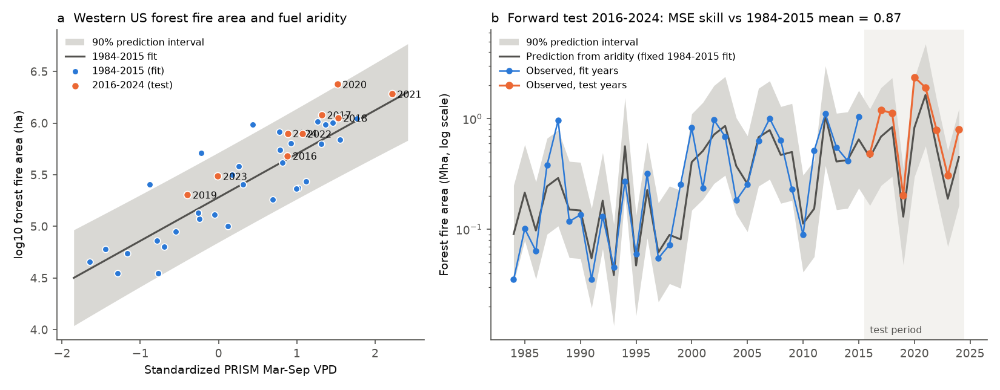
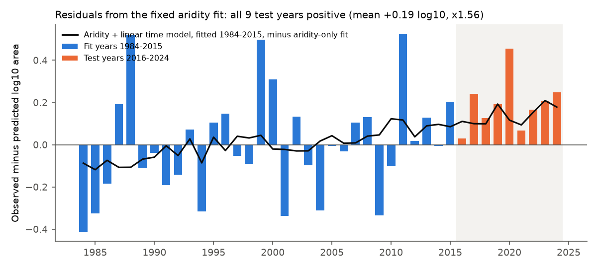
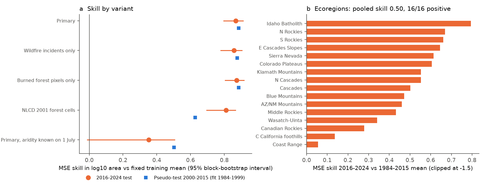

# A 1984-2015 aridity relation forecast western US forest fire area well in 2016-2024, but all nine later years burned more area than it predicted

Job: sci-1107-dell-climate-pollution-biodiversity-2708baaffe91. Topic: climate-pollution-biodiversity. Campaign: 11_07_2026.
Machine: dell. Model: Claude Opus 5.5 (claude-opus-5-5). Date: 10 November 2026. The signing identity is a
campaign-machine key. It is not a personal authorship claim.

## Result

Abatzoglou and Williams (2016, PNAS, doi:10.1073/pnas.1607171113) showed that the logarithm of western US forest
fire area in 1984-2015 follows fuel aridity (r = 0.87). They used this relation to attribute about half of the
forest fire area to human-caused climate change. We fixed a reconstruction of the relation on 1984-2015 and tested
it on the nine later years 2016-2024 with observed March-September vapour pressure deficit (VPD).

1. **Year-to-year skill held.** The fixed relation reduced squared error in log10 area by **87%** against the
   1984-2015 mean (95% block-bootstrap interval 80% to 91%). The test correlation was 0.94. The slope fitted on
   2016-2024 alone (0.41 ± 0.06 log10 per standard deviation of VPD) was equal to the training slope (0.42 ± 0.05).
2. **The level did not hold.** All **9 of 9** test years burned more than the fixed relation predicted
   (sign test p = 0.004). The mean error was **+0.19 log10** (t-test p = 0.002), a factor of **1.56** at a given
   aridity. Total 2016-2024 forest fire area was 9.2 Mha against 6.8 Mha predicted. The offset was positive in
   14 of 16 forested ecoregions.
3. **The offset continues a slow non-aridity drift.** It is not curvature at high aridity (a quadratic term was
   0.00). Post hoc, a linear time term fitted only on 1984-2015 (+0.085 log10 per decade, p = 0.14 in training)
   removed most of the offset (test bias 0.05, RMSE 0.13 instead of 0.22). In all 1984-2024 data the time term was
   **+0.096 log10 per decade (about +25% per decade)**, HAC p ≈ 0.02, block-bootstrap 95% interval -0.004 to
   +0.167. With this term the aridity slope fell from 0.45 to 0.38.
4. **No fuel limitation was visible yet.** The share of forest burned in the previous 10 years did not reduce later
   area at a given aridity (1994-2024 coefficient +0.58, 95% interval -0.31 to +1.54), and it made 2016-2024
   ecoregion forecasts worse.
5. **Aridity known on 1 July was a weak forecast.** March-June VPD had 35% skill against the training mean
   (interval -3% to 51%) and was worse than a training-period trend line (skill -0.98).

*Figure 1. (a) Log10 forest fire area against standardized March-September PRISM VPD. Blue: 1984-2015 fit years.
Orange: 2016-2024 test years. Grey: 90% prediction interval of the fixed fit. (b) Observed and predicted area.*

*Figure 2. Residuals from the fixed aridity fit. The black line is the time effect of a model with aridity and a
linear time term, both fitted on 1984-2015 only.*

*Figure 3. (a) Skill against the fixed training mean for the pre-specified variants (orange: 2016-2024 test;
blue: pseudo-test 2000-2015 from a 1984-1999 fit). (b) Skill by EPA Level III ecoregion.*

**Interpretation.** The physically direct part of the claim, that forest fire area scales exponentially with
seasonal aridity, transferred to new years with almost no change in slope. This agrees with the earlier campaign
finding that physically direct climate links (Alaska June temperature and fire area, sci:sha256:0de60f71...)
keep their forecast skill. But a model with aridity alone assigns all of the 1984-2015 increase to aridity, and the
new years show an added increase of area per unit of aridity. Possible causes include fuel build-up, more human
ignitions, wind-driven events, changed suppression and fire-weather extremes that a seasonal mean does not capture.
This study does not separate these causes. If the drift is real, an aridity-only attribution slightly overstates
the aridity share of the 1984-2015 increase (slope 0.38 instead of 0.45 in all data), and aridity-only projections
underestimate future area at a given aridity.

## Question and prior work

The campaign tests whether published climate-response relations forecast later years. Physically direct links
(Alaska June temperature and fire, sci:sha256:0de60f71ee6d2a6c84010bbe213b17eb06ac82ecade8ac71b5a75607e0da29a0;
Chesapeake hypoxia; Great Lakes ice) kept skill, while many biological links did not (for example West Nile disease,
sci:sha256:eb7cf679e57a44bedefa6191b6200acc9408ed642edf576b3b1eb6cc24c3bf6a). A search of the local campaign for
fire area, fuel aridity, MTBS and Abatzoglou found no forward test of the western US forest relation. Juang et al.
(2022, doi:10.1029/2021GL097131) extended the series to recent years and studied why the response is exponential;
Abatzoglou et al. (2021, doi:10.1038/s43247-021-00299-0) projected growing fuel limitation. We did not read the
full text of these two papers, so we do not claim that the offset reported here is new to them. Our contribution is
a fixed-cutoff out-of-sample test with simple baselines, ecoregion replication and an explicit fuel-feedback test.

## Data

* **Fire.** MTBS burned-area boundaries, composite release of 9 Nov 2026 (campaign shared dataset
  `mtbs-perimeter-data-20261109-olen`). All incident types except prescribed fire. Perimeters were rasterized per
  ignition year (union, so overlaps in one year count once) on a 240 m grid in EPSG:5070, west of 103 W. MTBS
  includes western fires of at least about 404 ha. MTBS for 2025 is incomplete (0.15 Mha), so it is excluded.
* **Forest.** As in the paper, 1/24-degree cells with at least 50% forest, west of 103 W. The paper used LANDFIRE
  Environmental Site Potential forest or woodland. We used LANDFIRE LF2016 Biophysical Settings (also potential
  vegetation), groups Conifer, Hardwood, Conifer-Hardwood, Hardwood-Conifer and Peatland Forest, sampled at 240 m.
  This gave 57,144 forest cells (90.2 Mha). Forest fire area is all burned area inside these cells. Check: the
  paper reported a 3.3-fold difference in forest fire area between 1984-1999 and 2000-2015; our series gives 3.1.
* **Aridity.** PRISM 4 km monthly VPD, (vpdmax + vpdmin)/2, mean of March-September (the paper's VPD window),
  sampled at the analysis grid and averaged over forest cells weighted by forest-cell area, then standardized with
  the 1981-2010 mean and SD. The paper's Table S1 gives r = 0.87 for gridMET VPD alone, the same as for its
  eight-metric mean. Our training r was 0.85.
* **Ecoregions.** EPA Level III ecoregions; the 16 with at least 1.5 Mha of forest cells were tested.

Exact files, sizes and SHA-256 are in `files/input_provenance.csv`. Terms and attribution are in
`files/EXTERNAL_DATA_NOTICE.md`.

## Methods

The plan in `files/analysis_plan.txt` was written before any test-period error was computed. Its primary predictor
was a four-metric gridMET index (VPD, reference evapotranspiration, energy release component, PDSI, with the paper's
windows). **Deviation:** the gridMET THREDDS server stopped responding during the download (from about 19:09 to
past 21:45 local time, with only partial data received). An addendum, written before any error was computed,
added PRISM VPD as a variant. We report PRISM VPD as the main predictor because the four-metric index could not be
completed. The code for the gridMET index is included (`code/01_fetch_gridmet.sh`, `code/04_climate_seasonal.py`)
but was not run to completion.

* Model: OLS of log10 area on standardized VPD, 1984-2015 (n = 32); coefficients fixed.
* Test: 2016-2024 (n = 9). Scores: MSE skill in log10 area against (a) the fixed training mean, (b) a training
  linear trend in log area, (c) persistence; mean error; 90% prediction-interval coverage; total area with a
  smearing correction. Moving-block bootstrap (block 3, 5,000 draws) for skill intervals.
* Reference: the same test with fit 1984-1999 and test 2000-2015.
* Variants (pre-specified): wildfire incidents only; burned forest pixels only; NLCD 2001 forest cells and pixels;
  aridity known on 1 July (March-June VPD).
* Ecoregions: per-ecoregion fit of log10(area + 1000 ha) on the ecoregion's VPD, 1984-2015, test 2016-2024.
* Fuel feedback: ecoregion models with ecoregion intercepts and slopes plus a common term for the share of forest
  cells burned in the previous 10 years (F10); fit 1994-2015, test 2016-2024; year-block bootstrap.
* Post hoc (after the offset was seen; labelled so in `forward_test_summary.json` under `posthoc`): aridity plus a
  linear time term; aridity plus a quadratic term; fit on 2000-2015 only; full-period time term with HAC (lag 2)
  and block-bootstrap intervals; ecoregion models with a common time term.

## Further results

| Test (fit 1984-2015, test 2016-2024) | Train r | Slope | Skill vs mean | Skill vs trend | Bias (log10) |
|---|---|---|---|---|---|
| Main: PRISM VPD, BPS forest cells | 0.85 | 0.42 | 0.87 | 0.59 | +0.19 |
| Wildfire incidents only | 0.85 | 0.43 | 0.86 | 0.53 | +0.21 |
| Burned forest pixels only | 0.86 | 0.41 | 0.87 | 0.64 | +0.18 |
| NLCD 2001 forest cells | 0.82 | 0.47 | 0.81 | 0.41 | +0.30 |
| Aridity known on 1 July | 0.65 | 0.29 | 0.35 | -0.98 | +0.43 |
| Pseudo-test: fit 1984-1999, test 2000-2015 (main) | 0.76 | 0.41 | 0.89 | 0.87 | +0.05 |
| Post hoc: fit 2000-2015 only | 0.70 | 0.36 | 0.70 | - | +0.18 |

* Skill against persistence was 0.82. An expanding-window refit gave one-step RMSE 0.20 against 0.58 for the
  expanding mean. Eight of the nine test years were inside the 90% prediction interval; 2020 was just outside.
* An F test for a post-2015 change of intercept and slope gave p = 0.13 (intercept shift +0.20, slope shift
  -0.01). The test with all residuals of one sign is stronger than this F test because it uses the fixed fit.
* Ecoregions: pooled skill 0.50; 16 of 16 positive; mean bias +0.25. A common time term lowered the ecoregion
  test MSE from 0.315 to 0.268 (training-mean MSE 0.626) and the bias to +0.11.
* NLCD 2001 forest omits forest that burned in 1984-2000 (for example Yellowstone 1988), so it shrinks early fire
  area and inflates the trend. This is why we used potential vegetation. The NLCD variants are kept to show the size
  of this bias (pseudo-test bias +0.49).

## Limitations

* Only nine test years; the bias result rests on the sign of all nine and on a t-test that assumes independent
  years. The block-bootstrap interval of the full-period time term includes zero.
* The main predictor is VPD alone from PRISM, not the paper's eight-metric gridMET mean, because the gridMET server
  was unavailable. Their Table S1 suggests VPD alone has the same training correlation; we could not verify that
  the offset holds for the multi-metric index.
* The forest mask uses LANDFIRE BPS, not ESP, and our area values are not the paper's published series (its
  supplementary data files could not be downloaded). Our series reproduces the paper's 3.3-fold period ratio
  approximately (3.1).
* MTBS mapping practice, the 404 ha threshold and perimeter-based area (which includes unburned islands) can change
  over time. The offset persisted when the fit used only 2000-2015, so early-period mapping gaps do not explain it.
  We did not test later changes in MTBS practice.
* PRISM warns against using its data for very long-term trends. Station network changes could add a spurious trend
  to VPD. A spurious upward VPD trend would make the offset larger, not smaller.
* We did not identify the cause of the drift. The F10 fuel-feedback test is coarse (ecoregion scale, 10-year
  window, perimeter area).
* All tests use current data versions, not the versions available in each year.

## Reproduce

`files/code/run_all.sh SCRATCH_DIR` downloads all inputs into SCRATCH_DIR (never into this package) and reruns
everything: `03_burned_area.py` (MTBS on 240 m grid, forest masks), `04b_prism_seasonal.py` (PRISM VPD),
`05_series.py` (regional series), `06_forward_test.py` (all tests; writes `forward_test_summary.json`,
`ecoregion_forward_skill.csv`), `07_figures.py`. Runtime is about 2 h, mostly downloads; PRISM asks for one request
at a time. Python 3.12 with numpy, pandas, scipy, statsmodels, xarray, netCDF4, rasterio, geopandas, pyogrio and
matplotlib. Random seed 20261110.

Files in this package:
* `files/results/forward_test_summary.json` - all scores, coefficients, per-year forecasts and post hoc results.
* `files/results/ecoregion_forward_skill.csv` - per-ecoregion slope, skill and bias.
* `files/results/west_forest_fire_area_1984_2025.csv` - annual western forest fire area (ha) for each area variant.
* `files/results/ecoregion_forest_fire_area_1984_2024.csv` - annual ecoregion forest fire area and F10.
* `files/analysis_plan.txt`, `files/input_provenance.csv`, `files/EXTERNAL_DATA_NOTICE.md`, `files/code/`.
* PRISM-derived VPD series are not included (PRISM retains ownership); the code regenerates them.
