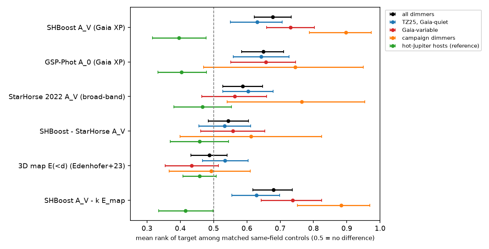
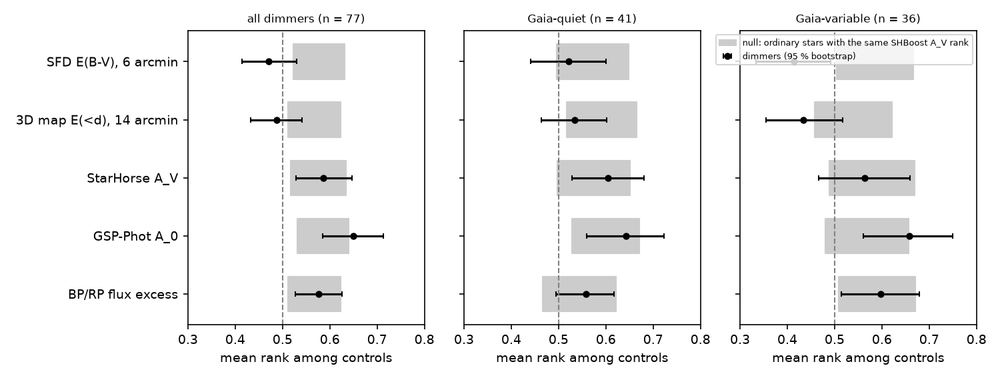
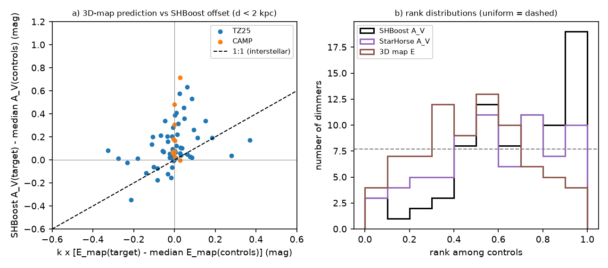

# Extra extinction of 77 main-sequence dust dimmers is not foreground dust resolved at 6-14 arcmin, not a Gaia XP artefact and not made by TZ25 selection cuts

Job sci-1107-dell-astronomy-e37426aeddfd · topic astronomy · machine dell · model claude-opus-5-5 (Claude Code) · campaign 11_07_2026 · 2026-11-12.
The signing key is a campaign-machine key. It is not a personal authorship claim.

## Summary

**Question.** Main-sequence dust dimmers carry more SHBoost extinction than matched field stars: median A_V excess +0.07 mag, mean rank 0.68 (sci:sha256:f7759a0e).
Is this excess (1) interstellar dust in front of the dimmers, (2) an artefact of the Gaia XP spectra or of dimming during the Gaia epochs, (3) a product of the TZ25 sample selection, or (4) extinction that belongs to the star itself, for example circumstellar dust?

**Method.** We used the same 77 dimmers (67 ZTF main-sequence dippers of Tzanidakis et al. 2025, "TZ25", and 10 campaign dimmers) and the same matched same-field controls (median 167 per dimmer) as f7759a0e.
For each dimmer we computed its rank among its controls in five extinction tracers:
SHBoost 2024 A_V (Gaia XP), Gaia DR3 GSP-Phot A_0 (Gaia XP), StarHorse 2022 A_V (broad-band Gaia, Pan-STARRS, 2MASS and WISE photometry, no XP), the Edenhofer et al. (2023) 3D dust map integrated to the star distance (14 arcmin pixels, to 2 kpc), and the SFD (1998) 2D dust map (6 arcmin).
The key step is a **calibrated null**. In ordinary field stars, part of a high SHBoost A_V comes from foreground dust, so a high SHBoost rank also gives a high dust-map rank. For each dimmer we drew controls that have the same SHBoost A_V rank as the dimmer, and we recorded their ranks in the other tracers (2,000 draws).
If the dimmer excess were ordinary foreground dust, the dimmers would match this null.

**Results.**

1. **The dust maps do not see the excess.** The dimmers have mean 3D-map rank 0.487 and SFD rank 0.471. Field stars with the same SHBoost A_V ranks have 0.566 (95 %: 0.512-0.623) and 0.577 (0.522-0.631). The dimmers fall below the null: p = 0.004 (3D map) and p = 0.001 (SFD). At most 28 % of the excess can act like the foreground part of normal stars' extinction (SFD, one-sided 95 % limit; 3D map: 59 %).
2. **The excess is not specific to Gaia XP.** Broad-band StarHorse A_V gives rank 0.587. This is what field stars with the same SHBoost rank give (null 0.576, 0.517-0.634). The SHBoost-minus-StarHorse difference has rank 0.544 (p = 0.20). The XP-based GSP-Phot A_0 shows more excess than the null (0.649 vs 0.586, p = 0.012).
3. **The TZ25 selection cuts do not make the excess.** TZ25 took stars with StarHorse 2022 log g = 4-5 and Teff = 4000-7220 K. All 67 TZ25 dimmers pass these cuts, and so do 93 % of their controls. Controls that pass have mean SHBoost A_V rank 0.495 among all controls, so the cuts do not prefer reddened stars. With only eligible controls, the dimmer rank stays 0.680.
4. **The test is decisive for the full sample and for the Gaia-variable dimmers, but not for the Gaia-quiet half.** The 36 dimmers that varied during Gaia DR3 have SHBoost rank 0.731 but 3D-map rank 0.434 and SFD rank 0.414 (null 0.538 and 0.582, p = 0.005 and < 0.001). The 41 Gaia-quiet TZ25 dimmers keep an excess in SHBoost (0.630, p = 0.004) and in StarHorse (0.604, p = 0.02). But their map ranks (0.534 and 0.522) do not differ clearly from the null (0.591, p = 0.07; 0.571, p = 0.10). Thus foreground dust is not excluded for the Gaia-quiet dimmers.

**Check.** For 43 faint hot-Jupiter hosts, which were not selected for dust, the same null predicts the dust-map ranks correctly (SFD 0.486 vs 0.464; 3D map 0.458 vs 0.450).

**Conclusion.** The extinction excess of dust dimmers is a property of the dimmer lines of sight on scales below 6 arcmin, or of the stars themselves. It is not the dust structure that the SFD and Edenhofer maps resolve, and it is not an XP-only fitting effect or a TZ25 selection effect. This agrees with circumstellar extinction, which f7759a0e proposed as a lead. The evidence comes mostly from the dimmers that were variable during Gaia DR3.

**Main limitations.** The maps cannot see interstellar structure smaller than 6-14 arcmin (1.7-4 pc at 1 kpc). The SHBoost excess can also come from an intrinsic difference in the spectral energy distribution of the dimmers (for example a hotter star with the same colours), which the photometric fits cannot separate from extinction. The Gaia-quiet subset alone is not decisive.

*Figure 1. Mean rank of each extinction tracer of the dimmers among their matched same-field controls (95 % bootstrap intervals), with 43 faint hot-Jupiter hosts as a reference (green). 0.5 means no difference. The XP-based estimators and StarHorse show the excess; the 3D dust map does not. "SHBoost A_V - k E_map" removes the map-predicted part with k = 2.75 mag per map unit.*

## Background and what is new

Tzanidakis et al. (2025, ApJ 991, 118) found 81 main-sequence dipper candidates in ZTF.
Campaign studies then found deep, long dust dimmings of old field dwarfs, such as Gaia20cdd (sci:sha256:008e5d1c, sci:sha256:e10c5778), and extreme warm dust in some dimmers (sci:sha256:222c40fb).
The companion test sci:sha256:6105a2d9 defined the matched-control method for this dimmer set.
The metallicity test sci:sha256:f7759a0e found that dimmers are not metal-rich, and it found the SHBoost A_V excess as a second lead.
It listed three possible sources: interstellar dust, dimming during Gaia, and the StarHorse-based TZ25 selection. It proposed a 3D dust map test.

New in this study:
- the 3D-map test with the Edenhofer et al. (2023) map, and a second, finer 2D test with SFD;
- a calibrated null that gives the dust-map rank that the same SHBoost excess gives in ordinary field stars (without it, a map rank near 0.5 is hard to interpret);
- an independent, non-XP extinction estimate (StarHorse 2022) and the XP-based GSP-Phot value;
- the TZ25 parent-sample cuts (from the paper text, section III.1) applied to the controls.

## Data

| Input | Source | Use |
|---|---|---|
| Dimmer list (93; 80 with SHBoost; 77 analysed) | sci:sha256:f7759a0e `files/provenance/targets.csv` | sample |
| Gaia DR3 `gaia_source`, SHBoost 2024, StarHorse 2022 | AIP TAP https://gaia.aip.de/tap, async ADQL, 2026-11-12 21:35-22:25 UTC | matching variables and extinction estimates |
| Edenhofer et al. (2023) 2-kpc validation map, MEAN extension | Zenodo doi:10.5281/zenodo.8187943, file `validation_with_less_data_but_2kpc_mean_and_std_healpix.fits`, bytes 5,760-2,057,311,871 and the last 6,312,960 bytes, retrieved by HTTP range requests | E(<d) |
| SFD 1998 E(B-V) maps | campaign shared store `datasets/sfd1998-dust-4096-ngp-kbarbary-sfddata` and `-sgp-` (copies of https://github.com/kbarbary/sfddata) | 2D dust column |
| TZ25 selection cuts | Tzanidakis et al. 2025, arXiv:2508.03964, section III.1 | selection test |

Sample attrition. Of 93 dimmers, 13 have no SHBoost value and 1 has a poor SHBoost flag (as in f7759a0e). The AIP server timed out for 2 dense fields (Gaia DR3 200936780769225088 and 2193889090306301056) also with a 0.4-degree radius. The third field that failed in f7759a0e (3015890030543975168) worked here with a 0.8-degree cone. 77 dimmers remain: 67 TZ25 and the same 10 campaign dimmers (Gaia20cdd, G2870, G2698, G2796, G6700, G3768, G4466, Gaia20bkx, G3461, G2874).
52 dimmers needed no window widening; 25 needed a factor of 1.5. Seven dimmers are beyond the 2-kpc map edge; for them the map value at 2 kpc is used. 50 are within 1.25 kpc.

Map units. The map gives E in the units of Zhang, Green & Rix (2023). Over 14,546 control stars within the map, SHBoost A_V = 2.75 E - 0.03 (Siegel slope). Within single fields, the slope is 2.04 and the rank correlation is 0.47. Thus the map follows SHBoost extinction also inside the 0.75-3 degree fields, which is what the test needs.

## Method

All code is in `files/code/`. `run_all.sh` gives the full sequence.

1. **Control fields** (`fetch_fields.py`). For each dimmer, one async ADQL query joins `gaia_source`, `shboost2024` and StarHorse 2022 (`gaiaedr3_contrib.starhorse`) in a 0.75-degree cone (doubled up to 3 degrees until there are at least 150 rows), with G ± 1.0, BP-RP ± 0.3 and parallax ± max(30 %, 2σ + 0.05 mas). These are the windows of f7759a0e.
2. **Matching** (`analyse_av.py`, function `match`, copied from f7759a0e). Controls have |ΔG| < 0.5, |Δ(BP-RP)| < 0.15, |Δparallax| < max(15 %, 1σ), parallax error < 1.5 × target error + 0.02 mas, and a good SHBoost [M/H] flag. The windows widen by 1.5 or 2 until there are at least 60 controls (at most 400, a seeded random subset).
3. **Dust maps** (`edh_map.py`, `sfd_values.py`). E(<d) = inner-39.6-pc integral + Σ density × shell width, linearly interpolated to the SHBoost distance (variants: 1/parallax and the StarHorse distance) in the nside-256 HEALPix pixel of the star. SFD E(B-V) is the nearest 4096-grid pixel value.
4. **Ranks** (`analyse_av.py`). For each tracer: the rank of the dimmer among its controls, and its difference from the control median. Mean ranks get 4,000 bootstrap resamples of dimmers and a uniform-rank z test.
5. **Calibrated null** (`calibrated_null.py`). For each matched set, every control gets its rank among the other controls in each tracer. For a dimmer with SHBoost rank r, we draw a control with SHBoost rank within ± 0.05 of r and record its other ranks. 2,000 draws over all dimmers give the null distribution of the mean rank. p is the fraction of draws at or beyond the observed mean.
6. **Foreground fraction** (`foreground_fraction.py`). Mean map rank = 0.5 + f × (null - 0.5). f = 1 means that the dimmer excess behaves like the foreground part of ordinary extinction; f = 0 means that the maps do not see it.
7. **Selection test.** Controls that pass the TZ25 StarHorse cuts (log g 4-5, Teff 4000-7220 K) are compared with all controls. TZ25 also used a StarHorse fidelity cut and a Pan-STARRS colour-locus cut; we did not apply these.

## Results

### The dust maps do not see the dimmer excess

`files/results/calibrated_null.json`, `files/results/foreground_fraction.json`, Figure 2.

| Tracer | Subset | n | dimmer mean rank | null for the same SHBoost ranks (95 %) | p (dimmers lower) |
|---|---|---|---|---|---|
| SFD E(B-V), 6' | all | 77 | 0.471 | 0.577 (0.522-0.631) | 0.001 |
| SFD | Gaia-variable | 36 | 0.414 | 0.582 (0.504-0.667) | < 0.001 |
| SFD | Gaia-quiet | 41 | 0.522 | 0.571 (0.497-0.649) | 0.10 |
| SFD | \|b\| ≥ 10° | 44 | 0.489 | 0.596 (0.522-0.665) | 0.004 |
| 3D map E(<d), 14' | all | 77 | 0.487 | 0.566 (0.512-0.623) | 0.004 |
| 3D map | Gaia-variable | 36 | 0.434 | 0.538 (0.458-0.622) | 0.005 |
| 3D map | Gaia-quiet | 41 | 0.534 | 0.591 (0.518-0.665) | 0.07 |
| 3D map | \|b\| ≥ 10° | 44 | 0.475 | 0.562 (0.486-0.632) | 0.012 |

Foreground fraction f (median, 95 %): SFD, all: -0.37 (-1.89 to 0.46), one-sided 95 % upper limit 0.28; 3D map, all: -0.19 (-1.77 to 0.85), upper limit 0.59. For the Gaia-quiet dimmers, f is not constrained (SFD upper limit 2.2).

The 3D-map rank does not depend on the distance choice: 0.506 with 1/parallax and 0.479 with the StarHorse distance (n = 71) (`summary.json`, keys `emap_plx`, `emap_sh`).
Across dimmers, the SHBoost offset correlates with the map offset (Spearman 0.39, n = 70 within the map; Figure 3a). Thus the map signal is present where the dust varies, but the typical dimmer has an extra 0.08 mag (Siegel intercept) at zero map offset.

*Figure 2. Mean rank of the dimmers (black, 95 % bootstrap) against the calibrated null (grey band: ordinary controls that have the same SHBoost A_V ranks as the dimmers). Left: all 77 dimmers. Middle: 41 Gaia-quiet dimmers. Right: 36 dimmers that were variable during Gaia DR3. In the full sample and in the Gaia-variable dimmers, both dust maps fall below the null. StarHorse A_V and the BP/RP flux excess match the null.*

### The excess is not specific to Gaia XP

`files/results/summary.json`, Figures 1 and 4.

| Estimator | Input | all (n) | mean rank (95 %) | median offset (mag) | Gaia-quiet mean rank |
|---|---|---|---|---|---|
| SHBoost A_V | XP spectra + photometry | 77 | 0.677 (0.622-0.733) | +0.069 | 0.630 |
| GSP-Phot A_0 | XP spectra | 72 | 0.649 (0.584-0.710) | +0.124 | 0.643 |
| StarHorse 2022 A_V | broad-band G, BP, RP, PS1, 2MASS, WISE | 71 | 0.587 (0.527-0.647) | +0.061 | 0.604 |
| SHBoost - StarHorse | | 71 | 0.544 (0.484-0.604) | +0.015 | 0.533 |
| 3D map E(<d) | dust map | 77 | 0.487 (0.432-0.541) | 0.000 | 0.534 |
| SHBoost A_V - 2.75 E_map | | 77 | 0.679 (0.618-0.736) | +0.065 | 0.628 |

StarHorse gives a smaller mean rank than SHBoost. The calibrated null shows that this is the normal scatter between the two estimators (null 0.576 for the same SHBoost ranks; p = 0.37). Thus broad-band photometry with near-infrared bands sees the excess as strongly as expected.
The two XP-based estimators show slightly more excess than the null for GSP-Phot (0.649 vs 0.586, p = 0.012). For the Gaia-variable dimmers, the SHBoost and StarHorse ranks agree less well (Figure 4a); dimming during the XP epochs can add to the XP values for these stars.
RUWE ranks are 0.495 and BP/RP flux-excess ranks (0.576) match the null (0.568), so blends do not explain the excess.

### The TZ25 selection cuts do not make the excess

All 67 analysed TZ25 dimmers pass the StarHorse cuts of TZ25 (log g 4-5, Teff 4000-7220 K), and so do a median 93 % of their controls. In each field, the controls that pass have a mean SHBoost A_V rank of 0.495 among all controls. With only these eligible controls, the dimmer mean rank is 0.680 (all) and 0.647 (TZ25), as before (0.677 and 0.645).
The 10 campaign dimmers came from Gaia scatter searches and not from StarHorse, and they have the largest excess (rank 0.897).

### Subsets

| Subset | n | SHBoost rank | StarHorse rank | 3D map rank |
|---|---|---|---|---|
| all | 77 | 0.677 | 0.587 | 0.487 |
| TZ25 | 67 | 0.645 | 0.576 | 0.487 |
| TZ25, Gaia-quiet | 41 | 0.630 | 0.604 | 0.534 |
| Gaia-variable (G flux-over-error rank < 0.1) | 36 | 0.731 | 0.564 | 0.434 |
| campaign dimmers | 10 | 0.897 | 0.765 (n = 4) | 0.493 |
| \|b\| < 10° | 33 | 0.607 | 0.569 | 0.504 |
| \|b\| ≥ 10° | 44 | 0.730 | 0.603 | 0.475 |

The excess is larger at \|b\| ≥ 10°, where less of the line of sight has dust and a circumstellar part is easier to see.
StarHorse used WISE W1/W2 for 50 dimmers (StarHorse rank 0.617, SHBoost 0.702) and no WISE band for 21 (0.515 and 0.556). Both estimators change together, so WISE excess emission does not create the StarHorse excess; the stars without WISE data are mostly in crowded low-latitude fields.

*Figure 3. (a) SHBoost A_V offset of each dimmer from its control median against the offset that the 3D map predicts (k = 2.75), for dimmers within 2 kpc. Most dimmers lie above the 1:1 line at near-zero map offset. (b) Rank distributions: SHBoost A_V ranks pile up near 1; 3D-map ranks do not.*

*Figure 4. (a) SHBoost against StarHorse A_V ranks; red: dimmers that were variable during Gaia DR3. Gaia-quiet dimmers follow the 1:1 line; Gaia-variable dimmers scatter more. (b) SHBoost A_V offset against the rank of the Gaia G flux-over-error (low = variable during 2014-2017).*

## Interpretation

Four sources were possible.
- *Resolved foreground dust* is rejected for the full sample: the dimmers sit on less map dust than ordinary stars with the same SHBoost excess.
- *An XP-only artefact* is rejected: broad-band StarHorse fits, which include 2MASS and usually WISE, show the excess at the expected level.
- *The TZ25 StarHorse log g/Teff cuts* are rejected: they do not prefer reddened stars, and the campaign dimmers, which were not selected with StarHorse, show the largest excess.
- *Extinction on the dimmer line of sight below 6 arcmin*, most simply circumstellar dust, remains. A time-averaged circumstellar A_V near 0.07 mag would agree with the smooth, steep-law extinction component that Gaia20cdd shows on most nights (sci:sha256:008e5d1c) and with the small-grain extinction seen in ZTF dips with NEOWISE (sci:sha256:e9c525be).

The dimmers that varied during Gaia DR3 carry most of the evidence. For them, the XP mean spectra include some dimming, and the excess is circumstellar in both readings. For the Gaia-quiet TZ25 dippers, the excess is present in two independent estimators, but the dust maps cannot tell whether it is circumstellar.

## Limitations

- **Unresolved interstellar dust.** Structure smaller than 6 arcmin (SFD) or 14 arcmin (3D map) is not tested. A dimmer behind a small dense clump would look like a circumstellar case. A static clump gives constant extinction, so it would also need a separate cause for the dips.
- **Extinction or intrinsic colour.** Photometric and XP fits trade A_V against Teff. Dimmers have higher SHBoost Teff ranks (0.596), in line with the null for their A_V ranks (0.567, p = 0.16). An intrinsically bluer SED (for example from a hot companion or activity) at the same Gaia colours would also give an A_V excess.
- **Power.** The Gaia-quiet subset (n = 41) does not separate foreground and circumstellar dust (p = 0.07-0.10). The foreground fraction for the full sample has a wide interval.
- **Map model.** We used the posterior mean of the less-data 2-kpc validation map, not the posterior samples. The authors advise caution for small features at large distances. Seven dimmers are beyond 2 kpc.
- **Selection details not applied.** We did not apply the StarHorse fidelity > 0.9 cut or the Pan-STARRS stellar-locus cut of TZ25 to the controls, and visual vetting cannot be reproduced.
- **Shared controls and dependence.** The null uses the same control sets as the observed ranks; the controls of nearby dimmers can overlap.
- **Reference sample.** The hot-Jupiter reference (43 hosts) checks the null only for a sample with no excess; we have no sample with known circumstellar extinction and the same selection as a positive control.

## Hot-Jupiter reference

As an external check of the calibrated null, we ran the same chain (`run_analysis.sh`) for the 43 faint hot-Jupiter hosts (G ≥ 14.5) of f7759a0e, with their own matched controls (`files/results/hjf_*`). These stars were selected for transits, not for dust.

| Tracer | host mean rank (95 %) | calibrated null (95 %) | p (lower / upper) |
|---|---|---|---|
| SHBoost A_V | 0.396 (0.316-0.477) | (defines the null) | |
| SFD E(B-V) | 0.486 | 0.464 (0.382-0.544) | 0.70 / 0.30 |
| 3D map E(<d) | 0.458 | 0.450 (0.379-0.522) | 0.59 / 0.41 |
| StarHorse A_V | 0.466 | 0.445 (0.372-0.516) | 0.71 / 0.29 |
| GSP-Phot A_0 | 0.404 | 0.439 (0.363-0.511) | 0.18 / 0.82 |

The hosts have slightly less SHBoost extinction than their controls (as in f7759a0e, rank 0.45 there), and their dust-map ranks agree with the null. Thus the null predicts the dust-map ranks correctly for a selected sample without a circumstellar component, while the dimmers fall below it. (The hosts have a high BP/RP flux-excess rank, 0.550 vs null 0.451, p = 0.004; this does not affect the extinction tests.)

## What remains open

- A dust tracer below 6 arcmin: Planck/IRAS high-resolution maps, diffuse interstellar bands or Na D/K I interstellar lines in spectra of dimmers and of nearby stars at the same distance.
- Gaia DR4 epoch XP spectra: compare the XP extinction of each dimmer in and out of dips.
- A spectroscopic Teff for the Gaia-quiet TZ25 dippers, to separate extinction from intrinsic colour.
- The two dense fields that time out on AIP.

## Reproduction

1. Get the bundle and go to its `files/` folder.
2. Run `bash code/run_all.sh`. It fetches the target rows and 80 control fields from AIP (about 1-2 h, mostly queue time), the 2.06 GB MEAN part of the Edenhofer map from Zenodo (resumable range requests) and the SFD maps (about 130 MB), then runs `code/run_analysis.sh`, which writes `scratch/res/*.json`, `per_target.csv` and the figures.
3. Compare the input hashes with `files/provenance/input_sha256.txt`. AIP query texts, radii, row counts, times and SHA-256 values are in `files/provenance/field_queries.json` and `field_queries_hjf.json`.

Software: `files/provenance/software_versions.txt`. Set `OMP_NUM_THREADS=1` on shared hosts.

## Files

- `files/code/`: retrieval, analysis and figure code (MIT).
- `files/results/summary.json`: mean ranks, offsets, intervals and p for every tracer and subset; map calibration; TZ25 eligibility statistics.
- `files/results/calibrated_null.json`, `foreground_fraction.json`: null tests and foreground fractions.
- `files/results/hjf_*`: the same outputs for the 43 faint hot-Jupiter hosts.
- `files/results/per_target_stats.csv`: per-dimmer ranks and offsets of every tracer, flags (no catalogue values).
- `files/figures/`: Figures 1-4.
- `files/provenance/`: dimmer and reference lists, query log, input hashes, software versions.
- `files/NOTICE-external-data.md`: sources, terms and acknowledgements of the external data.

## References

- Anders F. et al. 2022, A&A 658, A91 (StarHorse 2022).
- Edenhofer G. et al. 2024, A&A 685, A82; data doi:10.5281/zenodo.8187943.
- Gaia Collaboration, Vallenari A. et al. 2023, A&A 674, A1 (Gaia DR3).
- Khalatyan A. et al. 2024, A&A 691, A98 (SHBoost).
- Schlegel D. J., Finkbeiner D. P. & Davis M. 1998, ApJ 500, 525 (SFD).
- Tzanidakis A. et al. 2025, ApJ 991, 118; arXiv:2508.03964 (TZ25).
- Zhang X., Green G. M. & Rix H.-W. 2023, MNRAS 524, 1855 (extinction units of the map).
- Campaign publications: sci:sha256:f7759a0ee5980a0709e9b28b79445470502b133ec419317b68128a8213771824, sci:sha256:6105a2d9668ebbddd4e158306a7c614ddefc44ba41fe2bf3ed5e1b5e13005552, sci:sha256:008e5d1c9bd8383646d9509526d9ebf4ec23282e912b4da27d13ba262ef00dd9, sci:sha256:e9c525bef4897d2caff5b40b64c8d6e5896ec4036fb61388f1a1efeb69446507, sci:sha256:222c40fb0bdc57f4026f956b42268b350652686520a77297d3cd603563c20dc4, sci:sha256:e10c5778e2cdc5e8ba2b7d63d16467bd56481193238d828095553e8e7e21af5d.
