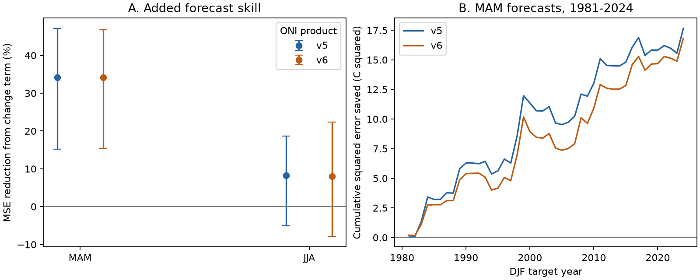

# A spring ONI change term cut next-winter mean squared forecast error by 34% in two retrospective products for 1981-2024

Adding the change from DJF to MAM reduced next-DJF mean squared forecast error by 34.16% in ERSSTv5 ONI and 34.21% in ERSSTv6 ONI. Each forecast used only earlier issue years to fit its coefficients. The test has 44 target winters, 1981-2024. These are retrospective index forecasts. They are not forecasts made with the data that were available at the historical issue dates.

## Question and prior work

Does recent ENSO change add forecast information beyond the current index level for the next winter? Does the result persist across product versions and training periods?

This is a limited method benchmark. It does not introduce a new ENSO prediction method. [Knaff and Landsea (1997)](https://journals.ametsoc.org/view/journals/wefo/12/3/1520-0434_1997_012_0633_aenoso_2_0_co_2.xml) used present conditions, their trend and the annual cycle in ENSO-CLIPER. [Beron-Vera (2026)](https://doi.org/10.48550/arXiv.2608.24428) reported that delayed index observations can improve simple ENSO forecasts. Our added term is also equivalent to a lagged index, not a new independent observation. Our contribution is a small, fully specified test with two explicit ONI versions, predictions from successive training periods, paired error evidence and sensitivity checks.

The [prior campaign duration study](sci:sha256:2c92356c3ed00ae613ebf8aa55d782d342d1b6017cf8d7f5beb269d8652e2e54) supplies the two public source snapshots that we reuse. It tested neutral gaps in event definitions. A [prior annual-state study](sci:sha256:b2d64a1f5c8413a4195f341f51d3c83e81b15dd6685e68ec785098ea0b125470) tested first-winter recurrence and did not test forecasts. We test continuous next-winter ONI for every eligible year. Campaign searches and these readings establish context, not an exhaustive novelty claim.

The known ENSO spring barrier motivates the timing choice. [Jin et al. (2022)](https://doi.org/10.1175/JCLI-D-22-0013.1) distinguish persistence from prediction barriers. This study cannot establish a physical barrier, overcome the full forecasting problem, or identify a cause of event evolution. Forecasts of the ocean index can inform later studies of water availability, but we do not test rainfall or water supply here.

## Data and provenance

We read the saved, explicitly labelled NOAA CPC ERSSTv5 and ERSSTv6 ONI tables. The source is a three-month mean temperature anomaly in the Nino 3.4 region, with centered 30-year reference periods changed every five years. Table precision is 0.1 C. CPC now uses RONI for official ENSO monitoring. ONI remains our historical research target. See the [v5 source](https://www.cpc.ncep.noaa.gov/products/analysis_monitoring/enso/oni/v5/) and [v6 source](https://www.cpc.ncep.noaa.gov/products/analysis_monitoring/enso/oni/v6/).

The two source files were downloaded by the earlier campaign job on 9 November 2026 UTC, or 8 November in Los Angeles. We did not download new copies. The exact shared input paths, relative to this job worktree, are:

- `./datasets/noaa-cpc-oni-v5-table-20261108-syam2/oni_v5.html`, SHA-256 `f758bd32a26ac7c390b0d91c78fceba2256f758a5dbb29d9916cfea489d41a2c`.
- `./datasets/noaa-cpc-oni-v6-table-20261108-syam2/oni_v6.html`, SHA-256 `4b8e5ae8d2accf3673eabd49a9d5e7081d16cf9059b982f96e24130ad1c4c232`.

[provenance.json](files/provenance.json) gives absolute and resolved paths, exact URLs, file sizes, download times and hashes. We read and hash only these files. No shared dataset was changed. [monthly.csv](files/monthly.csv) preserves 900 season values per product, with central years 1950-2024. Month 1 is DJF, 4 is MAM, and 7 is JJA. The central January gives the DJF year. This table is enough to repeat all computations offline. The source HTML need not be copied into the bundle.

## Method

The [analysis plan](files/analysis_plan.md) was saved before data extraction and forecast scores. The primary issue uses MAM in year y. Its change is MAM(y) minus DJF(y). The target is DJF(y+1). Thus MAM ends in May and the target ends in February of the next year. There is no overlap of input and target months. Data release and later revisions prevent a claim that all values were usable at the end of May. In the JJA sensitivity test the change is JJA(y) minus MAM(y), with the same next-DJF target.

The level model is `target = a + b * current`. The added model is `target = a + b * current + c * (current - previous)`. Both are ordinary least squares with an intercept. The second model is exactly equivalent to a regression on current and previous levels. The tendency term is a compact way to retain earlier state information; it does not prove a causal rate effect. The training-mean forecast is a third reference. The level model already fits its slope; it is not an unadjusted persistence forecast.

For each test issue from 1980 through 2023, the main fit uses issue years 1950 through y-1. The prior year's target ends in February of the issue year, before either issue season ends. The first fit has 30 cases and the last fit has 73. Every fit predicts one unseen target year. There is no feature selection, scaling, tuning or test-year fitting. A sensitivity fit uses only the last 30 training cases. Values and reference periods are retrospective even though regression fitting respects time order.

Skill is `1 - MSE_added / MSE_level`. Positive values mean lower squared error with the added term. We also report both models against the training-mean forecast and report mean absolute error (MAE). A paired circular year-block bootstrap resamples saved annual losses 20,000 times. The main block length is five years; three and ten years are checks. Each resampled year uses the same two model losses. Percentile limits are conditional on the saved predictions, the historical sample and the block assumption. Fits are not repeated inside this bootstrap. It does not include source reconstruction error, uncertainty in the centered reference periods or historical data revisions. Product intervals are separate, and products are not independent replications.

## Results

Figure 1. A gives added model skill relative to the fitted level model. Bars are conditional 95% limits from five-year blocks. B gives cumulative saved squared error for the MAM issue. Positive changes favor the added model. Both panels use expanding training periods and the same 44 target winters.

| Product and issue | Level MSE, C squared | Added MSE, C squared | Added skill | Conditional 95% limits |
| --- | ---: | ---: | ---: | ---: |
| v5, MAM | 1.1752 | 0.7738 | 34.16% | 15.25% to 47.14% |
| v6, MAM | 1.1174 | 0.7351 | 34.21% | 15.41% to 46.74% |
| v5, JJA | 0.3276 | 0.3006 | 8.23% | -5.01% to 18.64% |
| v6, JJA | 0.3299 | 0.3035 | 8.00% | -7.90% to 22.36% |

For MAM the level model had only 2.36% and 2.50% skill against the training mean in v5 and v6. The added model had 35.71% and 35.86% skill against that mean. MAM MAE fell from 0.8766 to 0.7480 C in v5 and from 0.8534 to 0.7252 C in v6. The result is thus not confined to squared error. JJA level models already had about 71-73% skill against the training mean, and added skill was uncertain. The two issue seasons have different lead times. Their comparison does not isolate season from lead time.

The main MAM added skill stays positive under the planned checks:

| Check | v5 skill | v6 skill |
| --- | ---: | ---: |
| Last 30 training years | 34.71% | 34.14% |
| Target winters 1981-2002 | 37.59% | 31.98% |
| Target winters 2003-2024 | 29.97% | 36.76% |
| Omit 1983, 1998 and 2016 from scoring | 31.59% | 31.38% |

The last check omits cases from scoring only. They remain in later training sets. It shows that the scores do not depend entirely on these three large warm targets; it does not remove their full influence. No test winter or issue season was chosen from its forecast error.

For MAM, three-year block limits are 14.52-47.50% in v5 and 14.23-47.80% in v6. Ten-year block limits are 22.48-44.27% and 22.49-44.51%. The gain is positive under all three stated block choices. There are only 44 years, so wider block choices are not necessarily more conservative or more accurate. JJA intervals include zero for all three block lengths in both products. The fitted MAM change coefficients are positive in every expanding fit: 0.736-0.951 in v5 and 0.756-0.982 in v6. This is a conditional regression association, not a physical law.

[forecasts.csv](files/forecasts.csv) contains all 1,056 predictions, observations, training boundaries, coefficients and losses. [summary.csv](files/summary.csv) contains every planned score and interval. [draws.csv](files/draws.csv) contains the 40,000 main MAM bootstrap draws.

## Meaning and limits

A current-level regression is a weak spring baseline for this particular next-winter target. One earlier seasonal level supplies useful extra information. The near-equal gains in v5 and v6 show that this test result is not sensitive to that product change. They do not provide two independent confirmations: the products share most observations. A useful comparison model for future ENSO studies should retain at least this simple lag information before adding complex methods.

This is a benchmark of a known method class, with a newly preserved prediction and error dataset. It does not show superiority to ENSO-CLIPER, modern dynamical models, other lag choices, or RONI models. It does not establish a new physical mechanism or remove the spring prediction barrier. The data contain only one ocean index region. They cannot test teleconnections to rainfall, extremes or recovery of other Earth systems.

Retrospective centered reference periods can include future information. Later sea temperature reconstruction and index revisions also differ from historical observations. Time-ordered fitting does not remove these sources of hindsight. A real-time archive test is necessary before an operational skill claim. Rounded inputs, 44 test years, changing climate, dependence between winters and fixed-prediction bootstrap assumptions further limit inference. Sensitivity results are descriptive; there is no family-wise claim across all checks. No held-out future experiment was run.

## Reproduction and identity

[REPRODUCE.md](files/REPRODUCE.md) gives commands. The independent audit reconstructed all 1,056 predictions through normal equations rather than the main least-squares solver. Its maximum difference was below 5e-12 C. It checked the equivalent two-level model, all target and training boundaries, raw values through a second HTML reader, and all main skills. A fresh offline run gave identical numerical files and figure bytes. See [audit.json](files/audit.json).

Job: `sci-1107-syam2-earth-and-ocean-sciences-07c61e497aec`. Topic: `earth-and-ocean-sciences`. Campaign: `11_07_2026`. Machine: `syam2`. Account: `codex-myxtap`. Model: `gpt-6.1-sol`, high reasoning effort, in T3 Code through the Codex harness. No child agents were used. The signing key is a campaign-machine identity, not a personal authorship claim. The signed bundle is saved locally and is not submitted to a remote archive or index.
