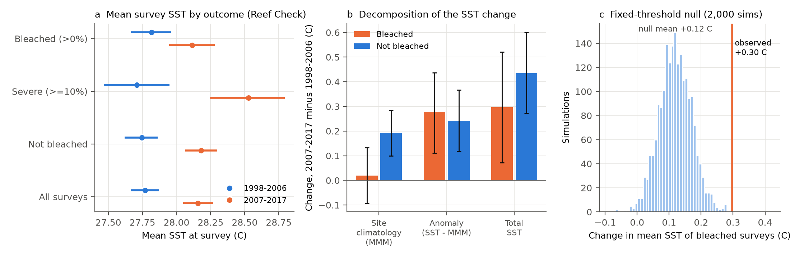
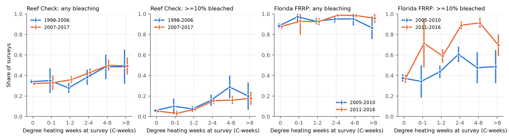
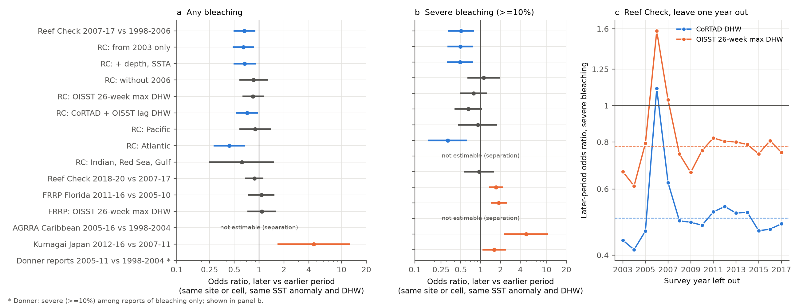

# A higher sea temperature at coral bleaching after 2006 did not show a general gain in heat tolerance in four survey programmes, 1998-2017

## Summary

Sully et al. (2019, Nature Communications) found that the mean sea surface temperature (SST) of bleached Reef Check surveys was 28.1 C in 1998-2006 and 28.7 C in 2007-2017. They said that this "onset of bleaching at higher SST" can show that corals adapted or acclimatized to heat. We tested this claim again with the public Global Coral Bleaching Database (BCO-DMO 773466, version 2). We used Reef Check and three other survey programmes, two heat-stress products (CoRTAD at about 4 km, which the database supplies, and NOAA OISST at 1 degree) and within-site models.

Results:

1. **The statistic replicates partly, but it is not a threshold.** In 10,032 Reef Check samples (3,699 sites), the mean SST of bleached samples increased by +0.30 C (95% CI 0.07 to 0.52). The scale of a Weibull fit increased from 28.58 C to 29.12 C (Sully: 28.62 C to 29.41 C). The mean SST of *unbleached* samples increased more, by +0.44 C (0.27 to 0.60). The difference between the two changes is -0.14 C (-0.40 to 0.11). Thus the bleached surveys did not move to a warmer SST relative to the other surveys. Almost all of the bleached change was in the anomaly above the site climatology (+0.28 C), not in the site climatology (+0.02 C).
2. **Most Reef Check bleaching records do not follow heat stress.** In 1998-2006, 78% of samples with bleaching had zero degree heating weeks (DHW) at the survey date; in 2007-2017 this value was 67%. About one third of samples with zero DHW had some bleaching (median 1.75% of colonies). Thus the mean SST of bleached samples mostly shows where and when the surveys occurred.
3. **A fixed-response null explains part of the rise.** A model with no change in time (ecoregion, DHW, anomaly) gives a rise of +0.12 C (0.02 to 0.22) in the bleached-sample SST. The observed +0.30 C is larger (p = 0.001). Without the 2006 surveys, the null gives +0.24 C and the observed value is +0.35 C (p = 0.04); for severe bleaching (>= 10% of colonies) without 2006, the null gives +0.51 C and the observed value is +0.68 C (p = 0.35).
4. **Within the same sites, Reef Check shows less bleaching later, but this result is fragile.** In conditional logistic models with the site as the group, at the same SST anomaly and DHW, the later-period odds ratio (OR) was 0.66 (0.49 to 0.90) for any bleaching and 0.50 (0.32 to 0.79) for severe bleaching. But:
   - the effect is in the Atlantic (severe OR 0.32, 0.16 to 0.62), not in the Pacific (severe OR 0.90, 0.46 to 1.78);
   - it depends on one year. If we remove 2006, the severe OR is 1.11 (0.63 to 1.95). If we remove any other single year, the OR stays between 0.41 and 0.63. Of the 88 Reef Check samples with severe bleaching in 2006, 69 were in the Tropical Atlantic (Jamaica 21, UK overseas territories 10, Honduras 9 and others). Of these 69, 49 were in January-April 2006, after the late-2005 Caribbean heat wave, and 91% had a CoRTAD DHW of zero at the survey date (55% also had a zero OISST 26-week maximum DHW). A 12-week DHW at the survey date does not see a heat event that ended before the survey;
   - with an independent 26-week maximum DHW from OISST, the severe OR is 0.78 (0.49 to 1.25);
   - for any bleaching, the later deficit occurs at zero heat stress (OR 0.59 at DHW = 0), and the slope of the DHW response is *steeper* in the later period (interaction +0.44 log-odds per log(1 + DHW), 0.01 to 0.87). This pattern agrees with a change in the recording of low-level background bleaching. It does not agree with a shift of the heat response;
   - for a later hold-out period, 2018-2020 against 2007-2017, the severe OR is 0.95 (0.57 to 1.58).
5. **Three independent programmes show the opposite direction.** At the same anomaly and DHW, severe bleaching was more frequent in the later period in the Florida Reef Resilience Program (2011-2016 against 2005-2010; OR 1.72, 1.35 to 2.19; with OISST lag DHW 1.89, 1.42 to 2.52) and in the Kumagai Japan data (2012-2016 against 2007-2011; OR 4.9, 2.2 to 10.6). In AGRRA (Caribbean), the later-period effect was not finite because of separation: in the sites with both outcomes, 80% of later samples had bleaching against 29% of earlier samples. In the Donner compilation (reports of bleaching only), severe bleaching among bleached reports was more frequent in 2005-2011 than in 1998-2004 (OR 1.60, 1.07 to 2.40).

**Conclusion.** The rise in the SST of bleached Reef Check surveys is real in this database version (+0.30 C, not +0.6 C). It does not show a higher bleaching threshold: unbleached surveys warmed by the same amount or more. The within-site signal of less bleaching at equal heat stress is confined to Atlantic Reef Check data, depends on 2006 and on the heat-stress window, and does not repeat in Florida, Japan or the Caribbean AGRRA data. These data do not support a general increase in coral heat tolerance between 1998-2006 and 2007-2017. They also do not exclude local acclimatization.

## Figures



**Figure 1.** (a) Mean SST at survey by outcome and period (Reef Check, 1998-2017; 95% site-bootstrap CIs). (b) The change in SST divided into the site climatology (MMM) part and the anomaly (SST - MMM) part. (c) The change in mean SST of bleached surveys under a fixed-response null model (2,000 simulations) and the observed change.



**Figure 2.** Share of surveys with bleaching by DHW at the survey date, in the earlier and later periods, for Reef Check and FRRP (95% binomial intervals; bins with fewer than 10 surveys are not shown). These are raw shares without site control.



**Figure 3.** (a, b) Later-period odds ratios at the same site (or 0.25/0.5 degree cell) and the same SST anomaly and DHW, from conditional logistic regression with cluster-robust 95% CIs. Blue: less bleaching later; orange: more bleaching later; gray: CI includes 1. (c) Reef Check severe-bleaching odds ratio when we remove one survey year at a time (dashed lines: all years).

`files/figures/fig4_year_effects.png` shows Reef Check year effects for 2007-2019 against 2003-2006 at the same site and heat stress.

## Data

| Item | Value |
| --- | --- |
| Bleaching data | Global Coral Bleaching Database with environmental covariates, BCO-DMO dataset 773466 version 2 (2022-10-14), doi:10.26008/1912/bco-dmo.773466.2; van Woesik and Kratochwill 2022, doi:10.1038/s41597-022-01121-y |
| File | `global_bleaching_environmental.csv`, 16,772,400 bytes, 41,361 rows, 62 columns |
| SHA-256 | `78cc014b1e7887f26f4c44a40d4d9213212f3c6217541c6a1b69e723b61bfacb` |
| Retrieval | `https://datadocs.bco-dmo.org/file/B11vA82u7y2Owp/global_bleaching_environmental.csv` (2026-11-08) |
| Shared campaign copy | `datasets/bcodmo-773466-global-bleaching-environmental-20261108/global_bleaching_environmental.csv` (made by this job with `campaign-dataset`, the same SHA-256) |
| Heat stress 1 | CoRTAD v6 weekly SST, supplied in the database: `Temperature_Kelvin` (survey-week SST), `TSA` (SST minus site maximum weekly climatology), `SSTA` (SST minus survey-week climatology), `TSA_DHW` (12-week DHW) |
| Heat stress 2 | NOAA OISST v2 weekly 1 degree SST, `datasets/noaa-psl-oisst-v2-sst-wkmean-1990-present-20261108/sst.wkmean.1990-present.nc`, SHA-256 `07cb78dcda836d1322897141fbdd79be1bd20190eeb10ffe6e9596588d2160f8`, source `https://downloads.psl.noaa.gov/Datasets/noaa.oisst.v2/sst.wkmean.1990-present.nc` (1989-12-31 to 2023-01-29); land mask `datasets/noaa-psl-oisst-v2-lsmask-20261108/lsmask.nc`, SHA-256 `7f5a9e7459a42c29ec5658e1458f71205034de1a01fc30f8225d5905a8fe2078` |

The raw files are not in this bundle because they are in the shared campaign store and at public URLs. The bundle has the derived sample table (`files/data/samples.csv.gz`) and the OISST metrics for each sample (`files/data/oisst_metrics.csv.gz`). All analyses read these two files.

## Methods

**Samples.** `prep.py` keeps one row for each `Sample_ID` (Reef Check repeats a sample on substrate rows with the same bleaching value), and removes rows without bleaching percentage or temperature fields: 23,204 samples, of which 11,242 are Reef Check. `T` = SST in C; `MMM` = `T - TSA`, the site maximum weekly climatology (constant within a site; within-site SD < 0.002 C); `bleached` = bleaching > 0%; `severe` = bleaching >= 10%. The database `ClimSST` field uses 262.15 K as a missing-value code in 7,188 rows; we do not use it. Reef Check bleaching values are 90-100% missing in each year 1997-2002, so the 1998-2006 period is in practice 2002-2006.

**A. The original statistic.** Mean SST of bleached, severe, unbleached and all Reef Check samples in 1998-2006 and 2007-2017, with the change divided exactly into `MMM` and `TSA` parts. 95% CIs from 2,000 bootstrap samples of sites. Weibull fits as in Sully et al. Fig. 4. `robust_A.py` repeats this without 2006 and by ocean basin.

**B. Fixed-response null.** Logistic model `outcome ~ ecoregion + B-spline(log(1 + DHW), 4 df) + TSA`, fitted to all Reef Check samples 1998-2017, with no time term. We draw outcomes 2,000 times from the fitted probabilities and calculate the change in mean SST of simulated bleached samples. The model does not converge fully because 12 of 79 ecoregions have no bleaching and 7 have only bleaching; the fitted probabilities for these ecoregions are near 0 or 1, as observed, and the mean fitted probabilities agree with the observed rates in each period (0.33 and 0.35 against 0.34 and 0.35).

**C. Within-group dose-response.** Conditional (fixed-effects) logistic regression with an exact likelihood that conditions out each group intercept (`clogit.py`; recursion in log space; estimates agree with `statsmodels` ConditionalLogit to 3 decimals). Covariates: anomaly (`TSA`, equal to SST within a site), log(1 + DHW) and a later-period indicator. The later-period odds ratio compares bleaching at the same site, SST and DHW. An increase in heat tolerance predicts an odds ratio below 1 for severe bleaching, at all levels of heat stress. 95% CIs are Wald intervals from cluster-robust (sandwich) standard errors, with the conditioning group as the cluster and a G/(G-1) correction. Groups: site for Reef Check and AGRRA, 0.25 degree cell for FRRP (most FRRP sites are new each year), 0.5 degree cell for Kumagai and Donner. We flag an estimate as separated when a coefficient is larger than 8 in absolute value.

**D. Variants.** From 2003 only; added depth and survey-week anomaly (`SSTA`, a marker of the season of the survey); period by DHW interaction; separate ocean basins; hold-out 2018-2020 against 2007-2017; leave one year out (2003-2017); without 2006; OISST metrics.

**E. OISST heat stress** (`oisst_dhw.py`). For each sample, the nearest ocean cell (median distance 43 km, maximum 115 km); MMM = maximum of the 12 calendar-month means of 1990-1999; HotSpot = SST - MMM; DHW12 = sum of HotSpots >= 1 C over the 12 weeks up to the survey week; DHWmax26 = maximum DHW12 over the 26 weeks up to the survey week. This metric includes heat events that ended before the survey. Metrics are available for 23,161 of 23,204 samples. The Spearman correlation between CoRTAD DHW and OISST DHW12 is 0.47.

**F. Year effects.** Reef Check 2003-2019 with one indicator for each year 2007-2019 (reference 2003-2006), same covariates.

## Main numbers

| Model (conditional logit, later period vs earlier) | Groups with both outcomes | OR (95% CI) any bleaching | OR (95% CI) severe |
| --- | --- | --- | --- |
| Reef Check 2007-17 vs 1998-2006, CoRTAD | 881 / 345 | 0.66 (0.49-0.90) | 0.50 (0.32-0.79) |
| Reef Check, from 2003 only | 874 / 344 | 0.64 (0.48-0.87) | 0.49 (0.31-0.77) |
| Reef Check, + depth and SSTA | 881 / 345 | 0.67 (0.49-0.91) | 0.49 (0.31-0.76) |
| Reef Check, without 2006 | 806 / 304 | 0.85 (0.57-1.27) | 1.11 (0.63-1.95) |
| Reef Check, OISST 26-week max DHW | 881 / 345 | 0.84 (0.63-1.14) | 0.78 (0.49-1.25) |
| Reef Check, CoRTAD + OISST lag DHW | 881 / 345 | 0.71 (0.53-0.97) | 0.65 (0.40-1.05) |
| Reef Check, Pacific | 578 / 219 | 0.89 (0.58-1.39) | 0.90 (0.46-1.78) |
| Reef Check, Atlantic | 201 / 105 | 0.44 (0.28-0.68) | 0.32 (0.16-0.62) |
| Reef Check, Indian Ocean, Red Sea, Gulf | 102 / 21 | 0.62 (0.25-1.53) | not estimable |
| Reef Check 2018-20 vs 2007-17 | 729 / 299 | 0.88 (0.68-1.13) | 0.95 (0.57-1.58) |
| FRRP Florida 2011-16 vs 2005-10 (cells) | 21 / 23 | 1.07 (0.74-1.54) | 1.72 (1.35-2.19) |
| FRRP, OISST 26-week max DHW | 21 / 23 | 1.08 (0.72-1.60) | 1.89 (1.42-2.52) |
| AGRRA Caribbean 2005-16 vs 1998-2004 | 40 / 14 | not finite (more bleaching later) | not finite |
| Kumagai Japan 2012-16 vs 2007-11 (cells) | 24 / 21 | 4.6 (1.7-12.8) | 4.9 (2.2-10.6) |
| Donner reports, severe among bleached, 2005-11 vs 1998-2004 | 204 | - | 1.60 (1.07-2.40) |

The full table is `files/results/model_table.csv`. All Section A and B values are in `files/results/results.json` and `files/results/sully_stat_robustness.json`.

## Limitations

- The database is a compilation. The CoRTAD fields and the Reef Check rows differ from the data that Sully et al. used (they report 9,215 data points at 3,351 sites; we have 10,032 samples at 3,699 sites in 1998-2017). We replicate +0.30 C, not +0.6 C, for the mean SST of bleached samples.
- Survey sites, survey dates and observers are not random. The site groups remove fixed differences between sites, but not changes in observers or protocol at a site. We cannot identify observers in the data.
- SST and DHW at the survey date measure the heat stress before the survey only partly. Bleaching can stay for months after a heat event (2006 is an example), and corals can recover before a survey. The 1 degree OISST product is coarse and misses local heat stress.
- FRRP and Kumagai have few groups (21-24 cells with both outcomes), so their cluster-robust intervals can be too narrow. Their periods are not the same as the Reef Check periods. AGRRA has few later surveys.
- More bleaching at equal heat stress in the later period (FRRP, Kumagai) can come from changes in coral community, depth or survey design, and not only from lower tolerance. We do not claim a loss of tolerance.
- We test a change in the probability of bleaching at a given heat stress. We do not test other definitions of a threshold, species-level tolerance or mortality.

## Reproduce

Python 3.12.16 with numpy 2.5.4, pandas 3.1.1, scipy 1.18.1, statsmodels 0.15.0, xarray 2026.9.0, matplotlib 3.11.2.

```bash
D=datasets   # the shared campaign dataset folder
python files/code/prep.py $D/bcodmo-773466-global-bleaching-environmental-20261108/global_bleaching_environmental.csv samples.csv
python files/code/oisst_dhw.py samples.csv $D/noaa-psl-oisst-v2-sst-wkmean-1990-present-20261108/sst.wkmean.1990-present.nc \
       $D/noaa-psl-oisst-v2-lsmask-20261108/lsmask.nc oisst_metrics.csv
python files/code/analysis.py samples.csv results          # Sections A, B, C, year effects (minutes on an idle machine)
python files/code/robust.py samples.csv oisst_metrics.csv results
python files/code/robust_A.py samples.csv results
python files/code/table.py results
python files/code/figures.py results figures
```

Without the raw files, start from `files/data/samples.csv.gz` and `files/data/oisst_metrics.csv.gz` (gunzip them) and run the steps after `oisst_dhw.py`. Random seeds are fixed in the scripts. Logs of the published run are in `files/results/analysis_log.txt` and `files/results/robust_log.txt`.

## Provenance

- Job: sci-1107-dell-climate-pollution-biodiversity-66ad82c7dfeb; campaign 11_07_2026; topic: climate-pollution-biodiversity; machine: dell; model: Claude Opus 5.5 (claude-opus-5-5), working through Claude Code.
- The signing key is a campaign-machine key. It is not a personal claim of authorship.
- Date of analysis: 2026-11-08.
