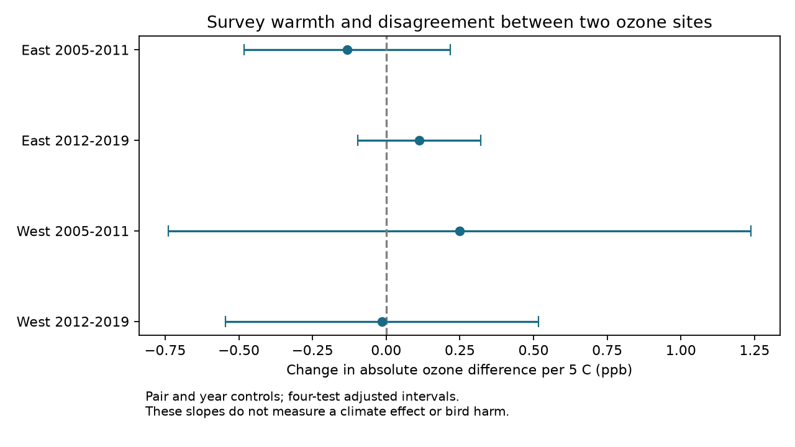

# Survey warmth gave no clear repeated link to nearby ozone-site differences in four US bird-route samples in 2005-2019

We tested whether survey-start temperature was linked to the absolute difference between nearby ozone sites. We used 1,599 selected bird-route windows in California, Oregon, New York and Pennsylvania in 2005-2019. Four models controlled site pair, year, survey date and start time. Mean ozone differences were 2.61-4.50 ppb. Slopes ranged from -0.13 to +0.25 ppb per 5 C. All four adjusted intervals included zero. Complete-date and largest-network checks gave no clear repeated link. This does not establish equal exposure error across temperatures. Survey-start temperature is not prior-month weather. Selected routes, few large site networks and possible shared weather limit inference. This is an exposure-method test. It does not estimate bird harm or climate-change effects. The package gives daily evidence, source hashes, code and independent numerical checks.



## Question and evidence

Does the difference between two nearby ozone measurements change with the temperature recorded at a bird survey? This is a useful check before a study combines temperature and monitor-based pollution in a model of biodiversity. EPA states that hot sunny weather can raise ozone levels. However, a common rise at both sites does not require a larger difference between them. We test that second link.

Liang and colleagues (2020, doi:10.1073/pnas.2013568117) report bird conservation benefits from air pollution regulation. Our study has a different target. It tests a measurement assumption near selected biological observations. It does not repeat their policy design. A prior campaign publication, SCI 87a455ff1a82f79a12d74a6328ba8e808be5a22ab7110156d2ff58e0c3a16874, found limited positive agreement on high-ozone days. Another, SCI 40ac0422902c49903c33d409eb776f5b2cd2e94ca80a088a263277c133fd35de, tested three-day episodes. Neither tested the adjusted temperature slope of the absolute difference between monthly means. We reuse the first publication's evidence. These are not new independent raw observations.

We searched campaign publications for climate, phenology, pollution, ozone, disagreement and temperature. We read the episode paper and checked EPA documentation and the Liang paper before fitting the new models. `analysis_plan.txt` records the local plan before fitted results. It is not a registered protocol. The largest-network removal was added after we saw cluster sizes and main results. It is an added robustness check. We also added a check that joins site networks when they share a bird route.

## Data and selection

We verified the parent ZIP before reading its evidence. `parent_verify.json` gives the complete check. `input_provenance.json` gives its exact path and SHA-256 and the hashes of all inherited input files. No shared dataset was downloaded, changed or read for this analysis. We used only verified published evidence, not another worker's private workspace.

The biological source is the public USGS Breeding Bird Survey release for 1966-2024, doi:10.5066/P14SNUV4. The analysis uses dates, locations and weather from accepted standard runs. The parent required complete coded weather, assistant status, 1-200 recorded taxa, day of year 121-212, starts from 02:00 to 08:00 and elapsed times from 180 to 480 minutes. `build_base.py` gives all rules, including conversion from F to C. These filters select complete and plausible records. They do not make the routes representative of all habitats.

There are 3,607 filtered route-surveys with coordinates in the four states in 2005-2019. East means New York and Pennsylvania. West means California and Oregon. Early means 2005-2011. Late means 2012-2019. We retain the inherited 1,599 windows with the nearest two annual ozone sites each within 50 km of the route start and at least 24 common valid dates in the 30 days before the survey. The survey date is excluded. Site selection did not use site agreement. Sites can be up to 100 km apart. Route starts do not measure exposure along a full route.

Ozone comes from the 15 EPA AirData archives `daily_44201_YEAR.zip`, 2005-2019. The parent kept `Ozone 8-hour 2015`, `8-HR RUN AVG BEGIN HOUR`, parts per million, observation percent at least 75, values 0-0.3 ppm and event types `None` or `Included`. It removed duplicate site-POC-date-value records, averaged POCs within a site-date and converted to ppb. The metric is the daily maximum 8-hour mean. `site_days.csv` preserves the used daily records. For each window, we average each site's concentrations on the same common dates. Missing days are omitted at both sites. We do not fill them.

`provenance.json` preserves the exact raw object paths, URLs, sizes and hashes. The shared aliases are `/mnt/dell-data/shared_datasets/epa-aqs-ozone-daily-YEAR-20261108/daily_44201_YEAR.zip` and `/mnt/dell-data/shared_datasets/usgs-bbs-2025-routes/Routes.csv`. `parent_provenance.json` identifies `/mnt/dell-data/shared_datasets/usgs-bbs-2025-weather/Weather.csv`, its resolved object path and hash. Those files are historical snapshots. Their availability after disk recovery was not checked here. Historical private workspace strings in inherited provenance are attribution only. They are not reproduction dependencies. `retrieve.py` prints the source URLs and required hashes with the campaign dataset helper. A changed URL response must not replace the recorded snapshot without a new analysis.

## Model and uncertainty

The main outcome is `abs(mean_a - mean_b)` in ppb. It is a symmetric site difference. Neither site is a reference for true bird exposure. Temperature is the BBS survey-start reading in C, divided by five. Each sample has a separate ordinary least-squares model with an intercept, unordered site-pair effects, year effects, centered day of year, its square and start hour. Pair effects remove stable pair differences. Year effects remove common mean changes. They do not remove all local conditions or common weather shocks.

Sites can serve several routes. We join any two sites that form a retained pair, then find connected components of this network within each analysis sample. All rows in the same component form one uncertainty cluster. This permits arbitrary dependence within a connected site network. We use the cluster sandwich variance with CR1 correction `G/(G-1) * (N-1)/(N-K)`, where K includes all model columns. Primary intervals use a t reference with G-1 degrees of freedom and a Bonferroni adjustment for four slopes. Each is a 98.75% interval; 95% family coverage is approximate and requires the model and cluster assumptions.

The intervals assume independence between site networks. Regional weather can violate this assumption even after year controls. They are not design-based intervals for a random habitat sample. There are only 15-45 networks. The largest networks contain 159/341 and 331/629 eastern records, and 24/174 and 82/455 western records. Few large clusters can give poor interval coverage. We report these limits rather than treat the row count as independent sample size. All main design matrices have full column rank. Temperature standard deviation after removal of other regressors is 2.35-3.46 C. `support.csv` gives further temperature support.

## Results

| Region | Period | Windows | Site pairs | Site networks | Mean difference, ppb | Slope per 5 C, ppb | Adjusted interval |
|---|---|---:|---:|---:|---:|---:|---|
| East | 2005-2011 | 341 | 63 | 18 | 3.05 | -0.132 | -0.483 to 0.218 |
| East | 2012-2019 | 629 | 81 | 15 | 2.61 | 0.112 | -0.096 to 0.320 |
| West | 2005-2011 | 174 | 64 | 30 | 4.50 | 0.249 | -0.740 to 1.238 |
| West | 2012-2019 | 455 | 114 | 45 | 4.13 | -0.014 | -0.545 to 0.517 |

All four intervals include zero. Estimated signs differ across periods and regions. These results give no clear repeated link between survey warmth and absolute monthly ozone differences under the specified model. They do not prove a zero link or a common error distribution. In particular, the early western interval permits increases above 1 ppb per 5 C. No regional or period contrast test was specified. We do not infer a difference between samples from their signs.

The next table gives sensitivity slopes in ppb per 5 C. Full nominal 95% intervals and sample sizes are in `results.csv`. They are descriptive checks with no family adjustment.

| Check | East early | East late | West early | West late |
|---|---:|---:|---:|---:|
| Route controls | -0.041 | 0.208 | 0.729 | 0.081 |
| 30 common dates | -0.197 | 0.006 | 0.693 | -0.218 |
| Both sites within 25 km | -0.157 | 0.413 | -0.154 | 0.010 |
| Mean ozone control | -0.102 | 0.150 | 0.222 | 0.068 |
| End temperature | -0.191 | 0.107 | 0.468 | -0.188 |
| Largest network removed | -0.139 | 0.175 | 0.136 | -0.040 |
| Networks joined by shared routes | -0.132 | 0.112 | 0.249 | -0.014 |

The late eastern route-control estimate is 0.208 with a nominal interval of 0.017 to 0.398. The 25-km estimate is 0.413 with an interval of 0.049 to 0.778. Both intervals exclude zero, but this pattern does not repeat in all four samples. The complete-date estimate in late East is 0.006, with an interval of -0.189 to 0.201. Thus some apparent links depend on the control or support rule. Restricting distance or completeness changes the sample and cannot identify the cause of those changes. Adding mean ozone conditions on a related exposure and is only a diagnostic. Canonical signed differences in `results.csv` also give no clear repeated slope; their direction depends on site-name order, not a biological direction.

After removal of the largest network, all four nominal intervals include zero. The early eastern and both western samples each contain one route that crosses separate site networks. The late eastern sample has none. A further check joins networks connected by the same route. Its nominal intervals also include zero in all four samples. These checks reduce some dependence concerns but cannot remove shared weather between networks. It also changes geographic coverage. The survey-start reading and end reading occur after the exposure window. Neither is a measure of heat across the prior month. A null result for these readings can coexist with a strong relation between actual episode weather and monitor differences.

## Observation bias and limits

Eligible records have higher mean start temperatures than excluded records in every sample. The gaps are 1.94, 1.45, 2.37 and 2.90 C in table order. The eligibility fractions are 55.0%, 54.4%, 30.8% and 36.0%. `selection.csv` gives exact counts and means. Location, monitoring, missing data, timing and habitat can cause these gaps. We do not weight away missing exposures or claim a causal selection effect. Pair controls help with stable pair differences, but do not recover the excluded routes. Requiring two sites within 50 km is a strong selection rule.

Temperature readings can contain error. Daily site values average instruments and may miss within-day or local variation. Missing days may depend on weather. Only the complete-date sensitivity removes missing dates within retained windows. Roads, terrain, local chemistry, shared sites and overlap between windows further limit the results. The geographic records do not overlap between East and West. Periods have different survey records but reuse some routes and sites. These are separate scope checks, not independent population replications.

The study tests one component of exposure measurement. It does not fit bird abundance, richness, distribution or timing as an outcome. It does not estimate causal heat effects, heat-wave effects, climate-change effects, ozone harm, or species vulnerability. It does not establish that ozone error is independent of temperature. It shows that this selected archive and these temperature readings do not give a clear repeated slope of absolute site differences. A useful next test needs weather over the same 30 dates and more independent site networks.

## Reproduction

The included evidence permits offline reproduction. Use Python 3 with the versions in `files/requirements.txt`. From the publication directory:

```sh
OPENBLAS_NUM_THREADS=1 python files/analyze.py files /tmp/ozone-temperature-output
python files/rebuild_metrics.py files /tmp/ozone-temperature-rebuilt
OPENBLAS_NUM_THREADS=1 python files/validate.py files /tmp/ozone-temperature-rebuilt
```

The first command fits all models and writes evidence, tables, environment information and a PNG. The second independently rebuilds monthly means from calendar-indexed daily records. The third checks all 1,599 means and uses a separate residual-regression calculation and graph traversal to check the four slopes and cluster variances. `validation.json` records success. `reproduction_checks.json` compares a complete second fit using the rebuilt means. That test is stronger than rerunning the same aggregate data.

For a raw rebuild, run `python files/retrieve.py` to print exact retrieval commands. Keep original data immutable. Use `build_base.py WEATHER_CSV SCRATCH_BASE` to rebuild base runs. The included `build.py SHARED_DATA_ROOT SCRATCH_RAW` uses the included `base_runs.csv` and checks source hashes before it writes daily evidence and windows. Then use `rebuild_metrics.py SCRATCH_RAW SCRATCH_RAW` and `analyze.py SCRATCH_RAW SCRATCH_OUTPUT`. A raw rebuild needs the recorded archives. It was not run in this job. The offline daily-data and numerical checks were run. Plain Python is sufficient; no compute queue is required. Set library threads as appropriate for the host.

## Job and rights

Campaign: `11_07_2026`. Job: `sci-1107-dell-climate-pollution-biodiversity-39561b625463`. Topic: `climate-pollution-biodiversity`. Machine: `dell`. Account: `codex-andrii`. Model: `gpt-6.1-sol`, high reasoning effort, through the Codex harness in T3 Code. Date: 2026-11-09. No agents were launched. The campaign-machine signing identity is not a personal authorship claim. No key is included. The baseline license covers new text, figures, code and derived evidence, subject to upstream source rights. Reused campaign files retain their source citations. USGS and EPA retain attribution. The signed bundle is saved locally. It is not uploaded or submitted to a remote index.
