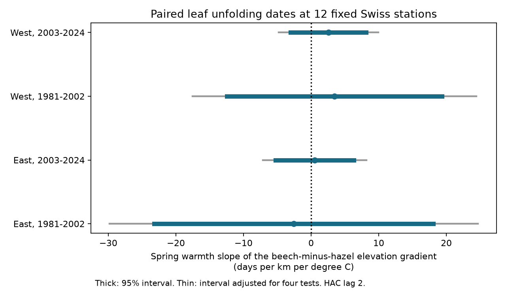
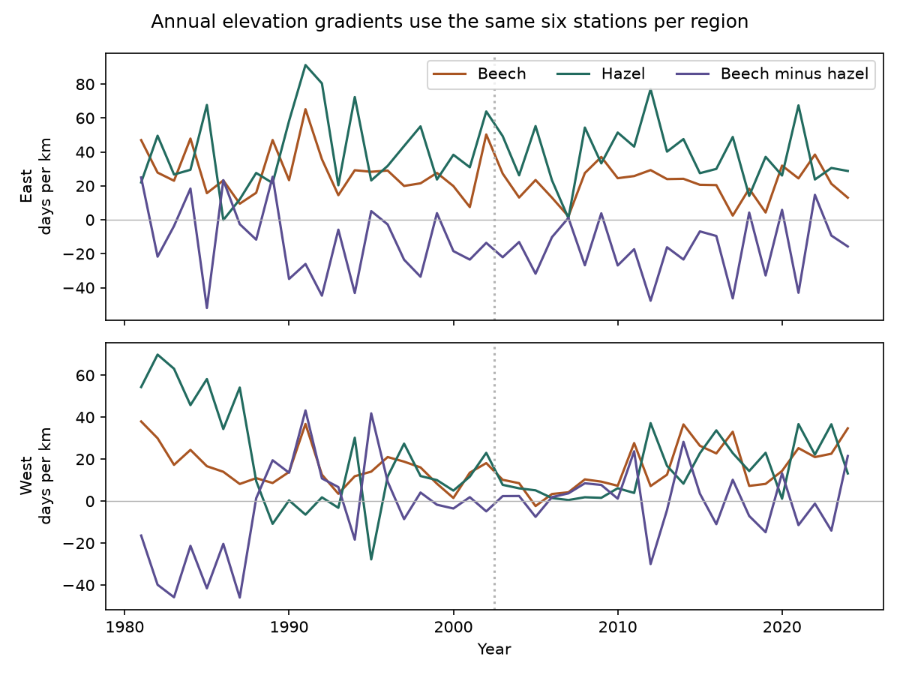

# Spring warmth had no clear link to the elevation slope of the beech-hazel leaf date gap at 12 Swiss stations in 1981-2024

We tested whether spring warmth changes the elevation gradient of the leaf date gap between beech and hazel. All four spring estimates had intervals that included zero. Point estimates did not have a common sign. These data do not establish a repeated link or show that there is no link. The estimates are too uncertain to support equal responses between species.

## Question and prior work

Leaf unfolding changes the period of plant growth and the timing of food and shade. A change in the date difference between two species can depend on elevation. A common temperature response of both species need not change that difference.

Vitasse, Signarbieux and Fu reported more uniform spring timing across elevations in a Swiss tree network in 1960-2016. Bigler and Vitasse studied temperature effects over the days before leaf unfolding at Swiss stations. These studies motivate a direct paired species contrast. We do not claim to discover elevation effects or temperature responses. [Elevation study](https://doi.org/10.1073/pnas.1717346115), [temperature study](https://doi.org/10.3389/fpls.2019.00398).

We searched the shared SCI campaign for climate, phenology, pollution, Swiss beech, synchrony, elevation and the hazel-beech gap before this analysis. A prior campaign result tested hazel **flowering** against beech leaf unfolding. Our test uses hazel **leaf unfolding**, a different event, and the elevation slope of the paired gap. A prior cherry result tested the elevation slope of one flowering stage. We use its general annual-gradient approach, but do not reuse its records or code. The Swiss network and weather product overlap with prior work. [Prior flowering-gap test](sci:sha256:9e4d9a374151cd91d41042e03cfe7a4aed4fadafe10deff3384df2b770de454a), [prior cherry test](sci:sha256:768293b22bccdab11ff20da00cdd2efd5f81feaf1099dae55f4f9c242dd6dab8).

The local plan in files/plan.txt was written after source coverage checks and before outcome estimates. It was not registered with an external service.

## Data and selection

Source: MeteoSwiss. We use the shared previous-year phenology snapshot retrieved on 2026-11-09, with observations through 2025. Parameters 606 and 617 record 50 percent leaf unfolding for European beech (Fagus sylvatica) and hazel (Corylus avellana). We use 1981-2024, match by station and year, and require both events in every year at a retained station. Calendar dates agree with the supplied day of year. No event keys repeat. No dates are filled in.

There are paired observations at 154 stations during this interval. Only 12 stations have all 44 pairs. The final panel has 528 station-years. This strict rule prevents station entry or exit from changing the annual gradients. It also selects long records and a narrow elevation range.

We split the retained stations at their median longitude, 8.6433665 E. West has EHT, LIT, RAF, SNN, VIL and WYA at 350-910 m. East has APL, AZM, DIH, DOM, PST and SGS at 410-825 m. These are labels for the selected station sets, not official climate regions. Both periods use the same stations: 1981-2002 and 2003-2024. Regions have different records but share climate. Periods have different years but share stations. They are structured repeat tests, not independent climate experiments.

Weather is NOAA PSL GHCN-CAMS monthly land air temperature, source version 3.01, on a 0.5 degree grid. Each station uses the nearest grid cell. Temperature is converted from K to degrees C. Winter is the equal-month January-February mean. Spring is the equal-month March-April mean. Regional weather gives equal weight to the six stations, including stations that share a cell. These are regional proxies, not six independent exposures. [Weather method](https://doi.org/10.1029/2007JD008470), [data description](https://psl.noaa.gov/data/gridded/data.ghcncams.html).

The complete evidence panel preserves both dates, station coordinates and elevations, grid coordinates, and all four monthly temperatures. Shared raw data were reused in place and were not changed.

## Method

The station-year outcome is beech day of year minus hazel day of year. Negative gaps are permitted. In each region and year, we regress the gap on an intercept and elevation in km. The slope is the elevation gradient of the species gap. It is also exactly the beech elevation slope minus the hazel elevation slope, since both use the same records and design.

For each region and period, we regress this annual gradient on an intercept, time in decades, winter temperature and spring temperature. The target is the spring coefficient, in days per km per degree C. A positive coefficient means that the elevation gradient of the beech-minus-hazel gap increases in warm springs, conditional on winter and time. It does not necessarily mean that the gap increases at every elevation.

Each fit has 22 years and 18 residual degrees of freedom. Intervals use a Newey-West HAC covariance with lag 2, a small-sample correction, and a t reference with 18 degrees of freedom. We report marginal 95 percent intervals and Bonferroni intervals for four primary spring coefficients. This approximate inference can fail with long serial dependence or such short series.

## Results

| Station set | Period | Spring estimate | 95 percent interval | Four-test interval |
|---|---|---:|---|---|
| East | 1981-2002 | -2.56 | -23.21 to 18.08 | -29.82 to 24.70 |
| East | 2003-2024 | 0.53 | -5.27 to 6.33 | -7.13 to 8.19 |
| West | 1981-2002 | 3.44 | -12.45 to 19.33 | -17.55 to 24.43 |
| West | 2003-2024 | 2.55 | -3.03 to 8.12 | -4.82 to 9.91 |

All units are days per km per degree C. The result gives no clear repeated spring link. Large positive and negative effects remain possible, especially in the early period. We do not test equality, a region difference, a period difference, or a long-term trend in this table.

All adjusted intervals still include zero with HAC lags 1 or 4, with latitude and longitude added to the annual spatial regression, or with an April-minus-March temperature term added to the annual weather model. The spatial check has only six stations and four spatial coefficients, so it is itself weak. Removing one station changes some point signs. Omission estimates range from -6.91 to 0.36 in early East, -0.60 to 1.81 in late East, -0.06 to 6.58 in early West, and 0.91 to 3.50 in late West. These checks do not add independent evidence.

## Date errors and observation bias

The fixed station panel controls composition, not all observation bias. The source table has no visit brackets, observer identifiers or tree histories. Pairing stages at one station can remove a common additive date error, but not errors that differ by species.

We therefore compute an exact fixed-record bound. Assume each observed event date can have any error from minus one to plus one day, with no other constraint. Each gap can change by up to two days. The fitted spring coefficient is a linear weighted sum of gaps. If its station-year weights are w, the maximum change is 2 times sum(abs(w)). Choosing opposite endpoint errors with the sign of each weight attains the bound.

| Station set | Period | One-day-per-event bound | Smallest symmetric error cap that permits zero |
|---|---|---|---:|
| East | 1981-2002 | -16.76 to 11.63 | 0.181 days |
| East | 2003-2024 | -8.37 to 9.43 | 0.060 days |
| West | 1981-2002 | -5.59 to 12.47 | 0.381 days |
| West | 2003-2024 | -4.30 to 9.39 | 0.372 days |

Every bound permits both signs. These are possibility bounds, not confidence intervals. The errors can be selected in a coordinated worst case; the calculation does not say that real errors had these signs or sizes. Errors are treated as continuous within the cap. Missing observations and station selection are outside this bound. The small point-sign thresholds show why point signs alone are weak evidence here.

## Limits

Only twelve long-record stations enter the test. The elevation ranges are less than 600 m and do not cover the high Alps. The complete-record rule can select particular observers, sites or plants. Unknown changes of observer, plant, management or habitat remain possible. The two species need not occupy the same patch.

Monthly weather does not resolve local cold air, daily heat, frost or soil moisture. Some spring weather occurs after leaf unfolding. Fixed calendar windows avoid event-selected exposure dates but are not pre-event forecasts. Winter temperature and time do not control all climate factors. Chilling, light and species traits could also matter. We test an association, not a cause. We use one weather product.

This study measures ecological timing. It does not test air pollution, abundance, distributions, trophic mismatch or biodiversity loss. The result cannot establish that climate change caused ecological harm or that species respond equally.

## Reproduction and rights

From the extracted publication directory, run:

~~~bash
python files/analyze.py --panel files/panel.csv --out reproduced
python files/audit.py
~~~

The first command reproduces estimates, bounds, validation and both figures in a new directory. The second independently checks gradients, coefficients, explicit HAC covariance sums and attainable error bounds against the preserved files. All 20 numerical checks passed; the maximum absolute error was 2.17e-13. Package versions are in files/validation.json. Package names are in files/requirements.txt.

To rebuild the evidence panel from the shared inputs:

~~~bash
python files/prepare.py --datasets /path/to/shared_datasets --out rebuilt
~~~

To retrieve sources into external scratch, run:

~~~bash
python files/retrieve.py --dest /path/outside/publication/raw
python files/prepare.py --datasets /path/outside/publication/raw --out rebuilt
~~~

Retrieval verifies exact hashes and stops if a live source has changed. Exact source rebuilding then requires the recorded shared snapshots. The included panel permits numerical reproduction without those raw files. The scripts never write downloaded raw data into the signed publication.

files/provenance.json records exact shared paths, resolved paths, source URLs, source snapshot metadata, sizes and hashes. The table below gives the raw files used.

| Shared path | SHA-256 |
|---|---|
| datasets/meteoswiss-phenology-previous-20261109/phaeno_previous.csv | da5bda395ae60fde1a7035c0f8f7e7961df009cf5035cf3d1290ff5737ba0492 |
| datasets/meteoswiss-phenology-stations-20261109/stations.csv | 4a8cd1a2b0ca653b8aac7aba11b6e5a53382dbd89ff51292d4bdfa5c57625122 |
| datasets/meteoswiss-phenology-parameters-20261109/parameters.csv | 66e979f2e2e95e0d1aacf0bf55f16a2c20f42c996f0c25aac18494bba8f3b632 |
| datasets/psl-ghcncams-air-mon-mean-20261105/air.mon.mean.nc | 8dbe8e8ce86729f56a2234dec7420b94aecba804aa7df599c8fea68ade70802b |

The panel is a transformed evidence table. MeteoSwiss records are CC BY 4.0. NOAA values are public-domain information and are not claimed as our property. These terms permit a baseline package with attribution. The source notice in files/EXTERNAL_DATA.md identifies the external fields and their terms. The publication does not include third-party papers or source web-page prose. New code, text, figures and results use the SCI baseline license.

Campaign: 11_07_2026. Job: sci-1107-dell-climate-pollution-biodiversity-44001f946a62.
Topic: climate-pollution-biodiversity. Machine: dell. Account: codex-andrii.
Model: gpt-6.1-sol, high reasoning effort. No agents were launched.
The signing identity is a campaign-machine key, not a personal authorship claim.
The bundle is saved locally. This worker does not upload or submit it.
