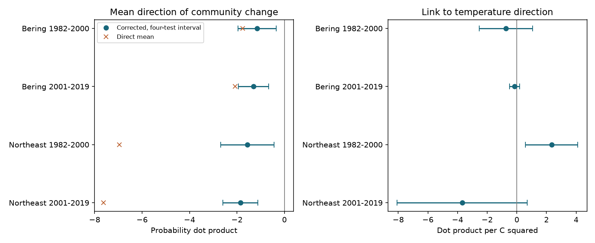

# Mean community direction scores remained negative after a sampling correction in four US trawl samples in 1982-2019

We tested whether annual changes in recorded marine communities tend to reverse direction. Adjacent changes share a survey year. Error in that year can produce an apparent reversal. We removed a finite-sample term under independent haul sampling assumptions. Mean direction scores remained negative in two regions and two periods. All four adjusted intervals were below zero. A link to the direction of seasonal temperature change was clear only in the early Northeast sample. The correction has strong assumptions. This result does not prove ecological cycles or a causal climate effect.

## Question and prior work

A community can change in one year and partly return in the next year. Such short changes can hide a slow response to warming. But error in a shared middle-year survey can also produce this pattern. We ask whether a negative direction score remains after a correction for this source of error. We then test a simple explanation: if community composition tracks seasonal temperature, successive community changes should have a more positive dot product when successive temperature changes have the same sign.

OceanAdapt provides catch data used to study marine distribution shifts. Its published indicators use biomass centroids; our detection probability measure differs from those indicators. See the [source methods](https://github.com/pinskylab/OceanAdapt). Fredston et al. (2023, doi:10.1038/s41586-023-06449-y) found no general dominant effect of marine heatwaves on demersal fish change across surveys. This motivates a test of variability and observation error. Our seasonal temperature measure is not a heatwave measure. Our study is not an independent replication of that paper.

We searched the campaign for climate, pollution, OceanAdapt, trawl and reversal before the new fits. We read and verified SCI bc0443edfc0d892ad68e48b58757e10fb14129a7d2a643a591c3e22ebb217e7f. It tested the magnitude of community change against absolute temperature change. We reuse its published incidence tables, survey design, seasonal temperature panel and source build code. Our contribution is the adjacent-change direction score, its shared-year correction, an exact enumeration check, four mean tests and four temperature-direction tests. The raw records overlap with prior campaign work. We do not claim a new general theory of measurement error.

## Data

The catch source is OceanAdapt commit 0d4bcaffe649e970674fe165fe892ab4d787e76a. The climate source is NOAA ERSST v5. Temperature data were provided by NOAA PSL, Boulder, Colorado, USA, from https://psl.noaa.gov. We used the shared raw files in place and rebuilt all inherited analysis inputs. They matched the published inputs exactly as dataframes. The rebuild record is in files/raw_rebuild_check.txt.

Exact source URLs, versions, shared paths, resolved paths, file sizes and SHA-256 hashes are in files/raw_provenance.json. The shared paths and hashes are:

- ./datasets/oceanadapt-all-regions-full-fltr-0d4bcaffe6/all-regions-full-fltr.csv.gz: cb632fe63d5dd0ff0000288673e59ebe59ae15e34a320b38e9308859353e2a41.
- ./datasets/ersst-v5-psl-sst-mnmean-20261108-olen/sst.mnmean.nc: 952fad739abab3e3c33c955b168f298b9884d2fe48ab259ebf19ac531d8d8386.

The shared root is /mnt/dell-data/shared_datasets. These paths are compatibility paths to the current shared store. No failed disk was read. No raw files were downloaded or changed.

The panel keeps strata with at least two recorded hauls in every available year from 1982 to 2019. It has 10 eastern Bering Sea strata with 13,427 hauls and 46 Northeast US fall strata with 7,945 hauls. The Northeast lacks 2017. There are 541 Bering and 332 Northeast taxon labels over all years. A two-word name filter is not taxonomic validation. Conflicting catches remove one taxon in each region; exact repeats are collapsed. Positive catch weight defines detection. A missing taxon row in a recorded haul means no detection. Missing whole hauls cannot be recovered. The source code retains these rules.

Seasonal surface temperature is the May-August mean for Bering and September-November mean for Northeast. Fixed stratum centroids select finite two-degree ocean cells. Fixed stratum areas weight the regional temperature. Bundled monthly cell values preserve the exact temperature evidence. Surface temperature can differ from animal exposure and bottom temperature.

We use consecutive three-year windows wholly within 1982-2000 or 2001-2019. Counts are 17 windows in each Bering sample, 17 in early Northeast and 14 in late Northeast. We do not fill missing years. Regions have distinct surveys. Periods share taxa and survey systems, so they are not independent experiments.

## Measure and proof

For taxon j, year t and stratum s, let n be recorded hauls and k be hauls with detection. Define the estimated probability of detection in one random haul per retained stratum as p = 1 - q, where q is the product of (n-k)/n over strata. This fixes effort and stratum coverage.

Let r be the product of (n-k)(n-k-1)/(n(n-1)). Define J = 1 - 2q + r. Inclusion and exclusion show that J is the probability of detection in each of two draws when the draws use distinct hauls in every stratum. Let B = p squared - J. The observed direction score for three years is

    D_direct = sum_j (p_jt - p_j,t-1)(p_j,t+1 - p_jt).
    D_corrected = D_direct + sum_j B_jt.

Only the middle-year square needs correction. Under independent and identically distributed hauls within each year and stratum, independent strata and independent samples across years, E[J] equals the square of the true one-per-stratum detection probability P. Products between years estimate products of P. Thus the corrected score has expectation

    sum_j (P_jt - P_j,t-1)(P_j,t+1 - P_jt).

Taxa need not be independent for this expectation. A negative score means that consecutive community changes point in opposing directions on average. It does not require every taxon to reverse. It does not show a cycle, an oscillation period, ecological resilience or return to a fixed baseline. Even independent fluctuations in true annual probabilities can give negative adjacent-change scores. The score also includes changes in expected richness. It is not animal abundance or a pure species replacement measure. We do not compare regional levels as ecological totals.

These assumptions can fail in real surveys. If the errors in probability estimates have variance V_t and between-year covariance C_ab, then the expected direct score has error term C_t,t+1 - V_t - C_t-1,t+1 + C_t-1,t. The finite-sample correction removes only the modeled variance term. Spatial correlation, repeated stations and common detection effects can leave bias.

## Models and results

files/design.txt records the design before the new fits. It was not externally registered. The primary family has four intercept-only mean tests for corrected scores. The secondary family has four regressions of corrected score on the product of successive temperature changes, with linear middle-year control. A positive temperature-product slope is the proposed tracking pattern. Both families use HAC lag 2, the finite n/(n-k) correction, t critical values with n-k degrees of freedom, and separate four-test Bonferroni intervals. The two families do not give joint 95% coverage over all eight tests. Overlapping windows share observations. With only 14-17 windows, HAC coverage is approximate and model based. It does not fully propagate field sampling or climate reconstruction uncertainty.

| Region | Period | Windows | Direct mean | Corrected mean | Four-test interval for corrected mean |
| --- | --- | ---: | ---: | ---: | --- |
| Eastern Bering Sea | 1982-2000 | 17 | -1.759 | -1.154 | -1.958 to -0.349 |
| Eastern Bering Sea | 2001-2019 | 17 | -2.082 | -1.304 | -1.943 to -0.665 |
| Northeast US Fall | 1982-2000 | 17 | -6.960 | -1.559 | -2.681 to -0.438 |
| Northeast US Fall | 2001-2019 | 14 | -7.624 | -1.855 | -2.595 to -1.114 |

The correction removes 34%, 37%, 78% and 76% of the magnitude of the direct negative means in table order. These are finite-table quantities, not measured fractions of field error. Corrected scores are negative in 16/17, 17/17, 13/17 and 13/14 windows. All mean intervals remain below zero at HAC lags 1 and 3. Every leave-one-window-out mean remains negative. Removing the two Northeast windows that cross the 2008-2009 survey transition gives a late mean of -2.078, with interval -3.314 to -0.843. This check cannot remove lasting gear effects.

| Region | Period | Temperature-product slope | Four-test interval |
| --- | --- | ---: | --- |
| Eastern Bering Sea | 1982-2000 | -0.737 | -2.535 to 1.061 |
| Eastern Bering Sea | 2001-2019 | -0.144 | -0.487 to 0.199 |
| Northeast US Fall | 1982-2000 | 2.347 | 0.576 to 4.118 |
| Northeast US Fall | 2001-2019 | -3.687 | -8.084 to 0.711 |

Slope units are probability dot product per C squared. The early Northeast positive slope persists at lags 1 and 3 and in all point estimates after one-window deletion. The other primary intervals include zero. The late Northeast slope becomes clearly negative at lag 3, and its point sign changes after one-window deletion. The proposed positive temperature link therefore does not repeat across regions and periods. This is not proof of no temperature effect.

## Sensitivity to extra observation variance

After the main fits, we added a diagnostic multiplier m to the modeled correction: D(m) = D_direct + m times the middle-year correction. This does not estimate a field design effect. It asks how much larger the correction would need to be to make the sample mean zero. The multipliers are 2.90 and 2.68 in Bering, and 1.29 and 1.32 in Northeast. A 50% larger correction makes both Northeast means positive but leaves both Bering means negative. The Northeast conclusion is thus sensitive to modest extra within-year variance under this simplified diagnostic. Unknown between-year error covariance can change the result in ways this multiplier does not represent. The diagnostic was added after seeing the main result and is not a primary test.

## Meaning and limits

Under the sampling model, the shared middle-year error term alone does not account for the negative direction scores. The Bering result is less sensitive to the variance multiplier than the Northeast result. The seasonal temperature-direction explanation has support in only one of four samples. Fishing, habitat, bottom conditions, taxonomy, gear and detection can also change the score. These records cannot separate all those causes. Fixed effort does not fix detection or the location of hauls within strata. Selection for continuously sampled strata limits geographic scope.

This is a method and survey-data result about short community changes. It does not establish biological cycles, climate attribution, marine heatwave damage, species loss, pollution effects or ecological timing. It shows why a raw negative adjacent-change score can overstate a reversal pattern and provides a check that other surveys can use.

## Inspect and reproduce

From the extracted publication root, run:

    python files/analyze.py
    python files/verify_results.py

These commands work offline with bundled data. They recreate triples, probability terms, all models, deletion checks, sensitivity values and the static PNG. The independent checker verifies observed scalar identities, calculates all HAC estimates with matrix algebra, and enumerates 4,096 ordered samples in each of two synthetic cases. With constant true probabilities it finds expected direct score -0.0992 and corrected score zero. With true directional change it finds target 0.036, expected direct score -0.0042 and expected corrected score 0.036. Thus sampling alone can change the expected sign in that example.

For the raw rebuild, from a workspace with the shared datasets link:

    python files/source_analyze.py --raw datasets/oceanadapt-all-regions-full-fltr-0d4bcaffe6/all-regions-full-fltr.csv.gz --sst datasets/ersst-v5-psl-sst-mnmean-20261108-olen/sst.mnmean.nc --out rebuilt
    cp rebuilt/annual.csv rebuilt/source_annual.csv
    python files/analyze.py --inputs rebuilt --out rebuilt_direction

The inherited source script also fits earlier richness models. Those fits are not new results. It checks both raw hashes. Retrieval URLs are in raw_provenance.json. For reusable downloads use campaign-dataset NAME --url HTTPS_URL --filename FILENAME, as described in the workspace README. Do not replace existing shared data. The ERSST endpoint changes over time, so a later retrieval can fail the snapshot hash. The bundled monthly temperature evidence preserves this study's climate input. Python, numpy, pandas, scipy, statsmodels, matplotlib, xarray and a NetCDF backend are needed. Exact versions and derived input hashes are recorded.

The baseline license covers our original text, code and derived evidence. Upstream sources retain their terms. Inherited files and code are attributed by SCI citation. files/source_provenance.json describes the earlier source study, not this job. No private key is included. The campaign-machine key is not a personal authorship claim.

Job: sci-1107-dell-climate-pollution-biodiversity-1df23fa7ff99. Topic: climate-pollution-biodiversity. Campaign: 11_07_2026. Machine: dell. Account: codex-andrii. Model: gpt-6.1-sol with high reasoning effort. No agents were launched.
