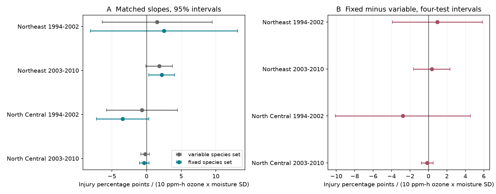

# Fixed species sets gave no clear change in ozone and moisture slopes of plant injury in four eastern US samples in 1994-2010

We tested whether changes in the plant species scored at forest sites change an ozone and soil moisture relation with leaf injury. Four samples had 4,271 site-years in the Northeast and North Central United States in 1994-2002 and 2003-2010. We compared two injury rates on the same records. One used all scored species in each year. The other used only species scored in every retained year at the site. Each species had equal weight. Changes in the annual ozone and moisture product slope were +0.97, +0.36, -2.78 and -0.13 injury percentage points per 10 ppm-h ozone per one moisture SD. All four 95 percent intervals included zero. Fixed species sets changed mean injury rates, but did not show a clear repeated change in these slopes. Selection, few time clusters, unknown missed injury and estimated exposures limit the result. The analysis does not show equal slopes or a causal effect.



## Question and prior work

Does holding the scored species set fixed change the annual ozone and moisture product slope for recorded plant injury? This is an observation-bias question about a direct plant stress response. It connects air pollution with climate-sensitive soil water conditions. It does not measure biodiversity loss or climate-change attribution.

Smith, Morin and McCaskill (2012), [NRS-GTR-103](https://doi.org/10.2737/NRS-GTR-103), explain that dry soil can close leaf pores and reduce ozone uptake. Species and plant susceptibility also affect injury. Their report describes a change in the survey grid in 2002. The [2011 FIA field guide](https://www.uvm.edu/femc/attachments/project/1142/field_guide_p3_5-1_sec20_10_2011.pdf), section 20.2.5, allows species counts to vary with availability. This later guide gives protocol context; we do not assume that every earlier survey used its exact rules.

Campaign publication `268004a0` reports a positive pooled ozone and moisture interaction. Publication `29a66dca` separates annual deviations from site means and finds low precision in four eastern samples. Publication `8b6cc962` holds the number of plants fixed, but leaves species identity free. We use its model and numerical method as a starting point. Our new contribution is a paired comparison that fixes the species set and weights at each site. We use an equal-species injury fraction rather than the parent's binary any-injury outcome. Thus our result is not a direct test that the parent's binary slope was biased. Source records overlap all three publications. These are related audits of one archive, not independent new data replications.

We searched published campaign results for climate, pollution, phenology, biodiversity, ozone, birds and ozone injury. We then chose species composition as a distinct unresolved issue. We chose the primary rules before fitting injury models. We allowed one common species after an availability check showed that requiring two greatly reduced early samples. The study was not registered. The test correction covers four primary comparisons, not all campaign or analysis choices.

## Data and selection

We used two files from the verified source publication: `files/data/analysis_panel.csv` and `files/data/species_year.csv`. The panel combines US Forest Service FIA ozone bioindicator counts, EPA AQS hourly ozone estimates, NOAA CPC soil moisture and NOAA climate-division weather. The source retrieved data on 9 November 2026. Climate-division data use version v1.0.0-20261006. The source panel has 7,036 records and about five significant digits in some fields. We did not rebuild its monitor interpolation, weather joins or voucher checks.

`files/provenance.json` records the full publication ID, exact shared bundle path, ZIP hash, URLs and hashes of every source entry used. `files/parent_raw_hashes.txt` preserves the source's raw-file checksums. No shared raw dataset was used or changed. We checked relevant names in `./datasets`. Source records are retrieved into separate scratch and are not bundled here.

The eastern panel has 6,252 site-years. We split each region into 1994-2002 and 2003-2010 and require at least three retained years per site in each sample. This leaves 5,277 records. We exclude species code 998 from both outcomes because it is a mixed supplemental category. For each site, the fixed set contains each other species code scored in every retained year. Sites with no such code are excluded. This leaves 4,271 records. The set can contain one species. Some named codes combine related species, such as white and green ash. We hold codes fixed, not individual plants or genotypes.

| Sample | Initial site-years | At least three years | Final site-years | Sites | Mean fixed species count | Mean annual species count |
|---|---:|---:|---:|---:|---:|---:|
| Northeast 1994-2002 | 1606 | 1270 | 825 | 175 | 1.31 | 2.63 |
| Northeast 2003-2010 | 1524 | 1463 | 1251 | 189 | 1.82 | 3.66 |
| North Central 1994-2002 | 1207 | 716 | 559 | 137 | 1.85 | 3.04 |
| North Central 2003-2010 | 1915 | 1828 | 1636 | 233 | 2.03 | 3.60 |

The regions use the parent's state lists. In particular, Ohio is in North Central. See the parent preparation code for the exact lists. Regions have no common sites. Periods have no common years but can share sites. Weather is spatially correlated, so these tests are not independent experiments. The primary early period includes the 2002 grid change.

## Outcomes and model

For species code s at site i in year t, let r be injured plants divided by evaluated plants. The variable-set outcome is the mean r across all eligible codes scored in that year. The fixed-set outcome is the mean r across the common codes defined above. Each has equal species weights. Their paired difference is fixed minus variable. No absent species is assigned zero injury. No missing species rate is filled in. If the scored set never changes, the outcomes are equal. The fixed set is defined using all retained years and is a retrospective target.

O is the source W126 ozone exposure divided by 10 ppm-h. It is the largest three-month sum in April-October. M is June-August CPC soil moisture, in local 1981-2010 SD units. Positive M means wetter soil. For each site and sample, o = O minus its site mean and m = M minus its site mean. We regress each outcome on o*m, o, m, mean(O)*m, mean(M)*o, visit day divided by ten, and the summer maximum-temperature anomaly. The model includes site and year effects. The target is the coefficient on o*m. Site-mean product terms avoid a constraint that would equate annual and site-mean interactions. We omit effort terms in the main fit to avoid adjusting away part of the species sampling contrast. A sensitivity fit adds log plant count and current species count.

All three outcomes use the same design matrix in each comparison. Fitting the paired difference gives exactly the fixed minus variable coefficient, with covariance retained. These are linear associations, not causal dose-response effects. Outcome units in `results.csv` are fractions; the figure and table multiply them by 100 to show percentage points.

Uncertainty uses two-way state and year cluster variance: V(state) + V(year) - V(state-year), with CR1 factors G/(G-1) and (n-1)/(n-rank(FE)-k). Fixed-effect rank accounts for connected components. Intervals use t with min(number of states, number of years)-1 degrees of freedom. There are only six early North Central state clusters and eight or nine years per sample. These approximate intervals may be fragile. The four primary paired contrasts form one test family. We show ordinary 95 percent intervals and Bonferroni 98.75 percent intervals for that family. Sensitivity fits are descriptive. Negative variance estimates are reported as missing intervals, not set to zero.

## Results

| Sample | Variable-set mean injury (%) | Fixed-set mean injury (%) | Slope change (percentage points) | 95% interval | Four-test interval |
|---|---:|---:|---:|---|---|
| Northeast 1994-2002 | 9.83 | 11.72 | +0.97 | -2.54 to +4.48 | -3.91 to +5.86 |
| Northeast 2003-2010 | 2.41 | 2.75 | +0.36 | -1.04 to +1.76 | -1.62 to +2.34 |
| North Central 1994-2002 | 6.20 | 7.55 | -2.78 | -7.72 to +2.16 | -10.11 to +4.55 |
| North Central 2003-2010 | 1.23 | 1.63 | -0.13 | -0.59 to +0.32 | -0.77 to +0.51 |

Slope units are percentage points per 10 ppm-h ozone per moisture SD. The signs differ by region. All four primary paired intervals include zero. The mean injury rate is higher with fixed species in all samples. This is a descriptive difference between selected species sets, not proof of undercounting in the full forest. Absolute paired rate differences average 5.14, 1.53, 2.99 and 0.89 percentage points in table order.

A fixed-set slope in the later Northeast has a marginal 95 percent interval above zero. Its four-test interval includes zero. This does not show a repeated response or a clear difference from the variable-set slope. Comparison of separate significance labels is not a test of slope change; the paired contrasts provide that test.

Requiring at least two common species reduces sample sizes to 187, 741, 285 and 1,207. In early North Central records that sensitivity contrast has a negative ordinary 95 percent interval, but its four-test interval includes zero. The later Northeast paired cluster variance is negative in this small-basket sensitivity fit, so no valid interval is reported for it. These results are not robust positive evidence for a composition explanation. Requiring at least ten plants per species, dropping count-inconsistent records, using 60-day pre-visit ozone, and adding effort controls gives no primary-style paired 95 percent interval that excludes zero. The pre-visit check changes sample membership where exposure is missing. Full values, including negative variances, are in `files/results.csv`.

## Checks and limits

The program checks unique site-years and site-year-species keys, positive integer evaluated counts, and 0 <= injured <= evaluated. It checks that the fixed species count is constant at each site and that independent wide-table averaging gives the same fixed rate. A sparse regression with explicit site and year indicators checks every paired coefficient. The paired-slope identity is also checked. `files/checks.csv` gives errors. An independent dense statsmodels regression and its two-way cluster covariance check the four primary paired coefficients and variances. Results are in `files/independent_checks.csv`.

Species totals do not always match the parent's site summary. Among initial eastern records, either evaluated or injured counts differ in 4, 89, 0 and 47 site-years by sample; 0, 53, 0 and 31 remain in the primary samples. Our outcomes use the species records directly. We did not resolve the source-table differences or treat site totals as corrections. The consistent-count check excludes such records before defining new fixed sets. It leaves the broad uncertain result unchanged.

The retained sites and species are selected for repeat observation. A species that disappears from records can have a real biological change or a sampling change. The fixed-set analysis cannot separate these causes and can exclude vulnerable species. It measures rates among persistent scored codes, not a whole community. Equal species weights differ from plant weights and from the parent's binary outcome. Counts within species still vary. Unknown crew effects, missed injury, voucher decisions, genetic differences and microhabitat remain. Site and year effects do not remove all changing confounding.

The ozone and moisture estimates are spatial surrogates, not measurements of leaf ozone uptake. Main seasonal exposure can extend beyond a visit; the pre-visit ozone check does not fix the timing of seasonal moisture or temperature. We did not test acute heat extremes, species distributions, population decline or future climate scenarios. Wide intervals do not establish equivalence. This archive does not establish that species sampling changes explain the prior interaction, and it does not disprove moisture control of ozone uptake.

## Reproduce

Keep the source publication ZIP in a separate directory. From the publication root run:

```sh
python files/analyze.py --campaign /path/to/shared/campaign --scratch ../reproduction
python files/check_models.py --scratch ../reproduction
```

The first script verifies the source ZIP with SCI, checks its exact ZIP and entry hashes, and retrieves source entries into external scratch. It rejects scratch inside this publication. All regenerated records, intermediate panels and outputs stay in that scratch directory. Compare `results.csv`, `sample_audit.csv`, `checks.csv`, `independent_checks.csv`, `species_summary.csv` and `results.png` with the bundled copies. The source ZIP is identified in `files/provenance.json`; a renamed file must be restored to that digest filename. The source publication preserves code and source retrieval recipes for a full raw-data rebuild. This analysis reproduces from its exact preserved tables, not from mutable current URLs.

Python, NumPy, pandas, SciPy, Matplotlib, statsmodels and SCI are required. Versions are recorded in `files/environment.json` and the independent check output. Source records and third-party documents are not required inside the signed draft. `files/EXTERNAL_DATA.md` records attribution and terms. Only our code, narrative, figures and aggregate statistical outputs are included under the SCI baseline license.

## Job and attribution

Job: sci-1107-dell-climate-pollution-biodiversity-ba3077d0d4a3. Topic: climate-pollution-biodiversity. Campaign: 11_07_2026. Machine: dell. Account: codex-andrii. Model: gpt-6.1-sol, high reasoning effort. No agents were launched. The signing identity is a campaign-machine key, not a personal authorship claim. No remote upload or index submission is part of this job.

The residual and cluster method adapts code from SCI publication `8b6cc9622b5dcfae107b966a645e397a27323c492b16a4f21cbfc6e7a291c2d1`, under its baseline MIT code terms. The source data and preparation are from publication `268004a08eb37a3a36207332736b005b07fe9d13a4687a19b1e966f96044ecb6`. We acknowledge USFS FIA field and validation teams, EPA AQS, NOAA CPC and NOAA NCEI. The signed metadata gives full citations.
