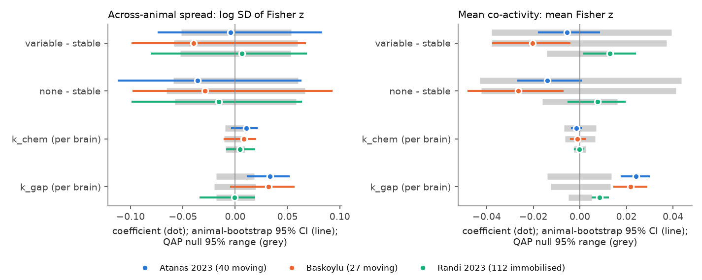
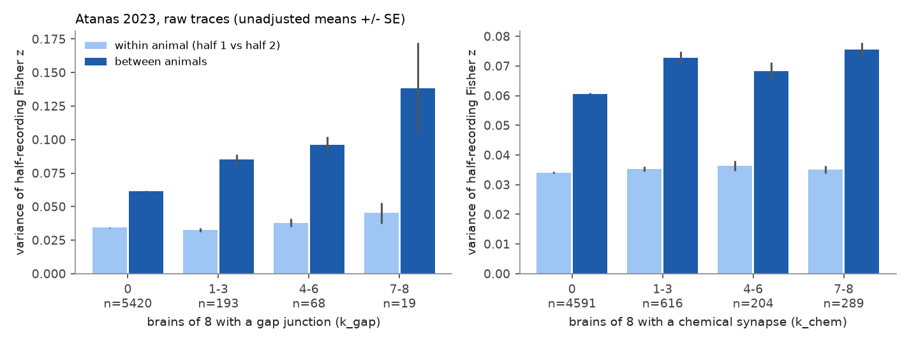
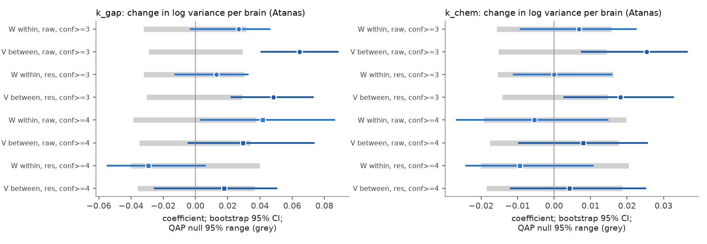

# Variable chemical wiring across 8 C. elegans brains did not predict more variable co-activity across animals; gap junctions in more brains gave stronger, and in moving worms more variable, co-activity

## Summary

Witvliet et al. (2021) reconstructed eight C. elegans brains, from L1 to adult. Some chemical connections occur in almost all brains ("stable"). Many weak connections occur in only a few brains ("variable"). We asked if this wiring variability between individuals shows in the activity of other individuals: do neuron pairs with variable wiring have co-activity that varies more from animal to animal?

We linked the eight connectomes to the pair correlations of identified neurons in three whole-brain calcium imaging data sets: Atanas et al. 2023 (40 freely moving animals; primary), Baskoylu (27 freely moving animals) and Randi et al. 2023 (112 immobilised animals with optogenetic stimulation). Kato et al. 2015 (12 animals, 504 pairs) is reported only as a descriptive check. For each pair we measured the mean co-activity (mean Fisher z over animals) and its spread across animals (log SD of Fisher z). All models control for adult synapse and gap junction counts, a fixed effect for each neuron, soma distance, ganglion, homologous pair, the number of animals, and (for the spread) a spline of the mean. Inference uses 2,000 QAP permutations of neuron identities and 1,000 animal bootstraps. The plan (`files/PLAN.md`) was written before any outcome was computed.

Main results:

1. **H1, not supported.** Pairs with only variable chemical connections did not have a larger spread across animals than pairs with a stable connection of the same adult strength. Atanas: log SD difference −0.004 (bootstrap 95% CI −0.073 to 0.082; QAP p = 0.84). Baskoylu: −0.040 (−0.098 to 0.067; p = 0.19). Randi: +0.006 (−0.080 to 0.068; p = 0.81). With behaviour-removed traces in Atanas, the difference was negative (−0.060, p = 0.036), which is the opposite direction to the hypothesis.
2. **H2, opposite direction for gap junctions.** Each additional brain (of 8) with a gap junction between the two neurons increased the across-animal SD by 3.3% in Atanas (log SD +0.033 per brain, CI 0.012 to 0.051, QAP p = 0.0005, Holm p = 0.003) and by 3.2% in Baskoylu (QAP p = 0.001; bootstrap CI −0.004 to 0.056). It had no effect in the immobilised Randi data (−0.0005, p = 0.94). The count of brains with a chemical synapse gave a small positive effect in Atanas (+0.011, p = 0.024, Holm p = 0.094) and no clear effect in the replications. Thus stereotyped wiring did not give more uniform co-activity across animals.
3. **H3, gap junction stereotypy predicts mean co-activity beyond adult counts.** Each additional brain with a gap junction increased the mean Fisher z by 0.024 in Atanas (CI 0.018 to 0.030; Holm p = 0.005), 0.022 in Baskoylu (p = 0.002) and 0.009 in Randi (p = 0.0015). Chemical-synapse stereotypy and the stable-versus-variable class gave no consistent change in the mean.
4. **H4, null.** Neurons with a larger share of adult chemical synapses in variable connections did not have a less consistent co-activity profile across animals (partial Spearman −0.13, p = 0.21, 115 neurons in Atanas; −0.09, p = 0.38 in Baskoylu; 0.03, p = 0.76 in Randi).
5. **Post hoc decomposition (Atanas raw traces, added after the first results).** We split each recording into two halves. In all labelled data (label confidence ≥ 3), the gap junction effect was in the between-animal variance (log V +0.065 per brain, p = 0.0005) more than in the within-animal half-to-half variance (log W +0.027, p = 0.09). But with only high-confidence labels (≥ 4; 3,650 pairs) the two parts rose by similar amounts (log W +0.042, p = 0.03; log V +0.030, p = 0.10). Thus we cannot separate true individual differences from neuron-label errors and within-recording changes. The animal's reversal fraction did not explain the extra spread.

## Background and prior work in this campaign

Witvliet et al. (2021, doi:10.1038/s41586-021-03778-8) found a stable core of chemical connections and many variable, mostly weak, connections between individuals. They classified each connection as stable, developmentally dynamic or variable. It is not known if this anatomical variability has a functional counterpart.

This campaign has five related C. elegans publications. a250df14 (sci:sha256:a250df14782a179b8bee744662c1a654f7fcf33a416f07366774b9b9bb58ab5a) showed that gap junctions, but not chemical synapse weight after neurite contact, predict pair co-activity in the Atanas data. fea404fc (sci:sha256:fea404fc826486791a933e7997984e6864538661c3296f9983f3c22227c76e3e) replicated this in Baskoylu and Kato, with a weak link in Randi. 7764c3fd (sci:sha256:7764c3fd656f8a0afe85d50fd7400030e7f33bca671aee510f4ac5373f42ec70) found that presence of a chemical edge in both adult Witvliet maps did not improve prediction of Randi evoked responses. fc45a3bb (sci:sha256:fc45a3bbacfe312efc4feb894ffe1069894afd046e9d4dab9f1dba9dcc0e9f69) measured homologous synapse count variability in worms and flies. bcd56cbb (sci:sha256:bcd56cbbaf2b2a6017163f45c5983596ff749473db319cb2d95cfad91faaaaa6) tested neuropeptide routes. None of these used the eight-brain stereotypy, the Witvliet classification or the across-animal spread of co-activity. We reuse the per-animal pair correlation tables of a250df14 and fea404fc without change.

## Data

| Item | Source | Use |
|---|---|---|
| 8 connectomes | Witvliet et al. 2021, GitHub dwitvliet/nature2021 commit 0646af9d, `data/nemanode/witvliet_2020_{1..8}.json` | chemical synapse and gap junction counts per cell pair and brain |
| Connection classes | same commit, `tables/connection_classifications.csv` | stable, developmentally dynamic, variable, post-embryonic |
| Neuron types | same commit, `tables/_neurons.csv` | type and embryonic/post-embryonic origin |
| Atanas pair r | sci:a250df14 `files/results/activity/pairs.csv.gz` (from Zenodo 19388374 `processed_h5.tar.bz2`) | 40 animals, label confidence ≥ 3 |
| Baskoylu, Randi, Kato pair r | sci:fea404fc `files/results/act/{baskoylu,randi,kato}/pairs.csv.gz` | 27, 112 and 12 animals |
| Atanas raw traces | Zenodo 19388374 `processed_h5.tar.bz2` (SHA-256 c93e0cea…c8) and `neuropal_label.json.bz2` | split-half analysis only |
| Soma positions, contact, ganglia | sci:a250df14 derived tables (OpenWorm atlas, Witvliet Dataset 8 contact, Atanas NeuroPAL regions) | controls |

All hashes are in `files/provenance/`. `files/PROVENANCE.md` gives the job, machine, model and retrieval steps.

Selection: we kept embryonic-born neurons that are endpoints in Witvliet Dataset 8 (162 neurons) and dropped pairs with a post-embryonic neuron. Pairs had to be seen in ≥ 5 animals. Analysis sets: Atanas 5,700 pairs / 115 neurons (378 stable, 111 dynamic, 620 variable, 4,591 without a chemical connection; 280 with a gap junction in ≥ 1 brain), Baskoylu 5,898 / 118, Randi 7,292 / 134, Kato 504 / 36.

## Methods

Structure (`files/code/01_structure.py`). For each unordered pair: `chem_class` is the most stereotyped Witvliet class over the two directions (stable > dynamic > variable > none). Note that Witvliet classes are defined on left/right-pooled cell classes, so a "stable" cell pair can be present in fewer than 7 brains. `k_chem` and `k_gap` count the brains (of 8) with ≥ 1 chemical synapse (either direction) or ≥ 1 gap junction. `s_chem` and `s_gap` are mean adult (Datasets 7 and 8) counts.

Pair models (`files/code/02_pairs.py`). Outcomes: log SD of Fisher z over animals (spread), mean Fisher z (mean), log median absolute deviation and sign consistency (robustness). Controls: homologous pair, same ganglion, soma-distance deciles and log distance, log number of animals, a fixed effect for each neuron (a_i + a_j), and for spread outcomes a cubic B-spline (5 knots) of the mean. Structure terms in all models: log1p(s_chem), log1p(s_gap), gap present. Model "class" adds dummies dynamic, variable and none (reference stable); model "k" adds k_chem and k_gap. Coefficients come from Frisch–Waugh–Lovell OLS. QAP: 2,000 joint permutations of neuron identities of all structure variables, outcome and non-structure controls fixed; two-sided p (minimum 1/2001). Animal bootstrap: 1,000 resamples of animals, outcomes recomputed, 95% percentile intervals. Holm correction over six primary coefficients in Atanas.

Neuron model (`files/code/03_neuron.py`). For each neuron and each pair of animals, we correlated the neuron's z values over ≥ 10 common partners and averaged over animal pairs. Predictor: share of the neuron's adult chemical synapses (in + out) in variable connections. Partial Spearman with type and log number of animals; 10,000 within-type permutations.

Post hoc decomposition (`files/code/04_halves.py`, `files/code/05_decomp.py`). From the Atanas raw traces (same labels and behaviour design as a250df14; full-recording r matches the reused table exactly), we computed r in the first and second half (800 frames each). Per pair: W = mean over animals of (z1 − z2)²/2 (within-animal variance of a half-recording z), V = mean of the across-animal variances of z1 and z2, IND = V − W. Same models and inference. Run for label confidence ≥ 3 and ≥ 4. `files/code/07_behaviour_check.py` relates per-pair z to the animal's reversal fraction.

## Results

**Figure 1.** Pre-specified coefficients in the three main data sets (raw traces, ≥ 5 animals). Left: across-animal spread (log SD of Fisher z). Right: mean Fisher z. Dots: estimates. Coloured lines: animal-bootstrap 95% intervals. Grey bars: 95% range of the QAP permutation null. Class contrasts are relative to pairs with a stable connection; k terms are per brain of 8.

| Data set | Term | Spread (log SD) coef [boot 95% CI], QAP p | Mean (Fisher z) coef [boot 95% CI], QAP p |
|---|---|---|---|
| Atanas | variable − stable | −0.004 [−0.073, 0.082], 0.84 | −0.006 [−0.018, 0.008], 0.75 |
| Atanas | k_chem | +0.011 [−0.003, 0.021], 0.024 (Holm 0.094) | −0.001 [−0.003, 0.000], 0.69 |
| Atanas | k_gap | +0.033 [0.012, 0.051], 0.0005 (Holm 0.003) | +0.024 [0.018, 0.030], 0.001 (Holm 0.005) |
| Baskoylu | variable − stable | −0.040 [−0.098, 0.067], 0.19 | −0.020 [−0.037, −0.005], 0.29 |
| Baskoylu | k_chem | +0.008 [−0.010, 0.019], 0.12 | −0.001 [−0.004, 0.002], 0.74 |
| Baskoylu | k_gap | +0.032 [−0.004, 0.056], 0.001 | +0.022 [0.015, 0.029], 0.002 |
| Randi | variable − stable | +0.006 [−0.080, 0.068], 0.81 | +0.013 [0.002, 0.024], 0.068 |
| Randi | k_chem | +0.004 [−0.008, 0.018], 0.34 | −0.000 [−0.002, 0.001], 0.86 |
| Randi | k_gap | −0.000 [−0.033, 0.018], 0.94 | +0.009 [0.006, 0.012], 0.0015 |

Full tables: `files/results/primary_summary.csv` and `files/results/pairs/coef_*.csv`.

Robustness (`files/results/pairs/`). The k_gap spread effect stayed in Atanas with ≥ 10 animals (+0.031, p = 0.001), with neurite contact as a further control (+0.031, p = 0.001), with behaviour-removed traces (+0.027, p = 0.005) and with log MAD (+0.033, p = 0.017). In Baskoylu it was weaker with ≥ 10 animals (+0.020, p = 0.05) and with behaviour-removed traces (+0.016, p = 0.13). The k_gap mean effect stayed in all specifications (p ≤ 0.06). The variable − stable spread contrast was not positive in any specification. Kato (504 pairs, 36 neurons) gave unstable class coefficients (for example mean variable − stable +0.41) because few pairs are in each class; we do not interpret it.

**Figure 2.** Atanas, raw traces, label confidence ≥ 3. Mean within-animal variance W (first versus second half of the same recording) and between-animal variance V of a half-recording Fisher z, by the number of brains with a gap junction (left) or a chemical synapse (right). Unadjusted means ± SE over pairs. The mean co-activity also rises with k_gap, so the models below adjust for it.

**Figure 3.** Post hoc decomposition. Coefficients (per brain) of k_gap (left) and k_chem (right) for log W and log V, with the same controls as Figure 1. Circles: label confidence ≥ 3 (5,700 pairs). Squares: label confidence ≥ 4 (3,650 pairs). With all labels, the k_gap effect is mostly between animals. With high-confidence labels, the within-animal part is as large as the between-animal part.

Decomposition numbers (`files/results/decomp_conf3/`, `files/results/decomp_conf4/`): with confidence ≥ 3, the individual component IND rose by 0.0060 per brain with a gap junction (CI 0.0033 to 0.0075, p = 0.0005; mean IND about 0.028); with confidence ≥ 4, by 0.0022 (CI −0.0011 to 0.0054, p = 0.079). For behaviour-removed traces with confidence ≥ 4, IND still rose (0.0016 per brain, p = 0.017). Over all pairs, IND was 42% (raw) and 52% (behaviour removed) of V at the median.

Behaviour check (`files/results/behaviour_check_atanas.csv`): across animals, the reversal fraction explained on average 5–7% of the variance of a pair's z in every k_gap group. This is at the chance level for the number of animals.

**Figure 4.** Neuron level (H4). Share of adult chemical synapses in variable connections against the across-animal consistency of the neuron's co-activity profile. Partial Spearman controls for neuron type and number of animals.

## Interpretation

Variable chemical wiring between individuals did not give a detectable increase in the variability of co-activity between individuals. This agrees with the weak link between chemical synapses and co-activity that a250df14 and fea404fc found: if chemical connections have little effect on pairwise co-activity at this time scale, their presence or absence in an individual cannot change it much.

Gap junctions behaved differently. A gap junction that occurs in more of the eight brains predicts stronger co-activity than its adult count alone. A probable cause is that the eight-brain count is a better estimate of the connection in a typical animal than counts from two adult brains. It also predicts a larger spread of co-activity across freely moving animals, not a smaller one. Thus the neuron pairs with the most reproducible electrical wiring are the pairs whose co-activity differs most between moving animals. Possible causes are: (a) individual or state-dependent differences in electrical coupling strength (for example innexin expression or gating); (b) differences in behaviour or internal state between recordings that modulate coupled pairs; (c) occasional label errors, which remove the strong correlation of a coupled pair in some animals. The high-confidence-label analysis shows that (c) and within-recording changes can explain much of the effect. The effect was absent in immobilised, stimulated worms (Randi), which agrees with (b) but has other differences (strain, stimulation, processing).

The general rule "stereotyped structure gives reproducible function" is not supported at the level of pairwise co-activity in these data. Strong, stereotyped coupling can give a large but variable functional signal.

## Limitations

- Wiring and activity come from different animals. The test uses connection-level variability across 8 brains as a property of a pair. It cannot test whether an individual's own wiring explains its own co-activity.
- Only 19–29 analysed pairs have a gap junction in ≥ 7 brains; the k_gap effects rest on a few hundred gap-junction pairs. Witvliet gap junction annotation can be less complete in early (L1) datasets, which can lower k_gap for real connections.
- Across-animal spread mixes true individual differences, sampling noise, behaviour and state, and label errors. The spline of the mean and per-neuron effects control part of this. The split-half analysis exists only for Atanas (Baskoylu raw traces could not be downloaded: the Dryad file API returned "Unauthorized" and the web route returned 403).
- The decomposition was added after the pre-specified results and is exploratory. Its assumption (two halves scatter independently around one per-animal value) does not hold if co-activity drifts during the recording.
- The QAP p values have a floor of 1/2001. Bootstrap intervals for Baskoylu k_gap spread included zero while QAP p was 0.001.
- Calcium imaging at about 1.7 volumes per second cannot resolve fast synaptic interactions.

## Deviations from the plan

- Added after the first results: the split-half decomposition (H5, `04_halves.py`, `05_decomp.py`), the label-confidence ≥ 4 decomposition, and the behaviour check (`07_behaviour_check.py`). These are labelled post hoc.
- The plan mentioned "gap presence" as a control in H1. We used the same three adult-strength terms (log1p s_chem, log1p s_gap, gap present) in all models.
- Kato was planned as descriptive only and is not interpreted.

## Reproduction

See `files/REPRODUCE.md`. All steps run in about 30 minutes on one machine (Python 3.12, numpy, pandas, scipy, scikit-learn, h5py, matplotlib).

## Provenance

Job sci-1107-dell-neural-structure-and-computation-90a29b21c39c, campaign 11_07_2026, topic neural-structure-and-computation, machine dell, model Claude Opus 5.5 (claude-opus-5-5), 2026-11-08. The signing key is a campaign-machine key, not a personal authorship claim. Details in `files/PROVENANCE.md`.
