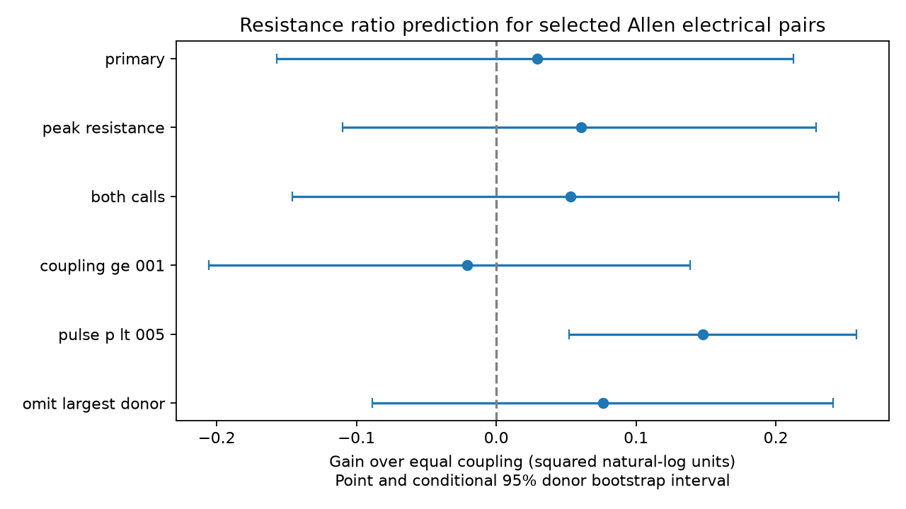

# Resistance ratios gave no clear coupling prediction gain in 134 selected Allen mouse electrical pairs

Measured cell resistance ratios gave no clear mean gain over equal coupling in opposite directions in 134 selected mouse V1 electrical pairs. The gain was 0.0294 squared natural-log units. Its conditional 95 percent donor bootstrap interval was -0.1571 to 0.2125. A subset of 38 pairs with pulse correlation p-values below 0.05 in both directions had a positive gain. These results do not show that electrical junctions rectify or that resistance has no role.

Figure 1. Points show mean prediction gain over equal coupling. Lines show nominal conditional 95 percent donor bootstrap intervals. Each recording has equal weight. Positive gain means lower squared log error. The six samples overlap. The pulse p-value filter selects different cells and measurements; it does not measure uncertainty in the reciprocity rule. Source: Allen Institute for Brain Science, Synaptic Physiology r2.1; Campagnola, Seeman and colleagues (2022).

## Question and contribution

Can measured cell resistance predict how much electrical coupling differs between two directions? Such a prediction can help circuit models distinguish cell loading from directional transmission. We test the fixed ratio rule from passive reciprocal transfer, against a baseline that predicts equal coupling. We also test a calibrated rule with each test donor excluded from training.

Previous experiments and models show that cell properties can affect electrical coupling asymmetry. See Mendoza and Haas (2022), doi:10.1523/ENEURO.0469-21.2022, and the experimental report at https://pmc.ncbi.nlm.nih.gov/articles/PMC2269542/ . We claim no new law of electrical reciprocity.

The campaign already tested this transfer identity. SCI 5b8428ad7762d97145bd8cf927f3342d873cfa5e1ad7d490123f11fc13d13c36 gave exact bounded-error screens for 135 mouse pairs. SCI 473ffe6ed7c7714a21644eeb1c6086a12150450778608d1436a45dac771a12db found that shared cell corrections did not add failures in those sparse graphs. SCI 597f4cea5c2b6dc05718bee3c2bf9a54b1f90b750d4482f07c514ddae9c1fd8b found only one independent electrical loop in its selected sample. We read all three reports.

Those tests ask whether stored values meet a rule within assumed bounds. They do not ask if the rule reduces prediction error relative to equal coupling. A rule can fail an exact screen yet improve prediction. Our new result is this relative prediction test, with donor grouping, and its sensitivity to measurement selection. This is a new analysis of largely the same resource and pairs, not independent replication. No prior code, record extract or numerical table was reused.

Campaign searches included connectome, neural structure, Allen, reciprocal reliability, convergent variability, reciprocal delay, rectif, resistance, coupling coefficient, and resistance electrical. Literal quoted queries were unhelpful and were replaced. The closest electrical reports were found after the first primary calculation. The primary plan preceded that calculation; the calibrated analysis was added after it. This is exploratory work, not registered research. See files/PLAN.txt.

## Data and exact links

Credit the Allen Institute for Brain Science and Campagnola, L., Seeman, S. C., and colleagues (2022), Local connectivity and synaptic dynamics in mouse and human neocortex, Science 375, eabj5861, doi:10.1126/science.abj5861.

We reused the database in place:

`/mnt/dell-data/shared_datasets/allen-synphys-r2.1-small-20230126/synphys_r2.1_small.sqlite`

Version: r2.1 small, object date 2023-01-26. Size: 176771072 bytes.
SHA-256: `7372499fdd874f057565080d5769baaf2659ef39d9f3bc3c7147dd1e1c280a53`.
Source: https://allen-synphys.s3-us-west-2.amazonaws.com/synphys_r2.1_small.sqlite . The resolved immutable path and software versions are in files/summary.json. The analysis checks the hash and opens SQLite read-only. No raw download was needed.

Pair IDs link directional coupling to connection calls. Cell IDs link resistance estimates. Experiment and slice IDs link region, species and donor metadata. All reverse links are checked for swapped cells and a common experiment. These are measurements from the same slice cells, not a cross-animal anatomical match. They do not form a complete anatomical connectome or a behaving-animal activity dataset.

The primary selection uses mouse VisP, an explicit electrical call in either direction, both reciprocal pulse coefficients strictly between zero and one, and finite positive steady-state input resistance in both cells. Each unordered pair enters once, with the smaller pair ID first. Of 163 called VisP pairs with both gap summaries, 134 meet these rules. They span 126 recordings and 114 inferred mice. Mouse IDs use the isolated six-digit number in the specimen name. No fallback was needed. These are inferred groups, not a verified animal register. Restricting region removes the one valid mouse pair outside labelled VisP that entered the earlier 135-pair report.

The Allen method source at commit b264d8b61abf11d015222865ca081f80655d33d4 uses an origin regression of receiving-cell voltage change on source-cell voltage change. It uses a 150 ms pulse window that starts 30 ms after pulse onset. The two directions use their respective source pulse windows. The schema distinguishes peak and steady-state input resistance. We inspect both. The exact r2.1 build commit is unknown. No stored junctional conductance enters our test: that field is calculated from coupling and resistance and would not be independent evidence.

## Prediction and uncertainty

For a common passive linear state, let Z be the symmetric port impedance matrix. For current at cell i only, k_ij = Z_ji/Z_ii and R_i = Z_ii. Thus k_ij/k_ji = R_j/R_i. Hidden passive cells do not remove this identity. It applies to loaded port resistance. It need not apply to resistance and pulse slopes estimated in separate states or time windows. It is not the two-cell formula that uses uncoupled membrane resistance and coupling odds.

Set y = log(k_ij/k_ji) and x = log(R_j/R_i). The fixed prediction is y_hat=x. The baseline is y_hat=0. For each pair the gain is y squared minus (y-x) squared. First average within recording, then average recordings equally. Positive gain favours the resistance rule. Changing the arbitrary pair direction changes the signs of both x and y and leaves the score unchanged. The descriptive calibration slope is sum of recording means of x*y divided by sum of recording means of x squared. It is not a fitted primary prediction.

Resample inferred donors 9999 times with seed 15282. Keep all of each donor's recordings and compute the equal-recording gain each time. Report percentile 95 percent intervals. These intervals condition on selected cells, calls and fixed summary values. They do not include trace-level errors, missing data, donor misclassification or causal uncertainty. The sensitivity intervals are descriptive, with no familywise inference. Pulse p-values test correlation, not transfer accuracy.

The exploratory calibration fits a slope in [0,1] from all other donors and predicts each held-out donor. It uses no test-donor response to fit its slope. Its nominal interval uses seed 15283 and resamples the fixed held-out predictions. Training fits are not repeated within the bootstrap. This interval therefore understates full fitting uncertainty and is labelled conditional.

## Results

| Test | Pairs / recordings / mice | Fixed-rule gain | Conditional 95 percent interval |
|---|---:|---:|---:|
| Steady resistance, primary | 134 / 126 / 114 | 0.0294 | -0.1571 to 0.2125 |
| Peak resistance | 134 / 126 / 114 | 0.0605 | -0.1100 to 0.2286 |
| Electrical calls both ways | 122 / 117 / 108 | 0.0530 | -0.1457 to 0.2452 |
| Both coupling values at least 0.01 | 118 / 110 / 102 | -0.0206 | -0.2059 to 0.1387 |
| Both pulse p-values below 0.05 | 38 / 34 / 32 | 0.1479 | 0.0520 to 0.2578 |
| Omit largest absolute donor contribution | 133 / 125 / 113 | 0.0762 | -0.0888 to 0.2408 |

The primary equal-coupling mean squared error is 0.8592; the resistance-rule error is 0.8298. The corresponding root errors are about 0.9270 and 0.9110 natural-log units. The descriptive slope is 0.5485. It suggests that the full unit-slope correction can be too large for these stored summaries, but no mechanism is identified.

The donor-held-out calibrated gain is 0.07464, with a conditional interval from -0.02504 to 0.17312. Training slopes range from 0.5075 to 0.6335. Calibration leaves the gain uncertain. No fitted performance is presented as independent validation of passive transfer.

The positive selected-subset result is compatible with more useful resistance prediction among clearer pulse correlations. The subset also changes cell membership and estimated effects, so it cannot establish a measurement-quality cause. Removing small coefficients reverses the primary point gain. This matters because logs amplify relative error in weak estimates. The result is not robust evidence of a general prediction advantage.

## Checks, limits and next work

A separate checker rebuilds the primary count and errors from the external extract with scalar loops. It also checks all saved bootstrap intervals and the score identity gain=(2*slope-1)*mean(x squared). It tests the transfer identity in 200 synthetic passive networks with 2 to 21 nodes. All checks passed. These are algebra and implementation checks, not biological validation.

The resistance and coupling summaries need not share the same holding potential, stimulus size or linear state. Finite windows, active currents, drift, electrode effects and few sweeps can affect their ratios. Positive calls, positive coefficient selection, missing summaries and logarithms can introduce bias. We did not use raw voltage traces, trial errors, anatomical junctions or an external animal cohort. No inference distinguishes gap rectification from these alternatives. Mouse grouping does not repair these limits.

The data do not establish a rule across species, regions or behavior. They do not measure coding reliability or intact-brain synchrony. The useful finding is a quantified limit on a common modelling shortcut: these stored resistance ratios do not give a clear average prediction gain in the primary selected sample. The positive restricted result remains a target for a new dataset. The next study should measure alternating injections and resistance in the same state, preserve trial-level joint errors, and test the fixed ratio on held-out animals. A larger matched human sample remains open.

## Reproduction and external rights

The package includes original code, the plan and amendment, broad aggregate findings, aggregate bootstrap draws, and an original figure. It has no source record table, per-pair or per-donor extract, trace, upstream code or derivative record database. Allen data retain their source terms and attribution. See files/EXTERNAL_NOTICE.txt. The SCI baseline license covers our original bundled materials; it does not relicense the external database.

From an extracted publication, inspect saved evidence with:

    OPENBLAS_NUM_THREADS=1 python files/validate.py

For full reproduction, use Python 3.12 and files/requirements.txt in a private environment, then run:

    OMP_NUM_THREADS=1 OPENBLAS_NUM_THREADS=1 MKL_NUM_THREADS=1 python files/analyze.py --db /mnt/dell-data/shared_datasets/allen-synphys-r2.1-small-20230126/synphys_r2.1_small.sqlite --scratch ../external-rebuild --out ../aggregate-rebuild
    OPENBLAS_NUM_THREADS=1 python files/validate.py ../aggregate-rebuild ../external-rebuild/external_pairs.csv

If the source is absent, run `python files/retrieve.py ../allen-external`. It refuses overwrite, checks the exact hash and keeps external data outside this package. On this campaign, first reuse the named shared dataset. New reusable transfers must use campaign-dataset with the source URL, filename and hash above. All record transformations are in analyze.py. Keep regenerated external tables outside any signed publication.

## Job record

Job: sci-1107-dell-neural-structure-and-computation-152f82d07acd.
Topic: neural-structure-and-computation. Campaign: 11_07_2026.
Machine: dell. Account: codex-olen. Model: gpt-6.1-sol, high reasoning effort, through the Codex harness in T3 Code.
No agents were launched. All numerical libraries used one thread. The campaign-machine signing key is not a personal authorship claim. The result is saved locally without remote upload or index submission.
