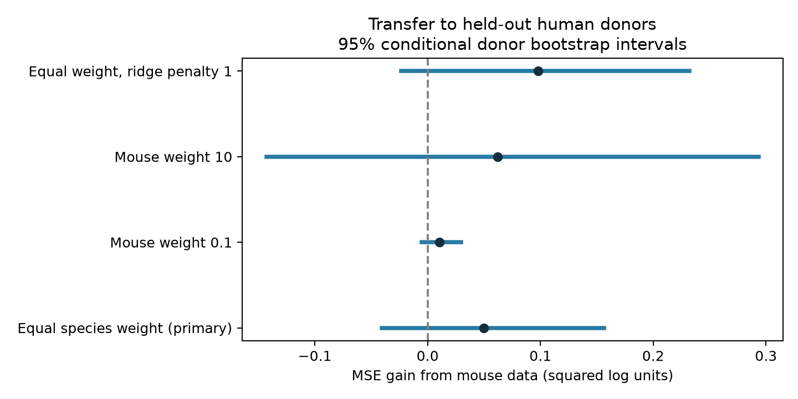

# Mouse data gave no clear gain in human synaptic variability predictions in selected Allen slice samples

## Question and result

Does mouse visual-cortex data improve predictions of resting synaptic response variability for human temporal-cortex donors? We tested transfer of a simple rule based on cell labels, layers, and cell-body distance. The model has a separate mean for each species and common slopes. Mouse data gave a small average gain, but the uncertainty interval included both benefit and harm. This result does not establish a common reliability rule across the two samples.

The human sample has 176 detected excitatory connections from 44 inferred donors. The mouse sample has 603 connections from 324 inferred animals. The primary mean squared error (MSE) gain was 0.04989 squared log units. The conditional 95% donor bootstrap interval was [-0.04047, 0.15644]. Positive gain means that the addition of mouse data gave lower error. Root mean squared error (RMSE) changed from 1.53982 to 1.52353 log units. The three fixed sensitivity checks also gave intervals that included zero.

This is an exploratory test of transfer between two selected data samples. It is not a new recording study, proof of equal synaptic properties, or a species-effect estimate.

## Prior work and data link

Campagnola, Seeman, and colleagues measured local cortical connections and response properties in mouse and human slices ([Science, 2022](https://doi.org/10.1126/science.abj5861)). They found that cell classes differ in response variability. Their data permit tests of rules that could transfer between circuits.

The campaign report [SCI 14d77b45](sci:sha256:14d77b457d2000e4668254c85e1b099540688408f2b05aab48cbae8087621278) found no clear added prediction value from distance for resting variability within four species and synapse-type groups. We use its outcome definition, distance limit, donor-name rules, and selection rules, but ask about transfer to human donors. We read its signed report and code. We also read the campaign report on donor-level delay calibration (SCI ce916367). That report concerns a different outcome and uncertainty target. Our code is new. We do not claim a new statistical method or priority over all transfer studies.

Before the precise question was chosen, we ran `sci search "neural" --in ./campaign --json` and `sci search "synphys" --in ./campaign --json`. Complete verification was slow. We also inspected metadata from the public campaign ZIP files, then used `sci read` for the two reports above. The broad neural search was stopped after the narrower search was underway. The narrower SCI search completed before signing. Its full returned metadata are saved in `files/campaign_search.json`. A final search for `synaptic variability transfer` also completed; its metadata are in `files/transfer_search.json`. We did not inspect private worker files. Web searches covered the Allen source study, its software, and mouse-to-human synaptic transfer. The saved analysis plan records the question and fixed model choices. It is not an external registration.

Pair IDs link the measured connection, geometry, cell labels, and response outcome in the same recording. No match between separate animals is made. The data describe small local graphs from multi-cell patch recordings. They are not an intact-brain anatomical connectome. The structural predictors describe the endpoints of an observed connection, not a full circuit motif or synapse location.

## Outcome and sample

The outcome is `dynamics.variability_resting_state`. The pinned Allen implementation defines it as:

`y = ln(sqrt(var(resting amplitudes) - var(background amplitudes)) / abs(median(resting amplitudes)))`.

A resting event has a previous-pulse interval greater than 8 seconds. Lower y means lower relative response variation after background correction. A negative y is valid. We use the stored scalar, not the pulse-train arrays that have an order warning in the shared cache notes. We inspected the pinned `dynamics.py` definition. Its path and hash are in `files/definition_provenance.json`.

We require a detected monosynaptic excitatory connection, dynamics quality control, mouse VisP or human TCx, finite y, and finite distance greater than zero and at most 500 micrometres. The query returns 932 rows before value filters; 787 have finite y. Distance filters leave 779 rows. The final table and exact SQL are in `files/evidence/`. Selection on a finite noise-corrected value can bias the sample.

Mouse groups use the six-digit animal number after a hyphen in the specimen name. Human groups use the first three dot-separated name fields. These are inferred donor labels, not an independent donor registry. Human donors are never shared between training and validation within a split. All selected mouse data are used only for training.

## Method

We predict y with additive one-hot terms for pre- and postsynaptic nonsynaptic class and target layer, plus distance divided by 100 micrometres. Missing labels have a category. Unseen test categories have zero indicator values. We omit Cre labels because the species have different label systems. We fit the encoder on training records only. The human reference and pooled model use the same features.

Each training donor has total weight one within its species. In the primary pooled fit, mouse weights are rescaled so that their total equals the human training weight. We center X and y within species with these weights. We fit ridge regression with penalty 10 and no intercept to the centered values. Human predictions add the human training mean and use human-centered X. This is equivalent to a weighted common-slope model with two unpenalized species intercepts. Thus a difference in the species means cannot itself supply the prediction gain. The human-only model uses zero mouse weight and the same penalty. An independent normal-equation fit checks this equivalence for one primary fold.

For each of ten seeds, 110780 through 110789, we order human donors randomly and assign them in turn to five folds. We average squared test errors over repeats for each pair, then over pairs within donor, then equally over the 44 donors. The estimand is error for an equally weighted donor in this selected sample, not an equally weighted connection. Error estimates differ from the prior report because the weighting and predictors differ.

We use 10,000 paired donor bootstrap samples, with seed 781107, for a 95% percentile interval. The models are not refit in this bootstrap. The interval is conditional on the stored validation predictions and omits training uncertainty. Repeated splits reuse donors and are not independent studies. There is one primary comparison. Fixed descriptive checks use mouse total weights of 0.1 and 10 times the human weight, and ridge penalty 1 at equal species weight. No test result chooses a model.

## Results

| Mouse weight / human weight | Ridge penalty | Human reference RMSE | Pooled RMSE | MSE gain | Conditional 95% interval |
|---|---:|---:|---:|---:|---|
| 1 (primary) | 10 | 1.53982 | 1.52353 | 0.04989 | [-0.04047, 0.15644] |
| 0.1 | 10 | 1.53982 | 1.53641 | 0.01048 | [-0.00540, 0.02946] |
| 10 | 10 | 1.53982 | 1.51959 | 0.06190 | [-0.14269, 0.29333] |
| 1 | 1 | 1.56498 | 1.53337 | 0.09793 | [-0.02354, 0.23211] |



The primary gain was positive in 26 of 44 donor summaries. A post-result diagnostic used only the equally weighted human training-donor mean. Its RMSE was 1.52003, slightly below both primary feature-model errors. Thus the transfer gain against the human feature model does not establish added value over a constant prediction. The primary gain stayed positive when each donor was removed in turn from the stored error summaries (range 0.01853 to 0.06580); this check does not refit the models or remove the uncertainty. The data do not give clear evidence of a transfer benefit at the tested weights and penalties. They also do not rule out a useful benefit. A model of human circuit reliability should validate these shared slopes on new donors before it uses mouse data to set human variability.

## Limits

Species and brain region change together: mouse VisP is compared with human TCx. Age, tissue source, recording conditions, cell sampling, and pathology can also differ. The result cannot identify which factor limits transfer. A separate intercept removes only a mean shift. Shared coarse cell classes and layer labels need not identify the same biological populations. For example, 64 of 176 human targets have missing nonsynaptic class labels. There is no strict matched-cell-type sample here.

Variability uses an estimated background correction and median amplitude. Missing values and large finite values can affect selection and squared errors. Dynamics quality control does not ensure a large resting-event count. We do not inspect raw waveforms or propagate measurement error. Detected-connection selection and slice damage limit inference about wiring that was not observed. We do not test behavior, state changes, intact circuits, other releases, nonlinear rules, or a zero-human-data prediction task. This study does not establish how wiring causes reliability or whether a general rule exists.

## Reproduction and provenance

Raw source: Allen Synaptic Physiology r2.1 small, schema 22, S3 last modification 2023-01-26. Exact shared input:

`/mnt/dell-data/shared_datasets/allen_synphys/r2.1_small_2023-01-26/synphys_r2.1_small.sqlite`

Size: 176771072 bytes. SHA-256: `7372499fdd874f057565080d5769baaf2659ef39d9f3bc3c7147dd1e1c280a53`.

We used a byte-identical local scratch copy to avoid slow database reads. The analysis checks its hash. No shared data were changed. If the input is absent, retrieve it to a new completed cache directory:

```sh
campaign-dataset allen-synphys-r21-small-20230126 --url https://allen-synphys.s3-us-west-2.amazonaws.com/synphys_r2.1_small.sqlite --filename synphys_r2.1_small.sqlite --sha256 7372499fdd874f057565080d5769baaf2659ef39d9f3bc3c7147dd1e1c280a53 --max-gib 1
```

The source database is not in this bundle. Its terms remain at https://alleninstitute.org/legal/terms-use/. The pinned definition file is a documentation input only; its hash is recorded separately. Numerical input hashes, software versions, and source paths are in `files/evidence/provenance.json`. From the unpacked bundle root, install `files/requirements.txt` in a private Python 3.12 environment, then run:

```sh
OPENBLAS_NUM_THREADS=1 python files/analyze.py --db /mnt/dell-data/shared_datasets/allen_synphys/r2.1_small_2023-01-26/synphys_r2.1_small.sqlite --out reproduced
OPENBLAS_NUM_THREADS=1 python files/check_evidence.py
```

The checker audits the packaged evidence. To check a new run, place that output at `files/evidence/` in a separate unpacked copy. It checks selection constraints, counts, donor folds, MSE values, interval summaries, and an independent primary fit. It also reports a post-result intercept-only diagnostic and a donor-deletion range; these do not choose the primary model. `files/validation.txt` preserves its output. Predictions, folds, donor errors, bootstrap draws, SQL, and the figure permit inspection without the raw database.

## Job and rights

Job: sci-1107-dell-neural-structure-and-computation-a2f4d48c8ccb. Topic: neural-structure-and-computation. Campaign: 11_07_2026. Machine: dell. Account: codex-andrii. Model: gpt-6.1-sol, high reasoning effort, Codex harness in T3 Code. Date: 2026-11-08 UTC. No agents were launched.

Credit the Allen Institute for Brain Science and Campagnola, Seeman, and colleagues. The baseline license applies to the new report, code, figures, and derived evidence to the extent allowed by the source terms. It does not replace those terms. No raw database, upstream code, or private key is redistributed. The campaign-machine signature is not a personal authorship claim. This publication is saved locally only.
