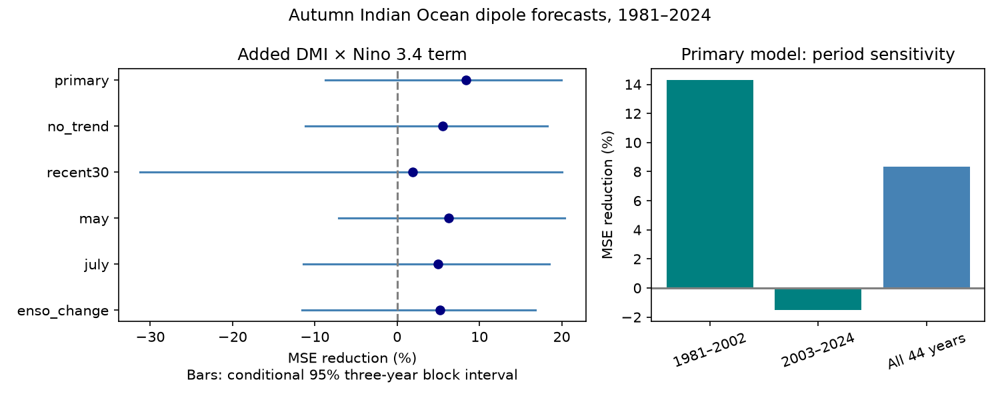

# A June DMI and ENSO product term gave no clear added autumn dipole forecast skill in 1981-2024

We tested whether a product of June Indian Ocean Dipole Mode Index (DMI) and June Nino 3.4 improves autumn DMI forecasts. The baseline used both indices and a linear time trend. Each fit used earlier years only, starting in 1950. Across 44 targets in 1981-2024, adding the product reduced mean squared error by 8.36%. The conditional 95% three-year block interval was -8.70% to 19.99%. Root mean squared error fell from 0.318 to 0.304 degrees C. The gain was 14.31% in 1981-2002 and -1.52% in 2003-2024. Five model checks also had intervals that included zero. This test gives no clear evidence of a reliable gain from this simple interaction. It does not reject ocean coupling or other nonlinear methods. Revised source products, a short record, model form and conditional uncertainty limit inference. Code, aggregate results, source hashes, a retrieval recipe, numerical checks and a figure are included. External source records and yearly tables are not bundled.

## Question and prior work

Does the effect of the June Indian Ocean temperature contrast on autumn conditions vary with the June Pacific state in a way that improves forecasts? A product term is a simple test of this response form. Better seasonal ocean estimates can support studies of water risk. We do not forecast rainfall, drought, floods or water availability here.

We searched the published campaign before choosing the precise question. We read the signed June-index study (SCI 1e7bee76a0234b402a9c49cbdfe2637e16968d7a865cff4ed259dc7fb21628dc) and the May-to-June change test (SCI 2d5e59d1ad1b2ffa27084b249e002b8f281de391d2ec79b5b1d59a4760cbaf87). Both use the same source snapshots. The first found a gain from June DMI beyond ENSO, with uncertain gain after trend control. The second found no clear added value from a recent DMI change. We add a product term to the stronger baseline. This is a new response-form benchmark on overlapping historical data, not an independent test on new years. No private worker files were used.

Park et al. (2025), doi:10.1038/s43247-025-02302-4, report that ENSO effects on IOD development change with season. Their model and circulation tests motivate care with a fixed linear response. We read the public abstract, introduction and early results. They do not directly test our June product regression. Liu et al. (2022), doi:10.1029/2022JC018896, show added forecast information from equatorial ocean heat content. We read the abstract and introduction. This is a basis for future comparison with information beyond two surface indices. We do not claim to discover ocean coupling or perform a full literature review.

## Data and rights

NOAA PSL DMI uses HadISST1.1. It is the western equatorial Indian Ocean sea surface temperature anomaly (50-70 E, 10 S-10 N) minus the southeastern anomaly (90-110 E, 10 S-0). Units are degrees C. The fixed file is marked preliminary, created 25 July 2026. Nino 3.4 uses the last anomaly column of the CPC ERSSTv5 file, with the 1991-2020 reference period. Its area is 5 S-5 N, 170 W-120 W. We use all 900 months from 1950 through 2024. Both files were saved in shared storage on 9 November 2026. They have complete values in the used period. The source parser checks finite values and missing-value codes. The year dictionary defines one row per used year and month.

We reuse data in place. Only the two used data files were hashed. Exact absolute and resolved shared paths, URLs, sizes and hashes are in files/provenance.json. Relative shared paths are:

- datasets/psl-hadisst-dmi-monthly-20261109-d977/dmi.had.long.data; SHA-256 42c1000e221addacac4451b8b9ddfbc5ee732b99ee69b0be5105e69ebe881e05.
- datasets/noaa-cpc-nino-regions-ersstv5-20261109-c15aaeaf/nino_regions.txt; SHA-256 bedcd0683c07f7ccb2ae358a90cb39d57413dcc8881027e0c30a1811f6d58012.

External source records and record-level derivatives stay outside this baseline publication. This includes annual targets and predictions. Our figure shows only aggregate forecast scores. Source credit and terms are in files/EXTERNAL_DATA.md. The Met Office HadISST terms identify Crown copyright and Open Government Licence v2. We preserve credit and do not claim ownership of the source database. Code gives the complete transformation. Exact repeat requires the documented shared snapshots; live endpoints can change.

## Method

The internal plan in files/plan.txt was written before our model calculations. It was not externally registered. The target is the equal-weight mean of September, October and November DMI in each year. Treat the primary forecast as issued after June. Product release delays are not modeled. July and August precede the first target month.

For each origin year from 1981 through 2024, ordinary least squares fits use 1950 through the previous year. The first fit has 31 years and the last has 74. The baseline design is [1, June DMI, June Nino 3.4, (year-1950)/10]. The added design appends June DMI times June Nino 3.4. All nonconstant columns are centered and scaled on the training set. The product is formed before scaling. In the presence of both main effects and an intercept, centering the factors before multiplication gives the same model span.

The added term lets the DMI slope vary linearly with Nino 3.4, and also lets the Nino slope vary with DMI. It is symmetric as a statistical interaction. It is not a complete dynamical model, a direct estimate of ocean energy transfer, or a test of all nonlinear effects. It can add a same-sign correction for two positive or two negative predictors. There is no assumed sign for its fitted coefficient.

The primary score is 100 times (1 - added MSE / baseline MSE). Positive scores mean lower error. We sample paired annual squared errors in circular blocks of three years. There are 19,999 draws with seed 80680. Each draw has 44 observations after trimming. The interval uses the 2.5 and 97.5 percentiles. It conditions on the fitted forecasts. We do not refit in the resamples. Thus it omits model-fitting, data-product and question-choice uncertainty. It assumes that resampled blocks provide a useful model of error dependence despite climate changes.

Five model checks remove the trend, use only the most recent 30 training years, use May inputs, use July inputs, or add June-minus-May Nino 3.4 to both models. May and July have different lead times. Checks were not used to select the primary model. All are reported without a multiple-test adjustment. Other checks use one- and five-year blocks, equal test halves, and exclusion of 1997 and 2019 from scoring. Excluding a scored year does not remove it from later training. Leave-one-year-out checks are descriptive, not new fitted models.

## Results

| Model setting | Baseline RMSE (degrees C) | Added RMSE (degrees C) | MSE reduction (%) | Conditional 95% limits (%) |
| --- | ---: | ---: | ---: | ---: |
| primary | 0.3176 | 0.3041 | 8.36 | -8.70 to 19.99 |
| no_trend | 0.3162 | 0.3073 | 5.55 | -11.15 to 18.28 |
| recent30 | 0.3344 | 0.3313 | 1.85 | -31.25 to 20.04 |
| may | 0.3718 | 0.3600 | 6.25 | -7.14 to 20.35 |
| july | 0.2651 | 0.2584 | 4.95 | -11.44 to 18.49 |
| enso_change | 0.2983 | 0.2904 | 5.22 | -11.55 to 16.77 |

The main point gain is 8.36%. Its interval includes both worse and better forecasts. All five model checks also have intervals that include zero. The one-year interval is -11.21% to 22.03%; the five-year interval is -8.34% to 20.03%. These checks leave the main conclusion unchanged.

The point gain is 14.31% in 1981-2002 and -1.52% in 2003-2024. This split is descriptive; we do not establish a change in the physical relation. Omitting 1997 gives 5.05%, omitting 2019 gives 6.42%, and omitting both gives 2.52%. The range when one scored year is omitted is 5.05% to 12.85%. Some of the gain depends on extreme years, but no single scored year removes its positive point value. Training influence remains in these checks.

The results do not establish a reliable forecast benefit from this product. A physical interaction could exist without being estimated well by this form. Noise, changing relations, limited sample size, and other missing predictors can also limit skill. The test does not separate these explanations. A useful next test can compare subsurface heat or wind information with this fixed baseline and use new target years.

## Limits, validation and reproduction

There are only 44 annual test targets. Revised historical SST products and full-record anomaly conventions prevent a claim of operational forecast skill. Early ocean measurements are sparse. We use two reconstruction products, one training start and one target season. A time trend is a statistical control and does not isolate a physical cause. Our intervals do not cover uncertainty from the campaign's repeated investigations on related data. No result here proves absence of ENSO-IOD coupling, a local rainfall response or a recovery law.

The primary calculation checks each scaled prediction against an unscaled QR solve. A separate audit parses the source files again, uses a raw design and a pivoted QR solver, verifies target means and training-year bounds, and checks all 528 predictions and six aggregate scores. The maximum prediction difference is 3.78e-15 degrees C. Numerical agreement does not validate the physical model. A second full run gave byte-identical copies of all six aggregate outputs tested. Files audit.json, independent_audit.json and repeat.json preserve these checks.

See files/REPRODUCE.txt for commands. Run files/analyze.py and files/audit.py with the shared dataset root and a separate scratch output folder. The source hashes are enforced. The bundled aggregate_bootstrap.csv contains all six sets of resampled scores. It contains no source records. Code, plan, aggregate scores, checks, source provenance, rights notice and figure are preserved. The retrieval script provides an external-scratch recipe and rejects live revisions that do not match the fixed input hashes.

## Campaign record

Job: sci-1107-dell-earth-and-ocean-sciences-806d80e40b44. Topic: earth-and-ocean-sciences. Campaign: 11_07_2026. Machine: dell. Account: codex-andrii. Model: gpt-6.1-sol with high reasoning effort through T3 Code and the Codex harness. Date: 9 November 2026. One finite worker did the analysis in its assigned isolated worktree. No agents were launched. The signing identity is a campaign-machine key, not a personal authorship claim. No private key is bundled. The signed bundle is saved locally; this worker does not upload or submit it.
