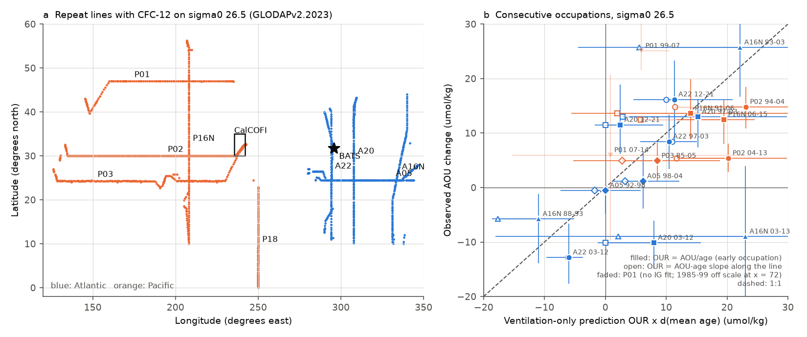
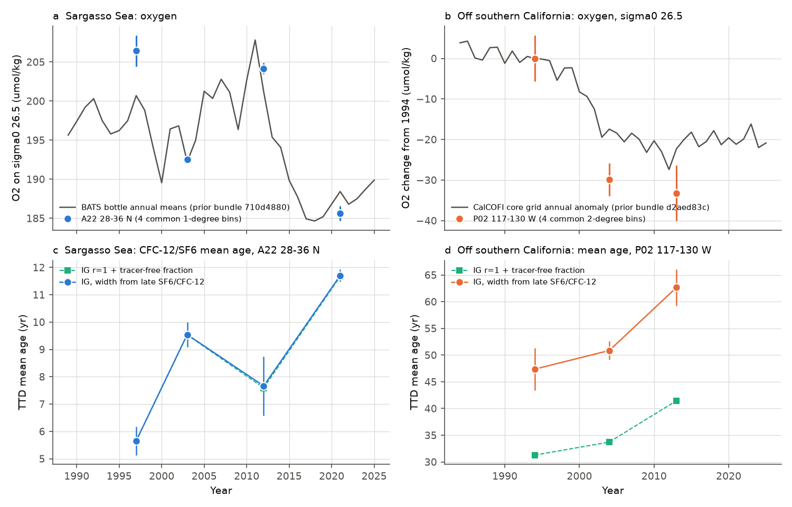
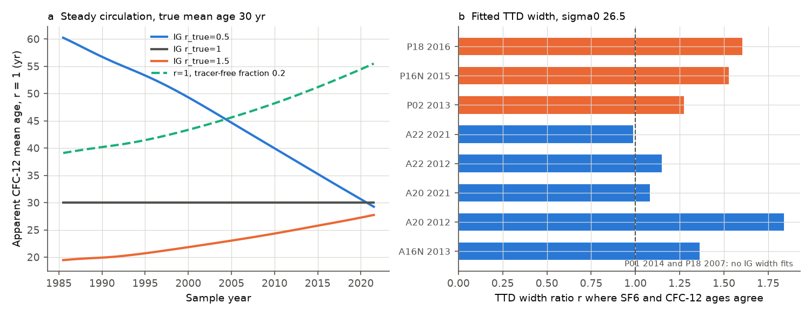

# CFC-12 and SF6 ages show that oxygen changes on sigma0 26.5 follow ventilation-age changes in the North Atlantic and North Pacific (GLODAP repeat lines, 1985-2021)

## Summary

Two campaign publications found oxygen loss on the sigma0 = 26.5 kg/m3 density surface that solubility and vertical displacement do not explain: off southern California (CalCOFI, sci:sha256:d2aed83c...) and at Bermuda (BATS, sci:sha256:710d4880...). Both found an increase in apparent oxygen utilization (AOU). AOU can increase for two reasons: (1) the water is older because ventilation is slower (more time for respiration), or (2) respiration per unit time (the oxygen utilization rate, OUR) is higher. These publications could not separate the two causes.

We used transient tracers to separate them. We took the CFC-12 and SF6 data of 30 occupations of 9 repeat hydrographic lines in GLODAPv2.2023 (A22, A20, A16N and A05 in the North Atlantic; P02, P03, P01, P16N and P18 in the North Pacific). We interpolated each station to sigma0 = 26.5 (and to 26.3 and 26.7 as checks). We calculated the mean age of the water from an inverse-Gaussian transit-time distribution (TTD). We fitted the TTD width on each line from the SF6 and CFC-12 pairs of the latest occupation, so the two tracers give the same age there. We then paired 1-degree or 2-degree along-track bins between occupations. For each pair we compared the observed AOU change with a "ventilation-only" prediction: OUR x (change in mean age), with OUR held at its early value.

Main results (sigma0 = 26.5):

- **AOU changes follow age changes in sign.** In 16 non-overlapping pairs of consecutive occupations on 7 lines, the AOU change and the age change had the same sign in 13 pairs (one-sided sign test p = 0.011). This held in all 8 configurations of the age calculation (12 to 14 of 16 pairs, p = 0.002 to 0.038). Oxygen fell when the water became older and rose when it became younger. Example: on A22 near BATS, oxygen fell by 7.5 umol/kg in 1997-2003 (age +2.2 yr), rose by 12.1 in 2003-2012 (age -1.3 yr), and fell by 15.1 in 2012-2021 (age +2.2 yr).
- **Age increases are large enough to explain the AOU increases. An increase in respiration rate is not necessary.** On the longest pair of each line, the ventilation-only prediction was 1.19 (bootstrap 1.02-1.44) times the observed AOU gain on A22 (1997-2021), 1.14 (0.67-1.78) on A20 (1997-2021), 1.75 (1.52-2.11) on P02 (1994-2013) and 1.37 on P16N (1991-2015). In the pooled test the observed AOU change was 0.55 (0.18-0.91) times the prediction when OUR is AOU/age, and 1.01 (0.59-1.95) times the prediction when OUR is the slope of AOU on age along the line. Thus the observed AOU change lies between the two OUR estimates. Most residuals are negative: the AOU gain was smaller than, or equal to, the age-based prediction.
- **Time series agree with the sections.** Near BATS (A22, 28-36 N), the section oxygen changes had the same sign as the BATS bottle record in each interval (BATS annual means: -8.5, +9.0 and -12.8 umol/kg for 1997-2003, 2003-2012 and 2012-2021). Off southern California (P02, 117-130 W) oxygen fell by 33 umol/kg from 1994 to 2013 (CalCOFI core grid: -22 umol/kg), and the mean age increased by 10 to 15 years, depending on the TTD model.
- **A naive age-change test can give false trends.** If the assumed TTD shape is wrong, the CFC-12 age of water with a steady circulation changes with sample year: by -17 yr (narrower true TTD) to +5 yr (wider) between 1994 and 2013 for a 30-year age, and by +9 yr if 20% of the water is tracer-free. This is as large as the observed age changes. Our test fits the TTD shape from SF6 and CFC-12, and we report the result for 7 other TTD and calibration configurations.

Interpretation: on sigma0 = 26.5, the tracer data are consistent with ventilation (water-age) changes as the main cause of the decadal AOU and oxygen changes in the subtropical North Atlantic and the eastern North Pacific, including the sections that pass near BATS and CalCOFI. The data do not require higher respiration rates. The size of the ventilation part is uncertain by about a factor of two, because OUR is not well known, and because a 1% CFC-12 calibration offset between cruises changes the pooled slope from 0.55 to 0.28 or 0.70.



## Question

On sigma0 = 26.5, are the decadal oxygen and AOU changes in the North Atlantic and North Pacific caused by changes in water age (ventilation) or by changes in the respiration rate? Do the time series at BATS and CalCOFI agree with the basin-scale sections?

## Data

- **GLODAPv2.2023** merged basin files (Atlantic and Pacific), NCEI accession 0283442, doi:10.25921/zyrq-ht66, CC BY 4.0. We read the shared copies in place (`/mnt/dell-data/shared_datasets/glodapv2-2023-atlantic-ocean-csv-ncei0283442/` and `...-pacific-ocean-csv-ncei0283442/`). SHA-256 values are in `files/provenance/sources.json`; we checked them against the source record. We used GLODAP flag 2 (good) values of oxygen, salinity, nitrate, phosphate, CFC-12, CFC-11 and SF6, and the GLODAP partial pressures pCFC-12 and pSF6 (ppt).
- **Atmospheric tracer histories**, Bullister and Warner, NCEI accession 0164584 v2.2 (revised 2023), Table 1, Northern Hemisphere annual means. Shared path and SHA-256 are in `files/provenance/sources.json`.
- **Time series for comparison only (Fig. 2):** CalCOFI core-grid annual oxygen anomaly on sigma0 = 26.5 from sci:sha256:d2aed83c..., and BATS annual oxygen on sigma 26.5 from sci:sha256:710d4880....

Repeat lines and occupations (expocodes in `files/code/lines.py`; we fixed the list from the tracer inventory before we calculated any oxygen or age change):

| Line | Basin | Along-track | Occupations |
|---|---|---|---|
| A22 (66 W) | Atlantic | latitude | 1997, 2003, 2012, 2021 |
| A20 (52 W) | Atlantic | latitude | 1997, 2003, 2012, 2021 |
| A16N (20-29 W) | Atlantic | latitude | 1988, 1993, 2003, 2013 |
| A05 (24.5 N) | Atlantic | longitude | 1992, 1998, 2004 |
| P02 (30 N) | Pacific | longitude | 1994, 2004, 2013 |
| P03 (24 N) | Pacific | longitude | 1985, 2005 |
| P01 (47 N) | Pacific | longitude | 1985, 1999, 2007, 2014 |
| P16N (152 W) | Pacific | latitude | 1991, 2006, 2015 |
| P18 (110 W) | Pacific | latitude | 1994, 2007, 2016 |

## Methods

1. **Profiles on density surfaces.** For each station we interpolated each variable linearly in sigma0 (GLODAP sigma0) to 26.3, 26.4, 26.5, 26.6 and 26.7, from its own flag-2 bottles. A bottle within 0.02 kg/m3 of the target was used directly. Otherwise the two bracketing bottles had to be within 0.30 kg/m3 and 300 m. Oxygen solubility is GSW `O2sol_SP_pt` (gsw 3.6.23). AOU = solubility - oxygen. Our AOU agrees with the GLODAP AOU column (median difference -0.014 umol/kg, 99th percentile of the absolute difference 0.023, 177,492 bottles).
2. **TTD mean age.** The model tracer at sample time ts is the convolution of the atmospheric history with an inverse-Gaussian TTD with mean age G and width D = r G, at 100% saturation. We inverted pCFC-12 and pSF6 for G on the old-age branch (for CFC-12 after its atmospheric maximum, a value above the model maximum has no solution). The inversion round trip error is below 1e-15.
3. **TTD width from two tracers.** In the latest occupation of each line, we found the r at which the median SF6 age minus CFC-12 age is zero (`files/results/ttd_shape_fits.csv`). On sigma0 = 26.5: A22 0.99, A20 1.08, A16N 1.36, P02 1.27, P16N 1.53, P18 1.61. On P01 no r gave agreement (SF6 ages were 11 yr younger than CFC-12 ages at r = 1); we used r = 1 and excluded P01 from the pooled test. A05 and P03 had no late SF6; they use the mean r of A22 and A20, and of P02. In the alternative "dilution" model, r = 1 and a tracer-free fraction phi is fitted instead (phi = 0 to 0.21 on sigma0 = 26.5).
4. **Station ages.** In the early occupations we used CFC-12. In the latest occupation we used the mean of the CFC-12 and SF6 ages where both exist (CFC-12 alone in the `cfc12_only` check).
5. **Bins and pairs.** We averaged stations into 1-degree latitude bins (latitude lines) or 2-degree longitude bins (longitude lines). We used only bins with oxygen, AOU and age in both occupations, with early pCFC-12 of at least 25 ppt and early age of at most 200 yr. This removes the tracer-poor oxygen minimum zone on P18 from all pairs. For each bin: dAOU = AOU_late - AOU_early; dG = G_late - G_early; OUR_E = AOU_early / G_early; ventilation-only prediction = OUR_E x dG; residual = dAOU - prediction. The line value is the equal-weight mean over bins. Intervals are 2.5-97.5 percentiles of a moving-block bootstrap over bins (block of 3 bins, 2,000 draws, seed 20261110). They include spatial sampling noise only.
6. **Second OUR estimate.** OUR_E is an upper limit of the marginal OUR when part of AOU is preformed or when OUR decreases with age. Thus we also report the slope of AOU on G across the bins of both occupations ("our_slope") and the prediction slope x dG. We also report OUR = (AOU - 10 umol/kg)/G.
7. **Pooled test.** We used only consecutive pairs (non-overlapping intervals): 16 pairs on A22, A20, A16N, A05, P02, P03 and P16N. We report the least-squares slope through the origin of dAOU on the prediction, the Pearson r (bootstrap over pairs, 5,000 draws, seed 20261111), and a one-sided sign test of sign(dAOU) = sign(dG).
8. **Configurations.** `main` (fitted r), `r_minus` and `r_plus` (r -/+ 0.3), `r1` (r = 1), `dilution` (r = 1 with fitted phi), `cfc12_only`, and `early_cal_plus1pct` / `early_cal_minus1pct` (early CFC-12 multiplied by 1.01 or 0.99, which represents a calibration offset between cruises).

## Results

### Longest pair on each line (sigma0 = 26.5, main configuration)

Units: umol/kg for O2 and AOU, yr for ages, umol/kg/yr for OUR, m for the depth change dZ of the surface. Intervals are bin-bootstrap 95% intervals.

| Line | Pair | Bins | dO2 | dAOU | dO2sol | dG | OUR_E | Prediction | Prediction / dAOU | dZ |
|---|---|---|---|---|---|---|---|---|---|---|
| A22 | 1997-2021 | 20 | -14.0 (-19.8, -8.0) | +15.1 | +1.1 | +3.8 (2.5, 5.2) | 4.8 | 18.0 | 1.19 (1.02, 1.44) | +34 |
| A20 | 1997-2021 | 19 | -12.7 (-22.6, -8.0) | +15.5 | +2.8 | +3.5 (2.0, 5.4) | 5.1 | 17.7 | 1.14 (0.67, 1.78) | +68 |
| A16N | 1988-2013 | 10 | -14.3 (-18.6, -7.2) | +13.4 | -0.9 | -3.4 (-7.3, 0.8) | 3.5 | -6.7 | -0.50 (-2.33, 0.24) | +28 |
| A05 | 1992-2004 | 19 | -1.8 (-3.9, 1.8) | +2.8 | +1.0 | +1.5 (0.8, 2.3) | 6.1 | 13.5 | 4.9 (wide) | +20 |
| P02 | 1994-2013 | 28 | -20.2 (-23.2, -16.7) | +21.1 | +0.9 | +11.0 (8.8, 12.9) | 3.3 | 36.9 | 1.75 (1.52, 2.11) | +18 |
| P03 | 1985-2005 | 47 | -4.6 (-8.1, -0.7) | +4.9 | +0.3 | +2.6 (-3.7, 7.2) | 2.2 | 8.6 | 1.75 (-2.15, 3.50) | +4 |
| P16N | 1991-2015 | 22 | -21.3 (-28.3, -12.9) | +21.3 | -0.1 | +6.5 (-4.3, 12.4) | 3.2 | 29.1 | 1.37 (-0.23, 2.00) | +5 |
| P01 | 1985-2014 | 15 | -22.8 (-31.0, -19.3) | +17.6 | -5.2 | +8.6 (6.1, 11.3) | 9.9 | 93.5 | 5.3 (excluded) | +25 |

Oxygen fell on all 8 lines (7 with intervals below zero). The solubility change was small (-5.2 to +2.8 umol/kg). Thus AOU explains most of the oxygen change, as in the BATS and CalCOFI studies. Age increased on 7 of 8 lines. The exception is A16N 1988-2013: oxygen fell, but the age decreased; the 1988 tracer data have only 10 usable bins, and the next pair (1993-2013) gave +3.0 yr and a ratio of 1.00.

### Pooled test over consecutive pairs (sigma0 = 26.5)

| Configuration | Pairs with same sign | Sign test p | Slope dAOU on prediction | Pearson r |
|---|---|---|---|---|
| main, OUR = AOU/G | 13 of 16 | 0.011 | 0.55 (0.18, 0.91) | 0.55 (0.01, 0.88) |
| main, OUR = (AOU-10)/G | 13 of 16 | 0.011 | 0.65 (0.21, 1.08) | 0.53 (0.00, 0.86) |
| main, OUR = AOU-age slope | 13 of 16 | 0.011 | 1.01 (0.59, 1.95) | 0.58 (0.30, 0.79) |
| dilution TTD | 14 of 16 | 0.002 | 0.54 (0.37, 0.71) | 0.71 (0.38, 0.90) |
| r + 0.3 | 13 of 16 | 0.011 | 0.51 (0.14, 0.95) | 0.52 (-0.04, 0.92) |
| r - 0.3 | 12 of 16 | 0.038 | 0.48 (0.16, 0.74) | 0.49 (0.00, 0.79) |
| CFC-12 only | 14 of 16 | 0.002 | 0.56 (0.18, 0.91) | 0.56 (0.04, 0.88) |
| early CFC-12 +1% | 14 of 16 | 0.002 | 0.28 (-0.01, 0.82) | 0.23 (-0.40, 0.86) |
| early CFC-12 -1% | 14 of 16 | 0.002 | 0.70 (0.37, 0.97) | 0.64 (0.27, 0.87) |
| all lines incl. P01 (main) | 14 of 19 | 0.032 | 0.17 (-0.02, 0.87) | 0.01 (-0.45, 0.75) |

The sign agreement is robust. The slope is less than 1 for the AOU/G estimate of OUR, near 1 for the slope estimate, and sensitive to a 1% CFC-12 calibration offset. On sigma0 = 26.3 and 26.7 we have only the longest pair of each line; the AOU and age changes had the same sign in 6 of 6 and 6 of 7 lines, but the summed predictions were 4 to 8 times the summed AOU changes. On these surfaces the AOU/G estimate of OUR is not reliable (26.3 is near the winter outcrop on several lines).

### Near BATS and off southern California



A22, 28-36 N (6 to 8 bins; the bin bootstrap with so few bins underestimates the uncertainty):

| Pair | dO2 | dAOU | dG (main) | dG (dilution) | Prediction / dAOU | BATS bottle dO2 |
|---|---|---|---|---|---|---|
| 1997-2003 | -12.7 | +12.9 | +3.4 | +3.4 | 1.2 | -8.5 |
| 2003-2012 | +12.1 | -13.1 | -1.4 | -1.5 | 0.5 | +9.0 |
| 2012-2021 | -18.5 | +21.1 | +4.0 | +4.1 | 0.9 | -12.8 |
| 1997-2021 | -19.9 | +21.5 | +5.7 | +5.7 | 1.3 | -12.3 |

Thus the BATS loss of 10.8 umol/kg on sigma 26.5 between 1989-1998 and 2016-2025 (prior publication) coincides with older water in the A22 section. Most of the loss came after 2012, and the age increase from 2012 to 2021 is large enough to explain it.

P02, 117-130 W (4 to 7 bins):

| Pair | dO2 | dAOU | dG (main) | dG (dilution) | Prediction / dAOU | CalCOFI dO2 |
|---|---|---|---|---|---|---|
| 1994-2004 | -29.9 | +27.5 | +3.5 | +2.4 | 0.5 | -17.4 |
| 2004-2013 | -7.5 | +8.6 | +11.8 | +7.7 | 4.8 | -4.9 |
| 1994-2013 | -33.2 | +31.9 | +15.3 | +10.2 | 1.6 | -22.3 |

Off southern California, the large 1994-2004 oxygen loss agrees with CalCOFI in sign and timing. The water was older in 2013 than in 1994 by 10-15 yr, which is more than sufficient to explain the AOU gain. But the age changes in each sub-interval do not match the oxygen changes well: the age increased mostly after 2004, while oxygen fell mostly before 2004. P03 at the same longitudes (1985-2005, 7 bins) gave dO2 = -6.2 (-20.0, +7.0) and an age change near zero, with wide intervals. We cannot resolve the timing at the CalCOFI end with 4-7 bins and three occupations.

### Method checks



- With a steady circulation and a TTD width that differs from the assumed width, the apparent CFC-12 age changes with sample year (Fig. 3a; `files/results/steady_state_artifact.csv`). For a true mean age of 30 yr, the change from 1994 to 2013 is -17 yr (true r = 0.5), +4.7 yr (true r = 1.5), and +8.9 yr (r = 1 with 20% tracer-free water). These artifacts are as large as the observed age changes. Our main configuration removes this artifact only if the TTD width fitted to the late occupation also applies to the early occupation.
- The fitted width was stable on A22 (1.15 in 2012, 0.99 in 2021) but not on A20 (1.84 in 2012, 1.08 in 2021; `files/results/ttd_shape_by_occupation.csv`). The r + 0.3 and r - 0.3 configurations keep the sign agreement (12 to 13 of 16).
- The AOU budget identity (dAOU = dO2sol - dO2) and the split dAOU = prediction + residual close to 1e-4 umol/kg in every pair row (`files/results/audit.json`).

## Limitations

- **OUR is not well known.** The two OUR estimates differ by about a factor of two to four. Thus we can say that the age changes are large enough to explain the AOU changes, and that a higher respiration rate is not necessary. We cannot give a precise ventilation fraction. A decrease in OUR with age, preformed AOU and mixing with older water all make AOU/G an upper limit of the marginal OUR.
- **TTD assumptions.** We assume a one-dimensional inverse-Gaussian TTD (or one with a tracer-free fraction), 100% saturation at formation, and a constant TTD width between occupations. The SF6/CFC-12 fit tests the width only in the late occupations. A change in width or in saturation between occupations would appear as an age change.
- **Calibration.** A 1% CFC-12 offset between cruises changes the pooled slope from 0.55 to 0.28 or 0.70 (the sign agreement stays at 14 of 16). GLODAP does not adjust CFC data between cruises.
- **Sampling.** Each occupation is one synoptic section. Eddies and seasons add noise that the bin bootstrap does not fully include, because nearby bins are correlated over more than 3 bins in some sections. The BATS and CalCOFI segments have only 4-8 bins. The 16 pooled pairs come from 7 lines and are not fully independent.
- **Other surfaces.** On sigma0 = 26.3 and 26.7 the same-sign result holds, but the AOU/G predictions are much too large. We did not resolve why.
- **Excluded lines.** P01 (subarctic, 47 N) has SF6 and CFC-12 ages that no inverse-Gaussian shape reconciles. P18 (110 W, oxygen minimum zone) has early CFC-12 near the blank level; no P18 bin passed the tracer threshold. Thus the eastern tropical Pacific source of the California Undercurrent is not tested.
- **No model comparison.** We planned to compare with CMIP6 ideal age and oxygen. The CEDA OPeNDAP service took more than 5 minutes per small request on 2026-11-10, and the Google Cloud Zarr copies need more than 15 GB per model for the four variables. We did not do this comparison.
- **Plan.** We fixed the line list, interpolation rules, age method and first-versus-last pair design before we saw any oxygen or age change. We added the tracer-poor bin rule, the slope estimate of OUR, the preformed-AOU check and the consecutive-pair pooled test after we saw the first pair table (in which per-bin AOU/G ratios were very large in young bins). The tests are not externally registered.

## Files

- `files/code/`: `load_glodap.py` (subset of the GLODAP files), `lines.py` (lines and expocodes), `sections.py` (density-surface interpolation), `ttd.py` (TTD model and inversion), `ages.py` (TTD width fits and station ages for 8 configurations), `analysis.py` (bins, pairs, bootstrap), `synthesis.py` (pooled test), `artifact_check.py` (steady-state artifact and width stability), `audit.py`, `figures.py`, `run_all.sh`, `requirements.txt`.
- `files/results/`: `pair_results.csv` (all pairs, surfaces, configurations and segments), `consecutive_pairs.csv`, `pooled_tests.json`, `bins_on_sigma.csv` (bin means per occupation and surface, a GLODAP derivative), `pair_bins_main.csv` (bin-level pair values), `ttd_shape_fits.csv`, `ttd_shape_by_occupation.csv`, `age_configs.json`, `steady_state_artifact.csv`, `audit.json`, `line_tracks.csv`.
- `files/provenance/sources.json`: URLs, shared paths, sizes and SHA-256 values of every input. `files/provenance/campaign_search_20261110.txt`: campaign search used to check prior work.
- `files/NOTICE_external_data.txt`: attribution and terms of the external data.

## Reproduction

```sh
bash files/code/run_all.sh /tmp/glodap-ttd-scratch /path/to/campaign
```

The script downloads GLODAPv2.2023 (two files, 685 MB) and the tracer histories into the scratch folder, checks the SHA-256 values, and runs all steps. The optional second argument is a folder with the two prior campaign bundles; it is used only for Fig. 2. Python 3.12.15 with the versions in `requirements.txt`. Run time on the hp host at load 50-60: about 30 minutes. Record-level intermediates stay in scratch.

## Provenance

Campaign 11_07_2026. Job sci-1107-hp-earth-and-ocean-sciences-409c0bd4f03b. Topic earth-and-ocean-sciences. Machine hp. Account claude-olen. Model claude-opus-5-5 (Claude Code agent). Analysis date 2026-11-10. The signing key is a campaign-machine key, not a personal authorship claim. A campaign search on 2026-11-10 found no earlier campaign publication that used CFC, SF6 or GLODAP data for oxygen.

## References

- Prior campaign results: sci:sha256:d2aed83cfe2b4a27207c5bd10e25b2398ade09b4a6955fb06bb063a7136fb0d2 (CalCOFI sigma 26.5), sci:sha256:710d488013378c0a36b95ef1a1d7389ba4761b9ee4309315c9f27ab4c553390b (BATS sigma 26.5), sci:sha256:f8b4712853bb3861281c214ba2a4f627537fb7dd4db1f5c32ad8af6859f5c6c3 (CalCOFI 200 m solubility).
- Lauvset, S. K., et al. (2023). GLODAPv2.2023 data product. NOAA NCEI. doi:10.25921/zyrq-ht66. Lauvset, S. K., et al. (2024). Earth System Science Data 16, 2047-2072. doi:10.5194/essd-16-2047-2024.
- Bullister, J. L., and Warner, M. J. Atmospheric histories (1765-2022) for CFC-11, CFC-12, CFC-113, CCl4, SF6 and N2O. NCEI accession 0164584 v2.2.
- Waugh, D. W., Hall, T. M., and Haine, T. W. N. (2003). Relationships among tracer ages. Journal of Geophysical Research 108(C5), 3138. doi:10.1029/2002JC001325.
- Bograd, S. J., et al. (2008). Oxygen declines and the shoaling of the hypoxic boundary in the California Current. Geophysical Research Letters. doi:10.1029/2008GL034185.
- Garcia, H. E., and Gordon, L. I. (1992). Oxygen solubility in seawater. Limnology and Oceanography 37, 1307-1312. doi:10.4319/lo.1992.37.6.1307.
- Schmidtko, S., Stramma, L., and Visbeck, M. (2017). Decline in global oceanic oxygen content during the past five decades. Nature 542, 335-339. doi:10.1038/nature21399.
