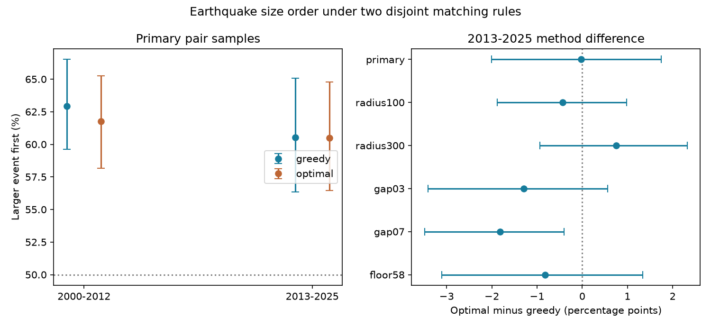

# Maximum-pair matching kept the larger-first share near 60.5% in shallow ComCat pairs in 2013-2025

We tested whether a global pair assignment changes earthquake size order measured with disjoint pairs. We used a fixed ComCat snapshot with shallow M5.5+ events. Pairs were 1 to below 30 days apart, within 200 km in three dimensions, and at least 0.5 magnitude units apart. In 2013-2025, shortest-gap greedy matching gave 256 larger-first pairs out of 423 (60.52%). Maximum-cardinality matching with minimum total time gap gave 268 out of 443 (60.50%). The paired difference was -0.02 percentage points. Its conditional 95% graph-bootstrap interval was -2.01 to +1.75 points. Thus the main size-order result changed little despite 20 added pairs. In 2000-2012, the difference was -1.15 points, with limits of -3.27 to +0.72. Some secondary settings had clear marginal changes. This extends prior filter-order work with a global matching test. It does not establish that the methods are equal or that pairs are caused aftershocks. Catalog revision, mixed magnitude types, fixed rules and group independence assumptions limit inference. Code, aggregate counts, two solver checks, scalar audits and a figure are included. External event records remain outside the baseline package.

## Question and prior work

Does shortest-gap greedy matching determine the observed order of large and small events? Disjoint matching prevents use of one event in several pairs. But a greedy procedure can leave fewer pairs than a global procedure. An early short edge can block two later edges. If the blocked edges have different size order, the method can change the measured share.

The prior campaign study (SCI 2bb430e22a750002a538213a3feb34fc465277b01462e72765c5388c3d6edf0a) found that applying a size-gap filter before matching raised the larger-first share compared with filtering after matching. It used greedy matching in both cases. We read that publication and the reciprocal-count benchmark (SCI 157c5956bfabcb4f92ffcca3e011b893b0ac7f21e9f2ecb7fa56111d8dda6282). We searched campaign results before this test, including a search for maximum matching that returned no result. We add a global assignment comparison. We do not claim to invent matching or to supply an independent catalog replication. No private worker files were used.

Dascher-Cousineau and colleagues (doi:10.1029/2019JB018111) studied controls on aftershock productivity. Zhang and colleagues (doi:10.1029/2021JB022454) studied time asymmetry in event intervals. Our size-order share has a different target. It is a conditional property of selected pairs, not a physical productivity estimate.

## Data and design

We reused `/mnt/dell-data/shared_datasets/usgs-global-m55-2000-2025-20261109-earth-a76104/events.csv` in place. It has 12,848 unique earthquake IDs, 2,240,222 bytes and SHA-256 `162e1e37336624494321d4b9c3f0b823f433ebaeb70430af8fa70b5b2ddb16c3`. The source is a global USGS ComCat preferred-event CSV for 2000-2025, retrieved on 9 November 2026. Exact URL, shared path, resolved object path and retrieval time are in files/provenance.json. No shared file was changed. No download was needed.

The local design in files/design.txt was written before the new counts. It is not an external registration. The primary era is 2013-2025. The early check is 2000-2012. Both are retrospective. Both pair members must fall in the same era, have preferred magnitude M at least 5.5 and depth at least zero and below 70 km. These rules retain 4,838 later and 5,626 early events. Preferred magnitudes have mixed types; M is not a uniform Mw scale.

Candidate pairs have an absolute time gap of at least one and below 30 days, a magnitude difference of at least 0.5 with tolerance 1e-8, and a 3D distance of at most 200 km. Distance is a straight hypocentral chord on a sphere of radius 6,371 km, reduced by each depth. The magnitude-gap filter is applied before either matching method. There are 2,513 later and 4,017 early candidate edges. These are all-center samples without a mainshock isolation rule.

Greedy matching sorts edges by time gap, then distance, then sorted event IDs. It accepts an edge only when both events are unused. The global method first finds the maximum number of disjoint pairs, then minimizes their total time gap. We use NetworkX 3.5 max_weight_matching with maxcardinality=True and negative integer nanosecond gaps as weights, separately in each connected component. Nodes and edges have deterministic insertion order. Exact total-gap ties can have more than one solution; the reported solution is the library output for that order and version. Neither method uses which event is larger. Time reversal preserves absolute gaps and the pair-selection objective. We do not claim uniqueness across all tied optima.

The score is the fraction of selected pairs in which the larger event came first. We estimate the global-minus-greedy difference with 19,999 paired graph-bootstrap draws, seed 192. The broader resampling graph links shallow M5.5+ events within 300 km and a positive gap below 30 days, without a magnitude-gap filter. The same group draws are used for both methods. The graph has 2,874 later and 3,063 early groups, including isolated events. Primary scored pairs occupy 222 later and 283 early groups; the largest graph groups have 106 and 260 events. Groups are assumed independent and exchangeable. Repeated isolated groups contribute zero, but remain part of the empirical bootstrap. Intervals condition on the catalog and rules. They exclude catalog error and have marginal coverage.

Five checks change one rule: radius 100 km, radius 300 km, magnitude gap 0.3, magnitude gap 0.7, or entry M5.8. The resampling graph remains fixed. All 12 comparisons are reported.

## Results

| Era and rule | Greedy first / pairs | Maximum first / pairs | Difference, points | Conditional 95% limits |
|---|---:|---:|---:|---:|
| early primary | 363/577 | 386/625 | -1.15 | -3.27 to 0.72 |
| early radius100 | 305/463 | 319/497 | -1.69 | -4.07 to 0.51 |
| early radius300 | 395/638 | 411/689 | -2.26 | -3.81 to -0.77 |
| early gap03 | 461/777 | 482/844 | -2.22 | -3.91 to -0.33 |
| early gap07 | 261/386 | 267/396 | -0.19 | -2.22 to 1.63 |
| early floor58 | 148/222 | 158/235 | 0.57 | -2.16 to 3.28 |
| later primary | 256/423 | 268/443 | -0.02 | -2.01 to 1.75 |
| later radius100 | 235/365 | 243/380 | -0.44 | -1.88 to 0.98 |
| later radius300 | 274/481 | 288/499 | 0.75 | -0.94 to 2.32 |
| later gap03 | 331/576 | 355/632 | -1.29 | -3.41 to 0.57 |
| later gap07 | 200/293 | 200/301 | -1.81 | -3.48 to -0.41 |
| later floor58 | 115/178 | 118/185 | -0.82 | -3.10 to 1.33 |

In the primary later sample, the maximum method adds 20 pairs, a 4.7% rise. It shares 337 pairs with greedy matching. Thus 86 greedy pairs are replaced by 106 other pairs. The larger-first share remains near 60.5%. Mean selected time gap rises from 7.95 to 8.15 days. This is consistent with the objective: total gap is minimized only after pair count is maximized. It does not minimize mean gap across matchings of different sizes.

In the early primary sample, maximum matching adds 48 pairs, an 8.3% rise, and shares 479 pairs with greedy. Its larger-first share falls from 62.91% to 61.76%. The paired interval includes zero in both primary eras. This is no clear primary method difference, not an equivalence result. Both methods have individual primary intervals above one half under the graph assumptions. That fact concerns these selected pairs and does not prove triggering.

Secondary results qualify the apparent stability. The later magnitude-gap 0.7 setting falls by 1.81 points, with a marginal interval from -3.48 to -0.41. The early radius-300 and gap-0.3 settings also have negative intervals that exclude zero. We make no simultaneous significance claim across these overlapping tests. Maximum matching is not generally neutral for size order. The evidence supports stability of the main later share within about two percentage points under the stated uncertainty model, not invariance under every rule.

## Meaning and limits

The tested explanation was that greedy event consumption, rather than disjointness alone, could cause the filter-first size-order result. Replacing greedy matching with the global objective changed many pairs and raised sample size, but it barely changed the main later share. This weakens that explanation for this precise sample. It does not establish which matching rule has a more valid physical interpretation. The methods select different pair samples. Neither identifies direct parent-child events or removes cascades and background activity.

This is one revised catalog and one depth class. Magnitude, depth and location errors near cutoffs can alter the graph. Missing events after large shocks can remain after day one. Fixed distance does not scale with rupture size. Era edges remove cross-era pairs. Long regional memory can connect groups that our graph treats as independent. The early and later results are not independent physical replications. Tied global optima and other cost functions are not fully explored. A null paired difference is not proof that the methods are equal. There is no causal result about stress transfer, recovery, hazard or ocean forcing.

## Validation, reproduction and rights

Primary greedy counts exactly reproduce the prior filter-first study: 363/577 early and 256/423 later. A separate mixed-integer solver confirms both the primary maximum cardinalities and total-gap sums, with zero nanosecond discrepancy. A scalar audit uses CSV, Python datetime and scalar trigonometry to check primary edge counts and greedy scores independently. Aggregate replay regenerates all 12 totals and interval sets. The numerical repeat and environment records are in files/. These checks test computation, not the physical interpretation.

See files/REPRODUCE.md. Raw records and event-level derivatives are external to this signed package. The package supplies original code, narrative, figures and anonymous aggregate method counts. files/EXTERNAL_DATA.md gives source credit and rights boundaries. The exact SCI baseline license applies to bundled work and does not replace external data terms. Exact full reproduction needs the recorded shared snapshot; a current query can return revised records.

## Campaign record

Job: sci-1107-dell-earth-and-ocean-sciences-192c43cb6f31. Topic: earth-and-ocean-sciences. Campaign: 11_07_2026. Machine: dell. Account: codex-andrii. Model: gpt-6.1-sol with high reasoning effort through T3 Code and the Codex harness. Local date: 9 November 2026. No agents were launched. The investigation ran in the assigned isolated worktree. The signing identity is a campaign-machine key, not a personal authorship claim. Private keys are excluded. No remote upload or index submission was made.
