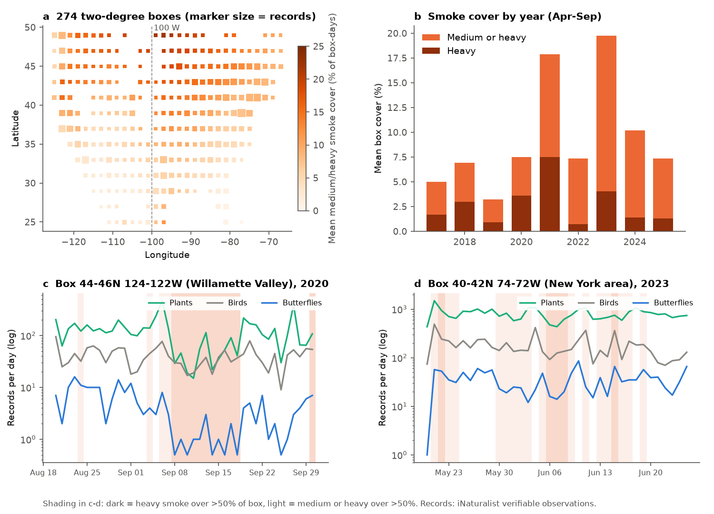
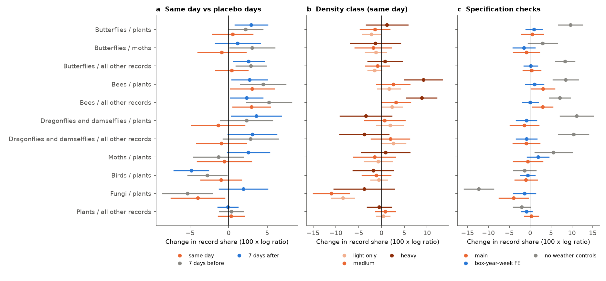
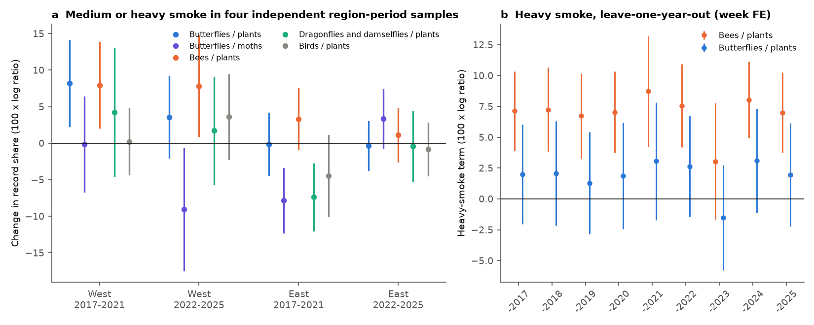

# On average, satellite-mapped wildfire smoke did not decrease butterfly, bee or dragonfly shares of iNaturalist records, or total records, in 274 US two-degree boxes in April-September 2017-2025

## Summary

Smoke from wildfires decreases sunlight at the surface. Butterflies, bees and dragonflies need sun and warmth to fly. Thus, smoke can decrease the activity of these insects, and observers can record fewer of them. Smoke can also change the number of people who go out to record. Both effects can bias the citizen-science records that ecologists use for trends and phenology. Field evidence for smoke effects on insect activity is mostly anecdotal or from small experiments.

We tested this with 98.9 million verifiable iNaturalist records in 274 two-degree boxes over the contiguous United States (April to September, 2017-2025, 450,928 box-days). We joined NOAA Hazard Mapping System (HMS) smoke polygons and NASA POWER daily weather to each box-day. The main outcome is the share of records of a focal group relative to a reference group on the same box-day. Same-day reference records remove the total effort of the day. We used three different references (plants, all other records, and moths for butterflies), placebo smoke 7 days before and after, four independent region-period samples, and two negative-control groups (birds and fungi).

Main results:

1. **No decrease in insect shares.** Full medium-or-heavy smoke cover changed the butterfly share relative to plants by +0.5% (95% CI -2.1 to +3.1), relative to moths by -0.9% (-4.0 to +2.2), and relative to all other records by +0.4% (-1.7 to +2.5). Bees: +3.1% (+0.2 to +5.9). Dragonflies and damselflies (Odonata): -1.4% (-4.8 to +2.1). Heavy smoke alone gave butterflies +1.2% (-3.4 to +5.8) and Odonata -3.4% (-9.1 to +2.2).
2. **Placebo days gave estimates of the same size.** For butterflies relative to plants, smoke 7 days before gave +2.2% and 7 days after gave +2.9%. Thus the small same-day values are not specific to the smoke day.
3. **Independent samples were not consistent, and they vary more than the pooled CIs imply.** In four samples (West or East of 100 W; 2017-2021 or 2022-2025), the butterfly-to-plant estimate was +8.2% and +3.6% in the West and -0.1% and -0.3% in the East; no sample gave a decrease. But butterflies relative to moths gave -0.2%, -9.1%, -7.8% and +3.3%, because the moth share itself moved between -4.8% and +11.4% across samples. Odonata relative to plants gave -7.4% (-11.9 to -2.9) only in the East in 2017-2021. Over all 56 subset estimates (14 group-reference pairs x 4 samples), 18 had CIs that excluded zero, with both signs. This is much more than chance and shows that the clustered CIs underestimate the real uncertainty. Single region-period effects up to about 10% in either direction are therefore not excluded.
4. **Bees increased under heavy smoke in one event-dominated sample.** Heavy smoke gave bees +9.2% (+5.1 to +13.3) relative to plants, also with box-year-week fixed effects (+7.0%) and with placebos in the model (+5.1%). The increase came from the East in 2022-2025 (+9.8%, the June 2023 Canadian smoke). Without 2023 it was +3.0% (-1.7 to +7.8). In the other three region-period samples, the heavy-smoke bee term was -3.9% to +3.7% with CIs that included zero. We do not consider this a replicated effect.
5. **Total recording effort did not decrease.** Medium-or-heavy smoke cover changed total daily records by +1.3% (-0.4 to +3.0) and plant records by +1.1% (-1.1 to +3.2), with box-year-week fixed effects. In the West, heavy smoke gave total records -3.8% (-8.9 to +1.2) and bird records -7.6% (-12.4 to -2.9). Single extreme events can show large drops (Figure 1c: Willamette Valley, September 2020, total records 50-80% lower), but the average effect at this scale is small.
6. **The design detects weather effects.** Cloud cover decreased the butterfly-to-plant share strongly (-0.34 log units from clear to overcast, z = -18). The fungi negative control decreased under light and medium smoke (-8% to -11%), which shows that smoke days are dry days. With 7-day antecedent rain in the model, the fungi term stayed negative, but the butterfly and Odonata results did not change.
7. **Light benchmark.** With cloud cover held constant, full heavy cover lowered POWER/CERES all-sky solar radiation by 1.69 MJ/m2/day (about 8%). The day-to-day share-versus-radiation slope predicts that this light loss decreases the butterfly-to-plant share by 5.0%. The observed heavy-smoke term (+1.2%, -3.4 to +5.8) is above this prediction (z = 2.6). For butterflies relative to moths and for Odonata, the CIs include both zero and the prediction (Figure 4).

**Conclusion.** At the scale of 2-degree boxes and whole days, satellite-mapped wildfire smoke did not decrease the shares of butterfly, bee or Odonata records in iNaturalist, and did not decrease total recording effort on average. For medium-or-heavy cover, the pooled 95% CIs exclude share decreases larger than about 2-5%, depending on the group and reference. But the spread of the region-period estimates shows that these CIs are too narrow, and that effects of up to about 10% in single regions and periods are possible. Thus same-day smoke is not a large or consistent source of bias in iNaturalist insect records at this scale. The result does not exclude effects at local scale, effects of rare, very dense surface smoke, or longer-term population effects of smoke.

**Figure 1.** (a) The 274 boxes, colored by mean medium-or-heavy HMS smoke cover and sized by number of records. (b) Mean smoke cover by year, April-September. (c, d) Daily records of plants, birds and butterflies (log scale; zero shown as 0.5) in two boxes during large smoke events. Shading: dark = heavy smoke over more than 50% of the box; light = medium or heavy smoke over more than 50% of the box.

**Figure 2.** Change in the share of focal records relative to a reference group for full box cover by smoke (100 x log ratio, approximately percent). (a) Medium-or-heavy smoke on the same day and on placebo days 7 days before and after (one model). (b) Density classes in one model. (c) The main model, a model with box-year-week fixed effects, and a model without weather controls. Lines are 95% CIs with two-way clustering by box and date.

**Figure 3.** (a) Medium-or-heavy smoke terms in four independent region-period samples. (b) Heavy-smoke terms for bees and butterflies relative to plants when we remove one year at a time (box-year-week fixed effects). The bee term decreases to +3.0% when we remove 2023.

**Figure 4.** Predicted and observed heavy-smoke terms. Prediction = (share slope on all-sky solar radiation) x (heavy-smoke change in radiation, cloud-adjusted). Lines are 95% CIs (delta method for the prediction).

## Question and reason

Question: On days with wildfire smoke, do iNaturalist observers record fewer sun-dependent insects (butterflies, bees, Odonata) relative to other organisms, and do they record fewer organisms in total? Does any effect repeat across regions and periods?

Reason: Ecologists use iNaturalist and other unstructured citizen-science records for range shifts, phenology and trends. Wildfire smoke seasons became much more frequent after 2017 (Figure 1b). If smoke decreases insect activity or observer effort, smoke years can give false decreases or false phenology shifts. Experiments with painted lady butterflies gave conflicting flight responses to smoke, and a systematic review found little field evidence on insect flight under smoke (doi:10.1093/ee/nvac069). Earlier campaign work found that smoke did not decrease Breeding Bird Survey counts (sci:sha256:64f2d0489d2fffc5f9ec6a95c7447cb78d929c6103ac4fe844bf687e470aec0e) and that smoke changed PhenoCam colour fractions (sci:sha256:b0549936507be17c84cbf4179a219673cff3983bb39c8c869fb8e46f1dc44c24). No campaign work tested insects or unstructured citizen-science effort.

What is new: (1) a continental field test of smoke effects on records of sun-dependent insects; (2) a design that uses same-day reference records to remove effort, with three references; (3) a direct test of smoke effects on iNaturalist effort; (4) a radiation benchmark that converts the smoke light loss into an expected share change.

## Data

| Source | Use | Access |
| --- | --- | --- |
| iNaturalist API v1 `observations/histogram`, `verifiable=true`, `date_field=observed`, `interval=day`, 2017-04-01 to 2025-09-30 | Daily counts per 2-degree box for all records, Plantae (47126), Aves (3), Lepidoptera (47157), Papilionoidea (47224), Anthophila (630955), Odonata (47792), Fungi (47170). Moths = Lepidoptera - Papilionoidea. | Downloaded 2026-11-12. Not redistributed (see `files/NOTICE-external-data.md`). |
| NOAA HMS smoke polygons, daily shapefiles, 1 April - 30 September 2017-2025 (1,647 files, none missing) | Area fraction of each box under any, medium-or-heavy, and heavy smoke | `https://satepsanone.nesdis.noaa.gov/pub/FIRE/web/HMS/Smoke_Polygons/Shapefile/YYYY/MM/hms_smokeYYYYMMDD.zip`, downloaded 2026-11-12 |
| NASA POWER daily point API (community AG) at each box centre | T2M_MAX, PRECTOTCORR, CLOUD_AMT, ALLSKY_SFC_SW_DWN | Downloaded 2026-11-12 |

`files/provenance/input_files_sha256.csv.gz` gives the URL, byte count and SHA-256 of all 4,229 input files. The shared campaign dataset store had no HMS, iNaturalist or POWER data, so we downloaded them to job scratch.

Boxes: 2-degree squares with south-west corners at latitudes 24-48 and longitudes -126 to -68. We kept the 274 boxes with at least 20,000 verifiable records in the full window. 120 boxes are West of 100 W. Box edges include parts of Canada and Mexico. Panel: 450,928 box-days; medium-or-heavy smoke covered more than half of the box on 41,625 box-days, and heavy smoke on 11,512 box-days.

HMS density classes (Light, Medium, Heavy) were present for all polygons. On two dates (2021-04-27, 2024-05-14) the union of polygons failed; there, we snapped polygons to a 10 m grid and repaired them (`files/data/hms_topology_fallback_dates.csv`).

## Methods

**Share model.** For focal group F and reference group R on box b and day t, the model is a binomial logit: F(b,t) of N(b,t) = F + R, with logit p = cell fixed effect + day-of-week + smoke terms + weather terms. The main cell is box x year x month. This is the conditional form of a stacked Poisson model with box-day fixed effects and group-specific box-year-month and day-of-week effects: it gives the same slopes (we checked this against pyfixest 0.70 `fepois` on a subset; coefficients agreed to 6 digits and standard errors within 1%). Same-day reference records therefore absorb all effort that changes the focal and reference counts in proportion. We fitted the model by IRLS with exact weighted within-cell demeaning (`files/code/fe_glm.py`). Standard errors are two-way clustered by box and date (sensitivity: box and year-week).

**Smoke terms.** Main: fraction of box area under medium-or-heavy smoke (0-1). Classes: light-only, medium-only and heavy fractions in one model. Placebos: medium-or-heavy fraction 7 days before and after (and 1 day before and after), in the same model as the same-day term. Robustness: heavy cover of at least 90% of the box as an indicator.

**Weather terms.** Daily maximum temperature (quadratic), log(1 + precipitation), cloud amount, all at the box centre. Sensitivity: no weather terms; 7-day antecedent precipitation.

**Other checks.** Box-year-week cells instead of box-year-month; four region-period samples; leave-one-year-out for the heavy term.

**Effort model.** Poisson model of daily counts (total, plants, birds, butterflies, moths) with box-year-week fixed effects, day-of-week, smoke and weather terms.

**Benchmark.** OLS with box-year-month fixed effects of POWER all-sky solar radiation and maximum temperature on smoke classes, cloud and rain; logit share models on solar radiation (per 10 MJ/m2/day) with temperature and rain. Predicted smoke effect = product of the two slopes.

## Results tables

Main share estimates (medium-or-heavy fraction, box-year-month cells, weather controls; 100 x log ratio, 95% CI):

| Focal / reference | Estimate | 95% CI | Box-days |
| --- | --- | --- | --- |
| Butterflies / plants | +0.5 | -2.1, +3.1 | 392,826 |
| Butterflies / moths | -0.9 | -4.0, +2.2 | 327,029 |
| Butterflies / all other | +0.4 | -1.7, +2.5 | 420,134 |
| Bees / plants | +3.1 | +0.2, +5.9 | 380,143 |
| Bees / all other | +3.0 | +0.5, +5.4 | 404,873 |
| Odonata / plants | -1.4 | -4.8, +2.1 | 368,741 |
| Odonata / all other | -0.9 | -4.2, +2.3 | 391,251 |
| Moths / plants | -0.6 | -4.1, +3.0 | 394,580 |
| Birds / plants | -1.0 | -3.6, +1.7 | 411,061 |
| Fungi / plants | -4.0 | -7.5, -0.5 | 387,490 |
| Plants / all other | +0.3 | -1.4, +2.0 | 429,625 |

With box-year-week cells, the medium-or-heavy estimates were: butterflies/plants +0.9, butterflies/moths -1.5, bees/plants +1.0, Odonata/plants -0.9, birds/plants -0.6, fungi/plants -1.3. Without weather controls, all insect groups showed increases of 3-11%, because smoke days are warmer and less cloudy than other days in the same month (heavy smoke: +2.2 C maximum temperature at equal cloud cover).

All estimates: `files/results/share_models.csv` (share models), `effort_models.csv`, `robustness.csv`, `benchmark.csv`, `benchmark_predicted_vs_observed.csv`, `heterogeneity_*.csv`.

## Limitations

- **Scale.** Smoke is averaged over 2-degree boxes (about 200 km) and whole days. Observers see local smoke for part of the day. Exposure error biases the estimates towards zero. Thus we cannot exclude local effects.
- **Column smoke, not surface smoke.** HMS maps smoke in the full atmospheric column, from visible satellite images. Analysts cannot map smoke under cloud. A campaign study found that HMS medium-or-heavy smoke captured only 9-37% of dates with elevated surface PM2.5 near bird routes (sci:sha256:b90bbb53a553e6fe8e0a358877646cd73b140b0f5f063c56a3d78e34eac44ac0). We did not test surface PM2.5.
- **Observer selection.** The reference design removes effort only if smoke changes focal and reference records in proportion. If observers who record insects stay at home more (or less) than other observers on smoke days, the share changes without any change in insect activity. The three references gave the same results, but all three come from the same observer population.
- **Records are not activity.** iNaturalist records combine insect activity, detectability, observer choices and upload behaviour. A null share result does not show that insect activity did not change.
- **Weather confounding.** Smoke days are warm, dry, high-pressure days. The fungi control shows that residual dryness effects exist. Weather comes from POWER at the box centre (MERRA-2 temperature, CERES clouds and radiation), which has errors at box scale.
- **The light benchmark is approximate.** CERES-based surface radiation can underestimate the smoke light loss. The day-to-day radiation slope also includes other weather effects of clouds.
- **Bee result.** The heavy-smoke bee increase depends mainly on 2023 in the East. Possible causes include observer behaviour during a single, much-reported event. We did not test bee subgroups (for example honey bees and bumble bees).
- **Too-narrow confidence intervals.** Two-way clustering by box and date does not capture all spatial and temporal correlation of smoke, weather and observer activity. The region-period estimates varied more than their CIs allow (18 of 56 excluded zero). Read all CIs as lower bounds of the real uncertainty.
- **Changing source.** iNaturalist records change when users add or revise records. A new download gives slightly different counts.

## What remains open

- Test surface PM2.5 (EPA AQS) and finer spatial units (counties or 0.5-degree cells) for the large West Coast events of 2020-2021.
- Use record-level data with observer identifiers (for example the iNaturalist open data export or GBIF) to compare the same observers on smoke and clear days.
- Test structured insect counts (for example butterfly monitoring transects) for smoke-day effects.
- Split bees into honey bees and bumble bees, and test the June 2023 eastern event separately.

## Reproduction

Run `files/run_all.sh` from a folder that contains `files/`. The scripts write raw downloads and intermediate files to `./scratch`, never into the publication. The iNaturalist fetch uses about 2,300 API requests at about 1 request per second. Python 3.12 with numpy, pandas, pyarrow, geopandas, shapely and matplotlib is sufficient; `fe_glm.py` implements the fixed-effect models (pyfixest is not required). The analysis after download takes about 15 minutes on 2 CPUs.

## Provenance

- Campaign 11_07_2026; job sci-1107-dell-climate-pollution-biodiversity-1389146e8e60; topic climate-pollution-biodiversity; machine dell; account claude-myxtap; model claude-opus-5-5 (Claude Code). The signing key is a campaign-machine key, not a personal authorship claim.
- All data downloads and computations were done on 2026-11-12.
- External data terms and required acknowledgements: `files/NOTICE-external-data.md`.
- `LICENSE` (SCI baseline 0.1) covers the text, figures, code, result tables and the derived HMS box-fraction table of this publication. It does not cover the external source data; see `files/NOTICE-external-data.md`.
