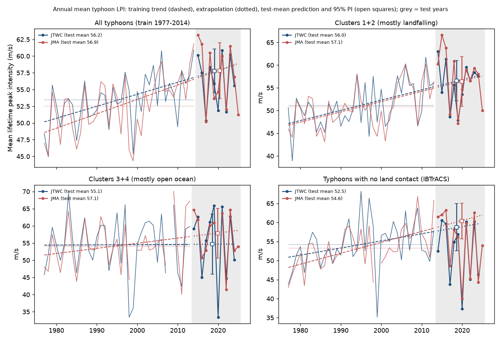
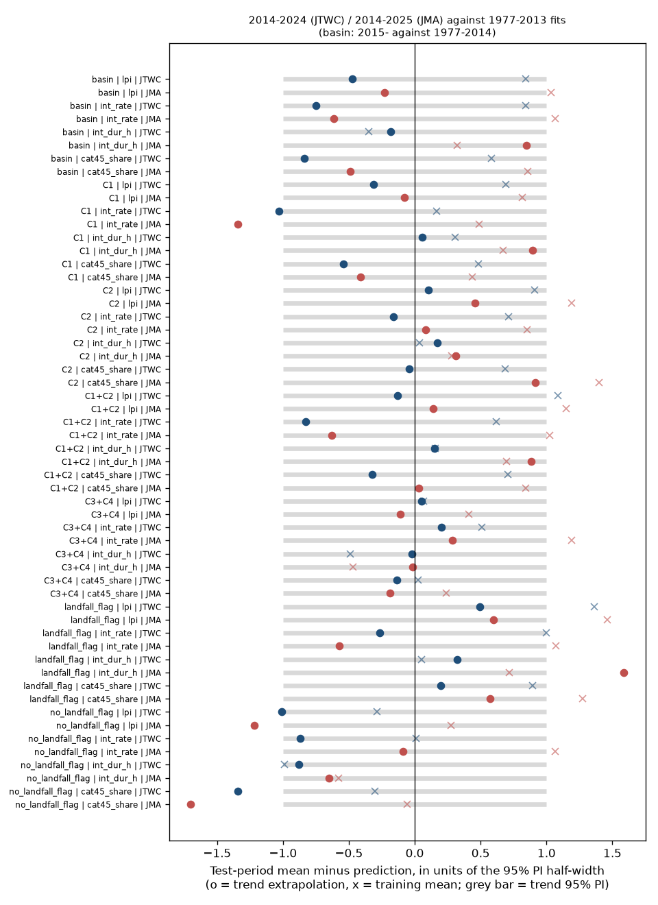
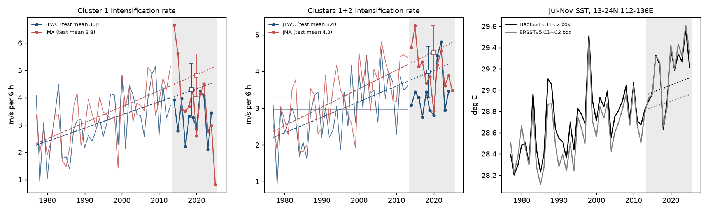

# Landfalling northwest Pacific typhoons kept their 1977-2013 intensity rise in 2014-2024, but their intensification rate stopped rising and local SST did not predict the new years

## Summary

Mei and Xie (2016, Nature Geoscience 9, 753) reported that typhoons that strike East and Southeast Asia became 12-15% more intense from 1977 to 2013. They divided typhoons into four track clusters. Clusters 1 and 2 have a high landfall rate (about 85%). In these clusters, the lifetime peak intensity (LPI) increased by about 8 and 5 m/s. Open-ocean clusters 3 and 4 changed less. They said that a faster intensification rate (+1.5 m/s per 6 h) caused nearly all of the increase, and that local ocean surface warming on the rim of East and Southeast Asia caused the faster rate.

We did an out-of-sample test of these statements with 11-12 new seasons (2014-2024 for JTWC, 2014-2025 for JMA). We used IBTrACS v04r01 and the methods of the paper. We wrote the test plan (files/PLAN.md) before we calculated any statistic for the new years. We fitted all models on the paper's years only, then we froze them.

Main results:

1. **The replication is close.** In 1977-2014 the JTWC basin mean typhoon LPI increased by 6.6 m/s (13.2%; paper: about 7 m/s, 14%). In 1977-2013, cluster 1 increased by 9.3 m/s (18.6%) and cluster 2 by 6.8 m/s (15.4%). The intensification rate of clusters 1+2 increased by 1.53 m/s per 6 h (70%; paper 1.5 m/s per 6 h, more than 60%). The open-ocean clusters 3+4 did not change in JTWC (+0.3%). The adjusted JMA data gave similar values.
2. **The intensity increase of the landfalling clusters continued.** In 2014-2024 the mean LPI of the 95 cluster 1+2 typhoons (JTWC) was 56.0 m/s. The extended 1977-2013 trend predicted 56.6 m/s (95% prediction interval 52.1-61.0). The 1977-2013 mean was 51.2 m/s. Adjusted JMA (96 typhoons, 2014-2025) gave 57.1 m/s against a trend prediction of 56.4 m/s (50.9-61.8). The trend forecast had half of the squared error of the no-change forecast in both data sets. The share of category 4-5 typhoons in clusters 1+2 was 0.48 (JTWC) and 0.54 (JMA), against 0.33 in 1977-2013 and a trend prediction of 0.54.
3. **The intensification rate did not continue to increase.** The cluster 1+2 rate in the new years was 3.40 m/s per 6 h (JTWC) and 4.04 (JMA), below the trend predictions of 3.99 and 4.51 (p = 0.10 and 0.21). For cluster 1 the rate was clearly below the trend in both data sets (JTWC 3.29 against 4.29, p = 0.044; JMA 3.76 against 4.81, p = 0.010). From 2000 the cluster 1+2 rate trend is near zero (JTWC -0.06 +/- 0.18, JMA -0.05 +/- 0.16 m/s per 6 h per decade). Thus the high LPI after 2013 did not come from a still faster intensification. In JMA the intensification period was longer than the trend predicted (33 h against 25 h, p = 0.08).
4. **Local SST continued to warm, but it did not predict the new years.** The July-November SST in the cluster 1+2 intensification box (13-24N, 112-136E) was 29.16 C in 2014-2025 (HadISST), 0.46 C above the 1977-2013 mean and 0.12 C above its own trend. A regression of the annual rate on box SST, fitted in 1977-2013, had r = 0.50 in training (JTWC). But after we removed the linear trends, r was only 0.28 (JTWC) and 0.00 (JMA). In the new years, r was 0.12 (JTWC) and -0.24 (JMA). The SST model predicted the mean LPI too low (53.8 against 56.0 m/s in JTWC; 52.0 against 57.1 in JMA) and had a larger error than the time trend. The year-to-year link between local SST and intensification is weak, and the new years do not support it.
5. **The contrast between landfalling and open-ocean typhoons became larger.** Clusters 3+4 stayed near their 1977-2013 level (JTWC 55.1 against 54.5 m/s). Typhoons that had no land contact in IBTrACS were less intense than their 1977-2013 trend predicted (JTWC 52.5 against 58.7 m/s, p = 0.048; JMA 54.6 against 60.4 m/s, p = 0.018), and their category 4-5 share was 0.34 against a predicted 0.69 (p = 0.010; JMA p = 0.001). Typhoons with land contact were at or above their trend (JTWC 58.4 against 56.3 m/s).

Conclusion: with JTWC and adjusted JMA best tracks, the high intensity of landfalling northwest Pacific typhoons that Mei and Xie found for 1977-2013 continued in 2014-2024. The stated mechanism did not continue in the same way: the intensification rate stopped increasing after about 2000-2010, and the year-to-year local SST link that the paper used as evidence did not predict the new years. A cause other than a still faster intensification (for example longer intensification or a change in where storms form and move) must explain the recent high intensity. We did not identify this cause.



## Claim under test

Mei, W. and Xie, S.-P. (2016), "Intensification of landfalling typhoons over the northwest Pacific since the late 1970s", Nature Geoscience 9, 753-757, doi:10.1038/ngeo2792. Statements that we tested:

- C-basin: the annual mean typhoon LPI increased by 14% (about 7 m/s) in 1977-2014, and the share of category 4-5 typhoons more than doubled (JTWC and adjusted JMA).
- C-landfall: clusters 1 and 2 (landfall rate about 85%) increased by about 8 and 5 m/s (15% and 12%) in 1977-2013; clusters 3 and 4 changed modestly.
- C-rate: the cluster 1+2 intensification rate increased by 1.5 m/s per 6 h (more than 60%) and explains nearly all the LPI increase.
- C-SST: the rate increase is tied to local SST warming; the interannual SST and rate are positively correlated.

## Data

| Data | Source and version | SHA-256 |
| --- | --- | --- |
| Best tracks | IBTrACS v04r01 ALL netCDF (NOAA NCEI), file created 2026-11-07, shared copy `datasets/ibtracs-v04r01-ALL-netcdf-20261109` | `c20cc4e291f91e166b92b560bec64cfda3bc23c00d39b1282ae7c3b34ba12d17` |
| SST (main) | HadISST1 monthly, Met Office, to 2026-09, shared copy `datasets/hadisst1-sst-nc-20261108-olen` (gz) | gz `eb0a4025...0d45`, decompressed `c1d70311...5635` |
| SST (check) | NOAA ERSSTv5 monthly (PSL copy), to 2026-10, shared copy `datasets/ersst-v5-psl-sst-mnmean-20261108-olen` | `952fad739abab3e3c33c955b168f298b9884d2fe48ab259ebf19ac531d8d8386` |

JTWC final best tracks are available to 2024. The 2025 JTWC tracks are provisional (TCVitals); we use them only as a sensitivity check. JMA best tracks are available to 2025. Full URLs, dates and hashes are in files/provenance.json. The external data terms are in files/EXTERNAL-DATA-NOTICE.md. No raw data file is in this bundle.

## Methods

We followed the methods section of the paper. Differences are stated.

- **Fixes and storms.** Six-hourly synoptic fixes (00, 06, 12, 18 UTC) in the WP basin, seasons 1977-2025; spur tracks removed. A typhoon is a storm with LPI of 64 kt or more (1-min). We used JTWC (`usa_wind`, 1-min) and JMA (`tokyo_wind`, 10-min) separately, each with its own positions. 1977-2013 gives 605 JTWC typhoons (paper: nearly 600).
- **Adjusted JMA wind.** As in the paper, JMA winds before 1987 are divided by 0.88. From 1987 the paper inverted the Koba et al. (1991) table to a Dvorak CI number and then used the Dvorak 1-min table. We could not get the Koba table values, so we inverted the published linear fit to that table (Knapp and Kruk 2010, Table 1): MSW1 = (MSW10 - 23.3)/0.60. The category 4 threshold is 58.5 m/s for JTWC and 56 m/s for adjusted JMA, as in the paper. After 1987 the JMA series uses one fixed rule, so any monotonic conversion keeps the sign of a test-period residual; the size can change a little.
- **Metrics.** LPI is the lifetime maximum wind. The intensification rate is the 12-h centred wind difference (m/s per 6 h), averaged over the fixes from the first fix at typhoon intensity to the LPI. The duration is the length of that period. Annual means use all typhoons of the year in the group.
- **Clusters.** A regression mixture model with quadratic polynomials of latitude and longitude against time (Gaffney 2004; Camargo et al. 2007), K = 4, fitted jointly to the JTWC and JMA tracks (fixes of 34 kt or more) of 1977-2013 typhoons. We used 30 random starts with a fixed seed and kept the best likelihood. We froze the parameters and assigned every track (1977-2025) to the cluster with the largest posterior probability. We labelled the clusters by the paper's description (files/results/cluster_description_1977_2013.csv and Figure 3): C1 forms east of the Philippines and moves northwest to north (JTWC land contact 70%, 31% of typhoons); C2 forms farther west and moves west-northwest to Southeast Asia and South China (land contact 96%, 30%); C3 forms far east and recurves over the open ocean (13%); C4 forms far east at low latitude and makes long westward tracks (49%). C1+C2 have 60% of typhoons and 83% land contact (paper: more than 60% and about 85%). The two agencies put the same storm in the same cluster in 92% of cases. Labels for C3 and C4 are less certain; the tests use C1, C2, C1+C2 and C3+C4.
- **Land contact grouping (check).** A typhoon has land contact if any fix has IBTrACS `dist2land` of 0.
- **Out-of-sample test (plan T1).** For each annual series we fitted an ordinary least-squares trend on the paper's years (basin 1977-2014, clusters 1977-2013). We compared the mean of the new years with (a) the extended trend and (b) the training mean. The 95% prediction interval for the test mean includes parameter and residual variance, inflated by (1 + r1)/(1 - r1) when the training residual lag-1 autocorrelation r1 is positive. We also report the mean squared error (MSE) of each forecast over the test years. As an exploratory baseline that was not in the plan, we added the mean of the last 15 training years.
- **SST mechanism (plan T2).** We formed a box from the 10th-90th percentiles of the mean intensification positions of 1977-2013 JTWC typhoons in each group (files/results/sst_boxes.json; C1+C2: 13-24N, 112-136E) and calculated the July-November mean SST. The paper used July-November HadISST, but its exact boxes are only shown in a supplementary figure. We regressed the annual rate (and LPI) on box SST in 1977-2013 and forecast the new years. We also used SST relative to the 30S-30N mean, and ERSSTv5.
- **Agency comparison (plan T3).** All tests were done separately for JTWC and adjusted JMA.

## Results

### Replication of 1977-2013/2014 trends (files/results/trend_tests.csv)

| Group, metric | JTWC change | JMA (adjusted) change | Paper |
| --- | --- | --- | --- |
| Basin LPI, 1977-2014 | +6.6 m/s (13.2%), 1.79 +/- 0.48 m/s per decade | +8.0 m/s (16.4%) | about +7 m/s (14%) |
| C1 LPI, 1977-2013 | +9.3 m/s (18.6%) | +9.2 m/s (18.9%) | about +8 m/s (15%) |
| C2 LPI, 1977-2013 | +6.8 m/s (15.4%) | +6.1 m/s (13.7%) | about +5 m/s (12%) |
| C1+C2 rate, 1977-2013 | +1.53 m/s per 6 h (70%) | +1.81 m/s per 6 h (76%) | +1.5 m/s per 6 h (more than 60%) |
| C3+C4 LPI, 1977-2013 | +0.3% | +10.4% | modest |
| Basin category 4-5 share, 1977-2014 | 0.25 to 0.54 (fitted) | similar | more than doubled |

### Out-of-sample test, new years against frozen trends

Values are means of annual means. PI is the 95% prediction interval of the trend forecast for the test-period mean. p is two-sided for the difference from the trend forecast. MSE is for annual values.

| Group, metric, agency (test years) | Training mean | Test mean | Trend forecast [95% PI] | p | MSE trend / no change / last-15-yr |
| --- | --- | --- | --- | --- | --- |
| Basin LPI, JTWC (2015-2024) | 53.5 | 56.2 | 57.8 [54.5, 61.1] | 0.35 | 16.2 / 21.0 / 13.6 |
| Basin LPI, JMA (2015-2025) | 52.6 | 56.9 | 57.8 [53.7, 62.0] | 0.64 | 23.9 / 38.9 / 23.1 |
| C1+C2 LPI, JTWC (2014-2024) | 51.2 | 56.0 | 56.6 [52.1, 61.0] | 0.80 | 21.9 / 44.2 / 27.4 |
| C1+C2 LPI, JMA (2014-2025) | 50.8 | 57.1 | 56.4 [50.9, 61.8] | 0.78 | 36.9 / 71.8 / 49.0 |
| C1 LPI, JTWC | 54.8 | 59.1 | 61.0 [54.8, 67.2] | 0.53 | 47.9 / 57.0 / 43.8 |
| C2 LPI, JTWC | 47.4 | 52.6 | 52.0 [46.3, 57.7] | 0.83 | 33.3 / 61.8 / 45.5 |
| C1+C2 cat 4-5 share, JTWC | 0.33 | 0.48 | 0.54 [0.34, 0.75] | 0.52 | 0.032 / 0.048 / 0.031 |
| C1+C2 cat 4-5 share, JMA | 0.33 | 0.54 | 0.54 [0.28, 0.79] | 0.95 | 0.039 / 0.081 / 0.053 |
| C1+C2 rate, JTWC | 2.97 | 3.40 | 3.99 [3.28, 4.69] | 0.10 | 0.70 / 0.59 / 0.40 |
| C1+C2 rate, JMA | 3.28 | 4.04 | 4.51 [3.77, 5.26] | 0.21 | 0.71 / 0.93 / 0.38 |
| C1 rate, JTWC | 3.13 | 3.29 | 4.29 [3.32, 5.25] | 0.044 | 1.51 / 0.51 / 0.63 |
| C1 rate, JMA | 3.38 | 3.76 | 4.81 [4.03, 5.60] | 0.010 | 3.61 / 2.17 / 2.08 |
| C1+C2 duration (h), JMA | 26.8 | 33.1 | 25.1 [16.1, 34.1] | 0.08 | - |
| C3+C4 LPI, JTWC | 54.5 | 55.1 | 54.7 [45.9, 63.4] | 0.92 | 100 / 100 / 100 |
| C3+C4 LPI, JMA | 54.1 | 57.1 | 57.9 [50.7, 65.1] | 0.83 | 51 / 57 / 50 |
| Land contact LPI, JTWC | 52.7 | 58.4 | 56.3 [52.2, 60.5] | 0.32 | 18.6 / 45.9 / 28.7 |
| No land contact LPI, JTWC | 54.2 | 52.5 | 58.7 [52.5, 64.9] | 0.048 | 102 / 63 / 66 |
| No land contact LPI, JMA | 53.3 | 54.6 | 60.4 [55.6, 65.1] | 0.018 | 101 / 62 / 62 |
| No land contact cat 4-5 share, JTWC | 0.42 | 0.34 | 0.69 [0.43, 0.95] | 0.010 | - |
| No land contact cat 4-5 share, JMA | 0.42 | 0.41 | 0.78 [0.56, 1.00] | 0.001 | - |

With the provisional 2025 JTWC season added, the C1+C2 LPI test mean becomes 55.1 m/s (trend 56.7, p = 0.49) and the C1 rate result becomes p = 0.025. The conclusions do not change.

The last-15-year mean (1999-2013) was a better forecast than the trend for the basin LPI, the C1 LPI and the rate series. It was a worse forecast than the trend for the C1+C2 LPI, mainly because the C2 LPI continued to increase (C2 trend 2000-2024: 3.7 +/- 1.7 m/s per decade in JTWC). Thus for cluster 1 the data cannot separate a continued trend from a step to a higher level before 2014.



### Intensification rate and SST (files/results/sst_mechanism.csv)



| Product, SST | Agency | Slope (m/s per 6 h per C) | r train | r train, detrended | r test | Test rate: observed / SST model / trend | MSE SST / trend / no change |
| --- | --- | --- | --- | --- | --- | --- | --- |
| HadISST, absolute | JTWC | 1.42 +/- 0.42 | 0.50 | 0.28 | 0.12 | 3.40 / 3.62 / 3.99 | 0.53 / 0.70 / 0.59 |
| HadISST, absolute | JMA | 1.01 +/- 0.49 | 0.33 | 0.00 | -0.24 | 4.04 / 3.74 / 4.51 | 0.57 / 0.71 / 0.93 |
| HadISST, relative to 30S-30N | JTWC | 1.14 +/- 0.56 | 0.33 | 0.20 | 0.32 | 3.40 / 3.13 / 3.99 | 0.44 / 0.70 / 0.59 |
| ERSSTv5, absolute | JTWC | 1.48 +/- 0.43 | 0.50 | 0.33 | 0.17 | 3.40 / 3.82 / 3.99 | 0.65 / 0.70 / 0.59 |

For LPI, the SST model (HadISST, absolute) predicted 53.8 m/s (JTWC) and 52.0 m/s (JMA) for the test mean, against observed 56.0 and 57.1 m/s. Its MSE (26.4 and 59.4) was larger than that of the trend (21.9 and 36.9).

The SST forecasts of the rate were better than the trend forecasts, because the rate stopped increasing and the SST model predicts a smaller increase than the time trend. But the SST models did not follow the year-to-year rate changes in the new years (r test -0.24 to 0.32), and they gave no clear gain over the no-change forecast in JTWC. The training correlation comes mostly from the shared trend.


## Interpretation

The LPI test supports C-basin and C-landfall: the higher intensity of landfalling typhoons did not go back to the old level, and the contrast with open-ocean typhoons is larger now than in 1977-2013. The test does not support C-rate and C-SST for the new years. In the paper's period, the rate increase and the LPI increase occurred together. From about 2000 the LPI stayed high while the rate stopped increasing, and the local SST continued to increase. Possible causes that we did not test are: a longer intensification period (JMA shows this), changes in genesis position and track inside the clusters, subsurface ocean heat (the paper's stratification term), vertical wind shear, and changes in agency practice. The JTWC and JMA results agree in sign for all main tests, which makes a single-agency artifact less likely.

## Limitations

- Eleven or twelve new seasons with about 8-9 cluster 1+2 typhoons per year give wide prediction intervals. The LPI tests cannot separate "trend continued" from "the level stayed at the 2000-2013 value" for cluster 1 and the basin.
- We made many tests (groups, metrics, agencies) and did not correct the p-values. The two results with p below 0.05 (C1 rate; no-land-contact LPI and category 4-5 share) occurred in both agencies.
- The JMA conversion uses a published linear fit to the Koba table, not the table itself. The clusters come from our own implementation of the regression mixture model, so the membership is not identical to that of the paper. The land-contact grouping is a simple check, not the paper's method.
- The SST boxes are our definition from training-year intensification positions; the paper's boxes are only shown in a figure.
- Best-track intensity estimates are not homogeneous. Both agencies changed satellite methods during the record. JTWC 2025 is provisional.
- We did not test potential intensity, ocean stratification, or wind shear.

## What is new and what remains open

New: the first out-of-sample test of Mei and Xie (2016) in the campaign record, with frozen trends, frozen clusters and a frozen SST model, for two agencies. Related campaign tests of other published tropical-cyclone trends are sci:sha256:cf44cb4a... (poleward peak latitude, continued), sci:sha256:504871a3... (slower translation, did not continue in raw data) and sci:sha256:40c23633... (slower Atlantic landfall decay, did not continue).

Open: (1) What keeps landfalling LPI high when the rate does not increase? A decomposition of LPI into rate, duration and genesis intensity by year, and a test with intensification-period potential intensity and ocean heat content, is the next step. (2) Why did typhoons without land contact become less intense than their trend? A test with genesis-position changes (for example ENSO and PDO phase) is needed. (3) A test with the Koba table, if it can be found, and with the CMA and HKO best tracks.

## Reproduction

```
bash files/code/get_data.sh /tmp/scratch_data        # downloads and decompresses HadISST
# or use the shared copies listed above, with: gunzip -c HadISST_sst.nc.gz > /tmp/scratch_data/HadISST_sst.nc
bash files/code/run_all.sh /tmp/scratch_data/IBTrACS.ALL.v04r01.nc /tmp/scratch_data/HadISST_sst.nc \
     /tmp/scratch_data/sst.mnmean.nc /tmp/scratch_work
```

Python 3.12 with numpy, pandas, scipy, netCDF4, pyarrow and matplotlib. The clustering uses a fixed seed (20261112). Outputs go to the work folder; files/results/ and files/figures/ are the outputs of this run. Files in files/results/: trend_tests.csv (all T1 tests and full-record trends), annual_series.csv (all annual series), sst_mechanism.csv (T2), storm_level_trends.csv, cluster_description_1977_2013.csv, cluster_params.json (frozen mixture parameters), sst_boxes.json, sst_jul_nov_boxes_ersstv5.csv. files/PLAN.md is the plan written before the test.

## Provenance

- Campaign 11_07_2026, job sci-1107-dell-earth-and-ocean-sciences-eb2df12744e2, topic earth-and-ocean-sciences, machine dell, account claude-myxtap.
- Analysis and text by the model Claude Opus 5.5 (claude-opus-5-5) as an automated research worker. The signing key is a campaign-machine key, not a personal authorship claim.
- Data provenance: files/provenance.json. External data terms: files/EXTERNAL-DATA-NOTICE.md.
