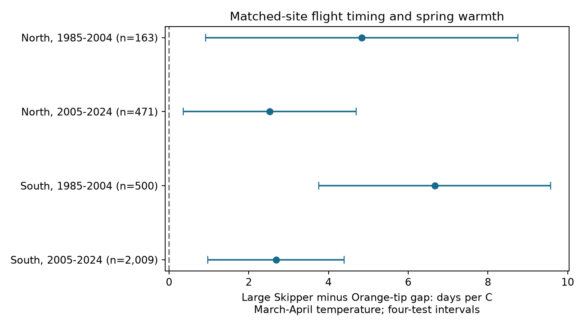
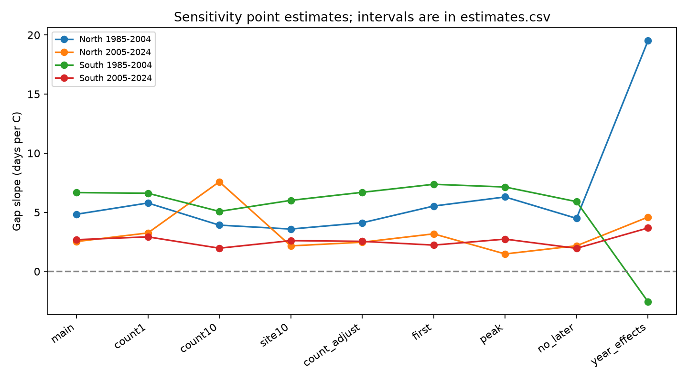

# Seasonal models gave positive spring warmth slopes for the Large Skipper minus Orange-tip flight-date gap in England, 1985-2024

## Question and prior work

We tested whether March-April warmth changed the gap between Large Skipper and Orange-tip mean flight dates at the same English sites. A positive slope means that Large Skipper flew later relative to Orange-tip in warmer early springs, after control for winter and later spring temperature. This is a test of relative adult timing. It is not a direct measure of ecological harm or species interaction.

Roy and colleagues (2015, doi:10.1111/gcb.12920) found that geographic and temporal butterfly timing responses need not agree. We therefore compare years within repeated sites. Stalhandske and colleagues (2015, doi:10.1002/ece3.1773) tested winter cold duration in Orange-tip pupae. This supports a winter control, but our seasonal mean cannot measure cold duration. The UKBMS source guide and Moussus and colleagues (2010, doi:10.1111/j.2041-210X.2010.00020.x) explain limits of flight-date measures. Mean dates reduce some sensitivity to first sightings, but remain count-weighted survey estimates.

Before choosing the exact pair, we searched the signed campaign for climate, phenology, pollution and butterflies. The exact Orange-tip and Large Skipper search returned no result. We read the cited Orange-tip date-measure study and the Ringlet-Meadow Brown gap study. The latter uses a related paired method on different species. These studies share the monitoring archive. Our analysis is a new pair comparison, not independent biological data. The local plan in files/plan.txt preceded fitting. It is exploratory and was not registered.

## Data and sample

We read three shared raw files in place. Their exact paths, URLs, sizes, versions and SHA-256 hashes are in files/provenance.json. ZIP member hashes are also given. The UKBMS 2024 releases provide flight dates and locations. GHCN-CAMS provides monthly temperature on a half-degree grid; its file states version 3.01. All selected months are in 1985-2024. The builder decodes UKBMS CSV text as Windows-1252. Shared inputs were not changed.

We join Anthocharis cardamines (Orange-tip) and Ochlodes sylvanus (Large Skipper) by site and year. We require English sites marked UKBMS in the location file, valid coordinates, positive peak counts, and first <= mean <= last and first <= peak <= last. First and last dates must lie in 1-183. These are day numbers relative to April, so subtraction gives a gap in days without a calendar conversion. The source describes standard weekly transects in suitable weather, mainly from April through September. Mean flight date is weighted by the observed counts. It is not the emergence date.

There were 19,461 matched site-years before the location filter, 18,367 at standard English sites, and 18,203 valid pairs before the main count and repeated-site rules. Source site-year keys were unique.

The main model requires peak counts of at least five in both species and at least five accepted years per site within each partition. North means British National Grid northing at least 300,000 m; South means lower northing. The periods are 1985-2004 and 2005-2024. This gives disjoint sites across regions and disjoint years across periods. Some sites occur in both periods. Climate can be correlated between regions. The partitions are not independent experiments.

We convert EPSG:27700 locations to WGS84 and use the nearest half-degree temperature cell. We use equal-month means for January-February, March-April and May-June. The panel retains the input coordinates, selected grid cells, counts, dates and weather. Five paired records have no finite temperature for the selected cell and are excluded before fitting. The same monthly windows apply to every record. These windows are coarse measures of possible developmental conditions.

## Model and uncertainty

Each partition has a separate model:

`Large Skipper mean date - Orange-tip mean date = site effect + b * March-April temperature + c * January-February temperature + d * May-June temperature + e * year trend + error.`

All site-years have equal weight. We remove site means before least squares. The trend is linear, in decades. The main target is b, in days per degree C. Temperature in kelvin gives the same slope as temperature in degrees C. Later spring control changes the estimand to an early spring association at fixed later spring warmth. It is not a causal adjustment set. May-June can follow much of the Orange-tip flight period.

We sum regression scores over all sites in each calendar year. A Bartlett covariance estimate includes annual lags one and two, with zero scores for missing calendar years. It uses the factor T/(T-k-1), where T is the number of observed years and k is the number of within-site regressors. Intervals use a t reference with T-k-1 degrees of freedom. This avoids treating many sites exposed to shared weather as independent weather trials. It assumes that dependence beyond the short lag window is small. Twenty years per partition limit inference; these are approximate intervals, not exact coverage guarantees.

Four main intervals use the Bonferroni critical probability 1-0.05/8. Our rule for a repeated nonzero link requires the same sign and a corrected interval excluding zero in all four models. Sensitivity intervals apply this same correction within a variant, with no family guarantee across variants.

## Results

| Region | Period | Paired site-years | Sites | Slope (days per C) | Four-test interval |
| --- | --- | ---: | ---: | ---: | --- |
| North | 1985-2004 | 163 | 19 | +4.84 | +0.92 to +8.76 |
| North | 2005-2024 | 471 | 65 | +2.53 | +0.36 to +4.70 |
| South | 1985-2004 | 500 | 60 | +6.67 | +3.76 to +9.58 |
| South | 2005-2024 | 2,009 | 226 | +2.68 | +0.97 to +4.40 |



All four corrected intervals are above zero. Under the seasonal model, warmer March-April conditions are linked to a larger Large Skipper minus Orange-tip gap in each partition. This supports a repeated conditional association. It does not establish a causal temperature effect or a difference caused by overwintering stage.

## Observation and model checks

Matching sites reduces differences in site selection and shared survey context. It does not show that both species were seen on the same visits. We change the peak-count threshold to one and ten, require ten accepted years per site, add each species' log peak count, and replace mean dates with first or peak dates. Peak count is a crude proxy for abundance and detection, and can respond to weather itself. Count filters and adjustment therefore cannot remove all observation bias.

We also omit the May-June control, replace the trend with calendar-year effects, extend the covariance window to lag four, and omit each year in turn. Year effects remove shared annual weather and leave spatial deviations. They test a different and usually weaker source of temperature variation.

All count thresholds, count adjustment, repeated-site checks, first-date gaps, peak-date gaps and models without later spring control retain positive point estimates in all four partitions. This is sign stability, not evidence that every sensitivity interval excludes zero. All four year-effect intervals include zero; the early South point estimate is negative. Thus, the clear primary result depends on using shared annual weather variation. The data do not establish a regional spatial response after annual conditions are removed.

North, 1985-2004: count adjustment gives +4.12; omitting later spring gives +4.49; year effects give +19.50 days per C. Year omission ranges from +3.03 to +6.03.

North, 2005-2024: count adjustment gives +2.47; omitting later spring gives +2.17; year effects give +4.59 days per C. Year omission ranges from +1.98 to +3.33.

South, 1985-2004: count adjustment gives +6.69; omitting later spring gives +5.90; year effects give -2.55 days per C. Year omission ranges from +5.99 to +7.52.

South, 2005-2024: count adjustment gives +2.55; omitting later spring gives +1.96; year effects give +3.67 days per C. Year omission ranges from +2.27 to +3.09.



Regional spring temperature correlations are 0.969 and 0.984 in the two periods, using annual regional means from the valid panel. Regional agreement is therefore weak evidence of independent climate replication. In the main samples, Orange-tip first dates fall within the first 14 April-relative days in 6.7%, 23.1%, 24.8% and 39.3% of records in table order. Large Skipper has no such records. This makes early-season censoring an asymmetric concern. Year effects reduce the site-demeaned spring temperature spread from 0.65-0.96 C to 0.065-0.085 C. This loss of weather contrast explains some loss of precision, but does not validate the primary model. Details are in files/diagnostics.json. All estimates, intervals, sample sizes and temperature spreads after fixed effects are in files/estimates.csv. Year omission results are in files/leave_year_out.csv. Species fits use exactly the same primary records and design. Their slope difference equals the gap slope. The independent validator checks this identity, the normal equations and the annual covariance by separate code. A direct raw-cell check matched all 36 sampled seasonal temperatures; see files/validate_weather.py and files/weather_validation.json. These checks test calculations, not ecological assumptions.

## Limits and use

Conditioning on both species being observed can select persistent populations. Missing populations, early emergence before April, missing visits, uneven visit weather, route changes and species-specific detection remain possible sources of bias. Site intercepts remove only stable site differences. Mean dates can move when the shape of the recorded flight period changes. The panel has no complete visit histories or zero reports. It cannot identify true emergence dates or bound them from observed visits.

The weather grid is coarse for local habitats. Seasonal means do not measure heat waves, frost, rainfall or microclimate. Unmeasured rainfall, habitat change, management and pollution can affect the estimates. Correlated seasonal temperatures and limited years can weaken the partial slopes. The study does not estimate a causal climate-change effect, a distribution change, a pollution effect, an extreme-weather response or a food-web mismatch. It does not test biological equality when an interval includes zero. The useful output is an inspectable matched-pair test and its uncertainty across four data partitions.

## Reproduce and inspect

Use Python 3.12 and the package versions in files/environment.json. From the extracted bundle root, run:

```sh
python files/analyze.py --panel files/panel.csv --output replay
cp files/panel.csv replay/panel.csv
python files/validate.py replay
```

The bundled panel permits an offline replay. The completed replay was compared with all numerical result tables. To rebuild from the shared snapshots on this machine:

```sh
python files/analyze.py --shared-root /mnt/dell-data/shared_datasets --output rebuilt
python files/validate.py rebuilt
```

For another machine, run `python files/retrieve.py private_raw`, then use `--shared-root private_raw`. Retrieval refuses changed hashes. URLs can change; the recorded hashes define the reference snapshots. Raw data are not copied into this bundle. The derived evidence is preserved. No model fitting or retrieval needs SCI credentials.

## Sources, rights and job record

Botham, M.S.; Middlebrook, I.; Heywood, J.; Harrower, C.A.; Milborrow, J.; Roy, D.B. (2025). United Kingdom Butterfly Monitoring Scheme: phenology 2024. NERC EDS Environmental Information Data Centre. Dataset. https://doi.org/10.5285/b9d237fc-5a79-4449-bcee-34c52d87608f.

Botham, M.S.; Middlebrook, I.; Heywood, J.; Harrower, C.A.; Milborrow, J.; Roy, D.B. (2025). United Kingdom Butterfly Monitoring Scheme: site location data 2024. NERC EDS Environmental Information Data Centre. Dataset. https://doi.org/10.5285/d7256b49-f2e3-4ae7-907d-af729610c768.

Contains UK Butterfly Monitoring Scheme (UKBMS) data © copyright and database right Butterfly Conservation, the Centre for Ecology & Hydrology, British Trust for Ornithology, and the Joint Nature Conservation Committee. Source data retain the Open Government Licence and its attribution conditions: https://eidc.ac.uk/licences/ogl-ukbms/plain. We thank the volunteer recorders. This adapted panel is not an official UKBMS product.

Temperature data were provided by NOAA PSL, Boulder, Colorado, USA: https://psl.noaa.gov/data/gridded/data.ghcncams.html. Method: Fan and van den Dool (2008), doi:10.1029/2007JD008470. The SCI baseline licence applies to our text, code and figures subject to source rights.

Campaign: 11_07_2026. Job: sci-1107-dell-climate-pollution-biodiversity-208eb093538c. Topic: climate-pollution-biodiversity. Machine: dell. Account: codex-andrii. Model: gpt-6.1-sol, high reasoning effort. The campaign-machine key signs this local package. It is not a personal authorship claim. No private signing key is included. No remote archive or index submission is made.
