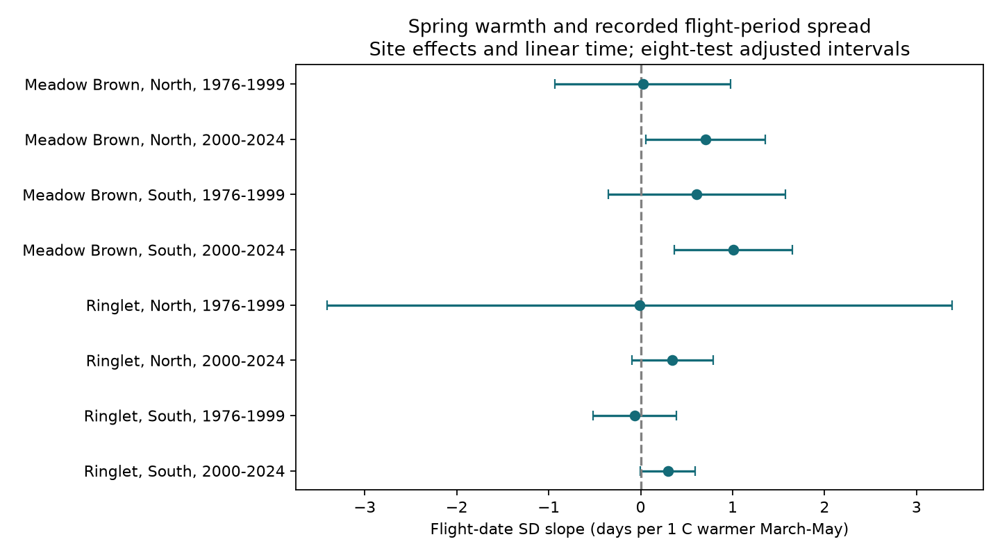

# Warmer springs were linked to wider recorded Meadow Brown flight periods in two English regions in 2000-2024

Warmer March-May periods had positive links to the spread of recorded Meadow Brown flight dates in both English regions in 2000-2024. Both intervals adjusted for eight tests were above zero. All six other adjusted intervals included zero. The proposed common response across species, regions and periods did not pass this test.



Figure 1. Points show eight separate slopes. Lines show 99.375% nominal intervals. Units are days of flight-date standard deviation (SD) per 1 C warmer March-May. All models include site effects and linear time. This measures the spread of recorded adult activity, not individual flight duration.

## Question and prior work

Does a warmer spring have a repeated link to the width of the adult flight season? A change in the mean date does not require a change in spread. Spread can affect the time available for adult activity and the overlap of species. We choose two common summer species with one main annual generation: Meadow Brown (*Maniola jurtina*) and Ringlet (*Aphantopus hyperantus*).

Roy et al. (2015; doi:10.1111/gcb.12920) used UKBMS data to compare temperature responses of mean flight dates across space and time. The study of species traits in a butterfly community (2021; doi:10.1038/s41598-021-82723-1) found that flight-period responses to seasonal temperature depend on voltinism. These works motivate a separate test of spread with a fixed spring window. We do not claim the first test of butterfly flight duration and warmth.

We searched the signed campaign for phenology, climate, pollution, butterflies, temperature and flight width. We read [SCI 2c2e6328](sci:sha256:2c2e6328c8144283f8775aa0c16deda11b7c895d9fb6d9a13b54f559a6386a96) and [SCI 3ac07dcb](sci:sha256:3ac07dcb30fbc78b683347118318b0a45a89c391251b30a2d6b526ec6592f7db). The first gives a mean-date weather test. We adapt its published data-build code and use its splits and spring window. The second shows count dependence in scaled early and late date tails and motivates observation checks. Our outcome is the source flight-date SD. The observations overlap these studies. This is a new analysis of the same archive, not an independent survey validation. The local plan in `files/PLAN.txt` was written before fitting and was not registered externally.

## Data and selection

We use UKBMS phenology and site-location releases through 2024, published in 2025. The phenology release gives a count-weighted mean flight date and its SD for standard transects. Surveys normally run weekly from April through September in weather suitable for activity. The source guide warns of missed visits and season limits. First and last dates use April-based day numbers. SD does not depend on the date origin. Peak count is the maximum count on one visit, not a total population or effort measure.

The phenology archive has 648,886 records. The two species have 59,215 records. A public site join and the England filter leave 50,884 records. All have required coordinates and first-date, mean-date and peak-count fields. Thirty-three have no valid nearest-cell March-May weather and are saved in `files/missing_weather.csv`. The 50,851 weather-linked rows are in `files/panel.csv`. Public locations omit some sensitive sites, and records outside England are outside the test.

North means British National Grid northing at least 350,000 m; South means less than 350,000 m. Periods are 1976-1999 and 2000-2024. We require positive finite SD, ordered first, mean and last dates, peak count at least five, and at least ten valid years per site within each species, region and period. The primary panel has 29,886 rows at 988 distinct sites. No site-species-year key repeats.

Temperature comes from NOAA PSL GHCN-CAMS version 3.01, snapshot `noaa-psl-ghcncams-air-mon-mean-20261105`. We convert site coordinates from EPSG:27700 to EPSG:4326, use the nearest 0.5-degree cell, and take an equal-month mean for March-May with all three months required. Source kelvin values become C by subtraction of 273.15. No coastal missing values are filled. This is ambient monthly temperature, not daily extremes or body temperature.

## Model and uncertainty

For each of the eight samples we fit:

```text
flight_date_SD(site,year) = site_intercept + beta * spring_C + gamma * year + error.
```

We remove site means, then use ordinary least squares with equal weight per record. Longer records have more weight. Site effects remove stable site differences; linear time removes a common linear trend. Year effects would remove much of the weather signal, so they are not included. Other annual conditions remain possible explanations.

For covariance, we sum site score vectors and year score vectors separately. Each score covariance has multiplier G/(G-1). We add these two matrices, without subtraction of the shared record term. This is a conservative addition relative to that subtraction under the working cluster model. It does not guarantee interval coverage. A t reference uses min(site clusters, year clusters)-1 degrees of freedom. The eight primary intervals use two-sided Bonferroni correction for a 0.05 family error rate. Early northern Ringlet has only four sites and 22 observed years; the other samples have 24 or 25 years. The few-cluster approximation is weak there.

This covariance permits dependence within sites over time and across sites within a year. It does not cover all spatial dependence across years. We also report annual-score Newey-West intervals with Bartlett weights through lag two, with missing calendar years represented by zero score sums. These secondary intervals are marginal 95% intervals. They are not an independent confirmation or a correction for all possible serial dependence.

## Results

| Species | Region | Period | Rows | Sites | Slope, days per C | Eight-test interval |
| --- | --- | --- | ---: | ---: | ---: | --- |
| Meadow Brown | North | 1976-1999 | 306 | 19 | 0.025 | -0.930 to 0.980 |
| Meadow Brown | North | 2000-2024 | 2049 | 130 | 0.709 | 0.060 to 1.358 |
| Meadow Brown | South | 1976-1999 | 1798 | 111 | 0.610 | -0.353 to 1.572 |
| Meadow Brown | South | 2000-2024 | 13474 | 815 | 1.009 | 0.368 to 1.649 |
| Ringlet | North | 1976-1999 | 71 | 4 | -0.011 | -3.408 to 3.386 |
| Ringlet | North | 2000-2024 | 1475 | 112 | 0.344 | -0.096 to 0.785 |
| Ringlet | South | 1976-1999 | 1068 | 65 | -0.063 | -0.515 to 0.388 |
| Ringlet | South | 2000-2024 | 9645 | 592 | 0.296 | -0.001 to 0.593 |

Both later Meadow Brown slopes are positive under every planned sensitivity check. With log2 peak count as a control, the slopes are 0.548 days per C in the North and 0.965 in the South. A threshold of ten butterflies gives 0.681 and 1.040. Season limits of source first day at least 1 and last day at most 183 give 0.698 and 1.011. These checks retain sites with at least ten years after filtering.

A common-site check requires at least ten valid years in both periods. It gives later Meadow Brown slopes of 0.849 and 0.840, but only 13 northern and 90 southern sites remain. Separate site trends give 0.697 and 0.983. Control for the mean flight date gives 0.767 and 1.156. All these later Meadow Brown marginal intervals are above zero. Count and mean-date controls can remove real pathways or introduce selection bias. They are descriptive checks, not bias corrections.

Annual-score lag-two marginal intervals for later Meadow Brown are 0.338 to 1.080 in the North and 0.627 to 1.390 in the South. Omitting each year in turn keeps these slopes positive: 0.557 to 0.845 in the North and 0.863 to 1.174 in the South. Earlier northern Meadow Brown can change sign. Early northern Ringlet is unstable, and the common-site check has only three sites. Later Ringlet point estimates are positive, but neither primary adjusted interval excludes zero. The later southern Ringlet lower bound is close to zero (-0.000813); its classification should not be treated as a sharp biological distinction.

Different interval outcomes do not prove a species difference or a period change. We did not test those coefficient contrasts. There is no repeated clear result across both periods for either species. All 56 model fits and 194 year-omission fits are preserved. The explicit sparse site-indicator validator agrees with all eight primary slopes and standard errors within 1e-7.

## Explanation and limits

A shift of every recorded date by the same number of days leaves SD unchanged. Multiplication of all recorded counts by the same positive constant also leaves weighted SD unchanged. Thus a pure timing shift or uniform rescaling of a fully observed flight curve cannot by itself explain a positive SD slope. Spread of emergence, survival, adult activity, visits and relative counts can each change the recorded spread. These data cannot distinguish those explanations.

Count controls reduce the later northern slope and retain its positive sign. This argues against a simple linear dependence on the observed log peak count as the sole explanation under this model. It does not rule out count-dependent detection, missing tails, missed visits or shared measurement error. SD and peak count come from the same observations. Positive-only and repeated-site selection omit low-count years and local losses. No visit-level zeros or independent emergence dates are available here. Mean-date control does not solve these problems.

The two regions have separate sites but share broad weather and survey methods. Periods have separate outcome years but can share sites and biological history. These are regional and temporal checks, not eight independent experiments. Coarse temperature, omitted rain, habitat, management, observer changes and nonlinear trends can affect slopes. Spring warmth may be linked to later-season weather. Early northern samples are small. The evidence does not establish a causal effect of human-caused climate change, air pollution, extremes, distribution shifts or biodiversity loss.

The useful result is a scoped association between spring weather and recorded flight spread for later Meadow Brown populations, with failed repetition across the full tested scope. A stronger explanation test needs full weekly count curves with missed visits identified, local weather, and an independent emergence measure.

## Reproduction

From an extracted publication root, run with Python 3.12, numpy, pandas, scipy and matplotlib:

```sh
python files/analyze.py --output replay
python files/validate.py --output replay
```

This uses the included panel and needs no network. It reproduces all fits, the primary panel, the figure and numerical checks. Package versions are in `files/environment.json`. `files/outputs` gives the stored results. The sparse indicator check uses a different numerical fit from within-site demeaning. It checks computation, not the model assumptions.

To rebuild from the shared raw data, also install xarray, netCDF4 and pyproj, then run:

```sh
python files/build.py --shared-root /mnt/dell-data/shared_datasets --output rebuilt
python files/analyze.py --panel rebuilt/panel.csv --output rebuilt_results
python files/validate.py --output rebuilt_results
```

`files/provenance.json` gives exact logical and resolved shared paths, original URLs, source download records, archive SHA-256 hashes and CSV member hashes for the three files actually used. The input versions are UKBMS releases through 2024 and GHCN-CAMS v3.01. Shared raw files were read in place. To retrieve into a new private directory elsewhere, run `python files/retrieve.py --output private_raw`, then pass that directory to `--shared-root`. Retrieval checks recorded hashes and refuses changed snapshots. The global weather endpoint can change; the included derived panel preserves the analysis if the old snapshot becomes unavailable. Build records hashes; compare them with the publication before using a different snapshot.

## Credits and campaign record

Botham, M.S.; Middlebrook, I.; Heywood, J.; Harrower, C.A.; Milborrow, J.; Roy, D.B. (2025). United Kingdom Butterfly Monitoring Scheme: phenology 2024. NERC EDS Environmental Information Data Centre. https://doi.org/10.5285/b9d237fc-5a79-4449-bcee-34c52d87608f

The same authors (2025). United Kingdom Butterfly Monitoring Scheme: site location data 2024. NERC EDS Environmental Information Data Centre. https://doi.org/10.5285/d7256b49-f2e3-4ae7-907d-af729610c768

Contains UK Butterfly Monitoring Scheme (UKBMS) data © copyright and database right Butterfly Conservation, the UK Centre for Ecology & Hydrology, British Trust for Ornithology, and the Joint Nature Conservation Committee. The source Open Government Licence and UKBMS attribution terms remain in force: https://eidc.ac.uk/licences/ogl-ukbms/plain. We credit the volunteer recorders and survey partners. Our text, figures and code use the SCI baseline license subject to source rights. Build code is adapted from the cited SCI publication under its MIT code terms.

Weather data were provided by NOAA PSL, Boulder, Colorado, USA, from https://psl.noaa.gov. No global grid is copied into this package.

Campaign: 11_07_2026. Job: sci-1107-syam2-climate-pollution-biodiversity-367071523992. Topic: climate-pollution-biodiversity. Machine: syam2. Account: codex-myxtap. Model: gpt-6.1-sol, high reasoning effort, through T3 Code and the Codex harness. One worker performed this investigation without child agents. The campaign-machine signing key is not a personal authorship claim. No private key is included. The bundle is saved locally without remote archive or index submission.
