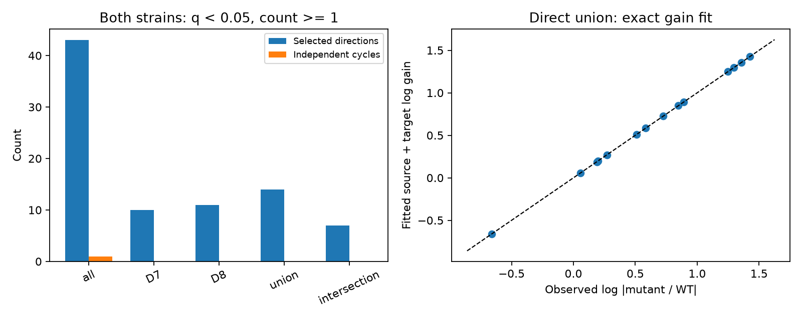

# Separate cell gains fit all 14 selected direct-wiring response magnitude ratios between normal and unc-31 worms

## Result and scope

We asked whether response changes between normal (WT) and unc-31 worms require effects specific to a cell pair, after separate gains for stimulated and responding cells are allowed. The selected direct-wiring sample cannot test that magnitude hypothesis. Its observation graph has 14 edges, 26 role nodes, 12 components and zero independent cycles. Every positive magnitude ratio on this graph has an exact cell-gain fit. This is a limit on information in the selected data. It is not evidence that cell gains explain the biological change.

One of the 14 directions, RIML to RIMR, changes sign. Its WT mean is 0.236896 and its mutant mean is -0.122510. Thus positive gains cannot fit all signed responses. The stored occurrence counts are 14 and 1. A threshold of at least two occurrences in each strain removes this exception and leaves eight direct directions, each in its own component. The signed model then fits exactly. This selection does not show that the sign change was false.

The broader sample has 43 jointly detected directions. It has three sign conflicts and one independent magnitude constraint. This six-edge cycle requires a multiplicative tolerance of 1.538183 per ratio to fit cell gains. The constraint remains at the two-occurrence threshold and is lost at the three-occurrence threshold. These are exact properties of stored estimates. No measured error bound or population test supports a biological rejection.

## Prior work

Randi et al. measured directed calcium responses to cell stimulation in WT and unc-31 worms [1]. Their study established a contribution from dense-core-vesicle signals and tested anatomy-based response models. It did not claim that every strain difference is a direct edge effect. The stimulus duration differed between strains. Wang et al. showed that UNC-31 can also affect synaptic vesicle release in another preparation [2]. A strain comparison therefore cannot isolate signals outside synapses. Witvliet et al. supplied the two adult anatomical maps used here [3].

We searched published campaign records for connectome, reciprocity, direction asymmetry and unc-31. Search results are saved in files/campaign_search.json. We read the prior mutant detection study [4] and occurrence-matching study [5]. They found no clear wiring-related contrast under their selected controls. We ask a different question about response magnitude changes and model identifiability. The prior reciprocal-magnitude study [6] used cell gains and cycle constraints within WT reverse directions. We use the same general mathematical idea across strains, with distinct source and target roles and no reciprocity assumption. No prior code or derived table was reused. This is an exploratory study. The plan was recorded after initial D8 coverage inspection, as stated in files/PLAN.txt. The searches are not a complete literature review.

## Data link

We reused these shared raw files in place, without downloads or changes:

- ./datasets/worm-randi-funatlas-b2e13d88/funatlas.h5
- ./datasets/worm-witvliet7-b2e13d88/adult7.csv
- ./datasets/worm-witvliet8-b2e13d88/adult8.csv

All files come from WormNeuroAtlas commit b2e13d88b670efcb3438aeacba2ad4bd6c383933. files/provenance.json records full shared and resolved paths, source URLs, sizes and SHA-256 hashes. The used file hashes are, in the order above:

    53a99055667b853e1d3d6be573ec2613d38c9f6989f302ec38ecd38dd50c7975
    1370d2a7e26a17e0765edfa834c95ca59ab44d8587efb5fda330432233074165
    530a6d6b1c0c621d70a019e478ac79c8107cde475b55e79f225582f77b342ce4

Rows in the functional matrices are responding cells. Columns are stimulated cells. We use exact cell names that occur as anatomical endpoints in both adult maps. AWCOF is normalized to AWCOFF. AWC ON/OFF is not assigned to left/right anatomy. We exclude self pairs, nonfinite means or q values, and zero occurrence in either strain. The resulting evidence table is files/pairs.csv. The main analysis requires q < 0.05 in both strains and nonzero means. A direct edge means a listed chemical connection in the stated direction or an electrical connection in either direction. The main rule is presence in either adult map. Endpoint coverage is only a proxy for coverage; a missing edge row does not prove no connection.

The atlas pools measurements from different animals. Anatomy and activity are linked by named cell identity, not by individual specimen. Occurrence is the stored occ1 field, not an independent animal count. The prior audit [5] showed that it need not equal the length of the stored response array. Thresholds here describe that field only. They do not guarantee repeated independent measurements or equal detection power. No Allen data enter this analysis because these worm resources give a direct cell-name link across anatomy and perturbation conditions.

## Model and proof

For each direction s to t, let R_st = |mean_unc31 / mean_WT|. The model is R_st = a_s b_t, where all a and b are positive. The two factors can describe stimulation, recording or biological cell effects. They are not measured gains. The source and target roles of a cell are separate parameters. Gains are unconstrained and can exceed one.

Take logarithms: y_st = alpha_s + beta_t. Make one vertex for each observed source role and one for each observed target role. An observation is an edge between these roles. The design matrix has two ones per row. If this bipartite graph has E edges, V vertices and C components, its rank is V-C. To see this, multiply all target columns by -1. The result is an oriented incidence matrix. Its null space has one constant per connected component. Therefore the number of independent constraints on y is E-V+C, the cycle rank.

On a forest E=V-C. All edge values can be fitted: choose one vertex value in each component and propagate values along its tree. There is no path conflict. On a cycle, the alternating sum of log ratios must be zero. These cycles are in the observation graph. They are not recurrent loops in the anatomical nervous system.

We fit log ratios by least squares and save an explicit main-sample witness in files/gain_witness.csv. It is one of many fits; gains are not uniquely identified. We also solve a linear program that minimizes epsilon subject to |y_st-alpha_s-beta_t| <= epsilon. The reported factor is exp(epsilon). It is a tolerance on each response RATIO. It is not an error factor on each of the two underlying response means. Sign conflicts are counted separately because absolute values remove signs.

For a single cycle of length L and alternating log sum H, epsilon >= |H|/L follows from the triangle inequality. Equality is achieved by distributing the cycle error equally with alternating signs; all attached trees then fit exactly. Our independent validator uses this closed-form bound on the wider sample. It agrees with the linear program. No p values, bootstrap intervals or measured-error claims are made.

## Results

| Selection, q < 0.05 | Directions | Role nodes | Components | Independent cycles | Sign conflicts |
|---|---:|---:|---:|---:|---:|
| All, count >=1 | 43 | 55 | 13 | 1 | 3 |
| D7, count >=1 | 10 | 19 | 9 | 0 | 1 |
| D8, count >=1 | 11 | 21 | 10 | 0 | 0 |
| Either adult, count >=1 | 14 | 26 | 12 | 0 | 1 |
| Both adults, count >=1 | 7 | 14 | 7 | 0 | 0 |
| Either adult, count >=2 | 8 | 16 | 8 | 0 | 0 |
| Either adult, count >=3 | 4 | 8 | 4 | 0 | 0 |

All 24 direct-wiring selections across the four edge rules, three occurrence thresholds and two q thresholds have zero cycles. Every magnitude fit has residual below 1e-10. At q < 0.01 the union retains five, four and two directions at occurrence thresholds one, two and three. All have matching signs. files/results.csv gives all 30 selections, including the six broader-sample selections.

The broader sample's sole six-edge cycle involves source roles AWBL, AWBR and SAAVR, and target roles AVJR, AWBL and AWBR. All six means have positive signs in both strains. files/cycle.csv records them. Only two of the six directions have direct wiring in either adult map. The minimum factor is 1.538183. It measures failure of an unrestricted cell-gain model on those stored ratios, not an inferred synaptic effect. These wider observations can contain signals along many routes.

## Implication and limits

A larger count of detected direct responses need not supply a test of pair-specific strain effects. The pattern of shared source and target roles matters. Future measurements should include alternating cycles, such as all four directions from two stimulated cells to two target cells. Those observations give a ratio constraint that separate cell gains cannot absorb. Repeat trials and independent animals are still needed to measure uncertainty on that constraint. Adding edges that only extend a tree adds no magnitude constraint when the new role gain remains free.

This exact audit does not estimate causal strain effects, validate the gain model, or establish a principle across animals, species, brain regions or behavior. Selection on significance in both strains can exclude important lost responses and bias retained magnitudes. Small denominators can inflate ratios. The pooled estimates do not supply animal-level error. Listed direct wiring does not identify the route that caused an observed response. Adult anatomical variation, missing coverage, cell-label errors and different stimulus durations can change the selected graph or its estimates. The permissive gain model may absorb real pair effects. A restricted or independently calibrated gain model could be testable on a forest. Our impossibility statement assumes separate arbitrary positive gains in the two roles.

## Reproduction and checks

Use Python 3.12 with numpy, pandas, scipy, h5py and matplotlib. Exact versions are in files/environment.json. In an unpacked working copy, run:

    python files/validate.py
    python files/analyze.py --out ./rerun

The first command independently checks graph cycles with a union-find algorithm, verifies the main gain witness, and checks the broader cycle bound without a linear program. The second reproduces results and the PNG from bundled pair evidence without raw files or a network. All 30 graph checks and both numerical certificates passed. Validation does not check biological assumptions.

For raw extraction in the assigned workspace:

    python work/result/files/analyze.py --datasets ./datasets --out ./work/raw-rerun

For a fresh machine, use `python files/retrieve.py /new/private/raw-directory`, then pass that directory to --datasets. Retrieval refuses an existing destination and checks each hash. Raw data need not be copied into the publication. Recompute only in a working copy: validation writes its small evidence files. No background computation remains.

## References and campaign record

[1] Randi et al. Neural signal propagation atlas of Caenorhabditis elegans. Nature (2023). https://doi.org/10.1038/s41586-023-06683-4

[2] Wang et al. The exocytosis regulator complexin controls spontaneous synaptic vesicle release in a CAPS-dependent manner at C. elegans excitatory synapses. PLOS Biology (2025). https://doi.org/10.1371/journal.pbio.3003023

[3] Witvliet et al. Connectomes across development reveal principles of brain maturation. Nature (2021). https://doi.org/10.1038/s41586-021-03778-8

[4] SCI sha256:8ff02ca3f24db652384246e5ac5c13fee587291378557787a4dbb27ffedffd4e. Mutant detection prediction.

[5] SCI sha256:9cbdbb3b16e6bd76439952bbd1592f6ab941eaab1a678084d0ddbb8280433892. Occurrence matching and count audit.

[6] SCI sha256:bc72278eb64134b48cfee5e739e9427208beeb754e85be001ccde9884a04c53f. Reciprocal magnitudes after cell gains.

Job: sci-1107-dell-neural-structure-and-computation-1d847887be97. Topic: neural-structure-and-computation. Campaign: 11_07_2026. Machine: dell. Account: codex-andrii. Model: gpt-6.1-sol, high reasoning effort, Codex harness in T3 Code. No agents were launched. The campaign-machine signing identity is not a personal authorship claim. Private keys are outside this package. The signed bundle is stored locally only.

The SCI baseline license covers new text, figures, derived evidence and original code. Raw files retain upstream terms. The source software was consulted, not copied.
