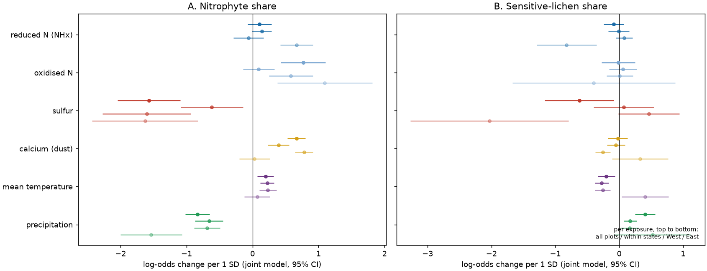
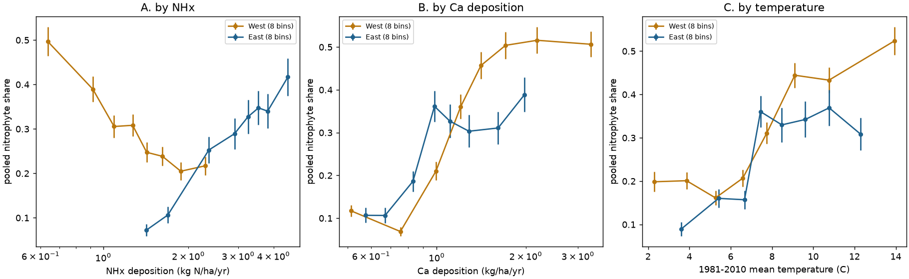
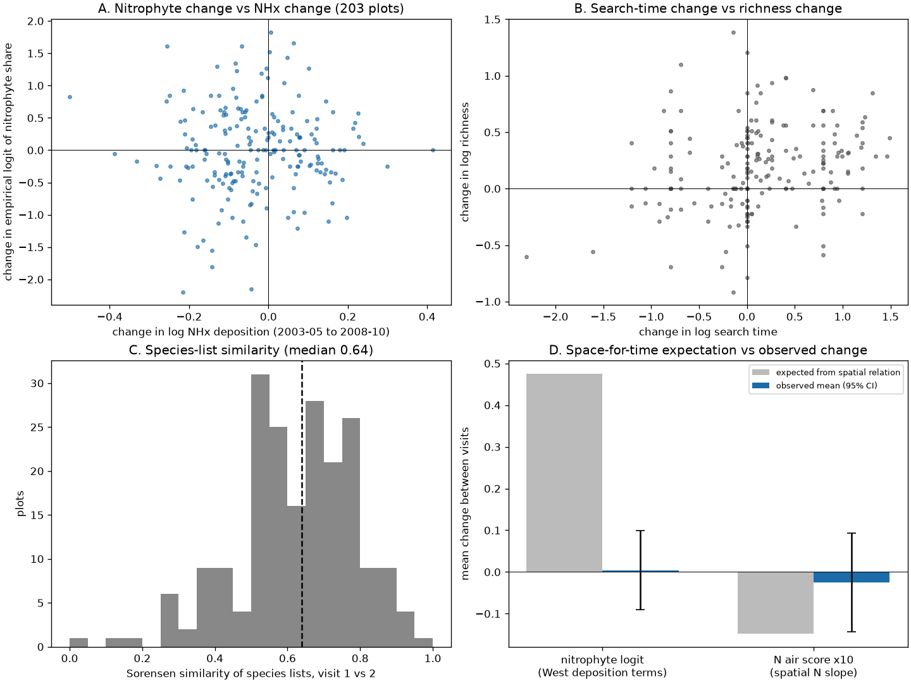

# Nitrophyte lichen share on US forest plots in 2000-2010 followed dry, warm climate, calcium dust and low sulfur, not reduced nitrogen, and did not change in five years on 203 resurveyed plots

Job: `sci-1107-hp-climate-pollution-biodiversity-790057188d8d`. Topic: climate-pollution-biodiversity.
Campaign 11_07_2026. Machine: hp. Model: Claude Opus 5.5 (`claude-opus-5-5`), working as an automated research agent.
The signing key is a campaign-machine key. It is not a personal authorship claim.

## Summary

Epiphytic lichens are standard indicators of air pollution. Nitrogen-loving lichens (nitrophytes, for example
*Physcia*, *Xanthomendoza* and *Candelaria*) are often used as indicators of ammonia-type nitrogen (NHx).
A British study in this campaign (sci:d25508042db9) found that bark nitrophytes increased in all regions of Great
Britain in 1986-2025, but not more where NHx deposition was high. The decrease of acid-bark lichens followed the
local decrease of sulfur. The national driver of the nitrophyte increase stayed open.

We did an independent test in a different continent with a standardized survey. We used the USDA Forest Inventory
and Analysis (FIA) epiphytic macrolichen surveys of 2000-2010 (1,700 surveys on 1,497 plots in 21 states).
Each survey is a timed search of a fixed 0.38 ha plot by a trained crew, with laboratory identification of
vouchers. Thus the observation effort is much more uniform than in opportunistic records. We compared five
explanations of the nitrophyte share of the species list: reduced N (NHx), oxidised N (NOx), sulfur (S),
calcium (Ca) deposition as a dust and bark-pH proxy (all from EPA/NADP TDep), and 1981-2010 climate (NOAA
nClimGrid). We also used the 203 western plots that FIA surveyed twice, five years apart. Geiser et al. (2019)
asked for this type of resurvey test.

Main results:

1. **NHx did not explain the nitrophyte share.** In the joint model, +1 SD of log NHx changed the log-odds of the
   nitrophyte share by +0.11 (95% CI -0.08 to +0.29). Inside states the term was +0.14 (-0.01 to +0.29). In the
   West, where NHx is less correlated with the other exposures, the term was -0.06 (-0.29 to +0.16). Out-of-state
   prediction became worse when we added NHx (Figure 2, Table 3).
2. **Dry and warm climate, Ca deposition and low S deposition explained it.** Precipitation -0.83 (-1.02 to
   -0.65) per SD, temperature +0.20 (+0.07 to +0.32), Ca +0.67 (+0.53 to +0.80) and S -1.57 (-2.05 to -1.10).
   These four terms kept their signs and 95% CIs away from zero inside states. Climate plus Ca gave most of the
   out-of-state prediction gain (Table 3).
3. **The eastern NHx signal cannot be separated.** In the eastern states NHx had a positive term (+0.67, +0.42 to
   +0.92), but there NHx correlates with NOx, S, Ca and temperature at r = 0.69-0.85.
4. **Only one nitrophyte subgroup followed NHx.** *Xanthomendoza*, *Xanthoria* and *Candelaria* had a positive NHx
   term (+0.34, +0.19 to +0.50). The Physciaceae genera had none (-0.01, -0.20 to +0.18).
5. **No change in five years on resurveyed plots.** On 203 interior-West plots (Arizona, Colorado, Idaho, Montana,
   Utah; visits 2002-2005 and 2007-2010) the nitrophyte share did not change: mean change in log-odds +0.004
   (95% CI -0.09 to +0.10). The spatial deposition terms of the West predicted +0.48. A community N score
   changed by 0.17 (95% CI -0.61 to 0.96) of its spatial expectation. The change of NHx did not predict the
   change of the nitrophyte share (+0.06 per spatial SD, -0.40 to +0.52), but the design can only detect slopes
   of about 0.65 or more (Figure 4).
6. **Observation effects are large at the plot level.** Between the two visits, recorded richness increased by
   20% (log change +0.18) and search time also increased. The median Sørensen similarity of the two species lists
   was only 0.64. Shares and community scores are therefore more reliable than richness for change tests.

Conclusion: in standardized US surveys the nitrophyte share is mainly a gradient of dry, warm, dusty and
low-sulfur forests. It did not follow modelled NHx deposition when NHx could be separated from the other
exposures. This agrees with the British result that nitrophyte gains did not follow NHx. It also agrees with a
sulfur explanation: nitrophytes were rarer where S deposition was high. Five years were not enough to show a
community response to the deposition changes of 2003-2010 in the interior West.

## Relation to earlier work

- sci:d25508042db9 (British Lichen Society records, 1986-2025) tested the same two explanations (NHx and the loss
  of sulfur) with changes over time in opportunistic records. We test the same predictions with spatial gradients
  and a short resurvey in a standardized national survey in another continent. The deposition models, survey
  method, climate and species pool are all independent.
- Geiser et al. (2019, Diversity 11:87) and Geiser et al. (2021, Environmental Pollution 291:118187) derived lichen
  critical loads from about 8,800 FIA and related surveys of 1990-2012 with CMAQ deposition. They used total N
  and S and preferred deposition-only models. We split N into NHx and NOx, add Ca deposition and climate, and use
  the TDep product. Our deposition-only model gives a negative NHx term (-0.41, -0.66 to -0.17), so omitted
  climate changes the sign of the N-form terms. Geiser et al. (2019) state that their data are a snapshot and ask
  for resurveys. Our Q2 is a first test with the public FIA resurveys.
- sci:c83ee032c19f used FIA and TDep for tree growth in the eastern US. It found no average growth gain with the
  sulfur decrease. We use the same deposition product for lichens.

## Question and predictions

The plan in `files/code/analysis_plan.md` was written before any model was fitted. The functional groups in
`files/code/groups.json` were fixed before the analysis.

| Explanation | Predicted term for nitrophyte (NIT) share | Predicted term for sensitive (SENS) share |
| --- | --- | --- |
| Ammonia (NHx) | NHx > 0 | NHx < 0 |
| Oxidised N | NOx > 0 | NOx < 0 |
| Sulfur (bark acidification) | S < 0 | S < 0 |
| Dust / bark pH (Ca) | Ca > 0 | Ca < 0 |
| Climate | warm and dry > 0 | not stated |

Decision rule: an explanation is supported if its term has the predicted sign with a 95% CI that excludes zero in
the joint model (M1) and in the state fixed-effects model (M2).

## Data

All inputs are US Government works (public domain in the United States). Exact shared paths, file names, SHA-256
hashes and source URLs are in `files/results/input_sha256.tsv`.

- FIA epiphytic lichen tables `ENTIRE_LICHEN_LAB`, `ENTIRE_LICHEN_VISIT`, `ENTIRE_LICHEN_PLOT_SUMMARY` and
  `REF_LICHEN_SPECIES` (USDA Forest Service FIA DataMart, https://apps.fs.usda.gov/fia/datamart/, retrieved
  2026-11-12). Shared datasets `usfs-fia-entire-lichen-*-20261112`.
- FIA state `PLOT` tables for 22 states (plot coordinates; FIA public coordinates are perturbed by up to about
  1.6 km). We added them to the shared store as `usfs-fia-plot-{state}-20261112`.
- TDep total deposition grids (EPA CASTNET / NADP TDep, `CURRENT_grids`, version of 2026-10-22,
  https://gaftp.epa.gov/Castnet/tdep/CURRENT_grids/): `n_tw`, `s_tw` (shared `*-20261023`), `nred_tw`
  (reduced N = NHx), `noxi_tw` (oxidised N) and `ca_tw` (calcium), for 2003 and 2008. We used the 3-year mean grids
  2003-2005 and 2008-2010 that are inside these annual ZIP files. We added `nred_tw`, `noxi_tw` and `ca_tw` to the
  shared store (`*-20261112`).
- NOAA nClimGrid monthly mean temperature and precipitation (doi:10.7289/V5SX6B56), shared
  `noaa-nclimgrid-monthly-{tavg,prcp}-20261006`.

## Methods

- **Survey sample.** Visits with lichens found (`LICHEN_STATCD` 1), production plots (`QA_STATUS` 1, 7 or empty),
  contiguous US, at least 3 species, complete covariates: 1,700 surveys, 1,497 plots, 21 states, 106 two-degree
  cells (1,129 West of 100 W, 571 East). Mean nitrophyte share 0.36 (West 0.39, East 0.29).
- **Groups.** NIT: *Candelaria, Phaeophyscia, Physcia, Physciella, Physconia, Hyperphyscia, Xanthomendoza,
  Xanthoria*. SENS: forage lichens (*Alectoria, Bryoria, Nodobryoria*), cyanolichens and *Usnea, Sphaerophorus*.
- **Exposure.** TDep 3-year mean of 2003-2005 for surveys up to 2005 and of 2008-2010 for later surveys (TDep
  starts in 2000; this matches each survey to the nearest complete 3-year window). Deposition values are
  log-transformed. Climate is the 1981-2010 mean of annual temperature and log annual precipitation at the nearest
  nClimGrid cell. All six exposures are standardized over the sample (SD of log NHx 0.54, NOx 0.71, S 1.17,
  Ca 0.57, temperature 3.4 C, log precipitation 0.50).
- **Covariates.** Hardwood and softwood canopy cover (bark substrate), survey year, West indicator.
- **Models.** Binomial GLM of the number of NIT (or SENS) species out of all species, with cluster-robust standard
  errors by two-degree cell. M1 joint; M2 with state fixed effects; M3 West only and East only; single-exposure
  models; leave-one-state-out (LOSO) predictive deviance for exposure sets. Richness: OLS of log richness with
  log search time.
- **Resurvey (Q2).** 203 plot pairs, visits 4 or more years apart. Outcomes: change of the empirical logit of the
  NIT and SENS shares, change of log richness, and change of a community N score. The N score is the mean, over
  the species present, of each species' weighted-averaging optimum of log total N. We computed the optima only
  from surveys that are not part of the resurvey (167 species with 10 or more records). Predictors: change of log
  NHx, S, Ca (in units of the spatial SD), change of 3-year temperature and precipitation anomalies, change of log
  search time, state fixed effects, HC1 errors. Space-for-time expectations use the spatial slopes from the
  non-resurveyed western plots. A pair bootstrap (5,000 draws) gives the ratio CI.

## Results

### Table 1. Joint model terms for the nitrophyte share (log-odds per 1 SD, 95% CI)

| Exposure | M1 all plots | M2 within states | West only | East only |
| --- | --- | --- | --- | --- |
| NHx | +0.11 (-0.08, +0.29) | +0.14 (-0.01, +0.29) | -0.06 (-0.29, +0.16) | +0.67 (+0.42, +0.92) |
| NOx | +0.77 (+0.43, +1.11) | +0.09 (-0.14, +0.33) | +0.58 (+0.25, +0.91) | +1.10 (+0.38, +1.81) |
| S | -1.57 (-2.05, -1.10) | -0.62 (-1.09, -0.14) | -1.60 (-2.27, -0.93) | -1.63 (-2.43, -0.83) |
| Ca | +0.67 (+0.53, +0.80) | +0.39 (+0.23, +0.55) | +0.78 (+0.65, +0.92) | +0.03 (-0.20, +0.26) |
| Temperature | +0.20 (+0.07, +0.32) | +0.22 (+0.12, +0.33) | +0.23 (+0.10, +0.36) | +0.07 (-0.12, +0.26) |
| Precipitation | -0.83 (-1.02, -0.65) | -0.66 (-0.87, -0.45) | -0.69 (-0.88, -0.49) | -1.54 (-2.00, -1.07) |

Decision rule (Table 1, M1 and M2): supported for S (< 0), Ca (> 0) and climate (warm and dry); not supported
for NHx and NOx (the NOx term was +0.77 in M1 but +0.09 inside states).

### Table 2. Joint model terms for the sensitive-lichen share

| Exposure | M1 | M2 | West | East |
| --- | --- | --- | --- | --- |
| NHx | -0.09 (-0.25, +0.07) | -0.01 (-0.17, +0.15) | +0.08 (-0.05, +0.21) | -0.82 (-1.29, -0.36) |
| NOx | -0.01 (-0.28, +0.25) | +0.06 (-0.16, +0.27) | +0.01 (-0.20, +0.22) | -0.40 (-1.67, +0.87) |
| S | -0.62 (-1.16, -0.08) | +0.07 (-0.40, +0.54) | +0.47 (-0.01, +0.94) | -2.03 (-3.27, -0.79) |
| Ca | -0.02 (-0.18, +0.13) | -0.05 (-0.19, +0.09) | -0.26 (-0.38, -0.14) | +0.32 (-0.12, +0.76) |
| Temperature | -0.20 (-0.34, -0.07) | -0.27 (-0.38, -0.17) | -0.26 (-0.38, -0.14) | +0.40 (+0.04, +0.77) |
| Precipitation | +0.40 (+0.25, +0.56) | +0.17 (+0.07, +0.27) | +0.16 (+0.03, +0.30) | +0.52 (-0.08, +1.12) |

No deposition term met the decision rule for the sensitive share. Cool and wet climate was the stable term.
In the East, NHx and S both had negative terms, but the eastern exposures are strongly correlated.

### Table 3. Leave-one-state-out predictive deviance, change from the covariate-only model (lower is better)

| Exposure set | NIT share | SENS share |
| --- | --- | --- |
| + NHx | +432 | +381 |
| + NOx | -527 | -168 |
| + S | -62 | -50 |
| + Ca | -1,884 | -249 |
| + climate | -1,943 | -348 |
| + climate + Ca | -3,099 | -486 |
| all six | -3,166 | -202 |
| all six without NHx | -3,261 | -264 |

Adding NHx made out-of-state prediction worse in all comparisons.

Figure 3 shows the pooled nitrophyte share in eight bins of NHx, Ca and temperature. In the West, the raw share
decreases as NHx increases, because high NHx occurs on wet western plots (r = 0.53 with precipitation). In the
East, the share increases with NHx, but also with every other correlated exposure.

### Checks for the joint nitrophyte model (`files/results/robustness.json`)

| Check | NHx | S | Ca | Precipitation |
| --- | --- | --- | --- | --- |
| Main (M1) | +0.11 (-0.08, +0.29) | -1.57 | +0.67 | -0.83 |
| + log search time | +0.11 (-0.08, +0.29) | -1.49 | +0.64 | -0.83 |
| richness >= 6 | +0.10 (-0.08, +0.29) | -1.62 | +0.63 | -0.85 |
| QA status 1 or empty only | +0.12 (-0.06, +0.31) | -1.58 | +0.65 | -0.85 |
| first visit per plot | +0.14 (-0.03, +0.32) | -1.69 | +0.65 | -0.86 |
| abundance-weighted share | +0.14 (-0.05, +0.33) | -1.71 | +0.70 | -0.85 |
| NIT without *Xanthomendoza*, *Candelaria* | +0.03 (-0.16, +0.21) | -0.95 | +0.46 | -0.72 |
| Physciaceae only | -0.01 (-0.20, +0.18) | -1.05 | +0.54 | -0.79 |
| *Xanthomendoza*, *Xanthoria*, *Candelaria* only | +0.34 (+0.19, +0.50) | -1.63 | +0.52 | -0.56 |
| West, state fixed effects | -0.02 (-0.20, +0.16) | -0.50 (-1.06, +0.07) | +0.43 | -0.61 |
| East, state fixed effects | +0.65 (+0.35, +0.96) | -0.81 (-1.63, +0.01) | +0.02 | -1.30 |
| deposition only (no climate) | -0.41 (-0.66, -0.17) | -1.48 | +0.80 | - |
| NHx x temperature term | -0.03 (-0.15, +0.09) for the interaction | | | |

Total N in place of NHx and NOx gave +0.75 (+0.46, +1.05), and +0.25 (+0.02, +0.48) inside states. Thus a
total-N model "finds" an N effect. The split into N forms shows that this effect comes from oxidised N (which
correlates with S, Ca and urban land), not from NHx.

### Resurvey (Q2)

| Quantity (203 pairs) | Mean change (SE) |
| --- | --- |
| log total N deposition | -0.147 (0.007) |
| log NHx | -0.031 (0.009) |
| log NOx | -0.215 (0.007) |
| log S | -0.169 (0.010) |
| log Ca | +0.305 (0.019) |
| 3-year temperature anomaly (C) | -0.34 (0.02) |
| empirical logit of NIT share | +0.004 (0.048) |
| empirical logit of SENS share | -0.002 (0.042) |
| log richness | +0.181 (0.026) |
| log search time | +0.138 (0.045) |
| community N score | -0.0025 (0.0060) |

- Expected change of the NIT log-odds from the western spatial deposition terms (S, Ca, NHx, NOx): +0.48. Most of
  it comes from the Ca increase (+0.42) and the S decrease (+0.23). Observed: +0.004 (-0.09 to +0.10).
- Expected change of the N score from the spatial slope (0.101 per log N): -0.0148. Observed -0.0025. Ratio 0.17
  (95% CI -0.61 to 0.96).
- Change model for the NIT log-odds: NHx change +0.06 (-0.40, +0.52), S change +0.02 (-1.10, +1.15), Ca change
  +0.00 (-0.28, +0.28), temperature change -0.35 (-0.84, +0.13), search-time change -0.04 (-0.21, +0.12).
  The minimum slope with 80% power is about 0.65 log-odds per spatial SD of NHx change.
- Change of log richness followed change of log search time (+0.16, +0.08 to +0.24) and, unexpectedly, Ca change
  (+0.24, +0.06 to +0.42); we did not plan the richness-Ca test.

## Interpretation

The US gradients do not support NHx deposition as the main control of the nitrophyte share of epiphytic
macrolichens. The best predictors are dry and warm climate and calcium deposition. Both raise bark pH and
nutrient supply through dust, and dry forests have more open, hardwood or juniper bark. The negative S term is
consistent with the sulfur explanation of sci:d25508042db9: acid deposition lowers bark pH and excludes
nitrophytes. Together, the British change data and the US spatial data both point away from NHx and toward bark
chemistry and climate. Only the *Xanthomendoza-Xanthoria-Candelaria* group showed an NHx signal, which agrees with
European reports that these genera respond to ammonia.

The resurvey did not show the change that the spatial relations predict. Three explanations are possible:
lagged community response (lichen colonization takes years to decades); spatial terms that are not causal
(for example dust-related Ca is a climate proxy); or errors in the TDep change between 2003-2005 and 2008-2010 (the
+36% Ca change may be partly a model or network effect). The plot-level pseudo-turnover (median Sørensen 0.64) also
adds noise.

## Limitations

- Exposures are modelled (TDep) and 3-year windows are matched to surveys only approximately. TDep starts in 2000,
  so we cannot use deposition history before the surveys. NHx dry deposition (NH3) is the most uncertain TDep
  component.
- FIA public coordinates are perturbed (about 1.6 km) and some plots are swapped. This adds exposure error.
- The public ENTIRE_LICHEN tables cover 2000-2010 and 21 contiguous states (no Pacific Northwest coast data before
  2000, few California plots). The national 1990-2012 lichen database of Geiser et al. is larger.
- Genus-level groups are coarse. Some *Physcia* species are not nitrophytes, and some *Usnea* species are tolerant.
- Climate, Ca and S are correlated with forest type and region. Spatial models cannot prove cause.
- The resurvey covers only five interior-West states, one five-year interval and low deposition. It cannot test
  recovery in the high-deposition East. Crew identity is not public, so crew effects cannot be removed.

## What remains open

- A resurvey of eastern FIA lichen plots after the 2005-2020 S and NOx decreases would test the sulfur
  explanation with large exposure changes.
- Species-level indicator values (for example the 362-species N and S ratings of Geiser et al.) could replace the
  genus groups; we did not find a public machine-readable copy.
- A direct bark-pH or dust measure would separate the Ca term from climate.

## Reproduction

1. Inputs: run `files/code/fetch_data.sh ./scratch_data` (writes outside the draft), or use the campaign shared
   datasets listed in `files/results/input_sha256.tsv`.
2. `DATASETS=<dataset folder> RAW=<folder with REF_LICHEN_SPECIES.csv> python3 files/code/build_surveys.py`
   writes `derived/surveys.csv` and `derived/species_records.csv` (copies are in `files/data/`; to skip step 2,
   copy them to `<work>/derived/`). The scripts expect the layout `<work>/code`, `<work>/derived`,
   `<work>/results`, `<work>/figures`.
3. `python3 code/analyze.py`, then `python3 code/robustness.py`, then `python3 code/make_figs.py`.
   Runtime is about 2 minutes on 2 CPUs (Python 3.12, numpy, pandas, statsmodels, patsy, rasterio, netCDF4,
   matplotlib).

Files: `files/results/main_results.json` (all model terms, correlations, LOSO deviances, resurvey results),
`files/results/robustness.json`, `files/results/revisit_pairs.csv` (one row per resurveyed plot),
`files/data/surveys.csv` (one row per survey: species-group counts, coordinates, exposures),
`files/data/species_records.csv` (FIA species records used), `files/EXTERNAL_DATA_NOTICE.md`.
