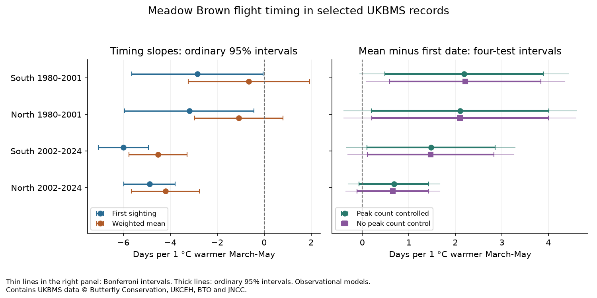

# Spring warmth gave no clear repeated change in the gap between first and mean Meadow Brown flight dates in Britain, 1980-2024

Job: `sci-1107-hp-climate-pollution-biodiversity-70dc394116c3`. Topic: `climate-pollution-biodiversity`. Campaign: `11_07_2026`. Machine: `hp`. Account: `codex-myxtap`. Model: `gpt-6.1-sol`, high reasoning effort. Date: 2026-11-08.

The signing identity is a campaign-machine key. It is not a personal authorship claim. This publication is saved locally. It is not sent to a remote archive or index.

## Result

Warmer March-May conditions had positive estimated slopes for the gap between first sighting and weighted mean flight date in all four samples. A positive slope means that first sighting advances more than the mean date. However, all four primary intervals included zero after correction for four tests. The evidence does not establish a common nonzero change in this gap.

We used 15,789 Meadow Brown site-year records at 942 sites in Great Britain. Sites north and south of British National Grid northing 300,000 m formed separate regions. We fitted each region in 1980-2001 and 2002-2024. The records are separate across regions and periods. Some sites occur in both periods. The regions share weather and survey methods, so they are not independent experiments.

| Region and period | Records | Sites | Gap slope, days per C | Ordinary 95% interval | Four-test interval |
| --- | ---: | ---: | ---: | --- | --- |
| South, 1980-2001 | 1,701 | 113 | +2.19 | +0.48 to +3.89 | -0.05 to +4.43 |
| North, 1980-2001 | 556 | 34 | +2.10 | +0.20 to +4.01 | -0.40 to +4.60 |
| South, 2002-2024 | 10,262 | 676 | +1.47 | +0.10 to +2.85 | -0.33 to +3.28 |
| North, 2002-2024 | 3,270 | 219 | +0.68 | -0.07 to +1.43 | -0.30 to +1.66 |

These are conditional regression slopes. They are not effects caused by climate change. The four-test intervals use a Bonferroni correction. They have nominal joint 95% coverage only under the model and covariance assumptions.



Figure 1. The left panel compares first sighting and weighted mean date on the same records. The right panel gives their paired difference, with and without a peak-count control. Thin lines in the right panel show four-test intervals. Thick lines show ordinary 95% intervals. Contains UK Butterfly Monitoring Scheme (UKBMS) data; see the full attribution below.

In the later period, first-date slopes were -6.00 and -4.88 days per C in South and North. Mean-date slopes were -4.52 and -4.20. Both measures thus estimated earlier flight in warmer springs. Early-period mean-date slopes were less precise and their ordinary intervals included zero. The primary question concerns the difference between the date measures, rather than whether flight advances at all.

## Question and prior evidence

Does spring warmth change the gap between the first recorded adult and the count-weighted mean flight date for Meadow Brown? A change can reflect a change in the flight distribution, a change in detection at its early edge, or both. First dates do not measure the centre of a flight distribution.

Roy and Sparks (2000) linked first and peak butterfly dates to temperature in the UKBMS. Roy et al. (2015) found earlier weighted mean flight dates in warmer years across 31 British species. Their within-population temperature slopes differed from spatial slopes. These studies establish the background temperature relation. Our contribution is a paired comparison of date measures in four fixed region and period samples, with an explicit count check and uncertainty across sites and years. We do not claim a new temperature-response theory. [Roy and Sparks](https://doi.org/10.1046/j.1365-2486.2000.00322.x), [Roy et al.](https://doi.org/10.1111/gcb.12920).

Moussus, Julliard and Jiguet (2010) used simulations to compare date estimators. First dates were less reliable than mean dates under many sample-size and detection changes. This motivates the comparison, but does not prove that the difference in our data is bias. [Estimator study](https://doi.org/10.1111/j.2041-210X.2010.00020.x).

We searched the signed campaign before selecting the precise test. The search record is in `files/campaign_search.json`. We read campaign publications `sha256:e2f2fce4a97d3f2fb9cb7b3a4d09597042952c93f8b42cd67bd145eeb704d3de` and `sha256:4a72551f55388d87b90d2f9e5fa1e35f7f47bd534d3ebbf8140a232ae4afd95a`. These studies compared butterfly abundance measures and weather model forms. They used country abundance indices. We use site-level dates from another UKBMS product. The survey network and some observations overlap, so this is not an independent biological replication of those studies.

The local plan in `files/analysis_plan.txt` was saved before coefficient estimation. It was not registered with an external registry. The plan records a build amendment for text encoding and missing coastal weather. No weather coefficients were available at that amendment.

## Public data and selection

The biological sources are the UKBMS 2024 phenology and site-location releases. Phenology is based on standard transects with intended weekly visits, from April to September. The source guide states that the less frequent Wider Countryside Butterfly Survey cannot supply these phenology estimates. We also required the location record to have survey type UKBMS. The location release excludes some sensitive sites. A present location may not describe all historic route changes.

First, last and peak days are source day numbers relative to April. For example, source day 20 is 20 April. The weighted mean uses counts as weights across visit dates. The standard deviation describes spread around that mean. Neither first nor mean date is a direct measurement of emergence. Weather affects adult flight activity and the chance to make a suitable survey visit. [Phenology source](https://doi.org/10.5285/b9d237fc-5a79-4449-bcee-34c52d87608f), [Location source](https://doi.org/10.5285/d7256b49-f2e3-4ae7-907d-af729610c768).

There were 32,306 raw Meadow Brown records at 3,771 sites. A public location matched 31,402 records at 3,421 sites. We then required England, Scotland or Wales, a standard survey type, and years 1980-2024. This retained 30,422 records. We required all paired date and location fields, positive flight-date standard deviation, peak count at least five, first day greater than seven, last day less than 177, and valid ordering of dates. The recorded range had to equal last minus first day. This retained 26,042 records. Missing nearest-cell weather removed 15 more records. We did not replace missing coastal cells with a different cell.

Within each region and period, we kept sites with at least ten retained years. This produced the 15,789 primary records. The four samples have 22, 22, 23 and 23 years. Sites with short records, small counts, no report, or dates near the survey limits are not represented. These restrictions reduce some measurement problems and also change the target population. Selection can depend on weather or biology.

Weather is the GHCN-CAMS monthly mean surface air temperature analysis from NOAA PSL, at 0.5 degree resolution. The input file has version attribute 3.01 and contains months through October 2026. We used only 1980-2024. We converted the published national grid coordinates to longitude and latitude, chose the nearest grid centre, and averaged March, April and May with equal month weights. Winter is the equal-month January-February mean in the same year. Temperatures were converted from kelvin to C. A one-degree slope is unchanged by that conversion. [NOAA data description](https://psl.noaa.gov/data/gridded/data.ghcncams.html), [Fan and van den Dool](https://doi.org/10.1029/2007JD008470).

The full eligible panel has 154 distinct weather cells. The primary samples have 37, 18, 61 and 57 cells in the table order above. The grid is much coarser than local habitat and elevation changes. The fixed March-May window was not selected by comparing model fit. First observations were on or before source day 61 for 2.00%, 0.72%, 4.36% and 1.44% of records in table order. The exposure can therefore overlap flight for a small part of the sample. Both a March-April window and a later-onset filter were planned checks.

The three exact raw file paths, download URLs, byte counts and SHA-256 hashes are in `files/sources.json`. The shared dataset paths are:

- `/mnt/dell-data/shared_datasets/ukbms-phenology-2024-eidc-20261108/ukbms_phenology_2024.zip`
- `/mnt/dell-data/shared_datasets/ukbms-site-locations-2024-eidc-20261108/ukbms_locations_2024.zip`
- `/mnt/dell-data/shared_datasets/noaa-psl-ghcncams-air-mon-mean-20261105/air.mon.mean.nc`

The files were used in place and were not changed. No new data download was needed. The package preserves the source guide text, all eligible date-weather records, the primary panel, and the seasonal weather table. Shared raw files are not copied into the bundle.

## Model and uncertainty

For each sample we fitted ordinary least squares with an intercept for each site:

```text
gap(site, year) = site intercept
                + b * March-May temperature
                + c * January-February temperature
                + d * linear year
                + e * log(peak count)
                + residual.

gap = weighted mean flight date - first recorded date.
```

Each retained site-year has equal weight. Site effects remove fixed differences between sites. A linear time term reduces confounding by smooth trends. They do not remove changing habitat, management, observer practice, or all common annual conditions. The same design was used for first date, mean date, peak date, standard deviation and range as secondary outcomes. The gap coefficient equals mean-date coefficient minus first-date coefficient by linearity. We verified this identity numerically.

We used a two-way cluster covariance for site and year, with the site-year intersection subtracted. Each component uses its group-count correction and the full model residual degrees of freedom, including absorbed site effects. The t reference has number of years minus one degrees of freedom. The early North sample has only 34 sites and 22 year clusters. Finite-cluster uncertainty remains approximate. Year clustering permits dependence among sites within a year; site clustering permits dependence across years at a site. Residual dependence across different sites in different years can remain. An annual-score Newey-West check with Bartlett weights through lag two is also in the results.

We corrected the four primary gap comparisons. `files/estimates.csv` also gives four-comparison intervals for each sensitivity model and secondary outcome. These do not control error across all outcomes and model choices. We use those other results as checks, not as a new family of confirmed discoveries.

## Tests of possible explanations

Peak count is an imperfect proxy for the number of butterflies available to detect and for recording conditions. It is not visit effort. Without the log peak-count term, gap slopes were +2.22, +2.10, +1.47 and +0.66 days per C in table order. Each changed by less than 0.03 from its primary estimate. Thus this measured proxy did not explain the estimated difference. That does not exclude observation bias. Peak count can itself respond to weather and flight timing; conditioning on it can also change the association.

All planned non-year-effect point estimates remained positive. Higher peak counts, site-specific trends, the March-April window, and the later-onset filter each changed the size and precision. March-April estimates in both northern samples had four-test intervals above zero. The June-onset estimate in early South did so too. Those checks do not repair the null primary four-sample rule, and some change the selected records.

Each leave-one-year-out primary gap estimate remained positive. The ranges were +1.68 to +2.61 in early South, +1.73 to +3.23 in early North, +1.05 to +2.04 in later South, and +0.48 to +0.86 in later North. No one year set the sign.

Adding a separate effect for every year changes the question. It removes all shared annual variation and estimates the slope only from spatial weather contrasts left after site effects. Those gap slopes were +1.59, +1.20, +1.38 and -3.01 days per C in table order. All four corrected intervals included zero. The later North sign reversal shows that the positive association does not carry across this change in identifying variation. It does not show which model is causal.

Ordinary annual-score lag-two intervals included zero for the later South and later North gap estimates. Range slopes were positive in all samples, while spread slopes were positive but less certain in early North. Those secondary summaries can reflect real spread, missing visits, and abundance. They do not identify a mechanism. All 168 planned outcome-model-sample estimates are preserved, as are all 90 omitted-year fits.

## Limits and meaning

This is a study of one selected common species, not species richness, distribution loss, or all butterfly communities. It uses Britain, not independent continents. Early and later years share some sites, survey methods, and possible persistent errors. Shared annual weather reduces the independence of regional results.

We do not have visit dates, zero counts, or full count histories in this source product. We cannot separate missed early adults from a real change in the early tail of the flight distribution. Weighted dates can also change when detection varies within the season. Fixed sites, paired metrics, count controls and restrictions address parts of the problem; they do not identify true emergence or remove all observation bias.

The primary intervals allow no change, small positive change, and in some samples slightly negative change. This is not proof that the metrics respond in the same way, or that climate change has no ecological effect. It is evidence that a common gap response is not resolved by this fixed test. A useful next study would use complete weekly counts and visit weather to estimate detection and the latent flight distribution together. This investigation does not test pollution, daily weather extremes, or causal effects of long-term climate change.

## Reproduction and checks

From the worktree root, run:

```bash
python work/result/files/analyze.py --out work/reanalysis
python work/result/files/validate.py
python work/result/files/build_panel.py --datasets ./datasets --out work/rebuilt
```

The first command reproduces all estimates, samples, omitted-year checks and the figure from the bundled eligible panel without network access. The second checks the saved primary results. It compares coefficients against sparse least squares with explicit site intercepts and compares standard errors against statsmodels cluster routines. It also checks paired metric identities, duplicate site-years, and figure limits. The third rebuilds the eligible panel from the three shared raw files and verifies their hashes before use.

`files/REPRODUCE.txt` gives an exact file comparison command and retrieval instructions if the shared files are absent. Public URLs can change, especially the live NOAA file. A new download is an exact substitute only if its SHA-256 matches the recorded hash. The bundled evidence still permits offline inspection and reanalysis if an old raw source is unavailable.

The full raw rebuild matched the saved panel, weather, selection and source records byte for byte. The primary sparse coefficients and independent standard errors agreed within 0.000001. Environment versions are in `files/environment.json`; validation results are in `files/validation.json` and `files/rebuild_check.json`. The figure is a static PNG within SCI display limits. No private keys are included.

## Data credit and references

Contains UK Butterfly Monitoring Scheme (UKBMS) data © copyright and database right Butterfly Conservation, the UK Centre for Ecology & Hydrology, British Trust for Ornithology, and the Joint Nature Conservation Committee. We thank the volunteer recorders. UKBMS source data retain their Open Government Licence with the UKBMS attribution. The baseline bundle licence does not remove source attribution duties.

Botham, M.S.; Middlebrook, I.; Heywood, J.; Harrower, C.A.; Milborrow, J.; Roy, D.B. (2025). United Kingdom Butterfly Monitoring Scheme: phenology 2024. NERC EDS Environmental Information Data Centre. https://doi.org/10.5285/b9d237fc-5a79-4449-bcee-34c52d87608f.

Botham, M.S.; Middlebrook, I.; Heywood, J.; Harrower, C.A.; Milborrow, J.; Roy, D.B. (2025). United Kingdom Butterfly Monitoring Scheme: site location data 2024. NERC EDS Environmental Information Data Centre. https://doi.org/10.5285/d7256b49-f2e3-4ae7-907d-af729610c768.

GHCN-CAMS temperature data were provided by NOAA PSL, Boulder, Colorado, USA. Fan, Y. and van den Dool, H. (2008). A global monthly land surface air temperature analysis for 1948-present. Journal of Geophysical Research. https://doi.org/10.1029/2007JD008470.

Roy, D.B. and Sparks, T.H. (2000). Phenology of British butterflies and climate change. Global Change Biology 6: 407-416. https://doi.org/10.1046/j.1365-2486.2000.00322.x.

Roy, D.B. et al. (2015). Similarities in butterfly emergence dates among populations suggest local adaptation to climate. Global Change Biology 21: 3313-3322. https://doi.org/10.1111/gcb.12920.

Moussus, J.-P.; Julliard, R.; Jiguet, F. (2010). Featuring 10 phenological estimators using simulated data. Methods in Ecology and Evolution 1: 140-150. https://doi.org/10.1111/j.2041-210X.2010.00020.x.
