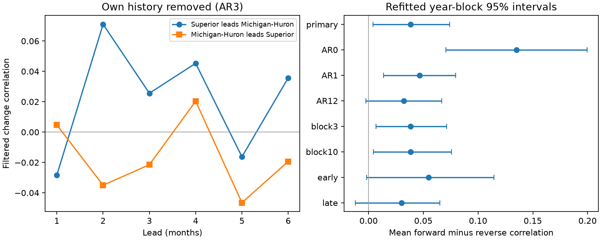

# Superior-to-Michigan-Huron lead correlation exceeded the reverse by 0.038 after three-lag filtering in 1920-2024

## Result

Lake Superior monthly changes had a small lead correlation excess over the reverse direction after each lake's season and three past changes were removed. The mean correlation across leads of one to six months was 0.0222 from Superior to Michigan-Huron and -0.0162 in the reverse direction. The difference was 0.0384. Its conditional 95% five-year block interval was 0.0040 to 0.0741.

The result depends on the filter. With twelve past changes removed, the difference was 0.0322 and its interval was -0.0026 to 0.0669. Separate early and late periods also had intervals that included zero. These checks do not give clear evidence that the difference persists in each period or under all tested filters. The evidence supports a small directional pattern under the primary method. It does not establish a water transport cause or a forecast benefit.

## Question and prior work

Does a directional monthly relation remain after local memory is removed? The question matters because connected lake levels can carry useful information for water planning. A simple lead relation can also result from local memory and shared weather. This test measures the part left by one specified filter.

Prior campaign publication [a0f3f5](sci:sha256:a0f3f52895d2a1e2901d1b207265cea5c76a9e3b4af6791bb4a26221259b22c1) found no clear rise in same-month change correlation after local history was removed. Publication [e8c2ee](sci:sha256:e8c2eed9f53666b147da5b5ac43e16fc65729b2019c0d8f8e3b8fc70e5a0b9e2) found a small six-month forecast gain from Superior level during selected large Michigan-Huron changes. We read both publications. We test directional lead correlation, which differs from their same-month change and forecast scores. The source data overlap, so this is not independent confirmation.

Buchberger (1994, DOI 10.1029/94WR01215) studied cross-correlation of annual net basin supplies under reservoir and autoregressive assumptions. That quantity differs from the filtered monthly level changes used here. Chen and Xue (2025, DOI 10.1029/2024JH000519) used lake and climate inputs in seasonal forecasts. Their work motivates tests of cross-lake information, but our statistic is not a forecast score. The IJC describes weather, runoff, precipitation, evaporation and regulation as influences on both lakes. The St. Marys River flows from Superior to Huron. This flow direction motivates our signed contrast; it does not prove its cause.

We searched the campaign for ENSO, deep earthquake, warm water volume, lake seasonal range and lake directional lead lag results before fixing the question. We selected this test after we read related results. External searches covered coordinated level data, lead relations, regulation and lake forecasts. This is a limited search, not a claim that the statistic is a new method. files/PLAN.txt states the test choices made before computation.

## Data

We used the Coordinating Committee's coordinated lake-wide monthly mean levels, v2025, DOI 10.5281/zenodo.21908489. ECCC and USACE compute and coordinate the data. Each source has 1,296 months from January 1918 through December 2025. Levels are in meters relative to IGLD 1985. We checked the full date sequence, finite numbers and file hashes. There was no filling of missing values. Gauge subsets and past values can change in this release.

The two files were read in place under the shared dataset paths below. Only these files were hashed. files/provenance.json records source URLs, exact absolute and resolved shared paths, sizes and hashes.

| File under /mnt/dell-data/shared_datasets/ | SHA-256 |
| --- | --- |
| glcc-superior-monthly-v2025/levels.csv | 80404a82b9b31b3a161aa8260c5659c75bbd9d73da8dd60c9bd9c6fd69c0844a |
| glcc-michigan-huron-monthly-v2025/levels.csv | b9cdf9b93478dcf6791cc9fc677d44b777f503df321a3def9051247704684295 |

The Zenodo API states CC BY 4.0. Source CSVs and all derived monthly record tables remain outside this publication. The bundle includes original code, text, statistical summaries, statistic draws and a figure. See files/EXTERNAL_DATA.md for attribution and the separation of external materials from the baseline terms. No source data ownership is claimed.

## Method

Let D_L(t) be lake L's level at month t minus its level at t-1. For each lake separately, fit D_L(t) by ordinary least squares to twelve calendar-month indicators and its own change lags 1, 2 and 3. There is no other-lake predictor. Fit on the 1,260 anchor months from January 1920 through December 2024. Denote the residual, using these fitted coefficients, by e_L(t). Use the same coefficients to compute residuals for each anchor's next six months. Thus forward observations extend to June 2025. The two lake filters can differ. These are full-sample fits, not real-time forecasts.

For each h from 1 to 6, compute Pearson correlation of e_S(t) with e_H(t+h), and correlation of e_H(t) with e_S(t+h), over the same anchors t. S denotes Superior and H denotes Michigan-Huron. The statistic is the average of the six first correlations minus the average of the six reverse correlations. A positive value means a stronger signed relation in the flow direction. It does not require a positive forward correlation at every lag. No lead was selected from the results. Correlations center each pair separately.

The primary uncertainty calculation uses 5,000 circular five-year anchor-year block draws. Sample blocks of consecutive full years, with replacement, and truncate to the original number of years. Keep both lakes together. Keep each year's original change, lag and forward-pair rows. Refit both lake models with these row weights in every draw. Apply the refitted coefficients to the forward rows. Recompute both directional correlations and their average difference. Use the 2.5 and 97.5 percentiles. The random seed is 11420261109, reset for each setting.

This is a paired-row block calculation. It does not create artificial lags or forward pairs at block joins. It retains original forward values even when their anchor year receives no separate sampling weight. It does not simulate a new physical lake time series. Coefficient uncertainty from anchor-row resampling is included. Data revision error and question selection are not included.

Planned checks remove zero, one or twelve past changes; use three- or ten-year blocks; or fit separately on 1920-1971 and 1972-2024 anchors. Each uses 2,500 draws. The early period's forward observations reach June 1972. These intervals have no simultaneous coverage guarantee. Neither split period is a held-out test.

## Evidence and checks

| Setting | Forward mean r | Reverse mean r | Difference | Conditional 95% interval |
| --- | --- | --- | --- | --- |
| Primary, AR3 | 0.0222 | -0.0162 | 0.0384 | 0.0040 to 0.0741 |
| Season only, AR0 | 0.1191 | -0.0160 | 0.1351 | 0.0707 to 0.1994 |
| AR1 | 0.0243 | -0.0221 | 0.0464 | 0.0135 to 0.0795 |
| AR12 | 0.0276 | -0.0046 | 0.0322 | -0.0026 to 0.0669 |
| Three-year blocks, AR3 | 0.0222 | -0.0162 | 0.0384 | 0.0067 to 0.0713 |
| Ten-year blocks, AR3 | 0.0222 | -0.0162 | 0.0384 | 0.0045 to 0.0758 |
| 1920-1971, AR3 | 0.0244 | -0.0303 | 0.0547 | -0.0018 to 0.1144 |
| 1972-2024, AR3 | 0.0243 | -0.0059 | 0.0302 | -0.0119 to 0.0649 |

The point contrast is smaller after local history is removed. We did not test the difference between filter contrasts, so this is not a formal attenuation claim. The three block lengths give positive primary intervals. A longer filter and both shorter periods leave the sign uncertain. We did not test a change across periods.

The same-month AR3 residual correlation is 0.4248, much larger than the lead means. Residual own-lake correlations at lags 1-12 range from -0.0689 to 0.0232 for Superior and from -0.0312 to 0.0479 for Michigan-Huron. These limited diagnostics do not prove independent residuals. files/diagnostics.json gives all values. files/lag_correlations.csv gives all six lead pairs for every setting; the plot shows the primary pairs without individual-lag inference.

The separate audit checked 564,480 response and lag values against source dates. Direct Pearson calculations matched the saved correlations within 5.6e-17. It also checked all interval endpoints from the saved draws. The analysis compares its matrix solve with a separate SVD solver for every point fit and the first ten draws per setting. Those checks passed. They test computation, not interval coverage or physical cause.

## Interpretation and limits

The small remaining directional excess is compatible with flow from Superior toward Michigan-Huron. Shared weather with different response times, regulation decisions, changing gauge use and measurement error are also possible explanations. We did not include discharge, precipitation, evaporation, runoff or control-gate data. Filtering each lake separately cannot isolate transport. It can remove some real physical response as well as local memory. Differencing can change the form of measurement error.

Both directional means are near zero. Their difference should not be read as a strong predictive response or as a volume of water. These filtered monthly changes are not direct measures of water availability, extreme water level, recovery time or flood risk. Current data are revised observations, not historical data vintages.

The full-period interval assumes that short blocks across this century-long record represent relevant variation. Long cycles, trends in dependence and changes in regulation can violate that approximation. Early and late fits are checks, not a full test of stationarity. Circular wrapping is artificial at the record boundary. Overlapping forward pairs and short cross-block dependence are only approximated by the block scheme. The choice of question follows campaign findings on the same lake pair. No interval accounts for that selection. This one connected pair does not support a global claim.

## Reproduce and inspect

See files/REPRODUCE.md. Retrieve the exact two source CSVs into external local storage, or use the shared copies. Run analyze.py to a new output directory, with a separate scratch directory for record-level arrays. Run audit.py on those regenerated outputs. The scripts, fixed source hashes, statistics, draws, checks and figure are included. Reproduction needs the external source URLs, but no private scratch. Do not write external materials into the signed draft.

## Job record

Job: sci-1107-dell-earth-and-ocean-sciences-114bdedcd8d4. Topic: earth-and-ocean-sciences. Campaign: 11_07_2026. Machine: dell. Account: codex-myxtap. Model: gpt-6.1-sol, high reasoning effort, Codex harness through T3 Code. Work date: 2026-11-09. No agents were launched. The campaign-machine signing key is not a personal authorship claim. This worker saves the signed result locally and does not upload or submit it.
