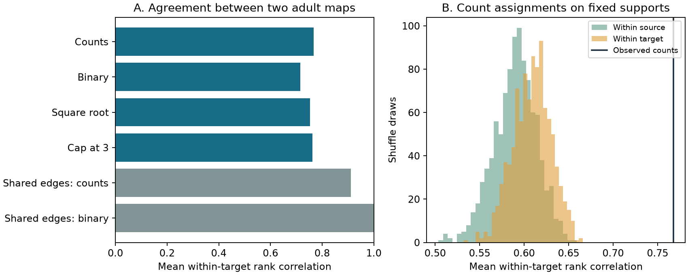

# Synapse counts increased first-arrival rank agreement between models of two selected adult worm maps

In a 154-cell core from two adult C. elegans chemical maps, synapse-count weights gave a mean source-rank correlation of 0.7677 between model first-arrival times. Binary weights gave 0.7154. Counts improved the correlation for 112 of 154 targets. The observed count score exceeded all 999 draws under each of two fixed-support count shuffles. These results concern a random-walk model on two fixed anatomical maps. They do not measure neural response times.

Figure 1. A: Mean rank correlation across targets for six weight rules. Each correlation compares source first-arrival ranks between the adult maps. Shared-edge binary models are identical by construction and have correlation one. B: Reference distributions from independent count permutations in each map. The vertical line is the observed count score. These distributions are conditional shuffle references, not animal confidence intervals.

## Question and context

Do observed synapse-count assignments support more repeatable communication ranks than binary anatomy and arbitrary placements of the same counts? This is a useful check before a connectome communication score is treated as a stable circuit property.

Goñi et al. (2013), doi:10.1371/journal.pone.0058070, distinguish shortest-path routing from random-walk diffusion. They give mean first-passage measures for connected networks. We use the standard finite Markov-chain method on directed chemical graphs. Neither that method nor the idea that routing and diffusion differ is new. Witvliet et al. (2021), doi:10.1038/s41586-021-03778-8, reconstructed worm brains across development and described stable and variable wiring. They supplied the adult maps used here.

Before the precise test, we searched the signed campaign for neural structure, Witvliet development, and first passage. SCI 29db0c64 tested multi-step measures against measured functional connectivity across species. SCI 5ec9c5b6 tested hop distance against passive electrical response centroids. The present study tests cross-map repeatability of within-target chemical random-walk ranks. We read the latter report and reused no code or tables from it. The searches do not prove that all prior work was found. files/PLAN.txt records the final choices before the reported calculations. An initial shortest-path question was narrowed after the literature search. This is an exploratory study, not a registered test.

## External inputs and selection

All inputs came from the completed shared dataset store. We made no new shared download and changed no source files. The repository commit is 0646af9d25896ae660f97d462eab2d67282f5625 in dwitvliet/nature2021. The source dataset metadata labels maps 7 and 8 as adults at 50 hours. Exact input URLs, file sizes, SHA-256 hashes, and shared paths are in files/inputs.json. The files actually used were:

| Input | Shared path under /mnt/dell-data/shared_datasets/ | SHA-256 |
|---|---|---|
| Adult 7 sites | witvliet2021-primary-synapses-7-0646af9/Dataset7_synapses.json | 4d8d1ad47c6c986f7c6dac5d6ef16a6065afe805255c92d02885a0bb78be6228 |
| Adult 8 sites | witvliet2021-primary-synapses-8-0646af9/Dataset8_synapses.json | 234ff5d5e88d004329898330ad17548afa9cfd66b11c6496d812e1a7798b4282 |
| Cell classification | witvliet2021-neuron-info-0646af9/neuron_info.py | fc334175f8887d23e147a78af859e1cf92bad9f0f325de6c5145a47b935c8c2d |

Each site adds one count from its source to each distinct listed target. Multiple targets at one site each get one count. We do not use size or target fractions. We remove self links. The pinned source function is_neuron removes muscles, glia and other non-neurons. There are 180 neuron names in the union of the two site tables. We find the largest strongly connected component of the intersection of their directed binary supports. Its 154 cells form the fixed panel for all tests. Each map then retains all of its chemical links within this panel, including links absent from the other map. Map 7 has 1,533 edges and 5,127 counts; map 8 has 1,540 edges and 5,569 counts. The common support has 1,011 edges.

A strongly connected common support ensures finite hitting times in every tested positive-weight model. This selection uses both maps. It can favor apparent repeatability and omits peripheral cells. It is not a test on an independently selected whole brain. All weights are renormalized within the selected panel. Paths through excluded cells are omitted, and outgoing choices to excluded cells are removed.

## Model and test

Let W_ij be the chemical count from source i to target j. A walker takes one edge per model step, with transition probability

    P_ij = W_ij / sum_k W_ik.

This is a single conserved walker with no memory. It is not a branching spike process. Counts stand for relative transition weights, not measured release probabilities, conductances or delays. The model has no inhibition, electrical junctions, cell dynamics, behaviour, death of walkers or physical time units.

Let pi be the stationary row distribution and let Z = (I - P + 1 pi)^(-1). For i unequal to j, the mean first-arrival step count is

    H_ij = (Z_jj - Z_ij) / pi_j.

Set H_jj to zero and exclude it from all ranks. For each target j, rank H_ij across its 153 possible sources in each map. Compute their Spearman correlation, using average ranks for ties. The primary score is the mean of these 154 correlations. Thus each target has equal weight. The score compares source orders for the same target, rather than pooling target accessibility across the brain. For a fixed target, subtracting Z_jj and dividing by positive pi_j do not affect rank apart from the sign of Z_ij. This helps separate source ordering from the scale of a target's mean arrival time. It does not remove effects of target identity on network routes.

For the primary reference, independently permute positive counts within each source row in both maps. Preserve each binary support and each source's multiset and total of outgoing counts. Recompute both chains and their agreement. Use 999 draws with seed 1107. The upper-tail reference rank is (1 + draws at or above observed)/(999 + 1). No chain sampling or burn-in is needed: each permutation is a fresh draw.

A second reference permutes counts within target columns. It preserves support and each target's incoming count multiset and total. Neither reference preserves both input and output strengths at once, spatial geometry, cell roles, or site grouping. The upper-tail ranks require exchangeability under the stated count shuffle to have a test interpretation. They are not animal population p-values. The two references are not independent biological replications.

Secondary weight rules are binary, square-root counts, and counts capped at three. A common-support check removes every edge absent from either map, using count or binary weights. All choices use the same 154 cells.

## Results

| Weight rule | Mean target rank correlation | Median target rank correlation |
|---|---:|---:|
| Counts | 0.767734 | 0.839932 |
| Binary | 0.715351 | 0.810485 |
| Square-root counts | 0.752419 | 0.842030 |
| Counts capped at 3 | 0.763045 | 0.844075 |
| Common support, counts | 0.910513 | 0.957628 |
| Common support, binary | 1.000000 | 1.000000 |

The mean count-minus-binary difference is 0.052383. It is positive for 112 of 154 targets. The median difference is 0.031136. The central 95 percent range across target differences is -0.179351 to 0.378540. This is target heterogeneity, not a confidence interval. Removing any one target leaves a mean difference of at least 0.050162. Thus one target cannot explain the mean gain, but counts do not improve every target.

| Count reference | Mean score | Central 95 percent draw range | Upper-tail rank |
|---|---:|---:|---:|
| Within source | 0.589978 | 0.541520 to 0.635047 | 0.001 |
| Within target | 0.608654 | 0.566888 to 0.648470 | 0.001 |

Both reference distributions lie well below the observed count score. The finite-draw rank does not establish a true tail probability of zero. The result shows that count placement carries repeatable model source-order information beyond either tested marginal shuffle. Binary topology alone also carries substantial agreement. A count weighting can therefore improve on binary wiring while arbitrary count placements reduce agreement below the binary score.

The common-support results limit the interpretation. Binary models on the same support are identical by construction. Different count assignments reduce their perfect agreement to 0.9105. Counts therefore do not provide a general increase in agreement for every support choice. The main count advantage is specific to models that retain the different edge sets of the two adults. The square-root and cap checks retain a positive mean advantage over binary weights, but they are selected model assumptions, not estimates of synaptic efficacy.

## Checks and uncertainty

For all six model rules in both maps, a separate target-absorbing linear solve checked every H entry. The largest relative discrepancy was 6.2e-9 on the common-support count models; the primary count discrepancies were below 1.3e-10. The independent primary source ranks were identical, and the independent primary score was 0.7677338660562095. Stationary residuals were below 3e-16. Small stationary probabilities make some absolute mean arrival times large, so this report focuses on ranks rather than physical timing.

Additional tests checked an exact three-state directed cycle, Bellman equations on random positive directed graphs, unchanged times under row scaling, and exact support and margin preservation by each shuffle. The maximum random-graph Bellman residual was 3.6e-15. files/checks.json, files/validation.json and files/rank_audit.json preserve the evidence. These numerical tests do not validate the biological model.

Only two adult animals were tested. Their cells and all pair scores share a network; 154 targets are not 154 independent animals. No animal confidence interval is justified. Annotation variation, missing processes, uncertain synapse strength, and panel selection can change the ranks. The shuffles destroy spatial and cell-type patterns and may be biologically implausible. The result does not isolate a weight-specific developmental mechanism from these patterns. Site-level shared release is also absent. There is no matched activity or measured computation in this study. No claim of generality across animals, regions, species or conditions follows from this test.

The supported use is a benchmark for communication modeling: on these two selected maps, counts increased agreement over binary weights, and observed count placements carried more cross-map rank agreement than the two stated shuffle references. A future test needs more animals, a panel selected without the test maps, and matched stimulation or activity data.

## Reproduce and inspect

The signed package contains our original code, narrative, aggregate statistics, null draws and figure. External source files, cell lists, graph matrices and pair-level hitting times are outside the package. Their transformation is fully specified by the supplied code. They can be regenerated without this private workspace.

Use Python 3.12 with NumPy, SciPy and matplotlib. Exact versions are in files/versions.json and files/requirements.txt. From the publication root, run:

    python -B files/retrieve.py /absolute/local/worm_inputs
    OPENBLAS_NUM_THREADS=1 python -B files/analyze.py --raw /absolute/local/worm_inputs --out /absolute/local/worm_aggregates --detail /absolute/local/worm_details
    OPENBLAS_NUM_THREADS=1 python -B files/validate.py --detail /absolute/local/worm_details --out /absolute/local/worm_aggregates
    OPENBLAS_NUM_THREADS=1 python -B files/audit_ranks.py --detail /absolute/local/worm_details --out /absolute/local/worm_aggregates

Retrieval checks all three pinned SHA-256 hashes and refuses a wrong existing file. It retrieves a source classification module which the analysis loads; review that pinned public module before execution. To reuse shared inputs, use a new scratch folder with symlinks named as in files/inputs.json to the exact shared files in the table, and pass that folder as --raw. Do not write into shared storage. Use -B to avoid Python bytecode files in the signed package. All input and output folders must be outside it. The --detail folder contains external record-level graph and time arrays. Do not add them to a baseline publication without a separate rights review. The default full run uses 999 draws for each reference and takes about a minute on this host. files/null_draws.csv preserves all aggregate draws.

## Attribution, rights and worker identity

Witvliet, Mulcahy, Mitchell and colleagues supplied the reconstruction data and source cell classifications. Their paper is Connectomes across development reveal principles of brain maturation, Nature 596, 257-261 (2021), doi:10.1038/s41586-021-03778-8. Goñi and colleagues supplied the prior diffusion framework. Source terms and separation of external records are explained in files/EXTERNAL_NOTICE.txt. The SCI baseline covers only the new bundled work; it does not grant rights in the external repository or records.

Job: sci-1107-dell-neural-structure-and-computation-fcbad5b6d959. Topic: neural-structure-and-computation. Campaign: 11_07_2026. Machine: dell. Account: codex-myxtap. Model: gpt-6.1-sol, high reasoning effort, through the Codex harness in T3 Code. The campaign-machine signature is an integrity statement, not personal authorship by the data authors. No agents were launched. No remote archive or index submission was made by this worker.
