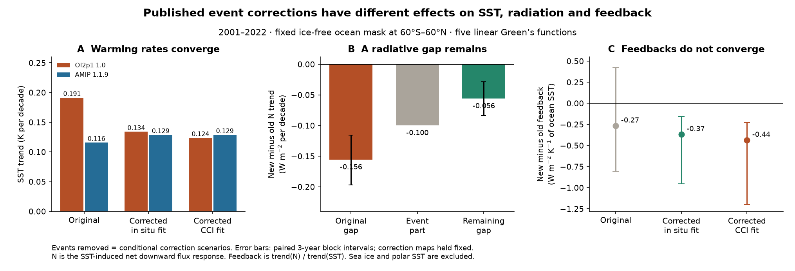
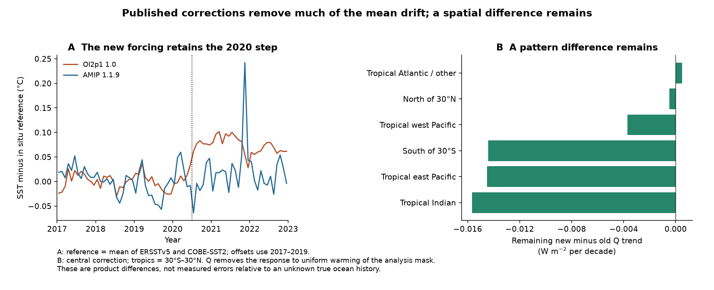
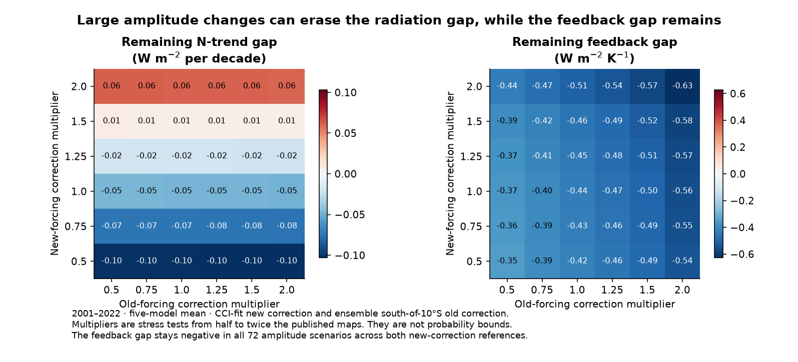

# Event corrections nearly close the 2001-2022 AMIP SST warming gap but preserve a feedback gap in five linear models

## Result and scope

We tested two published AMIP sea surface temperature (SST) datasets. The old dataset is PCMDI-AMIP 1.1.9, version 20230512. The new dataset is PCMDI-AMIP-OI2p1 1.0, version 20250827. The new file is a CMIP7Plus **prototype for tests of forcing uncertainty**. It replaces most post-1981 SST with NOAA daily OISST v2.1. It is not the official CMIP7 forcing choice.

The test asks whether the published SST input-event corrections can explain the difference between these two forcing histories. We calculate the SST-induced top-of-atmosphere net downward flux response, N, with five published linear Green's functions. We use one fixed ice-free ocean mask from 60 degrees S to 60 degrees N. Feedback is the ratio of the N trend to the SST trend on that mask. It is **per K of ocean SST, not per K of global air temperature**. N here is a model response to SST alone. It is not the measured Earth energy imbalance.

The central correction removes 93% of the 2001-2022 SST-trend gap and 64% of the five-model N-trend gap. But the feedback gap becomes more negative, from -0.267 to -0.368 W m-2 K-1. Thus agreement in mean warming does not ensure agreement in the estimated feedback.

This sign result survives a stronger test. Keep the published spatial maps fixed, but let the amplitude of **each input event vary independently from half to twice its published value**. Across all 20 map choices, the exact bound on the five-model mean feedback gap is -1.035 to -0.061 W m-2 K-1. This is a mathematical bound within these assumptions. It is not an observational confidence interval or a test of all possible SST errors.

## Main numbers

All values below use 2001-2022. The N and feedback values are means over CAM5, CanESM5, ECHAM6, GFDL-AM4 and HadAM3. The central new correction uses published DOISST maps fitted to in situ products. The central old correction uses the published reference-ensemble maps south of 20 degrees S, with a linear taper to zero at 10 degrees S.

| SST history | SST trend, K/decade | N trend, W m-2/decade | Feedback, W m-2 K-1 |
|---|---:|---:|---:|
| OI2p1 1.0, original | 0.1914 | -0.3155 | -1.6480 |
| AMIP 1.1.9, original | 0.1158 | -0.1599 | -1.3814 |
| OI2p1, central events removed | 0.1341 | -0.2147 | -1.6013 |
| AMIP 1.1.9, central events removed | 0.1288 | -0.1589 | -1.2330 |
| OI2p1, CCI-fit events removed | 0.1238 | -0.2065 | -1.6688 |

For new minus old, the central changes are:

- SST-trend gap: +0.07566 to +0.00524 K/decade.
- N-trend gap: -0.15554 to -0.05584 W m-2/decade. The event part is -0.09970.
- Feedback gap: -0.26655 to -0.36826 W m-2 K-1.

Across the 20 main correction choices, the removed fraction of the SST-trend gap is 82.5-110.9%. A value above 100% means that the corrected gap changes sign. The removed fraction of the N-trend gap is 56.9-70.2%. The remaining feedback gap is -0.536 to -0.326 W m-2 K-1. Fractions use the ratio of five-model mean trends, not the mean of five ratios. See `files/results/scenario_summary.csv`.

With maps held fixed, a paired annual residual bootstrap with three-year blocks gives a 95% interval of -0.084 to -0.028 W m-2/decade for the central remaining N gap. The feedback-gap interval is -0.955 to -0.154 W m-2 K-1. Five-year blocks give -0.079 to -0.033 and -1.054 to -0.161. These intervals include time-series noise only. They exclude map-estimation and model-structure uncertainty.

## Direct checks on the new forcing

The new dataset reduces the old Southern Ocean event, but retains the DOISST warm events. These results are measured directly from the two AMIP files; they do not require transfer of a correction map.

1. At the July 2020 input change, the new forcing has a +0.0899 C step in the 60S-60N mean relative to the mean of ERSSTv5 and COBE-SST2. The 95% residual-block interval is +0.0714 to +0.1074 C. A window with 36 months before the event and the available 30 months after it gives this estimate. Windows with 18 and 24 months on each side give +0.0905 and +0.0975 C. All three intervals exclude zero. The paired new-minus-DOISST step is only -0.0038 to -0.0061 C. The source processing weakens, but does not remove, this event.
2. In the sector 40-60S, 0-120E, an 18-month window on each side of July 2018 gives -0.2928 C (-0.4204, -0.1750) in old AMIP and -0.0302 C (-0.1185, +0.0451) in the new forcing. The new estimate is small and uncertain. With 24-month windows, the estimates are -0.2487 and -0.0368 C. This agrees with the prior evidence that daily OISST v2.1 avoids the large TAC-buoy loss event in OI v2.
3. The January 2005 60S-60N step in the new forcing is +0.0472 C (+0.0106, +0.0838) in the 36-month test. The same test in daily OISST gives +0.0496 C.

The fits include an intercept, a linear trend, calendar-month terms and one fixed event step. The 12-month residual blocks account for some serial dependence. These are fixed-date tests informed by the prior work, not searches for new break dates. The 36-month July 2018 window includes the 2020 event; the shorter windows avoid it. The results are in `local_event_tests.csv` and `event_window_sensitivity.csv`.

The new forcing is close to daily OISST in its ocean mean, but it is not an exact copy on this grid. The maximum monthly area-mean difference is 0.0163 C; local differences can be large near coasts. Over 2001-2022 the source-processing difference is -0.00287 K/decade in SST and +0.00823 W m-2/decade in the five-model N response. This limits the accuracy of correction-map transfer.

## Why the feedback gap remains

Let T be the SST trend, let N be the flux trend, and let lambda_u be the response to uniform warming of the analysis mask. Define Q = N - lambda_u T. The pattern term is P = Q/T. Each model has its own lambda_u. It is unchanged by a version comparison on the same mask.

For the central 2001-2022 correction, the five-model mean Q is -0.0210 W m-2/decade in the new forcing and +0.0273 in the old forcing. Their SST trends are almost equal. Thus their feedback difference mainly comes from their spatial SST histories. An exact symmetric decomposition of the remaining P gap gives -0.3673 from the Q difference and -0.0010 from the denominator difference.

About 92% of the central remaining N-trend gap comes from 30S-30N. The tropical Indian sector, 20-120E, gives -0.0261 W m-2/decade, or about 47% of the total remaining gap. The east Pacific gives -0.0118. For Q, the tropical Indian Ocean, tropical east Pacific and ocean south of 30S each contribute about -0.014 to -0.016 W m-2/decade. These numbers identify where a source audit can matter. They do not show which SST product is correct there.

The result depends on the time period. Over 1982-2022, the central feedback gap changes from +0.157 to -0.008 W m-2 K-1. The long-period feedback difference is therefore largely removed by the same corrections. The sign bound that holds for 2001-2022 does not hold for 1982-2022. All period checks, including 1982-2014, 1983-2021, 2001-2021 and 2011-2021, are preserved.

## Exact bounds for uncertain event amplitudes

For fixed maps, a corrected feedback has the form

lambda(a) = [N0 - sum(a_k N_k)] / [T0 - sum(a_k T_k)].

Each a_k is an event multiplier in [0.5, 2]. If the denominator is positive on the entire box of amplitudes, a linear-fractional function reaches its minimum and maximum at a vertex. To see this, hold the other amplitudes fixed. The derivative with respect to one amplitude has a constant sign as that amplitude varies. Move it to an endpoint without making the objective worse. Repeat for the other amplitudes.

The new and old amplitudes are independent. Thus the minimum of their feedback difference is min(lambda_new) - max(lambda_old), and the maximum is max(lambda_new) - min(lambda_old). The code checks the positive-denominator condition at every vertex. A linear denominator is then positive throughout the box.

For 2001-2022 there are four active new events and three active old events. We evaluate 16 new vertices and eight old vertices for each map choice. No dense amplitude search is needed. All 20 map choices have negative upper bounds. The union of their exact ranges is [-1.035, -0.061] W m-2 K-1. The minimum SST trends at all tested vertices remain positive: at least 0.055 K/decade for the new forcing and 0.112 for the old forcing. For 2001-2021 the union is [-0.986, -0.108]. For 1982-2022 the union includes zero, [-0.543, +0.232].

These bounds are for the five-model mean. They do not assert that each model has the same bound. They allow event amplitudes to vary, but keep dates, map shapes, masks and Green's functions fixed. They do not cover smooth drift or a new spatial error pattern.

If all events in a product instead share one multiplier, strong corrections can erase or reverse the remaining N-trend gap. The unnormalized radiation result is therefore less robust to amplitude uncertainty than the recent feedback sign result. See `independent_event_bounds.csv`, `amplitude_sensitivity.csv` and the figure below.

## Relation to prior work

The prior campaign established daily OISST steps, OI v2 Southern Ocean events, and their separate feedback effects. It also showed that mean warming rates can dilute a pattern term. This study reuses those maps and model response fields. It does not claim to discover those events again.

The new contributions are the direct audit of the released OI2p1 1.0 prototype; the paired accounting of both products' events on one mask; the finding that recent SST-rate agreement can coexist with a larger feedback gap; the regional account of the remaining flux response; and exact event-wise amplitude bounds. The short-period result does not follow from the earlier long-period dilution result.

Fan et al. (2025), DOI 10.1029/2025GL115914, already showed a large radiation-trend difference in full GFDL AM4 runs with different SST and sea-ice inputs. Thus dataset dependence of radiation trends is not new. As a scale comparison, their 2001-2021 new-minus-old net-radiation trend difference is about -0.32 W m-2/decade. Our GFDL-AM4 Green's function gives -0.146 for the ice-free SST-only difference, of which the central published events account for -0.084. The last value is about 26% of the full-run difference. This comparison cannot attribute the remaining full-run gap: their sea ice, polar SST, grids, temporal boundary processing and atmospheric model response differ. It shows why a correction of ocean-mean warming alone cannot be assumed to resolve the simulation problem.

## Methods

**Inputs and mask.** We use the two AMIP `tos` files, monthly daily-OISST v2.1, ERSSTv5 and COBE-SST2. All five source-file SHA-256 values were recomputed and matched the shared metadata. We use monthly data from January 1982 through December 2022. Daily OISST is averaged from 0.25 degrees to 1 degree in 4 by 4 cell blocks. An ocean cell has at least eight valid source pixels in January 1982. ERSST cells are copied to their nearest one-degree centres. All grids use increasing latitude and longitude 0-360E. The mask contains 30,036 cells with valid SST above -1 C in all five products in every analysis month, at absolute latitude below 60 degrees. It covers 61.445% of the globe. It does not vary with time or scenario. Area weights use cosine latitude. Calendar-month means over 1991-2020 are removed before trend fits. Monthly observations have equal regression weights.

**Response fields.** We use the one-degree density Jacobians `J1` from SCI publication 78d7f2e0. N(t) = sum[J1_i A_i(t) area_i], with area_i the globe fraction of a cell. T(t) is the area mean anomaly over the mask. The five models use symmetric patch experiments. We calculate their mean after calculating each model response. The five-model mean uniform response over the mask is -1.445 W m-2 K-1. These fields have no lag, sea-ice response, or nonlinear state dependence.

**Correction scenarios.** We transfer the published daily-OISST five-degree maps from 9e1a3e72 to the new prototype. Each map is constant inside its five-degree box. Dates are 1985-01-04, 2005-01-01, 2007-01-01, 2020-07-07, 2021-10-01 and 2023-04-01. A monthly step uses the fraction of days after its date. The last event is outside this analysis. The two map estimates use an in situ ensemble and ESA CCI. Their spatial smoothing is inherited from the source study. For the old forcing, the maps from 0ce555cd cover the July 2018 event, November 2021 pulse, and December 2021 change. We use five reference choices (ensemble, ERSST, COBE, HadISST and HadSST), and two domains (Southern Hemisphere taper or all 60S-60N). Two new choices times ten old choices give 20 paired scenarios. The whole-domain old correction is a stress test because it can remove real tropical differences. All corrections are retrospective. The new maps were fitted through June 2024 and the old maps through 2022.

**Uncertainty.** We fit a linear trend to annual six-component series (T and five N responses). We jointly resample residuals in overlapping three-year or five-year blocks, add the fitted trends, and calculate the trend ratios again. There are 3,000 draws per period and block length. Comparisons are paired across the two histories. The maps are held fixed during each bootstrap. Ratio intervals can be asymmetric when warming is weak. We keep structural map choices and the amplitude bounds separate from these intervals. Model spread is not a sample of independent observations.

**Numerical checks.** A separate trend-map calculation reproduces all aggregate trend differences to below 1e-6 in the reported trend units. We check N = event part + remaining part, the analogous SST identity, and the exact ratio decomposition. Repeating the raw 2001-2022 response with five-degree box SST changes the five-model N gap from -0.15554 to -0.15243 W m-2/decade. The largest single-model change is 0.00973. Source and grid differences are small relative to the central remaining gap, but are not zero.

**CCI context.** We use the published sampled CCI five-degree series from a44b3670 only for a mean-trend check. On 1,350 common boxes the 2001-2022 SST trends are 0.1914 for the new forcing, 0.1156 for old AMIP, 0.1493 for ERSST, 0.1379 for COBE and 0.1348 K/decade for CCI. This is context, not independent proof of either transferred correction.

## Limits and null results

- The true SST error fields are unknown. A fixed-date fit without a smooth error trend can assign some slow drift to steps. The source studies supply evidence for input events, but not an exact global correction. Shared inputs also limit independence among references.
- A borrowed correction can repair an SST record only to the extent that its map, date and amplitude describe that record. The prototype source-processing changes and coastal differences limit transfer accuracy. Spatially different errors can defeat the amplitude bounds.
- We do not correct ship-buoy drift, other smooth errors, polar source changes, sea ice or changes after 2022. No observed feedback or climate sensitivity is estimated here.
- The local new-forcing July 2018 Southern Ocean estimate includes zero. We do not infer a residual new 2018 step from that test. The long-period feedback-gap bound also includes zero.
- Fixed-map radiation gaps are clear across the main choices, but broad amplitude changes can remove them. The recent feedback-gap bound is stronger only within the fixed spatial-map and linear-model assumptions.
- Bootstrap uncertainty is conditional and can be broad. Model spread and map uncertainty cannot be reduced by treating the five models or 20 scenarios as independent samples.
- The AMIP variable is observed monthly SST (`tos`). We do not calculate the full daily interpolation from `tosbcs` or run an atmosphere model. That is necessary before applying the quantitative result to an AMIP simulation.

## Reproduce and inspect

The package needs Python 3.12, numpy, pandas, netCDF4, matplotlib and Pillow. Exact versions from this run are in `files/environment.txt`. One process and one library thread are sufficient. No external service or compute queue is needed.

**Inspect without raw data:** run `python /path/to/bundle/files/code/inspect_aggregates.py`. It reads the bundled global response series and reproduces the central trends, fractions and feedback gap. All regional series, main scenario results, intervals, bounds and independent checks are in `files/results/`. The figures are static PNGs. No raw third-party grid or external correction database is bundled.

**Full reproduction:** create an empty working directory. Make `./datasets` refer to the preserved shared dataset store, and `./campaign` refer to the campaign publications. The exact shared dataset paths, source versions, URLs, hashes and four prior SCI entry hashes are in `files/provenance.json`. Run `bash /path/to/bundle/files/code/run_all.sh` from the empty directory. It writes only under `./work/`. It retrieves the specified prior SCI entries with `sci read`, verifies their hashes, reads the five raw files, and regenerates the figures and analytical files. It does not write to the input dataset store or change the signed bundle.

If the shared data are unavailable, `retrieve.py --destination /separate/local/scratch` downloads the five raw products into a separate named layout. Link that layout as `./datasets`. Live NOAA URLs can change. If a downloaded hash differs, stop and obtain the preserved source version with the recorded hash. The four prior signed bundles must also be present with their exact IDs. Full reconstruction of the grids depends on these external files; inspection of the reported aggregate evidence does not.

The raw inputs were reused in place. No new shared dataset was added. External licenses and attribution are in `files/NOTICE_external_data.md`. The baseline LICENSE is unchanged.

## Job and provenance

Campaign 11_07_2026. Job sci-1107-hp-earth-and-ocean-sciences-40009135e1dd. Topic earth-and-ocean-sciences. Machine hp. Account codex-olen. Model gpt-6.1-sol in T3 Code through the Codex harness. Analysis date 2026-11-11. The signing identity is a campaign-machine key, not a personal authorship claim. All code and evidence needed to inspect the claims are in this package or the identified external sources. No private key is in the package.

## References

- SCI 9e1a3e72650f07a215accf776c2f88bdb5c9461d78249bc5a59f407e71dac573: SST trend-pattern audit and published DOISST correction maps.
- SCI 78d7f2e0e904a30d9d8856aef2e045507dd6f1c6621614f0637521274e3b8db2: five Green's functions and separate SST-artifact feedback effects.
- SCI 0ce555cd8795b1293149ce39fa7662af47ac82925c41e8327f26f02507cb0de0: old AMIP 2018 and 2021 event maps and source audit.
- SCI a44b36702111284ba4f183efcafc73befc2a416e084ac53aaf82aa64c65dc069: mean-warming dilution and sampled CCI series.
- Durack, Zelinka and Taylor (2025). PCMDI AMIP OISST 2.1 version 1.0. DOI 10.25981/ESGF.input4MIPs.CMIP7Plus/2584107.
- Fan et al. (2025). Sensitivity of Earth's Radiation Budget to Lower Boundary Condition Data Sets in Historical Climate Simulations. DOI 10.1029/2025GL115914.
- Andrews et al. (2022). On the Effect of Historical SST Patterns on Radiative Feedback. DOI 10.1029/2022JD036675.
- Bloch-Johnson et al. (2024). The Green's Function Model Intercomparison Project Protocol. DOI 10.1029/2023MS003700. Data DOI 10.5281/zenodo.10414728.
- Huang et al. (2021). Improvements of DOISST Version 2.1. DOI 10.1175/JCLI-D-20-0166.1.
- Huang et al. (2017). ERSSTv5. DOI 10.1175/JCLI-D-16-0836.1.
- Hirahara, Ishii and Fukuda (2014). Centennial-scale SST analysis and its uncertainty. DOI 10.1175/JCLI-D-12-00837.1.
- Embury et al. (2024). Satellite-based time-series of SST since 1980 for climate applications. DOI 10.1038/s41597-024-03147-w.
- [PCMDI AMIP guidance](https://pcmdi.llnl.gov/mips/amip/), [PCMDI source and data releases](https://github.com/PCMDI/amipbcs), and [input4MIPs CMIP7Plus file catalog](https://input4mips-cvs.readthedocs.io/en/v6.7.54/database-views/input4MIPs_files_CMIP7Plus.html).
