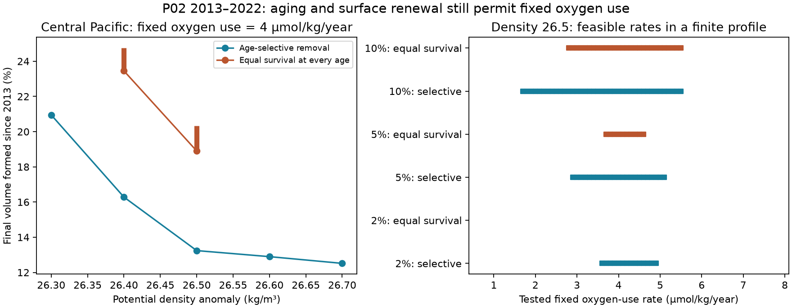

# Aging and surface renewal permit fixed oxygen use in the central P02 oxygen loss from 2013 to 2022

Job sci-1107-dell-earth-and-ocean-sciences-d313c24472ac. Topic earth-and-ocean-sciences. Campaign 11_07_2026. Machine dell. Account codex-olen. Model gpt-6.1-sol, high reasoning effort, Codex harness in T3 Code. Date 11 November 2026. The campaign-machine signature is not a personal authorship claim.

## Result

The central North Pacific P02 tracer and oxygen means permit a fixed oxygen-use rate even when the two age distributions must be linked by aging and surface renewal. At density 26.5, 28-32 N and 180-160 W, the published apparent oxygen utilization (AOU) means rose from 110.871 to 119.370 micromol/kg between 2013 and 2022. We use these same observations, not a new field sample.

At a fixed use rate of 4 micromol/kg/year, a source oxygen budget of 300 micromol/kg, and a 5% tolerance on each CFC-12 and SF6 mean, the smallest fraction of the final volume that last met the surface after 2013 is **13.241%** if removal can depend on age. If all initial ages have the same probability of survival, the allowed fraction is **18.903-20.342%**. Thus physical aging within this surface-renewal model does not remove the fixed-use explanation. These are conditional bounds, not measured replacement rates.

Left: minimum final fraction formed since 2013 at use rate 4. Thick orange bars give the full allowed range under equal survival. Missing orange points are infeasible under those assumptions, not missing calculations. Right: feasible rates on the tested 0.1-spaced profile at density 26.5, zero component oxygen floor, and three tracer tolerances. Empty rows contain no feasible tested rate. These are feasibility sets, not confidence intervals.

## Question and prior work

The selected work proposes that North Pacific winter outcrop loss reduced ventilation. It includes an independent ALOHA oxygen prediction (SCI aac1debf) and a warning from perfect-model tracer-age tests (SCI 978770d0). SCI 36596708 showed that repeated P02 CFC-12 and SF6 means permit an unchanged age distribution within 5% error. SCI f82c6869 showed that separate age distributions can instead fit changed oxygen with fixed use. Its minimum total variation of 2.833% was explicitly not a parcel replacement rate: the two distributions were not linked by aging.

We test that missing link. We require retained water to age by the actual interval between the mean sample dates, 9.0806 years at central density 26.5. All entering water must have last met the surface after the first observation. This is a new conditional test on the published regional means. It is not an independent observation or a test of a full ocean circulation.

Age spectra and boundary propagators are established ocean transport tools (Haine and Hall, 2002, https://www.giss.nasa.gov/pubs/abs/ha09300d.html). Repeated transient tracers have been used to test transport and oxygen-use laws (Sonnerup et al., 2015, doi:10.1002/2015JC010781). We do not claim the age equation or general tracer inversion as new. The contribution is a shape-free, temporally linked inverse test, including an exact linear form for equal survival, positive witnesses, and a P02 application.

We searched the shared campaign for outcrop results before selecting this question. This study is exploratory. It has no preregistration or held-out validation.

## Inputs and source assumptions

The exact 30 regional oxygen-and-tracer summaries are reused from SCI f82c6869 under its baseline license. We also reuse its three-degree-bin summaries. The original two-degree selection uses good-flag salinity, oxygen, CFC-12 and SF6, cast interpolation without extrapolation, density gaps at most 0.30 kg/m3, pressure gaps at most 250 dbar, and equal weighting of common longitude bins. Central density 26.5 has nine bins. Strict interpolation in the earlier work left too little central support. The quoted means have a shared observation basis; they are not independent tracer and oxygen experiments.

The gas variables are effective partial pressures normalized with sample solubility. We use northern atmospheric CFC-12 and SF6 histories from Bullister and Warner, NCEI accession 0164584 version 2.2, revised 2023. The exact external file is read in place at:

    ./datasets/bullister-atm-tracer-histories-ncei0164584-v2.2-rev2023/Tracer_atmospheric_histories_revised_2023_Table1.csv

Its SHA-256 is 415b39a995cbbfea2114bf6fb1b59bda6d22303d5341df7090f1e04bcf789e2d. The provenance file gives the resolved shared path, URL, byte count, aggregate hashes and parent publication. No raw bottle or atmospheric table is bundled.

We assume fixed 100% source saturation for both gases and spatially uniform atmospheric histories. Consumption at age a is J a, with zero preformed AOU and fixed J. Each component must retain at least F from a source budget C, so its age cannot exceed L=(C-F)/J. C is an idealized budget, not measured source solubility. The model does not conserve actual source heat, salt and oxygen for each mixed component. The tolerance is an error box, not a measured error distribution.

## Coupled measures

Let d be the time between observations. Let r(a) be initial water removed before the second observation, s(a) be initial water retained, and y(b) be final water last ventilated after the first observation. These are nonnegative measures. They obey:

    integral (r+s) = 1
    integral (s+y) = 1
    initial age measure = r(a) + s(a)
    final age measure = s(a) shifted to a+d, plus y(b)
    0 <= a <= L for r
    0 <= a <= L-d for s
    0 <= b <= min(d,L) for y

The two AOU means are exact J-weighted age moments. Each gas moment must be within its relative tolerance of the published observation. Retained gas concentrations do not change: their source date is t1-a = t2-(a+d). We minimize integral y, the fraction of the final volume ventilated during the interval. Removed mass equals new final mass. Repeated entry and exit can make cumulative exchange larger than this endpoint fraction.

This model excludes lateral entry of water whose last surface contact predates 2013. A real sampled ocean region is open to such entry. The restriction defines the surface-renewal test; it is not a universal law for local spectra. Age-selective removal is an endpoint allowance, not a resolved path model.

### Equal survival has an exact linear form

For removal independent of age, let p be the survival probability and x the initial probability measure. Then s=p x. An apparent product of two unknowns can be removed by using s itself as the variable. Since integral s=p, the initial constraints become:

    J integral a s(a) = AOU1 integral s(a)
    (1-e) Hobs1 integral s(a) <= integral H(t1-a) s(a)
                                        <= (1+e) Hobs1 integral s(a)

The final moments are linear in s and y. Total final mass is one. Maximizing and minimizing integral y therefore give exact linear programs, including optimization over p. No scan of p and no assumed spectrum shape are needed. In our tested range final AOU exceeds J d, so a solution with p=0 cannot meet the oxygen constraint. The initial distribution can be recovered as s/p.

Any nonnegative final young-age measure of mass 1-p can be made by an age-independent time-varying renewal hazard, allowing ideal pulses or their smooth limits. For a density y(b), the backward survival probability is p plus the integral of y over ages from b to d; its ratio with y gives the corresponding hazard. No limit on the speed of renewal changes is imposed.

An independent oxygen-only inequality is:

    new fraction >= 1 - AOU2 / (AOU1 + J d)

because young-water consumption cannot be negative. At central density 26.5 and J=4 this is 18.9027285%. The tracer constraints admit a witness that reaches it exactly, with newly formed water at age zero. Thus the lower equal-survival bound is sharp but can require an ideal late pulse. It is not an estimate of a likely annual renewal history.

### The finite reduction is exact under the boundary histories

Histories are linearly interpolated between annual values. All tracer moments, age moments and normalization constraints are affine between age zero, the applicable age limit, and the ages at which a source date crosses a history node. A measure between adjacent nodes can be moved to the two endpoints without changing any constraint or objective. For retained water, the source dates agree in both years. The linear programs therefore cover continuous ages under these histories, rather than approximate a chosen age mesh. Histories are zero before their first value and held constant after their last value, consistent with the parent test.

## Evidence and sensitivity

At J=4, C=300, F=0 and 5% tracer tolerance, the central-Pacific results are:

| Density | Age-selective minimum, % | Equal-survival range, % |
|---|---:|---:|
| 26.3 | 20.953 | infeasible |
| 26.4 | 16.281 | 23.453-24.752 |
| 26.5 | 13.241 | 18.903-20.342 |
| 26.6 | 12.897 | infeasible |
| 26.7 | 12.516 | infeasible |

A failure at a fixed rate is not a general rejection of renewal. For example, central density 26.3 fits equal survival at J=5, with a 35.130-37.449% fraction. At density 26.5, J=5 is feasible with age-selective removal (minimum 16.808%) but not with equal survival.

The central density 26.5 rate profile tests J=0.5 to 8 in steps of 0.1. These are finite tested sets, not certified continuous rate intervals:

| Tracer tolerance | Component oxygen floor | Selective feasible rates | Equal-survival feasible rates |
|---|---:|---:|---:|
| 2% | 0 | 3.6-4.9 | none |
| 5% | 0 | 2.9-5.1 | 3.7-4.6 |
| 10% | 0 | 1.7-5.5 | 2.8-5.5 |
| 5% | 50 | 4.4-5.1 | 4.6 only |
| 5% | 100 | none | none |
| 10% | 100 | 4.6-5.1 | none |

The unit for rates is micromol/kg/year. Source budget is 300 throughout. The file results.csv contains all profile successes and failures, including the other floor and tolerance combinations, and all 15 regional-density tests at J=4 and 5. This study does not establish one use rate for the whole section.

Three-degree binning retains the central density 26.5 result. At J=4, the selective minimum is 13.516%; the equal-survival range is 19.386-21.148%. At J=5 the selective minimum is 17.074%, while equal survival remains infeasible.

The earlier total-variation minimum of 2.833% and our replacement fractions measure different things. They must not be interpreted as contradictory water-replacement estimates. Total variation compares distributions at equal ages. Here retained parcels advance in age. The new bounds address that missing time link.

## Checks and limits

For every successful minimum, we check primal constraints, nonnegative weights, dual stationarity and the primal-dual objective gap to 1e-6. Equal-survival maxima also have primal and dual objective checks. The independent audit reconstructs all 48 saved endpoint witnesses from the external histories and bundled observations without an optimizer. The largest reconstruction error is below 5e-14. It also checks the analytic oxygen bound and that the selective feasible class contains the equal-survival class. A known synthetic equal-survival history is recovered as feasible at near-zero tracer tolerance. These are numerical checks, not field validation.

No observation bootstrap was added. The parent spatial ranges are conditional on two cruises and do not include calibration or source errors. Our tolerance, oxygen-floor and bin-width tests are scenario checks, not statistical confidence levels. Feasible measures can have narrow peaks, very low oxygen components and sudden renewal pulses. The 2% failures and oxygen-floor sensitivity show that a precise renewal fraction is not supported.

The test does not identify an outcrop contribution, prove a renewal decline, exclude changed respiration, validate a North Atlantic mechanism, or support a projection. It supplies an inspectable temporally linked fixed-use alternative. Its surface-only input rule, uniform use, approximate tracer normalization, fixed source saturation, free renewal history and sparse regional means limit physical inference. Future tests can admit measured lateral sources, gas disequilibrium and smooth renewal histories. The open-ocean setting makes lateral source constraints particularly important.

## Reproduction

Use Python 3.12 with the packages in files/requirements.txt. Exact versions used are in files/software.json. From the publication root:

    python files/retrieve.py /absolute/local/scratch/external
    python files/analyze.py /absolute/local/scratch/external/history.csv /absolute/local/scratch/output
    python files/audit.py /absolute/local/scratch/external/history.csv /absolute/local/scratch/output
    python files/check_synthetic.py /absolute/local/scratch/external/history.csv
    python files/figure.py /absolute/local/scratch/output

If the exact shared history is present, use its path and omit retrieval. Retrieval checks the recorded hash and fails if the version changes. Scripts refuse output inside their own code directory. Keep the entire output outside the signed package. Compare the regenerated results.csv and witness.csv with the bundled files. The analysis uses one compute process and one numerical thread. No private worktree, service, key, or unpublished worker output is required.

The package contains the exact compatible regional inputs, source code, model outputs, witnesses, checks, figure and source credit. Raw data stay external. The baseline LICENSE applies to the included materials. External source details and attribution are separate in files/NOTICE_external_data.md.
