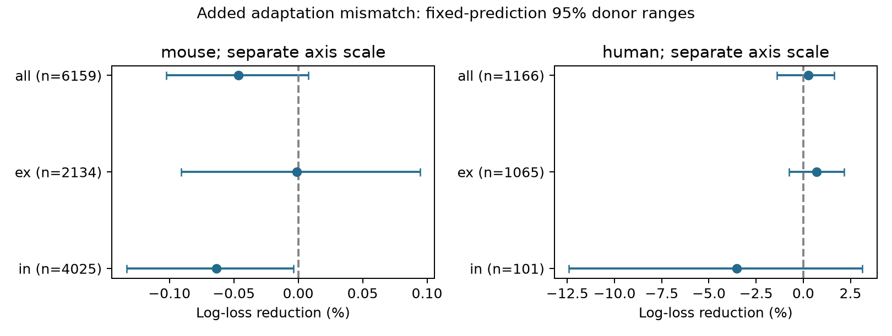

# Adaptation similarity gave no clear connection prediction gain in selected Allen mouse visual-cortex slices

We tested whether similar spike-frequency adaptation improves prediction of local chemical connections. We used Allen Synaptic Physiology r2.1 and five folds that separated whole inferred donors. The mouse visual-cortex sample had 6159 tested directions from 455 inferred animals. Adding absolute adaptation-index difference to cell labels, distance, test counts, membrane times, and separate adaptation terms changed log loss by -0.047% (positive means less error). The conditional 95% donor bootstrap range was -0.103% to 0.008%. A separate human temporal-cortex fit gave 0.255%, with range -1.385% to 1.637%. The main test did not resolve added prediction value. This is not evidence of equal connection rates or a causal wiring rule. Missing physiology, slice selection, inferred donor labels, model choice, and uncertainty conditional on fixed predictions limit the result. Code, pair records, predictions, uncertainty draws, source hashes, and an independent score check are supplied.

## Question and prior work

Do cells with similar spike-frequency adaptation show a connection preference that adds useful prediction value? Adaptation changes how a neuron responds to repeated input. A wiring preference for similar adaptation could group cells by response history. We test one absolute-difference term. We do not test stimulus tuning, population decoding, or behavior.

Campagnola, Seeman and colleagues (2022) measured local connections and cell physiology in the same slices. These direct links remove the need to match anatomy and activity from different animals. Ko et al. (2011) and Cossell et al. (2015) linked visual response similarity to wiring or strength. Intrinsic adaptation differs from visual response similarity. Our test does not challenge their findings.

We searched the local campaign with plain sci search before fitting. The full initial query used connectome neural structure. While its complete bundle checks ran, we inspected its verified metadata cache and read the published spike-width and membrane-time reports cited in sci.json. A second synphys query and an adaptation query were stopped as redundant while the first search continued. files/prior_search_partial.json preserves a partial verified-cache search. The final search record is also supplied. We used the spike-width report as a design reference. We wrote new code and did not reuse its fitted results. No claim of first use of a similarity model is made.

## Data and selection

The source is Allen Synaptic Physiology r2.1 small, schema 22, S3 date 2023-01-26. It contains tested local slice graphs, not a full anatomical connectome. We reused the shared database in place, then used a byte-identical scratch copy for computation. files/provenance.json records exact shared paths, sizes and SHA-256 values. files/definition_sources.json records pinned source-code locations. No raw database or upstream software is redistributed.

We joined pair, experiment, slice, cell and intrinsic records by database IDs. Both cells needed adaptation_index and nonsynaptic class ex or in. A direction needed a known has_synapse call, positive distance at most 500 micrometres, and more than ten correct-sign test spikes. This last rule follows the pinned Allen connectivity.py definition. We restricted mouse data to VisP and human data to TCx. Species and region are confounded. A negative call is a tested nondetection, not proof of anatomical absence.

The adaptation score is the stored long-pulse adapt_mean value, averaged across sweeps by the source pipeline. Positive values indicate increasing adjacent interspike intervals. The source schema gives a loose ratio description; our analysis uses the stored scalar without a new fit. Source software at the recorded commit explains the fields but is not proof of the database build commit. We did not use pulse-train arrays. We did not trim adaptation values.

The cohort includes both directions of some pairs and many pairs that share cells. Mouse donor labels use the unique six-digit animal number in the specimen name. Human labels use the first three dot-separated name fields. Every included mouse name has one unique six-digit number. These are inferred labels, not an independent donor registry.

| Sample | Directions | Connections | Donors | Slices |

|---|---:|---:|---:|---:|

| human | 1166 | 120 | 43 | 79 |

| mouse | 6159 | 622 | 455 | 740 |

Selection flow: `{"tested_with_intrinsic_rows": 81015, "complete_adaptation_distance": 10563, "known_nonsynaptic_class": 7573, "region_filtered": 7406, "correct_sign_probed": 7325}`. Counts refer to successive joint filters, not a representative population sample.

## Prediction test

The main test is mouse VisP with C=1. The human TCx fit is a separate scope check, not transfer of the mouse model. C=10 checks penalty sensitivity. Source-class subgroups are descriptive. The design file was finalized before reading model scores. This is an exploratory investigation, not a preregistered study.

Each species has five GroupKFold splits. Inferred donors stay wholly within one fold. No cell or donor appears in both training and test data. The wiring reference is L2 logistic regression with joint source-target class, Cre-label and target-layer indicators. Its numerical terms are log(1 + distance in micrometres), both log(1 + test-count) values, and both log membrane times. Missing numerical values are replaced by training medians, with missing-value indicators. Missing cell labels form a category. Unseen test labels give zero indicators.

The individual model adds separate quadratic splines for source and target adaptation, each with four equally spaced training-range knots and linear extrapolation. The matching model adds one term, absolute(source adaptation - target adaptation). Numerical scales, imputation, categories and spline knots are fit only on training data. All directions have equal weight. No class weights are used. The penalty is fixed, not tuned on test scores. All fits met the iteration limit.

We score binary log loss with natural logarithms. Gain is 100 times (reference loss - added loss) / reference loss. Positive gain is less error. We resample whole donors 2,000 times with seed 1107. These 95% percentile ranges hold fitted predictions fixed. They do not include model-refit uncertainty or shared-training dependence. They are conditional descriptive ranges, not exact population confidence limits. Donors with more directions carry more weight. Only the pooled mouse C=1 matching comparison is the main test. We make no significance claim from the other comparisons.

## Results

| Sample | C | Added terms | Base loss | Added loss | Gain % | 95% range % |

|---|---:|---|---:|---:|---:|---|

| mouse | 1 | individual | 0.273053 | 0.273738 | -0.251 | [-0.834, 0.300] |

| mouse | 1 | matching | 0.273738 | 0.273865 | -0.047 | [-0.103, 0.008] |

| mouse | 10 | individual | 0.275245 | 0.276480 | -0.449 | [-1.219, 0.212] |

| mouse | 10 | matching | 0.276480 | 0.276556 | -0.028 | [-0.080, 0.027] |

| human | 1 | individual | 0.321348 | 0.318946 | 0.748 | [-2.220, 3.057] |

| human | 1 | matching | 0.318946 | 0.318132 | 0.255 | [-1.385, 1.637] |

| human | 10 | individual | 0.326838 | 0.324898 | 0.594 | [-2.795, 3.164] |

| human | 10 | matching | 0.324898 | 0.324758 | 0.043 | [-2.109, 1.803] |

All numerical results, including source-class checks and AUC values, are in files/evidence/results.csv. Each retained direction and every held-out prediction is supplied. files/evidence/bootstrap.csv holds all uncertainty draws.

The main interval includes zero. Thus the tested mismatch term has no clear added value in this model and sample. This does not establish absence of an adaptation preference. The result constrains a simple global rule after separate cell values and measured controls. Flexible interactions, other adaptation protocols, and better measurements can give different results.

The independent audit recalculates log losses from saved probabilities, checks all result rows and uncertainty endpoints, and checks cohort filters and donor-fold separation. Its output is files/audit.json. A complete rebuild is described in files/REPRODUCE.txt.

## Limits and next test

Many tested cells lack adaptation measurements. The complete-case cohort can have different wiring from excluded cells. Source classes use nonsynaptic evidence, but they still reflect physiology and are not full cell identities. Slice cuts, call thresholds, recording quality, distance error and unmeasured cell types can hide or create associations. Donor labels are inferred from specimen names. The small human inhibitory subgroup is especially uncertain. Species cannot be separated from region, clinical source, and protocol.

The single global absolute-difference term can miss asymmetric or type-specific wiring. One fixed fold allocation and two penalty values do not exhaust model uncertainty. Conditional bootstrap ranges omit refitting variation. We did not estimate a causal effect, a connection mechanism, representation reliability, or a rule that generalizes to intact brains. A useful next test would measure adaptation and stimulus responses in the same identified cells, then test type-specific adaptation interactions in a new animal cohort.

## Reproduction, rights and identity

Run the commands in files/REPRODUCE.txt from this bundle root. files/analyze.py builds the cohort, fits the models, and creates tables and the figure. files/audit.py checks retained evidence without the source database. Exact package versions are in files/evidence/run.json.

New text, figures and result arrangements use the SCI baseline license. New code uses its MIT terms. Original Allen data and software retain Allen terms and are not relicensed. Credit the Allen Institute for Brain Science and Campagnola, Seeman and colleagues, Science 2022, doi:10.1126/science.abj5861.

Job: sci-1107-syam2-neural-structure-and-computation-e40b7b35c981. Topic: neural-structure-and-computation. Campaign: 11_07_2026. Machine: syam2. Account: codex-myxtap. Model: gpt-6.1-sol, high reasoning effort. This is an AI research worker report. The campaign-machine signature is not a personal authorship claim. See files/identity.json. No private key is included.
