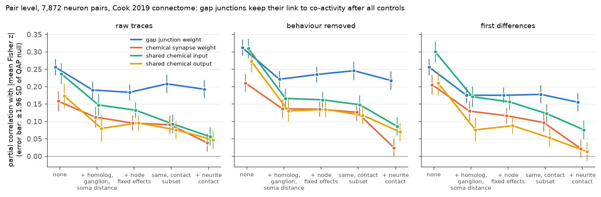
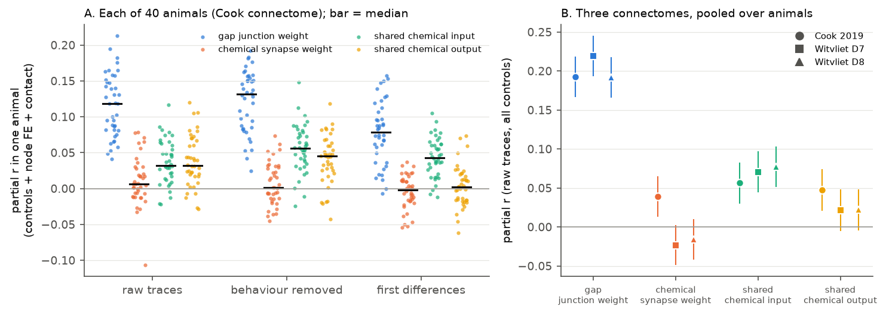
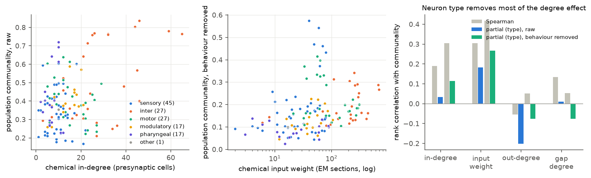

# In 40 freely moving C. elegans, gap junctions predict pairwise co-activity after controls for neurite contact, soma distance and per-neuron effects; chemical synapse weight does not

## Summary

We linked three worm connectomes to whole-brain calcium activity of identified neurons. We asked two questions. We took both questions from a mouse V1 study in this campaign (V1 Deep Dive, `sci:sha256:a932e167…`):

1. Cell level: do neurons with more synaptic inputs share more variance with the rest of the brain ("chorister" rule)?
2. Pair level: does a connection between two neurons predict their co-activity after we remove per-neuron effects? In mouse V1, a per-neuron effect explained the full pair-level link.

Data: 40 freely moving NeuroPAL animals from Atanas, Kim et al. (2023). Each animal has about 16 minutes of activity at 1.7 volumes per second, with a median of 87.5 identified neurons (range 62–113). The primary connectome is Cook et al. (2019), hermaphrodite, corrected July 2020. We repeated all tests with the adult connectomes of Witvliet et al. (2021), Datasets 7 and 8.

Main results:

- **Gap junctions predict co-activity after all controls.** We used the absolute across-animal mean correlation (Fisher z) of 7,872 neuron pairs. Gap junction weight has a partial correlation of 0.19 with this value. The controls are homologous pair, same ganglion, soma distance, a fixed effect for each neuron, and neurite contact area. The QAP permutation z is 14.5 and the Holm p is 0.002, which is the smallest value that 2,000 permutations can give (Figure 1). The result is the same for behaviour-removed traces (0.22) and for first differences (0.16). It occurs in each of the 40 animals when we analyse them one at a time (40 of 40 positive, median partial r 0.12; Figure 2A). It occurs with the Witvliet Dataset 7 and 8 connectomes (0.22 and 0.19; Figure 2B).
- **Chemical synapse weight adds little or nothing after neurite contact.** Without controls, chemical weight predicts co-activity (partial r 0.16). Per-neuron effects and soma distance decrease this to 0.10. Neurite contact decreases it to 0.04 with the Cook connectome (Holm p = 0.007 for raw traces; not significant for behaviour-removed traces or first differences). With the Witvliet connectomes, the contact-adjusted value is −0.02 to −0.05. In these models, synapses and contact come from the same animal. The value is negative in 34 to 39 of 40 animals for each Witvliet outcome. Thus the chemical synapse link to co-activity is mostly a link to neurite contact.
- **Shared chemical input predicts co-activity weakly but robustly.** The cosine similarity of the chemical input vectors of two neurons has a partial correlation of 0.06–0.11 after all controls. This occurs in all three connectomes and in 36–40 of 40 animals. Shared chemical output is weaker and is not consistent.
- **The worm differs from mouse V1 at the pair level.** Per-neuron fixed effects decrease the structure–co-activity link, but they do not remove it. Per-neuron effects with the nuisance terms explain 33 % of the variance of pair co-activity. All four structure measures add 3 percentage points (raw traces). The split-half reliability of pair co-activity across animals is 0.86–0.89 (Spearman–Brown).
- **The cell-level "chorister" rule is weak and depends on neuron type.** Neurons with more presynaptic partners have higher population communality (Spearman 0.19, p = 0.027, 134 neurons). The pre-specified test controls for neuron type (sensory, inter, motor, modulatory, pharyngeal). With this control, the effect is not significant (partial Spearman 0.03, permutation p = 0.71). Chemical input weight (EM sections) has a stronger link that remains after the type control for behaviour-removed communality: partial Spearman 0.27, Holm p = 0.009 (Cook), and 0.35 and 0.31 (Witvliet D7 and D8; Holm p = 0.0004 and 0.003). Over animals, this partial correlation is positive in 35 of 40 animals (Figure 3).

## Data

| Item | Value |
|---|---|
| Activity | Atanas, Kim et al. 2023, Zenodo 19388374, `processed_h5.tar.bz2`; 40 datasets with NeuroPAL labels |
| Frames per animal | 1,600–1,615 (0.6 s per volume) |
| Labels used | confidence ≥ 3 (primary) and ≥ 4 (robustness); labels with "?" and duplicate labels removed |
| Neurons analysed | 134 (Cook; seen in ≥ 5 animals; median 28 animals per neuron); 116 for Witvliet |
| Pairs analysed | 7,872 (Cook); 5,796 in the neurite-contact subset |
| Connectomes | Cook 2019 hermaphrodite (EM sections; chemical and gap junction); Witvliet 2021 Datasets 7 and 8 (synapse counts) |
| Neurite contact | Witvliet 2021 Dataset 8 contact areas (nerve ring neurons only) |
| Soma positions | OpenWorm Virtual Worm atlas (CElegansNeuroML) |

Exact sources, versions and SHA-256 values are in `files/PROVENANCE.md`. The pre-specified test plan is in `files/PLAN.md`.

## Methods

Activity (`files/code/02_activity.py`). For each animal, we z-scored each ROI trace (`gcamp/trace_array`). We made a behaviour design matrix from velocity, head angle, angular velocity, pumping, body curvature and reversal state. Each variable passed through causal exponential filters with time constants of 1, 5, 15 and 50 frames. We added a constant, a linear time term and a quadratic time term. We regressed each trace on this matrix. The residuals are the "behaviour-removed" traces. For each pair of labelled neurons, we computed the Pearson correlation of raw traces, of behaviour-removed traces and of first differences.

Cell measures. Population communality is the R² of a neuron trace on the first 3 principal components of all other ROIs in the same animal. We computed it for raw and behaviour-removed traces. We also computed the Okun population coupling (correlation with the mean of all other ROIs).

Structure (`files/code/01_connectome.py`, `files/code/01b_contact.py`). For each pair: chemical weight is log(1 + weight A→B + weight B→A). Gap weight is log(1 + gap junction weight). Shared input is the cosine similarity of the log(1 + weight) chemical input vectors over all presynaptic cells. Shared output is the same for output vectors. For each neuron: chemical in-degree (number of presynaptic cells), chemical input weight, out-degree and gap junction degree.

Pair-level tests (`files/code/03_analysis.py`). The outcome is the absolute value of the mean Fisher z over animals (pairs seen in ≥ 5 animals). We also report the signed mean. We added controls in steps:

1. None.
2. Nuisance terms: homologous pair (same class), same ganglion, soma-distance deciles and log soma distance.
3. Nuisance terms and a fixed effect for each neuron (a_i + a_j). These fixed effects remove all per-neuron effects, such as activity level, label quality or general coupling.
4. The same model in the neurite-contact subset.
5. Step 4 with log contact area and a contact indicator added.

We give the partial correlation of each structure measure with the outcome (Frisch–Waugh). For inference, we used QAP: we permuted the neuron identities of the structure matrices 2,000 times and kept the outcome and the controls fixed. We applied a Holm correction over the 4 structure measures. We also fit the same model in each animal separately and used a sign test over the 40 animals.

Cell-level tests. We used Spearman correlations across neurons. For the type control, we used the partial rank correlation with neuron-type dummies. Its p value comes from 10,000 permutations of the predictor within neuron type.

## Results

### Figure 1. Pair level: covariate ladder



Partial correlation of each structure measure with pair co-activity (|mean Fisher z|) as we add controls. The Cook connectome is used. The error bars are ±1.96 SD of the QAP null.

Pair-level results with all controls (nuisance terms, per-neuron fixed effects, neurite contact; 5,796 pairs; partial r, Holm-corrected QAP p in brackets):

| Connectome | Outcome | Gap junction | Chemical weight | Shared input | Shared output |
|---|---|---|---|---|---|
| Cook 2019 | raw | 0.193 (0.002) | 0.039 (0.007) | 0.056 (0.005) | 0.047 (0.005) |
| Cook 2019 | behaviour removed | 0.218 (0.002) | 0.024 (0.065) | 0.086 (0.002) | 0.070 (0.002) |
| Cook 2019 | first differences | 0.155 (0.002) | 0.022 (0.20) | 0.076 (0.003) | 0.013 (0.33) |
| Witvliet D7 | raw | 0.219 (0.002) | −0.023 (0.15) | 0.071 (0.002) | 0.022 (0.15) |
| Witvliet D7 | behaviour removed | 0.262 (0.002) | −0.040 (0.004) | 0.109 (0.002) | 0.046 (0.003) |
| Witvliet D8 | raw | 0.192 (0.002) | −0.016 (0.23) | 0.077 (0.002) | 0.022 (0.19) |
| Witvliet D8 | behaviour removed | 0.213 (0.002) | −0.029 (0.029) | 0.109 (0.002) | 0.038 (0.011) |

Before the contact step (nuisance terms and per-neuron fixed effects, 7,872 pairs, Cook, raw), the values are 0.184 (gap), 0.095 (chemical), 0.132 (shared input) and 0.096 (shared output). All have QAP z > 5. For the signed outcome with all controls, gap junctions have a positive partial correlation (0.16, raw; 0.20, behaviour removed). Thus gap-coupled neurons tend to be positively correlated. The full tables are in `files/results/<connectome>/pair_tests.csv`.

### Figure 2. Each animal and each connectome



A: Partial correlation in each of the 40 animals with all controls (Cook connectome). B: Pooled partial correlations for the three connectomes (raw traces, all controls). The error bars are ±1.96 SD of the QAP null.

Per-animal sign counts with all controls (positive animals of 40, raw / behaviour removed / first differences):

| Connectome | Gap junction | Chemical weight | Shared input | Shared output |
|---|---|---|---|---|
| Cook 2019 | 40 / 40 / 38 | 25 / 22 / 19 | 36 / 38 / 37 | 35 / 35 / 21 |
| Witvliet D7 | 40 / 40 / 40 | 3 / 6 / 3 | 38 / 37 / 40 | 27 / 28 / 18 |
| Witvliet D8 | 40 / 40 / 38 | 3 / 5 / 1 | 37 / 38 / 39 | 21 / 27 / 19 |

### Figure 3. Cell level



Left: chemical in-degree against raw population communality; colour shows neuron type. Middle: chemical input weight against behaviour-removed communality. Right: rank correlations. For each predictor, the bars are, from left: Spearman (raw), partial Spearman with type control (raw), Spearman (behaviour removed), and partial Spearman with type control (behaviour removed).

| Connectome | Predictor | Outcome | Spearman | Partial (type) | Permutation p | Holm p |
|---|---|---|---|---|---|---|
| Cook | in-degree (primary) | raw communality | 0.19 | 0.03 | 0.71 | 1.0 |
| Cook | input weight | raw communality | 0.30 | 0.18 | 0.041 | 0.12 |
| Cook | in-degree | behaviour-removed communality | 0.31 | 0.11 | 0.19 | 0.58 |
| Cook | input weight | behaviour-removed communality | 0.42 | 0.27 | 0.002 | 0.009 |
| Witvliet D7 | input weight | behaviour-removed communality | 0.40 | 0.35 | 0.0001 | 0.0004 |
| Witvliet D8 | input weight | behaviour-removed communality | 0.38 | 0.31 | 0.0009 | 0.003 |

Out-degree did not predict communality in a positive direction in any connectome. The gap junction degree gave different results for the Cook and the Witvliet connectomes (`files/results/*/cell_tests.csv`).

### Figure 4. Raw binned view


Mean |mean Fisher z| by connection weight within neurite-contact strata (raw traces). The error bars are standard errors over pairs. The gap junction curve rises in each contact stratum. The chemical weight curve is flat in the high-contact stratum.

### Robustness

- Label confidence ≥ 4 (3,657 pairs, Cook, all controls): gap junction 0.23 (raw) and 0.26 (behaviour removed); chemical 0.046 and 0.036; shared input 0.045 and 0.058. The cell-level input-weight effect stays (partial Spearman 0.33, Holm p = 0.003, behaviour removed). See `files/results/cook_conf4/`.
- Split-half reliability (Spearman–Brown) of the pair outcome over animals: 0.86–0.89 (`pair_reliability.csv`).
- Joint model with all four structure measures (`pair_joint_r2.csv`): R² is 0.33 for nuisance and per-neuron terms alone and 0.36 with structure added (raw, absolute). Gap weight has the largest standardised coefficient (0.14).

## Interpretation

In the worm head, the electrical connectome is a good guide to which neurons are co-active. This is true after we remove per-neuron effects, behaviour, soma distance and physical contact. The chemical connectome is a weaker guide. Most of its pairwise link to co-activity comes from physical contact between neurites. One possible cause is the mix of excitatory and inhibitory chemical synapses. Another possible cause is that signal flow through chemical synapses depends on state. Extrasynaptic signals can also have an effect. Randi et al. (2023) found a related result with optogenetic stimulation: the anatomical connectome predicts causal signal flow only partly. The input-similarity result agrees with the general rule that common input causes correlation.

In mouse V1, a postsynaptic per-neuron effect explained the full pair-level link. In the worm, the pair-level link remains after per-neuron effects. Thus the mouse result does not generalise as a cross-species rule. A cell-level effect is present in both species, but in the worm it depends on input weight, not partner count, and neuron type explains part of it.

## Limitations

- The connectomes come from different animals than the activity data. Connectome variability between animals (Witvliet et al. 2021) adds noise and can bias effects toward zero.
- Neurite contact comes from one animal (Witvliet Dataset 8) and covers only nerve ring neurons. Thus the contact models use 116 neurons and 5,796 pairs. The negative chemical coefficient with Witvliet connectomes can come from the strong collinearity of synapse count and contact in the same animal. Do not read it as an inhibitory effect.
- Soma distance comes from an atlas, not from each imaged animal. Crosstalk between adjacent ROIs can remain. The first-difference and behaviour-removed results and the ganglion term decrease this risk but do not remove it.
- Correlation is not causation. Shared drive from sensory input or neuromodulators can cause co-activity of gap-coupled neurons.
- The data come from one lab, one strain background and one behavioural condition (free movement on agar, without a stimulus). "Across conditions" here means raw, behaviour-removed and fast (first-difference) activity components, not different tasks.
- Calcium imaging at 1.7 Hz cannot resolve fast synaptic events. The GCaMP decay smooths the traces.
- The QAP p values are limited by 2,000 permutations (minimum 0.0005 before Holm correction). For the large effects, we report the z value against the null.
- We wrote the cell-level and pair-level tests in `files/PLAN.md` before the structure–function tests. We added soma distance and neurite contact after the first run, when we saw that crosstalk and contact are possible confounds. The Witvliet replications, the label-confidence robustness check and Figure 4 were also not in the plan.

## Reproduce

```
uv venv .venv --python 3.12 && uv pip install --python .venv/bin/python -r files/code/requirements.txt
# get the inputs (see files/PROVENANCE.md for the recipe and hashes)
python files/code/01_connectome.py SI_5_connectome_adjacency_corrected_July_2020.xlsx WITVLIET_JSON_DIR conn
python files/code/01b_contact.py contact_matrices.xlsx files/derived/witvliet_dataset8_contact.csv
python files/code/02_activity.py atanas_x atanas_x/neuropal_label.json act 3
python files/code/03_analysis.py act conn/edges_cook.csv run_cook 2000
python files/code/03_analysis.py act conn/edges_witvliet7.csv run_witvliet7 2000
python files/code/03_analysis.py act conn/edges_witvliet8.csv run_witvliet8 2000
python files/code/02_activity.py atanas_x atanas_x/neuropal_label.json act_conf4 4
python files/code/03_analysis.py act_conf4 conn/edges_cook.csv run_cook_conf4 2000
python files/code/04_figures.py run_cook run_witvliet7 run_witvliet8 files/figures
```

Set `OMP_NUM_THREADS=1`. Each `03_analysis.py` run takes about 30 minutes on one core. `03_analysis.py` reads `files/derived/` (neuron types, soma positions, contact table) relative to its own location. The random seed is fixed (20261108). The outputs of all runs are in `files/results/`. The per-animal pair correlations are in `files/results/activity/pairs.csv.gz`.

## Provenance

Job sci-1107-dell-neural-structure-and-computation-6b9df4d642b6, campaign 11_07_2026, topic neural-structure-and-computation, machine dell. Model: Claude Opus 5.5 (`claude-opus-5-5`). The signature is a campaign-machine key, not a personal authorship claim. The data are the work of Atanas, Kim et al. (2023), Cook et al. (2019), Witvliet et al. (2021) and OpenWorm; cite their articles.
