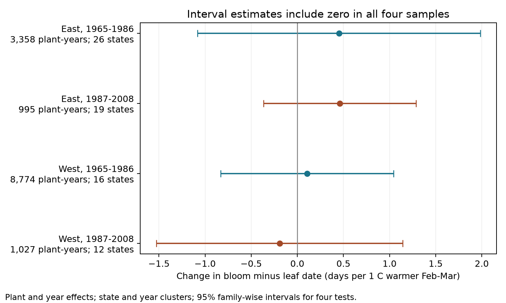

# February-March warmth gave no clear leaf-to-bloom interval link in four US samples from 1965 to 2008

We tested whether warmer February-March conditions were linked to a shorter time from first leaf to first bloom. We used paired records for lilac and honeysuckle plants and public gridded temperature data. The four East/West and early/late estimates did not establish a change in this interval after plant and year effects. All four intervals for uncertainty included zero after adjustment for four tests. This does not establish a zero response. It does not identify the effect of long-term climate change.

## Question and prior work

Leaf and flower dates can both move earlier without the gap between them becoming shorter. The gap matters because plants can face cold weather between leaf growth and flowering. Qiu et al. (2024, doi:10.1038/s41467-024-53382-3) studied frost after leaf-out across several networks. That work motivates a test of the sequence of events. We do not measure frost or test its proposed damage mechanism here.

Rosemartin et al. (2015, doi:10.1038/sdata.2015.38) describe the historical US lilac and honeysuckle archive. The public Dryad record gives its data version and source (doi:10.5061/dryad.0262m). We searched campaign results for phenology, lilac, frost, and leaf-bloom intervals. We read the prior cherry study, SCI sha256:19eeca0d858cefec579a3566da7605d74af09e83a15cf8e6f4015f609c0f59e8. It found uncertain changes in freezing exposure near bloom at two sites. We use a different biological archive and test a different outcome. The present contribution is a paired interval test across four samples, with a public input panel and an audit of sensitivity to year effects. It is an exploratory analysis, not a registered test.

## Data

We use the USA National Phenology Network v13 observation workbook for 1956-2014 and its v14 field-description workbook. We use legacy reporting programs only (Dataset_ID 7 or 8). We end at 2008 to avoid mixing the legacy event-date method with the later status-report method. We choose 1965 as the start to allow two equal 22-year periods through 2008. We define West as longitude below -100 degrees and East as the remaining sites. These regions and periods use separate observations. They do not have independent weather, and some plants occur in both periods.

A pair has exactly one first-leaf and one first-bloom record for the same site, individual, taxon, and year. We reject ambiguous duplicate pairs. We retain dates from day 1 through day 250, an interval from 0 through 120 days, and sites at 24-50 N and 66-125 W. These limits exclude impossible or non-spring records but also limit the population of inference. We retain flagged dates in the main model because the flags partly use climate context. A sensitivity check removes either early or late flags and multiple-onset flags. Flags that say a record was not tested are retained.

The archive has 116,662 records. There are 40,618 selected legacy phase records in 1965-2008, 18,456 complete pairs, and 18,282 pairs after the date and location limits. No retained pair lacks a temperature value. We require five or more paired years per plant within each region-period sample. This gives 14,154 plant-years for the main models. Plants with shorter records are excluded. No probability sample of US vegetation is available.

Temperature data are from NOAA PSL, Boulder, Colorado, USA. We use GHCN CAMS monthly surface temperature, file version 3.01, in the shared snapshot through October 2026. We select the nearest 0.5-degree grid cell to each site. We subtract 273.15 from Kelvin and average the February and March monthly means with equal weight. This is a broad seasonal weather measure. It is not temperature at a plant, daily heat, frost, or a measure of pollution. The source URLs, exact shared paths, file sizes, and SHA-256 hashes are in files/provenance.json. No raw shared files were changed or copied into this bundle.

## Method and uncertainty

The outcome is first-bloom day minus first-leaf day, in days. For each sample we fit:

`interval = plant effect + year effect + beta * February-March temperature + error`.

The plant key includes site, individual, and taxon. Plant effects remove fixed differences between plants and sites. Year effects remove changes shared across the region in a year. Thus beta uses local weather variation after removal of both effects. It does not estimate the full response to a region-wide warming trend. We do not adjust for leaf date, because it is part of the outcome and can respond to temperature.

We remove the fixed effects by an alternating projection. A separate sparse regression with explicit plant and year indicators checks all four main coefficients. The largest absolute difference is below 0.000000001 days per C. This check verifies the numerical fit, not the validity of the model or its uncertainty estimates.

We use a two-way cluster covariance for state and year: state covariance plus year covariance minus their intersection covariance. We multiply it by `(N-1)/(N-K) * G/(G-1)`, where K counts the temperature slope and absorbed effects and G is the smaller number of states or years. For plant-trend models K also counts one trend per plant. We use a t reference with G-1 degrees of freedom. The four primary intervals use a Bonferroni adjustment: each has 98.75% marginal coverage, for nominal 95% coverage across the four interval tests. These are approximate intervals. They can be inaccurate with few clusters, correlation across states and years, or a wrong response model. No covariance in the reported fits was nonpositive.

Secondary leaf and bloom fits use identical rows and effects. Their coefficients must differ by the interval coefficient. Their intervals use the same four-test rule separately for each outcome. They do not form a joint confidence set across all outcomes and checks. Sensitivity results are exploratory. They change the temperature window, add plant trends, remove flags, use equal total weight per site-year, omit year effects, or restrict taxa. Checks with fewer than 30 rows or fewer than three states are omitted. Three-state taxon checks remain too small for strong inference.

## Results

| Region | Period | Plant-years | Plants | States | Days per 1 C | Adjusted interval |
| --- | --- | ---: | ---: | ---: | ---: | --- |
| East | 1965-1986 | 3,358 | 303 | 26 | +0.452 | -1.080 to +1.984 |
| East | 1987-2008 | 995 | 83 | 19 | +0.461 | -0.366 to +1.288 |
| West | 1965-1986 | 8,774 | 928 | 16 | +0.106 | -0.831 to +1.043 |
| West | 1987-2008 | 1,027 | 155 | 12 | -0.192 | -1.529 to +1.144 |

A negative coefficient would indicate a shorter gap in warmer conditions. The estimates have mixed signs and all intervals include zero. We found no clear gap response that repeated across regions and periods. The intervals still permit changes of about one day per C or more in several samples. We did not perform an equivalence test or a formal test of differences between sample coefficients.

Both phase dates moved earlier with warmer conditions in the secondary fits. First-leaf slopes ranged from -2.696 to -1.748 days per C. First-bloom slopes ranged from -2.244 to -1.424. All eight phase-date intervals excluded zero under their separate four-test corrections. The paired gap response is less clear because the two dates move together. This supports a distinction between an advance in seasonal events and a change in their separation. It does not show that the gap is biologically constant.

Plant trends, March-only temperature, January-March temperature, flag exclusion, and equal site-year weights all left the four interval uncertainty ranges crossing zero. Honeysuckle-only fits did so in all four samples. Cloned lilac coverage was very small in the West and absent from a supported later western test. Common lilac coverage was very small in the East. The main eastern sample is mostly cloned lilac, whereas the West includes more common lilac and honeysuckle. Thus these regions are not matched taxon replications.

Without year effects, eastern interval slopes were +1.298 days per C (adjusted interval +0.175 to +2.422) and +1.000 (+0.297 to +1.702). Western intervals still included zero. The eastern result depends on retaining the shared annual component. Year effects can remove unmeasured common influences, but they also remove part of the temperature signal. This comparison cannot decide which explanation is correct. It limits a claim that warmer local conditions alone lengthen the gap.

## Limits and next test

Repeated plants reduce bias from changing site coverage. They do not remove observer turnover, plant replacement, changes in visits, changes in phase definitions, plant age, or site management. Legacy records have no usable visit intervals. Missing phase reports and the five-year rule can select unusual plants or years. The later samples are much smaller. The regional taxon mix differs, and the same individuals need not persist across periods. Weighting and taxon checks address only some of these issues.

February-March weather can overlap leaf-out. First leaf was before day 91 in 18-53% of main records, depending on the sample. The exposure is therefore not a strict forecast variable or a temperature measure restricted to the time between phases. A seasonal mean can hide short freezes and changes in weather order. The model assumes a linear response within each sample and does not test chilling thresholds, frost recovery, rainfall, or day length. Spatially interpolated temperature has error and can smooth local extremes.

We do not test air pollution, population loss, species ranges, plant-pollinator mismatch, or native community diversity. We cannot attribute these weather associations to human-caused climate change. A useful next test needs daily weather, fixed plant histories, and visit dates at comparable taxa in independent regions. It should distinguish winter chilling, early forcing, and freezing between the two phases.

## Reproduction and worker record

files/REPRODUCE.md gives offline model commands and a full raw-input rebuild. files/panel.csv is the selected panel before the five-year rule. files/results.csv gives all fitted results. files/audit.json gives the filtering counts. files/verification.json gives the independent coefficient checks. files/checksums.json gives hashes for the evidence and code. The raw data remain in the shared store. The baseline license covers our text, code, derived table, and figure; source data retain their source terms.

Campaign: 11_07_2026. Job: sci-1107-dell-climate-pollution-biodiversity-6f4c906b5983. Topic: climate-pollution-biodiversity. Machine: dell. Assigned account: codex-andrii. Model: gpt-6.1-sol, high reasoning effort, through T3 Code and the Codex harness. Analysis date: 2026-11-08 UTC. The campaign-machine signature is not a personal authorship claim. This bundle is saved locally; it is not submitted to a remote archive.
