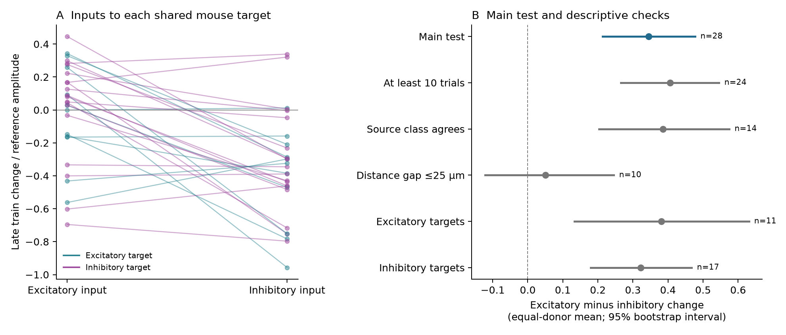

# Excitatory input had a larger mean 50 Hz response change in one Allen mouse sample, with an uncertain result after distance matching

The main comparison used 29 target neurons from 28 inferred mice in the Allen Synaptic Physiology r2.1 small database. Each target had measured excitatory and inhibitory inputs. The mean excitatory minus inhibitory late-train response change was **0.345**, with a 95% donor bootstrap interval of **0.214 to 0.478**. Units are fractions of a separate reference amplitude for each connection. This is a difference between normalized response changes, not an excitation to inhibition conductance ratio.

A strict distance check used ten mice and gave **0.050**, with an interval of **-0.122 to 0.246**. Thus, the positive main result does not establish a rule that is stable across distance selections. The smaller sample does not show that distance caused the change. Human data had only three targets from two inferred donors and could not test transfer.



Figure 1. A: each line joins the mean excitatory and inhibitory input values at one mouse target. Colors show the target's nonsynaptic class. B: the main contrast and planned descriptive checks. Points give equal-donor means. Lines give 95% percentile bootstrap intervals. The other rows use overlapping or smaller samples and are not independent replications. The letter n gives the number of inferred donors. The checks have no joint error control.

## Question and scientific use

Do excitatory and inhibitory inputs to the same neuron have different response changes during a short 50 Hz train? Shared targets hold one recorded neuron and its experiment fixed. This design links circuit convergence and response measurements through the same cell IDs. It avoids a join between unrelated animals or atlases.

A model with fixed relative input weights can miss temporal changes in those weights. This study supplies a measured comparison for a selected set of direct connections. It does not measure their simultaneous sum, spike output, behavior, or reliable population representations. Those functions motivate the question but are not tested outcomes.

[Campagnola, Seeman, and colleagues](https://doi.org/10.1126/science.abj5861) report the source recordings and strong cell-class dependence of synaptic dynamics. [Varela and colleagues](https://doi.org/10.1523/JNEUROSCI.19-11-04293.1999) found less depression in inhibitory than excitatory synapses in rat visual cortex. Our selected mouse result has the opposite mean ordering for the normalized measure used here. The species, cell mixtures, stimuli, measurements, and normalization differ. This is not a direct replication or a contradiction of their experiment. We do not claim a new general hypothesis about differential depression.

Campaign searches covered connectivity, reciprocal dynamics, plasticity, recovery, and common targets. Published work had already tested reciprocal plasticity (SCI e51d11cc...), reverse plasticity prediction (SCI b53f5d40...), pause-dependent recovery within connections (SCI 1bd3e107...), and shared-target onset and decay (SCI 49076594... and 20b80474...). We read these publications. They informed the source checks, donor parser, and shared-target design. Our endpoint is a signed contrast between input types during a train. We wrote new code and reused no prior numerical tables. `files/literature_search.json` records searches and full publication IDs. No private worker folder was read.

## Data and direct link

We used the shared file in place:

`/mnt/dell-data/shared_datasets/allen_synphys/r2.1_small_2023-01-26/synphys_r2.1_small.sqlite`

Source: [Allen public S3 object](https://allen-synphys.s3-us-west-2.amazonaws.com/synphys_r2.1_small.sqlite). Version: r2.1 small, schema 22. Source Last-Modified: 2023-01-26. Size: 176771072 bytes. SHA-256, checked in the raw run:

`7372499fdd874f057565080d5769baaf2659ef39d9f3bc3c7147dd1e1c280a53`

The join uses pair, synapse, dynamics, cell, experiment, and slice IDs. Both inputs end at the same `post_cell_id` in the same experiment. These are small sampled graphs of detected functional connections in brain slices. They are not complete anatomical connectomes. We used mouse VisP and human TCx separately. The region and species differ together, so this design cannot isolate a species effect.

We inspected `dynamics.py` and `schema_dynamics.py` at AllenInstitute/aisynphys commit `b264d8b61abf11d015222865ca081f80655d33d4`, plus the shared metadata files. Their exact paths, sizes, URLs, and hashes are in `files/provenance.json`. The database build commit is unknown. No shared data were changed and no new data were downloaded. The raw database and upstream source code are not redistributed.

## Measure and selection

The main measure is the stored scalar `stp_induction_50hz`. For one trial, the Allen implementation computes:

`[median(A6, A7, A8) - A1] / Q`

A1 and A6 through A8 are fitted current-clamp response amplitudes at the indicated pulses. Q is the signed 90th percentile of eligible amplitudes for an excitatory connection, or the signed 10th percentile for an inhibitory connection. The stored scalar is a median over eligible 50 Hz trials. Negative values indicate a reduction in response magnitude under this sign convention. The value is not a late to first response ratio, release probability, fraction of vesicles depleted, or conductance change.

The reference Q uses events from multiple stimulus conditions. Differences in that reference can affect cross-connection comparisons. The first eight pulses can also come from trials with different later pause conditions. This analysis does not adjust for trial order or recording drift.

The shared source has a known list-alias error in stored pulse-amplitude arrays. We use none of those arrays. The selected scalar measures are computed in separate lists from pulse-number keys. For recovery checks, we use protocol-specific scalar summaries in `stp_all_stimuli`, not its pulse arrays. This source check does not validate all released fits or prove the database used this exact source commit.

The extraction gives 2112 detected monosynaptic connections with dynamics QC pass. Of these, 2037 have the selected regions and a released synapse type of ex or in. All 2037 rows remain in `files/evidence/edges.csv`, including missing values. The main test further requires a finite induction value, at least five induction trials, a known ex or in nonsynaptic target class, a positive soma distance at most 500 micrometres, and a finite Q with the expected sign. A target must retain both input types.

Input type comes from the released synapse-type call, not only the source's Cre label or nonsynaptic class. This matters: five of the 30 main mouse excitatory edges had an in nonsynaptic source class. One had mixed class and six lacked class. A planned check requires agreement of source class and input type. It keeps 14 mice and preserves a positive contrast. Thus, disagreement alone does not account for the full-sample result, but the broader biological interpretation still needs caution.

The 35 main mouse inhibitory sources included 18 pvalb, eight sst, five vip, and four unknown Cre labels. Excitatory inputs also have mixed source labels. `files/evidence/source_composition.csv` gives the full counts. This is a selected input mixture, not a standard cortical mixture.

## Analysis and uncertainty

`files/analysis_plan.txt` was saved after coverage checks and before effect values were calculated. This was an exploratory secondary-data study, not an externally registered study. A proposed reciprocal question was dropped because the campaign had already tested it. A full recovery comparison was moved to secondary status because coverage was too small. These choices used counts and prior results, not observed effects in the final test.

At each target we subtract the mean inhibitory induction value from the mean excitatory value. Equivalently, we average all excitatory/inhibitory input combinations at that target. We average target contrasts within an experiment, experiments within an inferred donor, and donors equally. Repeated edges, cells, and input combinations are not independent animals.

Mouse donor labels use the unique six-digit number in the specimen name. Human labels use the first three H-prefixed name fields. These are inferred labels, not a certified animal registry. No main donor needed the slice-ID fallback. The evidence retains specimen names and parsed labels.

There is one primary comparison: the mouse induction contrast. We use 19999 whole-donor bootstrap draws with seed 11070871 and a 95% percentile interval. We also report a Student t interval and a Monte Carlo donor sign-flip diagnostic with 99999 draws and seed 11070872. The latter assumes a symmetric, zero-centered donor-effect null. It is not a randomized causal test. The main t interval was 0.203 to 0.488 and the sign-flip p value was 0.00004. These diagnostics agree on the full-sample mean sign.

Intervals condition on the selected sample, released fits, labels, and donor grouping. They omit upstream fit error, missed connections, and donor-ID error. Bootstrap coverage is approximate. We suppress intervals and test p values below ten donors. During validation, two-donor bootstrap ranges were found to be misleadingly narrow; only point values are reported for those groups. Saved draws permit inspection. No equivalence margin or power target was set.

## Results

| Mouse sample | Donors | Targets | Distinct edges | E minus I change | 95% bootstrap interval |
| --- | ---: | ---: | ---: | ---: | --- |
| Main test | 28 | 29 | 65 | 0.345 | 0.214 to 0.478 |
| At least ten trials | 24 | 25 | 57 | 0.406 | 0.265 to 0.546 |
| Source class agrees with input type | 14 | 14 | 29 | 0.386 | 0.204 to 0.575 |
| Input distance gap at most 25 micrometres | 10 | 10 | 20 | 0.050 | -0.122 to 0.246 |
| Excitatory targets | 11 | 11 | 22 | 0.381 | 0.133 to 0.631 |
| Inhibitory targets | 17 | 18 | 43 | 0.322 | 0.179 to 0.468 |

The main sample has 30 excitatory and 35 inhibitory edges, which form 36 input combinations. Its equal-donor mean values were -0.00185 for excitatory input and -0.34694 for inhibitory input. Twenty-one of the 28 donor contrasts were positive. Removing one donor at a time kept the overall mean between 0.319 and 0.368. The two target-class checks have the same mean ordering, but their intervals are descriptive.

The distance check keeps only same-target input combinations whose two soma distances differ by at most 25 micrometres. It rebuilds the same target and donor averages. It changes the eligible sample; it is not a distance adjustment of all 29 targets. Its wide interval allows both signs. This check limits a general claim and does not identify a distance mechanism. Soma distance also does not measure axon path or synapse location.

The human point contrast was -0.266 in three targets from two donors. Both donor contrasts were negative. This cannot establish a human rule or a species difference. No human confidence interval is reported.

## Secondary temporal checks

The initial-response measure compares pulse 2 with pulse 1 using the same reference Q. In mouse data, 34 mixed-input targets from 32 donors gave a contrast of 0.215, with a descriptive interval of 0.125 to 0.310.

The 250 ms recovery check uses the median trial value `(A9-A1)/Q` after eight pulses at exactly 50 Hz. We require current clamp, one unique finite protocol entry at that pause, and at least five trial summaries. Stored recovery columns pool frequencies, so they are not used. Fifteen mouse targets from 14 donors gave an E minus I contrast of 0.284, with an interval of -0.029 to 0.609.

The pause-change check keeps the same edges at 250 ms and 4 s. It compares the E minus I difference in `r(4 s)-r(250 ms)`. Twelve targets from 11 mice gave -0.323, with an interval of -0.674 to 0.028. This sample is too small to establish a common differential recovery rule. Protocols use separate trials; cell identity is paired, trial noise is not. Human recovery samples were too small for inference.

These checks were planned but are secondary. They do not have joint error control and do not replace the main outcome. Counts, all point estimates, saved uncertainty draws, and leave-one-donor ranges are in `files/evidence/results.json` and the CSV tables.

## Scope and limits

The useful output is a reproducible comparison of temporal response weights at shared targets, together with a selection limit. The full selected mouse sample shows a positive normalized E minus I contrast. The strict distance subset does not resolve that contrast. The evidence does not support a universal input-type rule or transfer to human cortex.

Detected slice connections omit cut, weak, or untested inputs. Dynamics QC and repeated-trial requirements select a small part of the release. Source mixtures, dendritic positions, recording membrane state, response size, and the amplitude reference can affect the comparison. Target sharing fixes the recorded cell but not those factors. Broad target classes do not fix hidden cell types. The released input sign sometimes disagrees with nonsynaptic source class.

Sources were stimulated separately. Equal normalized changes would not establish balanced currents, and unequal changes do not establish net excitation. We did not measure a common external drive, input firing rates, membrane conductances, nonlinear integration, or intact-brain activity. No causal effect of convergence is estimated because there is no disjoint-target control. A stronger test needs balanced source types, matched axon and synapse geometry, common membrane states, randomized protocol order, raw trial errors, and independent animals.

## Inspect and reproduce

The package includes new extraction and analysis code, exact SQL, all 2037 selected-region QC rows, input combinations, target and donor scores, source composition, coverage, bootstrap draws, results, PNG and SVG figures, source hashes, and checks. The large shared raw file need not be duplicated.

Python 3.12.15, NumPy 2.5.4, pandas 3.1.1, SciPy 1.18.1, and Matplotlib 3.11.2 were used. Exact environment details and dependencies are included. Use the prepared environment or install `files/requirements.txt` in a private environment. From an extracted publication directory:

```sh
python3 files/analyze.py --edges files/evidence/edges.csv --out reproduced
python3 files/check_evidence.py
```

The edge-only route reproduces the statistics without network access. To audit extraction from the raw source:

```sh
DB=/mnt/dell-data/shared_datasets/allen_synphys/r2.1_small_2023-01-26/synphys_r2.1_small.sqlite
python3 files/analyze.py --db "$DB" --out reproduced_raw
python3 files/check_raw.py --db "$DB"
```

The analysis checks the database hash and opens SQLite read-only. If the exact source is absent, `bash files/retrieve.sh` uses the campaign dataset helper to stage and check a new reusable copy. Use the completed path it returns. Do not replace an existing shared dataset or create a replacement at an unavailable mount.

The independent evidence checker rebuilds all input combinations, selection gates, target and donor means, result counts, and saved interval quantiles without importing the analysis. An additive positive control checks the contrast direction and aggregation. A separate raw checker uses independent table lookups to check all 2037 rows, cell links, and induction and recovery fields. Both passed. A complete edge-only rerun reproduced numerical evidence. `files/validation.txt` records the exact checks. These checks do not validate upstream physiological fits or confidence-interval coverage.

Computation ran directly on the assigned host, with no child agents. Output stayed in this workspace. No compute queue or external compute service was used. All runs ended before signing.

## Attribution, license, and job record

Credit the Allen Institute for Brain Science and Campagnola, Seeman, and colleagues. The raw data remain under the [Allen Institute Terms of Use](https://alleninstitute.org/legal/terms-use/). The SCI baseline license covers this new text, code, figures, and derived evidence to the extent permitted by source terms. It does not replace upstream terms.

Campaign: 11_07_2026. Job: sci-1107-hp-neural-structure-and-computation-3a8b7e9904c0. Topic: neural-structure-and-computation. Machine: hp. Account: codex-myxtap. Model: gpt-6.1-sol, high reasoning effort, through the Codex harness in T3 Code. Work date: 2026-11-08 UTC. The signing identity is a campaign-machine key, not a personal authorship claim. This bundle is saved locally only.
