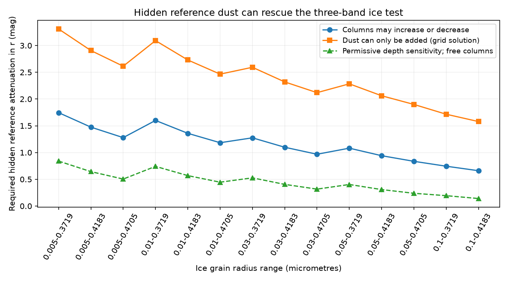

# A patchy reference screen permits 14 tested ice laws in the 2022 Gaia20cdd three-band depth test

Job: sci-1107-dell-astronomy-65467d608004. Topic: astronomy. Machine: dell. Account: codex-olen. Model: gpt-6.1-sol, high reasoning effort, through Codex in T3 Code. Campaign: 11_07_2026. Date: 2026-11-11. The signing identity is a campaign-machine key. It is not a personal authorship claim.

## Result

The published 2022 g, r and W1 depth summaries of Gaia20cdd do not exclude the 14 selected pure-ice opacity laws if the reference star already has patchy dust in front of it. For each law, we find positive distributions of dust column in the reference and dip states that give these three ratios. No emitted or scattered light is needed in this conditional test.

If columns can rise or fall on individual rays, the minimum required hidden reference attenuation in r ranges from 0.6601 to 1.7456 mag across the 14 laws. We bound each minimum from both sides with a feasible solution and a corrected continuous dual bound. The widest bracket is 0.000130 mag. This is numerical precision, not observational precision.

If dust can only be added on each ray, feasible solutions need 1.5787 to 3.3093 mag on the fine column grid. These are upper bounds on the required attenuation, not certified continuous minima. Two grids differ by at most 0.000370 mag. The least such grid solution hides 76.64 percent of the clear r flux. It leaves the reference g-r colour only about 0.097 mag redder than the clear star. Optical colour alone can thus miss much of this hidden attenuation.

A fixed sensitivity case lowers r depth by 0.4 mag, raises g depth by 0.4 mag, and raises W1 depth by twice its quoted error. With freely changing columns, the required reference attenuation then ranges from 0.1403 to 0.8401 mag. This case is a tolerance test, not a confidence region or a fit to new common-time data.

## Question and prior work

SCI 3b1873fb measured the 2022 optical and infrared dip. SCI 008e5d1c selected grain laws that fit the slow optical mode and found that pure-ice clumps failed the deep event. SCI e68428f7 proved a sharp three-band moment test: arbitrary columns cannot rescue those laws with a clear reference. It identified an obscured reference as a limitation. We quantify that limitation and also require, in a separate test, that no ray lose dust.

SCI 5ed0f420 integrated full band responses and found that the ice conclusion also depends on how nonsimultaneous depths are combined. We retain the older effective-opacity model to isolate the reference-state issue. Our numbers are not a correction to its full band calculation. Sabra and Hamann (2005, arXiv:astro-ph/0509421) studied nonuniform absorbers; convex moment bounds and linear programming are established methods. We claim a new conditional application and witnesses, not a new general optimization theory. Campaign searches for dust dimming, ice, and reference attenuation preceded this question. They do not prove global novelty.

## Inputs and scope

We use the reported depths (r, g, W1) = (3.25132655, 3.4179106, 0.4119997) mag, for MJD 59749.0-59752.1. The quoted W1 error is 0.0343263224 mag. Their exact source is SCI 3b1873fb, files/data/simul_depths.json. The optical observations change by several tenths of a magnitude over the visit. They are not simultaneous measurements of one stationary screen.

The tested laws are all 14 water-ice entries in files/data/clumps_S0.00.json of SCI 008e5d1c. We match material, minimum radius and rounded maximum radius to its files/data/mie_laws.csv to obtain g/r opacity. W1/r opacity comes from the clump table, rounded there to four decimals. Grain sizes follow the source power law with index -3.5. This finite selected family is not all possible ice grains. No raw sky catalogue or new observation is used. No shared dataset is used or added. Exact source paths, member hashes, versions, and depth rounding are in files/provenance.json.

## Model

Let t be r optical depth, and let k=(1,p,q) be the r, g, W1 microscopic opacity ratios. For state j, let P_j be any probability measure on [0,infinity], with mass at infinity allowed as an opaque limit. Weights are the clear stellar surface flux and must be the same in all bands. The star and grain law are fixed between states. Its transmission is

    T_j,b = integral exp(-k_b t) dP_j(t).
    F_b = 10^(-0.4 depth_b) = T_1,b / T_0,b.

Both measures have total mass one. We maximize T_0,r subject to T_1,b - F_b T_0,b = 0 in all three bands. Then -2.5 log10(T_0,r) is the smallest hidden r attenuation. These constraints and the objective are linear in the two measures. This extends the clear-reference test to two unknown states without choosing clump shapes or counts.

For the added-dust test, P_1 must have cumulative distribution no larger than P_0 at each t. This is equivalent to a coupling in which every ray has t_1 >= t_0. On the ordered grid, nonnegative slack s_i obeys

    s_i - s_(i-1) = P_0,i - P_1,i.

Total mass one in both states closes the last slack at zero. This gives a sparse linear program and does not prescribe which patches receive the extra dust. It establishes the existence of a possible coupling, not a reconstructed stellar image.

## Continuous lower bounds and checks

For freely changing columns the maximization dual has five coefficients y. Its two functions must satisfy, for every t >= 0,

    y0 - sum_b y_b F_b exp(-k_b t) >= exp(-t)
    y1 + sum_b y_b exp(-k_b t) >= 0.

Integration against the two measures bounds T_0,r by y0+y1. We obtain trial coefficients from the finite linear program and correct each constant to cover the continuum. For each slack function h, on a uniform grid from 0 to 200 with spacing 0.001, the linear interpolation error is at most M hstep^2/8, where M=sum |c_b| k_b^2 bounds |h''|. After 200, the absolute exponential tail is at most sum |c_b| exp(-200 k_b). The smaller of these two lower bounds gives the required nonnegative constant correction. We add 1e-11 for rounding. This bounds all nonnegative columns, including columns absent from the solver grid. It is an analytic interpolation bound evaluated in ordinary double precision, not an interval-arithmetic proof.

The solver uses t=0 to 30 with steps 0.02 and 0.005 for free columns and 0.04 and 0.02 for added dust, then 500 logarithmic points to 2000 plus infinity. All 70 saved solutions include their positive support, transmissions, and residuals. The largest fine-grid ratio residual is below 3.1e-9 for free columns and 1.1e-14 for added dust. Independent code recomputes all witness moments, checks cumulative distributions, and samples the corrected dual functions on a different dense grid. All checks pass. The independent script checks the saved outputs; reproduction of the solver is separate.

## An explicit added-dust example

The law with grain limits 0.1 and 0.4183 micrometres has g/r=1.73645 and W1/r=0.1866. A reference distribution has weight 0.00913043 at t=0, weight 0.25185344 at t=0.12, and weight 0.73901613 at t=6.5. In the dip, keep the t=0 and t=6.5 patches fixed. Split the t=0.12 patch into weights 0.05731584 at t=5.14 and 0.19453761 at t=5.16. No column decreases.

The reference transmissions in (r,g,W1) are (0.23361546, 0.21362035, 0.47514149). The dip transmissions are (0.01169421, 0.00917230, 0.32510457). Their ratios reproduce the three input depths. The reference attenuation is 1.578746 mag in r. Its implied r-W1 change is about 0.771 mag. These are properties of a witness, not measurements of the real star.

The infrared receives substantial stellar light through the thick reference patches, while the optical light comes mainly through the thin patches. Adding dust to the thin patches removes most optical light but less of the total W1 light. A uniform persistent screen cannot give this escape: its exponential factor cancels in the ratio and returns the clear-reference moment problem. Patchiness and the correlation of old and new columns are essential.

## Scientific use and limits

The calculation turns an unspecified baseline caveat into a quantitative test. Under the effective-opacity assumptions, an independent limit below 0.6601 mag on total hidden reference r attenuation would rule out all 14 laws for the central three-band vector, even with freely changing patches. Large hidden attenuation is compatible with small optical colour changes, so this requires absolute luminosity, radius, or broader spectral constraints. The added-dust examples show that clearing some rays is not necessary for an escape.

This study does not establish that Gaia20cdd actually has hidden attenuation, that its grains are pure ice, or that any screen has the correct mass, temperature or lifetime. It does not fit i, W2, the 3.1 micrometre band, or the infrared excess. Passing these three bands is necessary but insufficient for a complete model. It does not infer an orbit or a dust source. Stellar surface weights may vary by wavelength; full band integration, changing opacity, limb darkening, forward scattering, unresolved light, emission, and intrinsic stellar variability can alter the result. The effective W1 opacity at large column is a serious approximation. Some unconstrained solutions move nearly opaque patches into intermediate columns; the added-dust case is included to expose this freedom. No smooth spatial map or physically consistent time evolution is imposed. No statistical rejection level is claimed. There is no new observational evidence for ice in 2022 here.

## Reproduction and rights

Use Python 3.12 with numpy, scipy, pandas and matplotlib. Preserve the two cited source ZIPs from the campaign. Verify the source bundles with sci verify. Retrieve the depth member with sci read to check the quoted constants. From the unpacked publication run:

    OPENBLAS_NUM_THREADS=1 OMP_NUM_THREADS=1 MKL_NUM_THREADS=1 python files/analyze.py --campaign /path/to/campaign --out /path/to/local-scratch/recomputed
    OPENBLAS_NUM_THREADS=1 python files/check_witnesses.py

The output directory must be separate local scratch, outside this signed package. The first command verifies the model-source bundle, reads two members without extracting them, and regenerates results and the figure. It writes a fresh provenance file for the model inputs; the supplied provenance also records the separately checked depth-source hash. The second command checks the published results directly. files/results.json contains the full numerical evidence. No private scratch is needed.

The package includes our code, text, figure and computed optimization results. It does not include optical constants, filter responses, raw photometry, or copies of input tables. Source attribution and external terms are in files/NOTICE.md. The baseline LICENSE applies to the included material.
