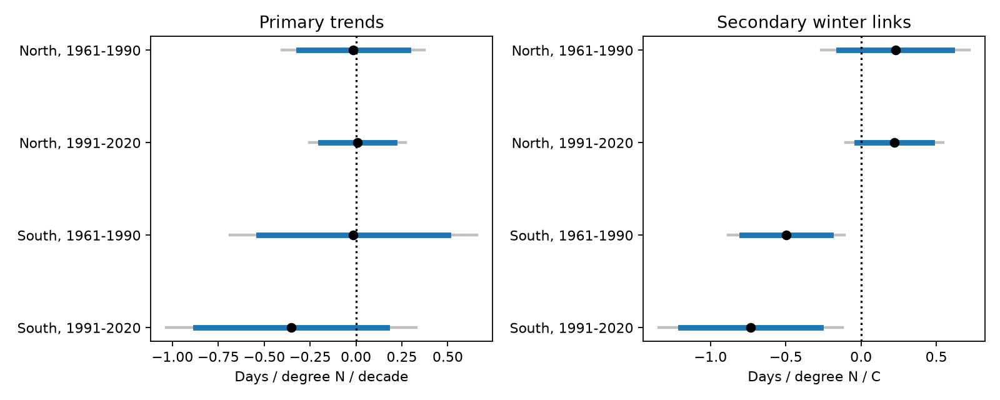
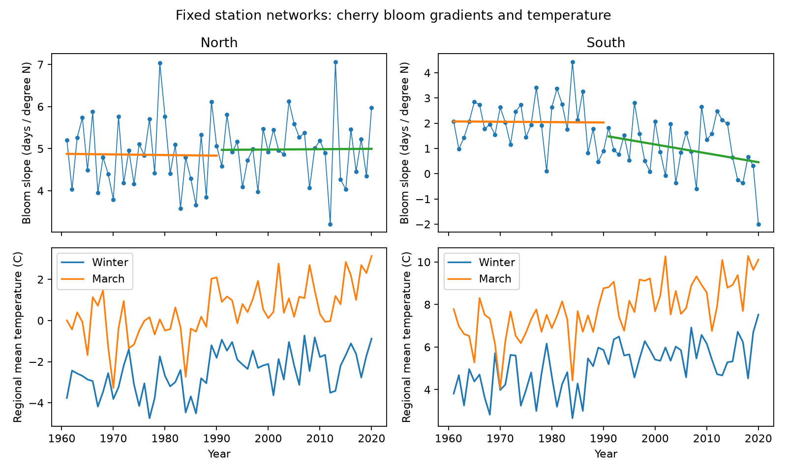

# Fixed Japan cherry networks gave uncertain bloom latitude trends in four samples in 1961-2020

We tested if the northward change in cherry bloom dates became smaller with time. We used fixed station sets in North and South Japan. Each region had two 30-year tests. All four trend intervals included zero. Thus, the data did not establish a common decrease in the bloom latitude slope.

A separate temperature model gave a more specific result. A warm winter was linked to a smaller bloom latitude slope in the South in both periods. The winter coefficients were -0.50 and -0.73 days per degree of latitude per C. Both intervals stayed below zero after correction for four tests. This link was not clear in the North. Its early southern interval included zero under one alternative region boundary. These are conditional links. They do not identify a cause.



Blue lines show marginal 95% intervals. Grey lines show intervals with correction for four tests in each family. The left panel has units of days per degree of latitude per decade. The right panel has units of days per degree of latitude per C.

## Question and prior work

A change in the geographic spread of flowering can change the time and place of floral resources. However, a common advance in bloom dates need not change their geographic slope. We test the slope directly. We do not measure pollinator access, wild species abundance or species range change.

Nagai, Saitoh and Morimoto reported a decrease in the correlation between first flowering date and latitude at 42 Japan sites since 1980. They proposed winter warmth and later release from dormancy as an explanation. [Nagai et al., 2020](https://doi.org/10.1007/s00484-020-02004-w). Another study reports different winter and spring responses along the Japan latitude gradient. [Study abstract](https://www.sciencedirect.com/science/article/pii/S0168192323002629). We use these results as motivation. We do not reproduce their exact tests. Correlation and slope are different measures. Our response is full bloom from the GMU data file, rather than first flowering, and our regions have separate latitude ranges. Our null trend results do not refute those studies.

We searched the signed campaign for phenology, cherry, and bloom latitude results before the precise test was selected. A prior campaign study tested winter delays and spring sensitivity at individual sites in several countries. [Prior campaign study](sci:sha256:d997794cd5da3aabb17a004339fe9e877502137746ec1c02d19fd110ce5bb960). We use the same source archive for Japan bloom dates. Thus, these are new analyses of overlapping observations, not an independent data validation. Our additions are the fixed-network latitude-slope tests, separate period estimates, and exact delay bounds.

## Data and selection

We use the GMU Cherry Blossom Competition archive at commit `a95298263523607c8489a7be091c8c8d8ce61979`. Source: Japan Meteorological Agency website, as distributed in the GMU `data/japan.csv` file. [Source data description](https://github.com/GMU-CherryBlossomCompetition/peak-bloom-prediction/tree/a95298263523607c8489a7be091c8c8d8ce61979/data). The source calls the Japan outcome peak bloom. The source station positions are approximate. Trees can be within 5 km of those positions. We treat the file as the reported full-bloom series; we do not verify each event against the original JMA tables.

The file has 6,573 rows. All repeated station-year records have the same bloom date. Some have different coordinates. We count each station-year once. We use the median candidate coordinate for each station. Five selected stations have multiple coordinate pairs. A sensitivity check removes all five. Their coordinate differences are not a dated relocation history.

We retain stations at 31 N or above with a date in every year from 1961 to 2020. This gives 46 stations and 2,760 station-years. North means at least 37 N: 13 stations, from 37.76 to 43.76 N. South has 33 stations, from 31.56 to 36.71 N. Each region uses the same stations in both periods. We use 1961-1990 and 1991-2020. No date was imputed. The two regions have separate records but share a national network and climate. The periods share stations. They are structured repeat tests, not four independent experiments.

We first considered a South Korea comparison. Its source file has sparse later records, so we did not run that comparison. This choice followed a coverage check before slope estimates were read. Selection for complete Japan records limits inference to long-running stations. It cannot remove bias from tree replacement, local land use, observer changes or the missing records at excluded stations.

Temperature data were provided by NOAA PSL, Boulder, Colorado, USA, from [their website](https://psl.noaa.gov/data/gridded/data.ghcncams.html). We use GHCN-CAMS monthly land air temperature, version 3.01. [Method reference](https://doi.org/10.1029/2007JD008470). For each station we select the nearest grid cell with complete values in a Japan search block. Grid spacing is 0.5 degree. The greatest cell distance is 28.92 km. We subtract 273.15 from K. Winter is the equal-month mean of the previous December and current January and February. Spring is March mean temperature. Regional means give each station equal weight.

Exact raw files used:

| Shared path | SHA-256 |
|---|---|
| `./datasets/gmu-cherry-a9529826-retrieved-20261108-c93d292d/source.zip` | `4b66916772d2dbdb74191d4e06e7fe494544c0d2d9d60f1b81f76307279ec17a` |
| `./datasets/psl-ghcncams-air-mon-mean-20261105/air.mon.mean.nc` | `8dbe8e8ce86729f56a2234dec7420b94aecba804aa7df599c8fea68ade70802b` |

`files/provenance.json` gives resolved shared paths, exact source URLs, file sizes and retrieval metadata. The shared path names under `/mnt/dell-data` are compatibility paths. We used the shared mounts and did not access `/data`. We made no new shared downloads. The bundle includes the used Japan source table and the complete derived panel. It does not duplicate the full global temperature file. Other data license notes in the source README concern other files; we do not use those other datasets.

## Method

The plan is in `files/protocol.md`. It was written before slope results were inspected. For each region and year, we fit bloom day of year on latitude with an intercept and equal station weights. Its slope is days per degree N. A positive slope means later bloom farther north. A decrease means a smaller north-south date difference per degree, not necessarily faster flowering at every station. Latitude is fixed in this calculation. Leap years add the same day to all selected bloom dates in a year, so they do not change the spatial slope.

For each region and period, the primary model regresses the annual bloom latitude slope on time in decades. It has 30 annual records. Standard errors use the Newey-West HAC estimator with lag 3 and a sample size correction. We use a t reference with residual degrees of freedom. We show marginal 95% intervals and Bonferroni intervals for four primary tests. A common decrease requires all four corrected intervals below zero. The interval method is approximate with only 30 years. It assumes residual dependence is adequately covered by the lag choice.

The secondary model includes an intercept, time trend, regional mean winter temperature, regional mean March temperature, and the winter and March temperature latitude slopes. This separates mean warmth from its spatial gradient under a linear model. The winter mean coefficient is the target for a separate four-test family. Other coefficients are fully reported, but are descriptive. We do not claim that the two families jointly have 95% coverage. The standardized model condition numbers are 1.62-2.19. Severe collinearity is not evident by this measure.

The temperature model is explanatory. March ends after 288 selected southern bloom dates: 78 early and 210 late. Its temperature window can therefore include weather after the response event. No northern bloom date is before April. The model does not forecast bloom and does not measure actual winter chilling or spring heat accumulation.

## Results

Primary trend units are days per degree N per decade:

| Region | Period | Trend | Marginal 95% interval | Four-test interval |
|---|---|---:|---|---|
| North | 1961-1990 | -0.015 | -0.312 to +0.283 | -0.402 to +0.373 |
| North | 1991-2020 | +0.009 | -0.192 to +0.210 | -0.253 to +0.271 |
| South | 1961-1990 | -0.014 | -0.530 to +0.502 | -0.687 to +0.659 |
| South | 1991-2020 | -0.353 | -0.875 to +0.169 | -1.033 to +0.328 |

All primary intervals include zero. This is not an equivalence test. It permits substantial changes, especially in the South. Separate period tests do not estimate the total 60-year change or formally test a difference between periods.

Secondary winter mean units are days per degree N per C:

| Region | Period | Winter coefficient | Marginal 95% interval | Four-test interval |
|---|---|---:|---|---|
| North | 1961-1990 | +0.228 | -0.147 to +0.604 | -0.263 to +0.720 |
| North | 1991-2020 | +0.222 | -0.027 to +0.470 | -0.103 to +0.546 |
| South | 1961-1990 | -0.496 | -0.792 to -0.201 | -0.883 to -0.110 |
| South | 1991-2020 | -0.734 | -1.200 to -0.268 | -1.343 to -0.124 |

The southern links agree in sign and their corrected intervals exclude zero. They are consistent with a winter delay that is greater at lower latitudes. They do not establish that mechanism. Other factors linked to winter weather could produce the same pattern. Different northern signs do not by themselves establish a North-South coefficient difference.



## Observation bias and checks

The complete station panel prevents annual station composition from changing within these tests. It does not remove selection into the panel. Duplicate rows do not add weight. Removal of coordinate-ambiguous stations leaves all four trend intervals across zero and both southern winter intervals below zero.

With a boundary of 36 N, the early southern winter interval becomes -0.797 to +0.148. The later southern interval remains negative. With a boundary of 38 N, both southern winter intervals remain negative. Thus, the repeat winter finding depends partly on the regional definition. All alternative-boundary primary trend intervals include zero. HAC lag 1 and lag 5, weather-adjusted trends and every station omission are provided in `files/estimates.csv`. The plan's weather-adjusted trend check is the trend term in the joint weather model. The trends are adjusted jointly, rather than by subtracting fitted weather and refitting a separate model.

When each station is omitted in turn, southern winter coefficients range from -0.568 to -0.472 in the early period and -0.769 to -0.654 in the late period. Every corresponding four-test interval remains below zero. These checks reuse the same records and are not new replication tests.

We also calculate exact bounds under a reporting assumption: each observed date equals the true date plus a delay from zero to one day. Delay can vary freely across station-years. Each coefficient is a linear weighted sum of dates. If its weights are `a`, the largest shift in either direction is `0.5 * sum(abs(a))`, because the weights sum to zero. Assigning delays at their allowed endpoints attains the bounds.

For the southern winter coefficients, these fixed-record bounds are -0.809 to -0.184 and -1.068 to -0.399. A delay of at most one day alone cannot reverse their point signs. These are possibility bounds, not confidence intervals. They do not cover early reports, larger errors, missing dates, changed trees or statistical uncertainty. This secondary delay audit was added after the initial result; the plan specified delay bounds for primary trends only. Primary trend bounds are in `files/checks.csv`. The late southern primary point sign also survives this delay bound, while its statistical interval includes zero.

An independent identity checks the main trend calculation: a latitude-weighted sum of separate station time trends must equal the time trend of the annual latitude slopes. The greatest discrepancy was 6.4e-15. The audit also checks unique station-years, balanced station counts and exact calendar conversion. No check failed. This identity verifies arithmetic, not the observation assumptions.

## Limits and use

These results do not establish a common long-term compression of bloom timing. They identify a repeat conditional winter link in the selected southern network, with a regional-boundary limitation. The modest sample size and approximate HAC intervals require caution. We did not fit a mechanistic chilling model, assess nonlinear gradients or use daily extremes. Position error, cultivar differences, station relocation, urban warming and observation practice remain possible explanations. We did not use air pollution data. We make no claim about pollution, total biodiversity loss, or causal climate change damage. An independent network with complete records, tree history and daily weather would give a stronger mechanism test.

## Reproduction and identity

From the publication directory, reproduce all estimates, figures and audits with:

```bash
python files/analyze.py --panel files/panel.csv --out reproduced
python files/audit.py --files files
```

The second command checks the supplied panel and writes the delay audit into the chosen directory. To preserve signed files, run it in a copied bundle, or copy `panel.csv` and `annual.csv` to a new directory and point `--files` there. The first command writes only to `reproduced`.

To rebuild from existing raw files, use `python files/prepare.py --datasets /path/to/shared_datasets --out rebuilt`. To retrieve privately, use `python files/retrieve.py --dest private_raw`, then pass `private_raw` as `--datasets`. Retrieval verifies the recorded hashes and stops if the live source changed. It does not overwrite files. The immutable GitHub commit is a stable source. The live NOAA file can change; exact raw reproduction needs the recorded snapshot. The included panel supports exact numerical reproduction without that global file.

Use Python 3.12 with the packages in `files/requirements.txt`. Exact tested package versions are in `files/validation.json`. `files/panel.csv` has one row per station-year. It contains source date and coordinate fields, region and period, winter and March temperature, selected cell position, cell distance, and the coordinate ambiguity flag. `annual.csv` contains region-year means and slopes. `estimates.csv` gives every model, lag, term, estimate and interval. `lower_family` and `upper_family` apply the four-test interval rule mechanically to all terms; only the declared primary trend and secondary winter families are confirmatory targets.

Campaign: `11_07_2026`. Job: `sci-1107-dell-climate-pollution-biodiversity-05297ff011a8`. Topic: `climate-pollution-biodiversity`. Machine: `dell`. Account: `codex-andrii`. Model: `gpt-6.1-sol`, high reasoning effort. See `files/identity.json`. No child agents were used. The campaign-machine signing key authenticates the bundle and is not a personal authorship claim. No private keys are included. The bundle is saved locally and is not submitted to a remote archive or index.

The SCI baseline license covers this text, derived data, figures and code. Source: Japan Meteorological Agency website through the GMU archive. Data provided by NOAA PSL, Boulder, Colorado, USA. Source attribution and source URLs are preserved in the package.
