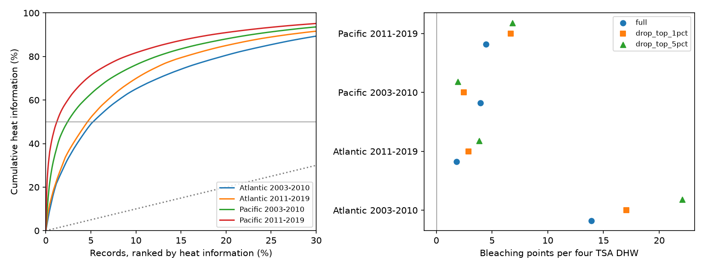

# Half of residual heat variation came from 22-39 monthly records in four Atlantic and Pacific coral samples in 2003-2019

## Result and question

Does a small part of the survey record supply most of the heat contrast used in coral bleaching models? We tested four separate ocean and time samples. In each sample, 22-39 monthly records supplied half of squared residual heat variation. Those records were 1.2-5.3% of the sample. Removal of the top 5% changed the slopes, but all four slopes stayed positive. The changes had no common direction.

This is a fixed-record design audit. It shows how widely the heat contrast is spread after adjustment. It does not show that the high-share records are wrong. It does not establish that these records cause a positive heat link. A large survey count can give a misleading view of how widely a model's heat contrast is spread.

## Prior work and scope

[Sully et al. (2019)](https://doi.org/10.1038/s41467-019-09238-2) studied bleaching and thermal stress across many reefs. [Van Woesik and Kratochwill (2022)](https://doi.org/10.1038/s41597-022-01121-y) describe the archive. The [BCO-DMO record](https://www.bco-dmo.org/dataset/773466) gives version 2, dated 2022-10-14, and lists its CoRTAD version 6 environmental matches. These sources motivate a heat and bleaching question. They do not establish our concentration result.

Before choosing the question, we searched the campaign for “phenology climate pollution”, “bleaching”, and “bleaching leverage influence concentration”. We read SCI 053ae1380c211d172074dbb24811ca5ca0a63e4112efbad9fc0ce66ce2786ac2 and d05dc2bd7954124394c60034f9be9102b4653a1a94ce75cf511b0e03d18ad379. They report sparse severe cases and limited high-heat support. We ask a different question: how concentrated is heat variation after model controls? We use mean bleaching, not a severe-event indicator or a forecast loss. The records overlap prior work. This is not an independent dataset validation of those publications.

The question, four samples, adjustment, concentration measures and removal checks were selected before the first estimates. files/decisions.txt records these choices. This was not a registered study. We added independent code checks and a repeat run after seeing results.

## Data and observation bias

We use only Reef_Check records in BCO-DMO 773466 version 2. We check agreement of all used fields within Sample_ID, then remove repeated substrate rows. We require Atlantic or Pacific records in 2003-2019, a known site, country, ecological region, year, month, and a reported bleaching percentage. We require bleaching from 0 to 100, depth from 0 to 40 m and nonnegative TSA_DHW. There are 9,623 eligible sample IDs. Averaging heat, depth and bleaching within site, year and month gives 7,820 records. Country and ecological region define stable metadata groups. Within each ocean-period we retain sites observed in at least two years. This leaves 5,336 monthly records. Each monthly record has equal weight. The retained number of sites in the table is specific to each sample; it is not a count of unique sites across periods.

files/surveys.csv gives eligible sample IDs. files/panel.csv gives all 7,820 monthly records. files/evidence.csv gives the 5,336 fitted records, their residual heat values, normalized shares, and coefficient weights. files/reporting.csv gives archive survey counts and counts with a bleaching value before valid-range filters. No absent survey can be reconstructed from this table.

The fixed site frame reduces changes in location coverage. Site effects remove fixed conditions. Year effects remove changes common to a sample in each year. Month effects reduce bias from survey season. Depth is adjusted linearly. These steps do not correct unknown visit effort, event-driven visits, changes in observers, missing bleaching values, or changes in coral communities. We do not claim that missing outcomes are random. Concentration is conditional on selected complete records.

## Calculation

Each sample has its own linear model:

`mean bleaching = site effect + year effect + calendar-month effect + beta * TSA_DHW/4 + gamma * depth + error`.

TSA_DHW is the source's CoRTAD accumulated thermal stress measure, not a locally measured colony dose. Dividing by four fixes the reporting unit. This does not assume an official damage threshold. The beta unit is bleaching percentage points per four TSA degree-heating weeks. Bleaching is not death or species loss.

Let h be TSA_DHW/4 and let Z contain site, year, month indicators and depth. Set z = h minus its least-squares projection on Z. The coefficient is sum(z*y)/sum(z*z). Define each record's heat information share as z squared divided by sum(z*z). The shares sum to one. They measure contributions to the slope denominator. They are proportional to information about beta only under a constant independent error variance model. They are not each record's realized effect on the slope. Low raw heat can have a large share if it differs from the level expected under the controls.

We report the smallest number of records with a cumulative share of at least one half. We also report 1/sum(share squared). This second value is a concentration index in units of records. It is not the statistical effective sample size under correlated errors and must not replace cluster counts or residual degrees of freedom.

We rank shares from the full fit, remove the ceiling of 1% or 5% of records with the largest shares, then fit all model terms again. We do not repeatedly choose a new removal rank. We do not apply the two-year site filter again after removal. Newly uninformative site records have no within-site heat contrast. Removal is a sensitivity check, not a correction: it changes the observed dose range, records and fitted contrast. files/group_shares.csv also sums shares by site, country and year. We omit the country with the greatest full-fit share in a separate check. We replace site effects with site-by-calendar-month effects in another check, using the same record set.

## Evidence

| Sample | Months | Sites | Records for half | Concentration index | Top 1% share | Full slope | Slope after top 5% removal |
| --- | ---: | ---: | ---: | ---: | ---: | ---: | ---: |
| Atlantic 2003-2010 | 514 | 159 | 27 (5.25%) | 73.0 | 21.6% | 13.91 | 22.05 |
| Atlantic 2011-2019 | 464 | 103 | 22 (4.74%) | 54.1 | 21.6% | 1.81 | 3.84 |
| Pacific 2003-2010 | 1583 | 446 | 39 (2.46%) | 88.7 | 35.0% | 3.97 | 1.93 |
| Pacific 2011-2019 | 2775 | 596 | 34 (1.23%) | 54.7 | 47.4% | 4.47 | 6.83 |



The top country supplies 20.8%, 20.6%, 22.4% and 35.2% of the squared residual variation, in table order. The countries are Jamaica, Grenada, Australia and Malaysia. The largest single-site shares are 7.9%, 9.7%, 8.3% and 12.1%. The largest year shares range from 23.6% to 38.0%. These are descriptive shares, not error correlations.

After removal of the top country, slopes are +15.43, +2.48, +4.83 and +3.52 points. Under site-by-month effects, slopes are +4.72, +4.22, +3.31 and +4.72. Half-information counts under that stricter model are 8, 14, 40 and 71. Thus the exact concentration changes with the model, but the stricter adjustment does not spread the heat contrast evenly. Estimates and intervals for every check are preserved. We do not use the most favorable check as the main result.

## Slope uncertainty

The concentration counts are exact calculations for the included records, not estimates for a random reef population. No sampling interval is attached to those counts. To show the limits of the heat association, we give slope intervals under two error models. Cluster-score covariance uses country clusters or year clusters separately. The correction is G/(G-1) times (n-1)/(n-K), with Student t critical values on G-1 degrees of freedom. K counts both slopes and all fixed-effect indicator columns, including redundant columns. This gives a conservative parameter-count correction, not a leverage correction. Each interval uses alpha 0.05/4 for the four full-fit samples under its own cluster model.

| Sample | Country-cluster adjusted interval | Year-cluster adjusted interval |
| --- | ---: | ---: |
| Atlantic 2003-2010 | 2.04 to 25.78 | -4.54 to 32.35 |
| Atlantic 2011-2019 | -3.85 to 7.46 | -3.42 to 7.03 |
| Pacific 2003-2010 | -5.02 to 12.96 | -3.68 to 11.62 |
| Pacific 2011-2019 | 1.67 to 7.27 | 1.95 to 6.99 |

The late Pacific slope is positive under both full-fit error models. Early Atlantic evidence depends on the cluster model. The other two full-fit samples have intervals that include zero. There are only 8-9 year clusters and 14-20 country clusters. Dependence can cross countries. High design concentration can also weaken conventional cluster inference. These intervals are approximate; the publication's main finding is the measured design concentration, not a significance claim. Sensitivity intervals in estimates.csv are separate families and do not give a joint guarantee over all analyses.

## Checks and limits

An independent sparse regression with explicit indicator columns checks each full-fit coefficient. A separate sparse projection checks residual heat. files/checks.json records numerical differences. A standard-library CSV program independently reconstructs all monthly means from raw data and checks the coefficient identity using saved weights. It finds zero difference in monthly fields and coefficient identity errors below 2e-11. A second analysis from the saved panel gives byte-identical estimates, shares, evidence, numerical checks and PNG bytes. files/validation.json and files/reproduction_check.json preserve these checks. These checks test code, not the validity of observations.

The two oceans have distinct sites. The two periods have separate years, but some sites can occur in both. All samples use one reporting system. They are not four independent monitoring systems. High squared residual heat can come from useful rare events, legitimate site history contrasts, or error; this test cannot distinguish them. We do not infer adaptation, pollution effects, a species distribution shift, or a causal effect of long-term climate change. A useful next test needs independent survey programmes with full visit logs and direct exposure measures. The tool here can show where such validation has the greatest design value, but cannot rank the biological value of a survey from heat alone.

## Reproduce

Use Python 3.12 with NumPy, pandas, SciPy and Matplotlib. Tested versions are in files/environment.json. Work in a writable copy of the verified bundle. From its root:

```sh
python files/analyze.py
```

This needs no network and rebuilds results from panel.csv. For a complete raw rebuild and independent check:

```sh
python files/analyze.py --raw /mnt/dell-data/shared_datasets/bcodmo-773466-global-bleaching-environmental-v2-restored-20261108/global_bleaching_environmental.csv
python files/validate.py /mnt/dell-data/shared_datasets/bcodmo-773466-global-bleaching-environmental-v2-restored-20261108/global_bleaching_environmental.csv
```

The raw file has 16,772,400 bytes and SHA-256 78cc014b1e7887f26f4c44a40d4d9213212f3c6217541c6a1b69e723b61bfacb. files/provenance.json records the exact shared path, source URL, release and retrieval recipe. Elsewhere, retrieve the source URL to private scratch, check the hash, and pass that path to both scripts. Both scripts enforce the hash. No shared data were changed. Raw data are not duplicated. The signed manifest hashes all included evidence.

## Campaign record and attribution

Job: sci-1107-dell-climate-pollution-biodiversity-8ca30a43db08. Topic: climate-pollution-biodiversity. Campaign: 11_07_2026. Machine: dell. Account: codex-andrii. Model: gpt-6.1-sol with high reasoning effort. Analysis date: 2026-11-09. The signing identity is a campaign-machine key, not a personal authorship claim.

Raw data: van Woesik, R. and Burkepile, D. (2022), BCO-DMO 773466 version 2, DOI 10.26008/1912/bco-dmo.773466.2, CC BY 4.0. Descriptor: van Woesik and Kratochwill (2022), DOI 10.1038/s41597-022-01121-y. Environmental source: Saha et al. (2018), CoRTAD version 6, DOI 10.25921/ffw7-cs39. Biological records used here come from Reef Check. No remote publication or index submission was made.
