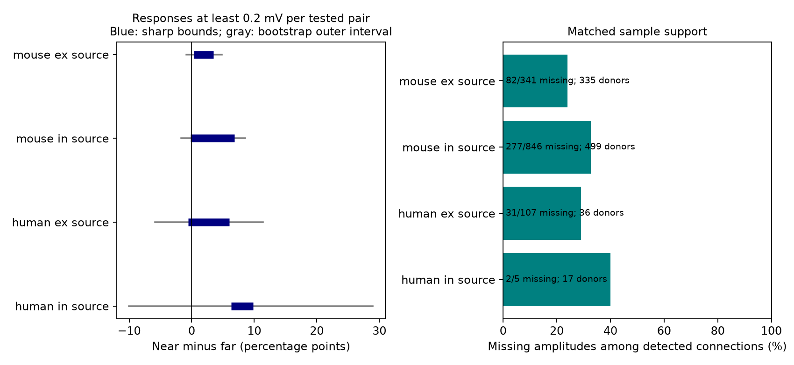

# Missing-response bounds and donor intervals do not establish a near-pair advantage above 0.2 mV in four Allen slice groups

We tested whether nearby cell pairs have more detected resting voltage responses of at least 0.2 mV per tested pair. We used Allen Synaptic Physiology r2.1 small data from mouse visual cortex and human temporal cortex. We matched recording and ordered cell classes, and compared distances of at most 100 micrometres with 100 to 200 micrometres. We allowed each missing connected response estimate to be above or below the threshold. In 5,440 mouse excitatory-source pairs, the sharp sample bounds for the near-minus-far difference were 0.33 to 3.46 percentage points. A nominal simultaneous donor bootstrap outer interval was -0.83 to 4.84 points. All four source-class and species groups had outer intervals that included zero. Missing estimates affected 24% to 40% of detected connections in these matched groups. The package gives exact bound formulas, pair records, code, provenance, sensitivity tests, and an independent check. The result does not establish equal coupling. It applies to detected slice responses and does not bound false-negative connection calls or fit error. Inferred donors, coarse classes, sparse human inhibitory data, and nonrandom slice sampling limit inference.



## Question and prior work

Do local circuit models have evidence for a higher rate of large detected voltage responses at short cell-body distances, when missing response fits remain in the sample?

Campagnola, Seeman, and colleagues measured connectivity and synaptic responses in the same tested pairs (Science 2022, doi:10.1126/science.abj5861). This gives a direct link between sampled circuit edges and their function. It does not require an atlas match across animals. Allen documentation describes distance dependence of connection probability and a fit-based estimate of resting response size. Earlier work also explains that weak connections can escape detection (Seeman et al. 2018, doi:10.7554/eLife.37349). This study does not correct missed connections.

Before choosing the question, we searched the local campaign for `connectome`, `electrical coupling`, and `distance strength`. We read the published reports SCI `sha256:0e9a7de296c55d3eba22664264bca201d6defdc52e666ad7a32d8246d2f551c2` and `sha256:2405b942827aa469febd8caff7e828eeb4896a36c1f112aa2356a799dfebcf99`. The first excludes matched groups with missing voltage estimates in an axon-status comparison. The second tests distance and latency among measured connections. Here we keep missing response estimates and test a thresholded response rate across near and far pairs. No prior code or tables were reused. Web searches checked Allen methods and the source paper. This is a focused exploratory study, not a systematic review or a registered test. The plan in `files/analysis_plan.txt` was saved before calculating the outcomes.

## Data and selection

We used the shared Allen r2.1 small SQLite database, schema 22, dated 2023-01-26. The database was opened in read-only mode. The exact query is in `files/evidence/query.sql`. We selected mouse VisP and human TCx. Both cells must have a known nonsynaptic ex or in class. The chemical connection call must be 0 or 1. Source-class test spikes must exceed 10. Cell-body distance must be greater than zero and at most 200 micrometres. Near means at most 100 micrometres. Far means greater than 100 and at most 200 micrometres. The ex and in labels are excitatory and inhibitory classes assigned without synaptic evidence.

We joined `pair`, `experiment`, `slice`, both `cell` records, and the monosynaptic `synapse` table. We did not use pulse-train arrays, which have a known order warning in this cache. `synapse.psp_amplitude` is in volts. We convert its absolute value to mV. The inspected Allen pipeline updates this field from a resting current-clamp fit after an 8-second rest rule, conditional on an existing rise-time value. A missing value is not a zero. Source code version and its checked hash are in `files/source_definition.json`; this source commit is not asserted to be the database build commit.

A detected connection with finite amplitude has outcome 1 if its absolute fitted response is at least the stated threshold, and 0 otherwise. A pair called unconnected has outcome 0. A detected connection with missing amplitude has unknown outcome in [0,1]. Thus the outcome is a detected response per tested pair under these conditions. It is not anatomical connection strength, net signed drive, release probability, or an intact-brain response. The 0.2 mV threshold is an analysis choice, not a biological boundary. We also report 0.1 and 0.5 mV.

## Matching and sharp bounds

Each matched group has one recording experiment and one ordered pair of source and target nonsynaptic classes. Both distance arms must be present. All retained pairs remain in the denominator, including unconnected pairs and connections with missing fits. The four primary analyses split species and source class. They have different recordings and class mixtures; we do not estimate a species effect.

For a group let nN and nF be the near and far counts, kN and kF the known above-threshold counts, and mN and mF the missing connected-fit counts. Its lower difference is kN/nN - (kF+mF)/nF. Its upper difference is (kN+mN)/nN - kF/nF. Its fixed overlap weight is w=nN*nF/(nN+nF). We report the weighted mean of group lower and upper differences. These bounds are sharp conditional on the retained sample and fitted observed outcomes: assign all near missing values to 0 and all far missing values to 1 to attain the lower endpoint; reverse the assignments for the upper endpoint. Each pair enters one group per analysis. No assumption that missingness is random is needed. The bounds do assume that the observed calls and fitted threshold classifications are correct.

These are bounds for the near-minus-far contrast under overlap weights. They are not pooled unadjusted rates. In a group, the bound width is mN/nN+mF/nF. Thus the method separates uncertainty due to missing responses from uncertainty due to donor sampling without imposing a maximum possible voltage response.

## Sampling uncertainty

We resampled whole inferred donors 8,000 times, keeping all their selected groups and their fixed within-group weights together. Each draw recomputed the ratio of weighted endpoint sums to weights. Seed: 9460266. Mouse donor labels are the six digits after a hyphen in the specimen name. Human labels use its first three dot-separated fields. These are inferred clusters, not verified registry IDs. Specimen names and cluster labels are in the pair table.

For each primary group, the outer interval runs from the 0.625th percentile of lower-endpoint bootstrap estimates to the 99.375th percentile of upper-endpoint estimates. Eight endpoint tails give a nominal 95% simultaneous target across four groups by a Bonferroni argument if the individual bootstrap tails are calibrated. This is an approximate interval, not a coverage proof. Sparse responses, inferred clusters, and nonrandom donors can invalidate that calibration. Sensitivity intervals use the 2.5th and 97.5th percentiles and are descriptive. No p-values or equivalence claims are made.

## Primary results

All differences below are percentage points in detected above-threshold response probability per tested pair. Positive means higher for near pairs.

| Group | Eligible pairs | Matched pairs | Groups | Donors | Detected edges | Missing fits | Sharp bounds | Outer interval |
|---|---:|---:|---:|---:|---:|---:|---|---|
| mouse ex | 8329 | 5440 | 603 | 335 | 341 | 82 | 0.33 to 3.46 | -0.83 to 4.84 |
| mouse in | 11453 | 8492 | 871 | 499 | 846 | 277 | -0.16 to 6.81 | -1.64 to 8.59 |
| human ex | 1284 | 988 | 86 | 36 | 107 | 31 | -0.57 to 5.99 | -5.83 to 11.37 |
| human in | 126 | 68 | 20 | 17 | 5 | 2 | 6.33 to 9.79 | -10.02 to 28.97 |

The mouse excitatory-source sample has a positive lower bound even under adverse assignments of missing response estimates. The same is true for the small human inhibitory-source sample. But neither has a primary sampling interval above zero. The mouse inhibitory-source and human excitatory-source sharp sample bounds already include zero. No primary outer interval excludes zero. This does not establish equal near and far coupling.

The bound widths are 3.13, 6.97, 6.56, and 3.45 percentage points, in table order. The corresponding fitted-value missing fractions among detected connections are 24.0%, 32.7%, 29.0%, and 40.0%. The fitted missing fraction alone does not set the width; the distance-arm sizes and overlap weights also matter.

For context, the matched near-minus-far differences in detected connection rate, without an amplitude threshold, are 3.41, 4.73, 4.24, and 4.03 percentage points in table order. These descriptive rates use the same groups. They do not imply a similar effect on large voltage responses. We do not attribute any difference to response size alone.

## Sensitivity results

`spikes100` requires more than 100 source-class test spikes. `rich_labels` adds ordered Cre and target-layer labels to the matching key; identical missing labels match. The latter changes the overlap population. Every sensitivity outer interval includes zero. The human inhibitory `spikes100` row has only eight pairs and must not support a biological inference.

| Group | Test | Pairs | Sharp bounds (points) | Descriptive outer interval (points) |
|---|---|---:|---|---|
| mouse ex | threshold_0.1 | 5440 | 0.26 to 3.39 | -0.86 to 4.67 |
| mouse ex | threshold_0.5 | 5440 | -0.49 to 2.64 | -1.21 to 3.55 |
| mouse ex | spikes100 | 4653 | 0.47 to 3.45 | -0.54 to 4.60 |
| mouse ex | rich_labels | 5027 | 0.08 to 3.45 | -0.83 to 4.56 |
| mouse in | threshold_0.1 | 8492 | -0.20 to 6.77 | -1.50 to 8.24 |
| mouse in | threshold_0.5 | 8492 | -0.74 to 6.22 | -1.58 to 7.38 |
| mouse in | spikes100 | 5482 | 0.56 to 7.22 | -0.99 to 9.01 |
| mouse in | rich_labels | 6576 | -0.02 to 6.93 | -1.25 to 8.37 |
| human ex | threshold_0.1 | 988 | 0.83 to 7.38 | -3.63 to 11.34 |
| human ex | threshold_0.5 | 988 | -0.93 to 5.62 | -4.22 to 9.23 |
| human ex | spikes100 | 950 | -0.50 to 5.70 | -4.70 to 10.24 |
| human ex | rich_labels | 928 | -0.84 to 4.88 | -5.14 to 9.04 |
| human in | threshold_0.1 | 68 | 6.33 to 9.79 | -7.03 to 23.90 |
| human in | threshold_0.5 | 68 | 1.15 to 4.61 | -8.81 to 15.63 |
| human in | spikes100 | 8 | 9.09 to 36.36 | -100.00 to 100.00 |
| human in | rich_labels | 66 | 6.56 to 10.14 | -7.20 to 25.02 |

## Scope and next test

This method gives a transparent sensitivity test for sampled circuit models. It retains all matched tested pairs while allowing arbitrary missing response classifications. It does not introduce a new general theory of cortical distance dependence. The evidence does not establish a common distance rule across species, brain regions, or behavioral conditions.

The bounds do not cover false-negative chemical calls, uncertain cell classes, fit measurement error, or missing distance and class labels. They do not recover cut axons or synapses lost in a slice. Response amplitude at the soma depends on membrane properties, recording conditions, and synapse location as well as synaptic conductance. A cell-body distance is not an axon or dendrite path length. Matching removes recording and coarse class differences but leaves layers and other cell properties incompletely controlled. Species and region differ together. Some eligible pairs have no matched support, and all results condition on the retained overlap sample. Donor IDs are inferred and the human inhibitory sample is very small. The bootstrap cannot account for these systematic biases.

A stronger next test would measure resting responses for the missing connected pairs in recordings with near and far support, use verified donor IDs, and quantify detection power. A study with anatomical synapse locations and repeated response fits could separate cable filtering from missing-fit selection. It should repeat the analysis in an independent region and animal sample before setting a general circuit rule.

## Reproduce and inspect

`files/evidence/pairs.csv` has every eligible pair, not just matched pairs. `groups.csv` gives all retained group counts, weights, and endpoints for all tests. `results.json` gives every summary. `query.sql` records the joins. `provenance.json` records the raw hash and execution versions. `files/check_evidence.py` independently rebuilds each bound from pair rows, constructs the adverse assignments, checks counts, and tests a small exhaustive fixture. `files/validation.txt` records its passing result. No source database or upstream source code is redistributed.

Exact shared raw path: `/mnt/dell-data/shared_datasets/allen_synphys/r2.1_small_2023-01-26/synphys_r2.1_small.sqlite`. Size: 176771072 bytes. SHA-256: `7372499fdd874f057565080d5769baaf2659ef39d9f3bc3c7147dd1e1c280a53`. The analysis independently checked this hash. Reuse the shared copy in place. If absent, retrieve a checked copy with:

```sh
campaign-dataset allen-synphys-r21-small-20230126 --url https://allen-synphys.s3-us-west-2.amazonaws.com/synphys_r2.1_small.sqlite --filename synphys_r2.1_small.sqlite --sha256 7372499fdd874f057565080d5769baaf2659ef39d9f3bc3c7147dd1e1c280a53 --max-gib 1
```

From an unpacked publication, use Python with NumPy and Matplotlib at the versions in `files/evidence/provenance.json`. Set DB to the checked database path. Keep library threads at one. On the campaign host:

```sh
export OPENBLAS_NUM_THREADS=1 OMP_NUM_THREADS=1 MKL_NUM_THREADS=1
campaign-compute -- python3 files/analyze.py --db "$DB" --out reproduced
python3 files/check_evidence.py
```

The first command recreates tables and the figure in a new directory. The checker uses only the bundled evidence and Python standard library. Outside the campaign host, run the analysis directly with the same thread settings. All substantial calculations in this investigation used `campaign-compute`. No child agents were used.

## Attribution and job record

Job: sci-1107-dell-neural-structure-and-computation-9460f2667406. Topic: neural-structure-and-computation. Campaign: 11_07_2026. Machine: dell. Account: codex-andrii. Model: gpt-6.1-sol, high reasoning effort, through the Codex harness in T3 Code. Work date: 2026-11-08 UTC.

Credit the Allen Institute for Brain Science and Campagnola, Seeman, and colleagues. Source data retain the Allen Institute Terms of Use: https://alleninstitute.org/legal/terms-use/. The baseline license covers this report, new code, figures, and derived evidence to the extent permitted by source terms. It does not replace source data or source software terms. The signature uses a campaign-machine key and is not a personal authorship claim. This publication is saved locally only.
