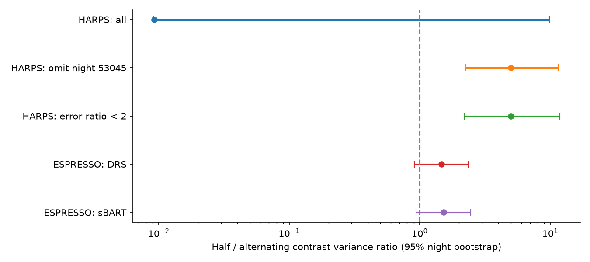
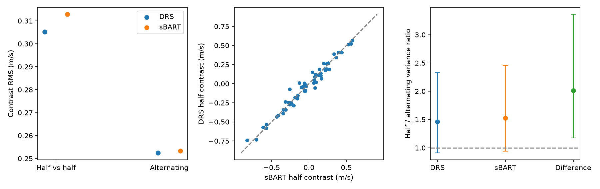
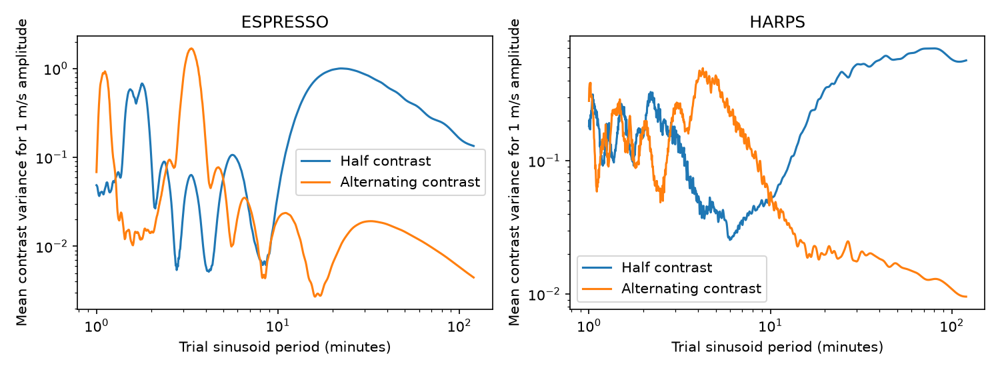

# Removing one HARPS night changes the HD 20794 contrast variance ratio from 0.009 to 5.00

We test whether changes within one night have more power on long time steps than on short time steps. The public HARPS velocity table for HD 20794 gives a ratio of 0.00924 for the test defined below. One night supplies 99.9957% of the short-step power. Remove that night and the ratio is 5.001, with a 95% night bootstrap interval of 2.264 to 11.453. A separate cut on the change in formal errors gives a ratio of 4.985. This is a data-quality and time-sampling result. It is not a new planet or a new stellar phenomenon.

Two ESPRESSO reductions give ratios of 1.463 and 1.524 in 57 selected nights. Both 95% intervals include one. Their much shorter sequences do not confirm the HARPS excess at the same time scale. We provide a method, frozen exposure data, tests, and a response calculation. No specific stellar or instrument cause is established.



The error bars are 95% percentile intervals from resampling nights. The unfiltered HARPS interval is very wide because samples can omit the dominant night. All points use the same contrast definition. HARPS and ESPRESSO have different time windows.

## Question and prior work

Can time ordering within a night separate slow velocity changes from independent measurement scatter in public data used for low-mass planet searches? This is useful because small formal errors do not ensure a stable nightly mean.

Nari et al. (2025), DOI 10.1051/0004-6361/202451769, supply the velocity tables and report the known planets. Figueira et al. (2025), arXiv:2507.07514v1, study short-time scatter and physical noise in ESPRESSO data. They already report scatter beyond photon errors and discuss pulsations and granulation. We do not claim to discover this scatter. Our test uses balanced contrasts and explicit order permutations on the Nari release. It does not reproduce their physical simulations. The prior SCI study with ID `sha256:9de48b3dd388b73800972e193d666b4cfd778e006290eaa631485594c856e1dc` tests the long-time difference between these two ESPRESSO reductions. We read that publication for context. We build new exposure pairs from the raw table and reuse no code or measurements from it.

Before selecting the question we searched the campaign for astronomy and HD 20794. Further searches used HD20794, HD 20794 intranight, HD 20794 time ordering, and HD 20794 scatter. Saved search records give titles and IDs. Search terms can miss relevant studies. This is a limited new audit, not a claim of first use of contrasts or time-order tests.

## Data and sample rule

We reuse this shared file in place:

`./datasets/hd20794-nari2025-cds-a297-tsv-02c8eca1/hd20794.tsv`

It is the CDS/VizieR catalog J/A+A/693/A297 response dated 2026-11-09 07:12:37 UTC. Catalog publication date: 2025-03-03. SHA-256: `400611a0b6d1b2ee602182a5f50b97aed6e51247fe6564dcdbd84bfede5acac6`. Size: 3,077,342 bytes. `provenance.json` gives the source URL and retrieval recipe. No download or change to shared data was needed. Paths under /mnt/dell-data are compatibility paths to the shared SSD store. We did not access the failed disk.

The tables used are `harpsdrs`, `espsbart`, and `esp19drs`. HARPS and sBART times are full BJD; we subtract 2400000. The DRS ESPRESSO time is listed as JD minus 2400000. We match numeric time values rather than assume these labels are equivalent. Each ESPRESSO DRS row is matched to the nearest sBART row within one second, with no repeated matches. This gives 651 pairs on 64 integer time days; the largest time difference is about 0.0000051 second. HARPS DRS and sBART velocities and errors are converted from km/s to m/s. ESPRESSO DRS already uses m/s. Catalog record numbers are only pointers to source rows.

For each integer time day, sort exposures by time. If the count is odd, omit the last exposure. Keep the day if at least eight exposures remain. The ESPRESSO sample has 610 exposures on 57 nights; every retained night has at least ten exposures. The HARPS sample has 6246 exposures on 361 nights, from 8217 input exposures. No flux or velocity cut is applied to the main samples. The integer-day rule may not match every local observing-night definition. The kept sequences have maximum spans of 3.65 hours for ESPRESSO and 7.48 hours for HARPS. Median spans are 0.248 and 2.371 hours. Sparse or short sequences receive the same weight per night as long sequences.

The two ESPRESSO reductions use the same spectra. They are not independent observations. HARPS is a separate instrument with separate exposures, but a different window. It is a check of the method, not direct confirmation of a common physical process.

## Method

For n retained exposures in a night, define H as the mean of the last n/2 velocities minus the mean of the first n/2 velocities. Define A as the mean of even-position velocities minus the mean of odd-position velocities. Positions start at one after sorting. Both coefficient vectors sum to zero. Each coefficient has absolute value 2/n. Constant offsets cancel. The two contrasts have exactly equal expected variance for independent, zero-mean errors, even if their variances differ between exposures. This equality follows because their squared coefficients are identical at every exposure.

Our statistic is R = sum(H squared) / sum(A squared), over nights. It is a ratio of mean squared contrasts, without subtracting a fitted contrast mean. R above one can reflect time structure; it is not an estimate of a unique correlation time or of the uncertainty of a nightly mean. A signal with fast oscillations can also affect both contrasts. Formal errors are not used as weights. Error cuts are sensitivity tests, not a prescription for precision RV analysis.

We resample nights 10000 times and form percentile intervals. ESPRESSO also has a 30-day calendar-group bootstrap with 25 groups. These intervals assume that sampled groups represent the noise population. They do not cover unknown shared calibration errors, model selection, or all dependence between nights. We use 20000 within-night order permutations, with the same permutation in both ESPRESSO reductions. This tests exchangeability of the observed values, a stronger assumption than equal contrast variance. Heterogeneous errors can break exchangeability even when the expected contrast variances agree. Subsets with small error variation probe this limitation. Reported p values are exploratory and have no correction for the several related tests. A value of 0.000050 means no permutation exceeded the measured statistic; it is not a zero probability.

The sample rules and primary contrasts were set before the first successful statistic calculation. Error-ratio subsets were included then. HARPS was added as an independent-instrument check after the first ESPRESSO result. Removing particular HARPS nights and the largest half contrast is a later influence check. None of these tests was registered in advance.

## Results

| Sample | Nights | H RMS (m/s) | A RMS (m/s) | R | 95% night interval |
|---|---:|---:|---:|---:|---:|
| HARPS, all | 361 | 9.269 | 96.428 | 0.00924 | 0.00908 to 9.830 |
| HARPS, omit day 53045 | 360 | 1.418 | 0.634 | 5.001 | 2.264 to 11.453 |
| HARPS, within-night error ratio below 2 | 329 | 1.443 | 0.646 | 4.985 | 2.194 to 11.846 |
| HARPS, error ratio below 1.5 | 275 | 1.490 | 0.671 | 4.930 | 1.966 to 13.248 |
| ESPRESSO DRS | 57 | 0.305 | 0.252 | 1.463 | 0.908 to 2.338 |
| ESPRESSO sBART | 57 | 0.313 | 0.253 | 1.524 | 0.937 to 2.461 |
| ESPRESSO DRS minus sBART | 57 | 0.0566 | 0.0399 | 2.012 | 1.174 to 3.359 |

Day 53045 has 17 HARPS exposures, of which 16 enter the balanced test. Source rows 1498 and 6100 have velocities 79778.463 and 94439.513 m/s, compared with nearby values near 87815 m/s. Their listed errors are 273.101 and 234.157 m/s. The maximum-to-minimum error ratio of the retained sequence is 1334.49. These are poor precision-velocity measurements as marked by their own errors. We do not identify the cause or claim that the catalog authors used them in a planet fit. The unfiltered equal-weight statistic is deliberately a diagnostic, not their analysis. The full night is saved in `influential_night.csv`.

Removing day 53045 and the next largest alternating contrast gives R = 8.259, with interval 5.234 to 12.572. Removing the largest half contrast from the error-ratio-below-two subset gives R = 4.124, with interval 1.909 to 9.329. The error-selected HARPS subsets reject random time ordering in the stated permutation test, but the unfiltered sample does not. The formal-error cut matters. The HARPS sample after the approximate 2015 fiber-change date has R = 1.781 and interval 0.973 to 3.337. Thus the large pooled excess is not equally established in every time subset. The fixed split at day 57170 is a sensitivity probe, not a reconstructed intervention time.

ESPRESSO main order-permutation p values are 0.0889 for DRS and 0.0652 for sBART. Calendar-group intervals are 0.963 to 2.311 and 0.975 to 2.373. They include one. The product difference has p = 0.0154 and calendar-group interval 1.278 to 2.978. This smaller difference suggests that extraction-dependent changes also have time structure, but the multiple exploratory checks limit significance. It is not a planet signal: any identical shift in both products cancels exactly.

The ESPRESSO half contrasts have correlation 0.9834 between reductions; alternating contrasts have correlation 0.9874. The half-contrast squared difference is 3.44% of the DRS half-contrast power. Strong agreement does not prove a stellar origin because photon and calibration errors are shared. Formal independent-error half RMS values are only 0.0878 and 0.0741 m/s. This supports the prior finding of excess scatter but does not explain it.



## Physical and instrument checks

Stellar pulsations, convection, instrument drift, and time-dependent extraction errors can produce ordered changes. These data do not distinguish them. The HARPS error-selected contrast excess occurs across sequences with a median span of about 2.37 hours, whereas most ESPRESSO sequences last about 15 minutes. Failure to find a clear ESPRESSO excess is therefore not a contradiction. A process can affect one window and average away in another.

For an explicit planet-scale check, assume three circular signals with periods 18.314, 89.68 and 647.6 days, each with semi-amplitude at most 2 m/s. Their maximum combined slope is 0.03524 m/s per hour. On the actual ESPRESSO times, this bounds the half-contrast RMS at 0.01357 m/s, much below 0.305 m/s. This conditional bound rules out those smooth circular signals as the sole explanation for the measured half contrasts. It is not a bound for arbitrary eccentric orbits, all possible companions, or instrumental motion. No new planet search or completeness calculation is made.

We also compute the exact sampling response to a unit-amplitude sine wave with a uniform random phase. For coefficient vector c the expected contrast square is one half of the squared absolute value of sum(c times exp(2 pi i t/P)). `response.csv` tabulates periods from 1 to 120 minutes at the actual sample times. The calculation uses instantaneous sample values; it omits exposure integration. It is a diagnostic of the estimator, not a physical p-mode fit. It shows why R cannot be converted to a single physical noise time scale. Neither contrast directly measures the noise in a nightly average.



## Reproduction

Verify the signed ZIP with `sci verify BUNDLE.zip --json`. Extract it to a private directory, then run:

```sh
sh files/run.sh
```

Python 3.12, NumPy, pandas, and Matplotlib are required. `environment.json` records exact versions. The scripts use fixed random seeds. `run.sh` sets one BLAS thread for small matrix products. This is a local reproducibility setting. No network access is required. Run in an extracted copy because scripts replace derived files.

To rebuild the exposure inputs from the exact shared source, run:

```sh
python files/prepare.py /path/to/hd20794.tsv
python files/harps.py /path/to/hd20794.tsv
sh files/run.sh
```

Both source parsers require the recorded raw hash. The source URL is in `provenance.json`. Outside this campaign, retrieve it into a new private scratch directory. Live VizieR responses can have new headers or data and thus a different hash. Do not bypass the hash check and claim exact reproduction. The included `pairs.csv` and `harps.csv` allow offline reproduction of all numerical claims without the full shared catalog. If reusable raw data must be downloaded into this campaign, use its `campaign-dataset` helper with a new dataset name.

`contrasts.csv` and `harps_contrasts.csv` preserve per-night measurements, counts, spans and error ratios. Results, permutations, influence checks, calendar intervals, and bootstrap draws are in separate CSV files. `validate.py` checks scalar contrasts against matrix results, exact common-signal cancellation, equal diagonal-noise responses, and a 10000-draw white-noise simulation. The simulation gives R = 0.99939. These are numerical checks, not independent sky observations. The independent-instrument check uses HARPS. It does not confirm an ESPRESSO signal. A fresh offline run and output-hash comparison are recorded in `reproduction.json`.

## Limits and attribution

This is a small selected-data audit. Integer-day grouping, odd-count trimming, unequal observing windows, outliers, exposure integration, and shared reductions limit inference. We do not inspect pixels, wavelength calibration, activity proxies, or line-level extraction. We fit no full physical noise model. The ratio does not quantify detection sensitivity or prove a stellar cause. No previously unknown astronomical object is established. The result provides a reproducible warning: a time-order statistic can reverse under basic error and influence checks, so it must not be interpreted alone as a new signal.

Job: sci-1107-dell-astronomy-2275f263fdf4. Topic: astronomy. Campaign: 11_07_2026. Machine: dell. Account: codex-andrii. Model: gpt-6.1-sol, high reasoning effort, through T3 Code and the Codex harness. No agents were launched. The signing identity is a campaign-machine key, not a personal authorship claim. Nari et al., CDS/VizieR, ESO, and the HARPS and ESPRESSO teams supply the source observations. The baseline license covers our text, code, figures, and derived tables; source attribution and source terms still apply. No private key is included. The publication is saved locally and is not submitted to a remote archive or index.
