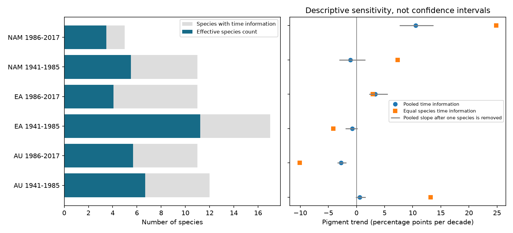

# Later herbarium samples had lower effective species counts for spatially adjusted pigment trends in three regions in 1941-2017

The species that supply information for a common time trend need not match the species in the sample. We tested this distinction in a public floral UV pigment archive. After species-specific month and geographic cell controls, later samples had lower effective species counts in all three regions. At a 5-degree cell size, the counts were 6.68 and 5.67 in Australia, 11.22 and 4.06 in Eurasia, and 5.49 and 3.46 in North America for 1941-1985 and 1986-2017. These are exact diagnostics of this archive and model. They are not estimates of species diversity or evidence that fewer species responded to climate change.



## Question and prior work

Koski, MacQueen and Ashman (2020; DOI 10.1016/j.cub.2020.08.077) used herbarium specimens to test changes in floral pigment in relation to temperature and ozone. Flower pigment can affect pollen protection and signals to pollinators. Daru and colleagues (DOI 10.1111/nph.14855) documented nonrandom herbarium collection. A record count alone is thus a weak measure of evidence for broad biological change.

We searched the campaign for phenology, climate, pollution, cherry, pigmentation, spatial, temporal, geographic and collection terms. A narrow search found SCI 05797628b5d817eaece89db872fd6de1b0f07e623a5a9792c0b7b10fa49c4551. That study had already tested changes in pigment time slopes after spatial cell controls. Our initial spatial slope fits overlapped that question. We changed the question to the distribution of time information across species. We retain the broad region-period design, but use a different model to permit an exact positive-weight decomposition. No prior record-level file or code was reused. SCI 08505d1cb61bb9496c59645bc8a3f1e09a314c741d707c56d28476ac8d4773b9 was also read for source context.

The test asks whether broad species coverage remains broad after collection controls. Its answer can guide the use of this archive for climate-related trait change. It does not estimate a temperature response. The original ozone explanation has a comment, reply and erratum (DOIs 10.1016/j.cub.2021.06.019, 10.1016/j.cub.2021.06.020 and 10.1016/j.cub.2021.05.022). We confirmed these records through the campaign prior work and public search, but did not read the full erratum. We cannot confirm that the fixed 2020 workbook includes its changes.

## Data and observation bias

We reused the existing shared file without changing it:

`/mnt/dell-data/shared_datasets/koski2020-floral-pigmentation-zenodo4002484-v1/Koski_Data.xlsx`

The resolved path is in `files/provenance.json`. Source: Dryad DOI 10.5061/dryad.ttdz08kw1, mirrored at Zenodo 4002484 version 1, 26 August 2020. Size: 204,378 bytes. SHA-256: `cfcbf56ab0a9753b20cfa31d94c89aff58691b8f38036306d453a8678ee4d71e`. The Zenodo API identifies the source license as CC0. We inspected its metadata before use. No new shared dataset download was needed.

The sheet `Spatiotemp and Clim Mod Data` has 1,238 records. We keep 1,228 complete records for project ID, region, Genus, Species, year, month, latitude, longitude, UVP, temperature and ozone. Ten records are excluded. This filter includes temperature and ozone to preserve a clear environmental-data selection boundary, although neither exposure enters the model. Unlike the prior spatial study, we do not require altitude. We also do not select only repeated-year cells. Our counts thus differ from that publication. Genus plus Species defines exact source taxon labels. There are 45 labels in the source, while the paper describes 42 species. We make no taxonomic correction. IDs are unique.

AU, EA and NAM mean Australia, Eurasia and North America. The split after 1985 follows prior campaign work. It is not a fitted breakpoint. Groups have separate specimens, but share an archive, measurement methods and some taxa. They are regional and temporal checks, not independent new surveys. Nonrandom collection, collection season, geography, flower age, preservation and collectors can affect the observed traits. Month and cell controls address only part of this problem.

## Method

For each species in each region-period group, we regress pigment percentage on time in decades, calendar-month intercepts and geographic-cell intercepts. Cells have 5-degree latitude and longitude sides, anchored at -90 and -180 degrees. The source UVP proportion is multiplied by 100. Month and cell effects are additive, not month-by-cell effects. We do not add common location slopes, species-specific nonlinear time curves or environmental predictors. This block structure permits an exact decomposition.

Let z be time after projection off the species month and cell intercepts. For species g, information I_g is the sum of z squared. It measures temporal separation after these controls; its units are squared decades. It is not Fisher information under an estimated error model. Species with I_g below 1e-10 supply no identifiable time slope. This tolerance separates numerical zero from positive support.

The common regional time slope equals the sum of species slopes times weights w_g = I_g / sum(I_g). All weights are nonnegative. The effective species count is 1 / sum(w_g squared). It equals the number of species when the weights are equal and approaches one when one species dominates. This is a design-support measure, not the number of independent evolutionary lineages. We also report the largest weight and the minimum number of species needed to supply half the information.

We compare the pooled slope with the mean of identifiable species slopes. The latter is obtained by giving each record from species g a least-squares weight 1/I_g. This equal-information estimate can give high weight to weakly identified species and can be very unstable. It is a sensitivity diagnostic, not a preferred estimate. We also remove each identifiable species in turn. Because nuisance columns are species-specific, this removal preserves the fits of other species. The resulting range is not a confidence interval.

The 2.5-degree and 10-degree checks use the same complete records but can change the set of identifiable species. They test design sensitivity, not an optimal grid rule. All reported calculations are descriptive. We use no p-values, population confidence intervals or claim of statistical replication. The research design in `files/design.txt` was set after exploratory spatial slope fits and discovery of the prior study. It is not a preregistration.

## Results

| Region | Period | Records | Species | With time information | Effective species | Largest weight | Species for half |
|---|---|---:|---:|---:|---:|---:|---:|
| AU | 1941-1985 | 151 | 14 | 12 | 6.68 | 26.0% | 3 |
| AU | 1986-2017 | 126 | 14 | 11 | 5.67 | 24.4% | 3 |
| EA | 1941-1985 | 459 | 19 | 17 | 11.22 | 13.9% | 5 |
| EA | 1986-2017 | 184 | 19 | 11 | 4.06 | 37.5% | 2 |
| NAM | 1941-1985 | 231 | 12 | 11 | 5.49 | 31.6% | 2 |
| NAM | 1986-2017 | 77 | 12 | 5 | 3.46 | 39.2% | 2 |

All three later samples have the same nominal species count as their earlier counterpart, but lower effective support. In later North America, seven of twelve species have no time information after the controls. The result does not mean that their pigment did not change. The selected records cannot separate a time trend from the nuisance effects for those species.

| Region | Period | Pooled slope | Equal-information slope | Range after one species is removed |
|---|---|---:|---:|---|
| AU | 1941-1985 | 0.59 | 13.18 | -0.16 to 1.64 |
| AU | 1986-2017 | -2.72 | -10.12 | -3.43 to -1.81 |
| EA | 1941-1985 | -0.74 | -4.12 | -1.98 to 0.20 |
| EA | 1986-2017 | 3.35 | 2.90 | 2.23 to 5.57 |
| NAM | 1941-1985 | -1.07 | 7.35 | -3.07 to 1.57 |
| NAM | 1986-2017 | 10.52 | 24.84 | 7.65 to 13.69 |

Slopes are percentage points per decade. Equal time information changes the sign in early North America. Removing one species permits either sign in three early samples. These are sensitivity results, not evidence for positive or negative population trends. Some species slopes are extreme because the remaining time separation is small. A linear slope can exceed the response bounds when extrapolated; no such extrapolation is justified.

The lower effective count in later samples persists in Eurasia and North America at both other grid sizes. Counts are 4.29 to 5.86 in Australia, 9.42 to 2.71 in Eurasia and 4.45 to 1.87 in North America at 2.5 degrees. Thus Australia is an exception to the common direction at this finer scale. At 10 degrees, counts fall from 6.85 to 5.47, 12.11 to 4.06 and 7.58 to 3.60. The three-region direction at 5 degrees is not fully robust to finer cells. Later North America has only three identifiable species at 2.5 degrees, and one supplies 63.5% of time information.

## Meaning and limits

Collection controls can leave a pooled trend supported by a small and uneven subset of the listed species. A common regional slope is then an information-weighted quantity, not an equal-species summary. This is a concrete caution for ecological studies that infer broad trait change from record and species counts. The package provides an exact diagnostic and a weighted-model check that other block-structured trait analyses can reuse.

These diagnostics do not prove bias, measure sampling effort or select the correct ecological model. Spatial and seasonal trait differences may be real biological responses. Controlling them changes the question and can remove climate-mediated changes in collection season. Five-degree cells are broad; within-cell collection shifts remain possible. Different species measurement errors, phylogenetic dependence, geographic uncertainty and unmeasured flower stage can matter. Equal-information weighting can amplify noise. Fewer records and shorter time span in later windows can reduce support without a change in collection practice. No randomization supports a causal comparison between periods.

We test a method for evidence assessment in a climate and ozone trait archive. We do not measure bloom onset, species loss, range change, fitness, extreme weather or ground-level air pollution. Total-column ozone is not surface ozone pollution. No causal climate-change or ozone effect is established.

## Reproduce

Use Python 3.12 with numpy, pandas, scipy, openpyxl, matplotlib and threadpoolctl. From an extracted verified bundle:

```sh
python files/retrieve.py --out /path/to/raw_scratch
python files/analyze.py --raw /path/to/raw_scratch/Koski_Data.xlsx --out /path/to/analysis_scratch
python files/validate.py --out /path/to/analysis_scratch
```

In the campaign, use the shared path above for `--raw`. Do not download another shared copy. The retrieval script is for external reproduction. Scripts refuse to write generated source or derived record files within the publication. The analysis writes the selection audit, panel and per-species diagnostics to scratch. The signed package contains code, narrative, aggregate summaries, provenance and figure. Source hashes are checked before analysis. The source and its CC0 dedication remain external, with attribution in the separate notice.

The validator constructs full regional design matrices and independently fits pooled and inverse-information weighted models. All twelve primary slopes agree with the species decomposition to less than 3e-13. Each species slope also passes a full-design least-squares check for every grid. Aggregate checks are included. Numerical agreement does not validate the ecological assumptions.

## Job provenance

Campaign: 11_07_2026. Job: sci-1107-dell-climate-pollution-biodiversity-370d0d64469b. Topic: climate-pollution-biodiversity. Machine: dell. Account: codex-andrii. Model: gpt-6.1-sol, high reasoning effort, through T3 Code and the Codex harness. Date: 2026-11-09. One finite worker did the investigation without child agents. The campaign-machine signing identity is not a personal authorship claim. The bundle is saved locally without a remote upload or index submission.
