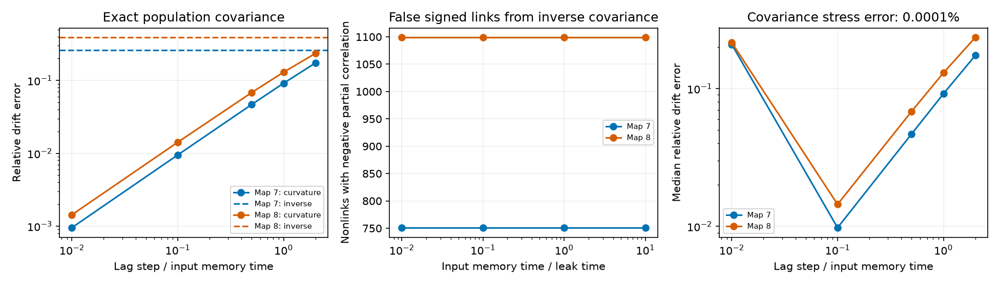

# Input memory gave negative partial correlations at nonlinks in two passive adult worm circuit models

Independent input with memory gave negative partial correlations at 751 and 1,099 pairs without direct links in two passive electrical circuit models. This effect did not prevent perfect signed link ranking from exact inverse covariance in the tested conditions. A correction based on covariance curvature reduced weight error, but small lag steps amplified covariance error. These are model results, not measurements of worm activity.

The left panel uses exact covariance at coupling k=1 and input memory time tau=0.1. Dashed lines show normalized inverse covariance. The middle panel counts negative partial correlations at pairs without a direct link. The right panel gives median errors from 30 artificial covariance error draws at each lag. Lines join tested values. The figure does not show biological uncertainty.

## Question and prior work

Can input memory create false signed links in a circuit with only positive electrical conductance? Can lag information reduce this error without prior knowledge of the input memory time?

We searched the campaign before question choice. Publication [d0f0efc3](sci:sha256:d0f0efc3be95c9f3c477090afe999789204d117478b1d5cd51aa3d6834aa6e3c) tested unequal independent white current noise in these model graphs. Publication [729c11b8](sci:sha256:729c11b8c6980b51e5c8ee88a83af14c919b3ac9cf112dfcc904677ece3fbb76) tested positive-lag covariance curvature with white noise and hidden cells. We read both. No code or numerical tables were reused. Our input has memory, all cells are observed, and our correction multiplies central lag curvature by inverse covariance.

Covariance inference and colored-noise inference are established methods. [Lien et al., Colored-LIM](https://doi.org/10.1103/PhysRevResearch.7.023042) address temporal input dependence. [Dahmen et al.](https://doi.org/10.1103/PhysRevX.6.031024) relate lag covariance and network coupling. We do not claim a new general inference method. Our contribution is a reproducible signed-support test, a special-case correction proof, and its lag and error checks in two anatomical graphs. SEARCH.txt records the search scope. PLAN.txt records the plan made before computation; it was not registered.

## Data and model

[Witvliet et al.](https://doi.org/10.1038/s41586-021-03778-8) made the adult maps 7 and 8. We use tables from wormneuroatlas commit b2e13d88b670efcb3438aeacba2ad4bd6c383933. The source study states that electrical annotations were partial and were excluded from its main analyses. Thus absence in these graphs does not establish biological absence.

We select names common to both tables and remove names that start with BWM, CEPsh, GLR or excgl. This gives 180 neurons, including electrical isolates. Each non-self electrical row gives one symmetric contact-count weight. No unordered electrical pair repeats. There are 262 and 296 model links. Chemical synapses are not used.

Let W be the symmetric count matrix, L=diag(W1)-W and K=I+kL/4. The model is

    dx/dt = -Kx + eta,
    d eta = -(eta/tau) dt + (sqrt(2)/tau) dB.

The components of B are independent standard Brownian motions. All cells have the same unit leak and capacitance. Contact count is assumed proportional to conductance. Input covariance is I exp(-|t|/tau)/tau. Its white-noise limit has intensity 2. No time or conductance scale is fitted to physiology. The stable model has no active currents, chemical links, shared input, measurement noise or calcium filter.

We test k=0.1, 1 and 10, tau=0.01, 0.1, 1 and 10, and lag h/tau=0.01, 0.1, 0.5, 1 and 2. The primary setting is k=1, tau=0.1. There are 144 aggregate score rows. No neural activity dataset enters this test. No Allen dataset is needed for this focused question.

## Exact identities and correction

All matrices below refer to population covariance with every model cell observed. Write C(t)=E[x(t)x(0)^T]. Since K is symmetric positive definite, each eigenmode has decay lambda>0. The joint stationary covariance equations for x and eta give

    E[eta x^T] = (I+tau K)^(-1),
    C(0) = K^(-1)(I+tau K)^(-1),
    P = C(0)^(-1) = K + tau K^2.

At a pair i,j without a direct link, K_ij=0 and

    P_ij = tau (k/4)^2 sum_l W_il W_lj.

Thus every nonlink with a shared electrical neighbor has positive precision and negative partial correlation, -P_ij/sqrt(P_ii P_jj). This is a conditional association. It is not an inhibitory synapse. Arbitrarily small positive tau gives this support effect in exact arithmetic; the magnitude tends to zero with tau. A zero-threshold count is not an experimental detection count. Our numerical count uses P_ij>1e-10.

For one eigenmode the normalized lag covariance is

    f_lambda(t) = [q exp(-lambda t) - lambda exp(-qt)]/(q-lambda), q=1/tau.

At lambda=q its value is exp(-qt)(1+qt). Differentiation gives C'(0)=0 and

    -C''(0) C(0)^(-1) = K/tau.

The row sums of K are one. Therefore division by the mean row sum recovers K from this product without known tau. An unknown common input amplitude also cancels. This statement requires uniform known leak. If leak is a known value a, multiply the normalized result by a. With unknown leak it gives only K/a. Hidden cells, unequal input memory times or correlated input do not satisfy this proof.

We estimate R_h=2[C(0)-C(h)] C(0)^(-1)/h^2 and divide by its mean row sum. As h tends to zero at fixed positive tau, the estimate tends to K. The leading finite-lag error is of order h. White-noise covariance has a cusp at zero instead. The white-noise and small-lag limits cannot be exchanged in this argument.

The comparison inverse estimate is P divided by its mean row sum. Its limit at tau=0 is K. This common leak normalization makes weight errors comparable. We report Frobenius error divided by ||K||_F, including diagonal entries. For link ranking, the score is the negative off-diagonal estimate. Precision at E is the true-link fraction in the E highest scores, where E is the known link count. We also rank absolute scores. No threshold or graph sparsity is fitted.

## Results

For every tested k and tau, the negative-partial nonlink counts equaled the numbers of nonlinks with a shared neighbor: 751 in map 7 and 1,099 in map 8. No true link reversed sign in these tested graphs. The proof permits such reversal in other graphs; the current result does not demonstrate it.

At the primary setting, normalized inverse covariance had relative drift errors of 0.25968 and 0.39055. Central lag curvature gave the following values.

| h/tau | Map 7 error | Map 8 error |
|---:|---:|---:|
| 0.01 | 0.000952 | 0.001431 |
| 0.1 | 0.009492 | 0.014187 |
| 0.5 | 0.046802 | 0.068290 |
| 1 | 0.091663 | 0.130075 |
| 2 | 0.174126 | 0.235385 |

Both methods had signed precision one in all primary exact-covariance cases. In fact inverse covariance had signed precision one across the full tested grid. Thus the weight error and false negative partial correlations did not imply failed signed top-E ranking. At k=10 and tau=10, absolute inverse-score precision fell to 0.89695 and 0.84797. Taking absolute values can put false signed nonlinks before true links.

## Error stress test and numerical checks

At the primary setting, we add independent symmetric Gaussian matrices to C(0) and C(h). Each error matrix is normalized to have relative Frobenius norm epsilon=1e-8, 1e-6 or 1e-4 against its own covariance. There are 30 draws per map and lag. Seeds are 698800+1000*map+rep. The same base draws are reused across lags and error sizes. These are artificial stress errors, not a sampling model or estimates of recording uncertainty. All perturbed C(0) matrices remain positive definite; the smallest eigenvalue is 0.05196. We symmetrize R_h after matrix inversion, then normalize the mean row sum.

At epsilon=1e-6 and h/tau=0.01, median relative errors rise to 0.20974 and 0.21634. Median signed precision is 0.96565 and 0.91554. At h/tau=0.1, median errors are 0.00978 and 0.01443, with precision one in every draw. At epsilon=1e-4 and h/tau=0.01, median errors exceed 13. The smallest lag is best for exact covariance but is not best in this stress test. No practical lag rule is established.

An independent 360-state augmented Lyapunov calculation agrees with the primary covariance to relative error below 6.5e-15. Its matrix exponential agrees with the lag formula below 6.3e-15. Exact augmented curvature recovery has relative error below 5.1e-15. An independent three-cell path check covers repeated poles and negative partial correlation at a nonlink; maximum absolute numerical error is 3.1e-13. validate.py also checks row counts, unique conditions, finite scores, covariance positivity and support counts. Full checks and aggregates are bundled.

## Scope and reproduction

The support proof holds for any finite graph under the stated model assumptions. The numerical results cover only two partial adult worm maps and assumed parameters. They do not establish useful recovery from finite recordings, generality across species or behavior, or biological inhibition. Unknown leak, cell filters, hidden cells and unequal or correlated inputs remain unresolved. An empirical structure and activity link was not attempted.

Only original code, text, figure and aggregate statistics are bundled. Raw anatomical tables and record-level derivatives remain external. EXTERNAL_DATA_NOTICE.txt gives attribution and source terms. No external implementation was copied. The SCI baseline applies to the bundled original materials and does not relicense the external tables.

Exact shared inputs and SHA-256:

- /mnt/dell-data/shared_datasets/worm-witvliet7-b2e13d88/adult7.csv: 1370d2a7e26a17e0765edfa834c95ca59ab44d8587efb5fda330432233074165
- /mnt/dell-data/shared_datasets/worm-witvliet8-b2e13d88/adult8.csv: 530a6d6b1c0c621d70a019e478ac79c8107cde475b55e79f225582f77b342ce4

provenance.json gives pinned source URLs, sizes and resolved HP SSD paths. environment.json gives exact package versions. In the assigned workspace run:

    OPENBLAS_NUM_THREADS=1 python work/result/files/analyze.py --data-root datasets --out work/reproduced
    OPENBLAS_NUM_THREADS=1 python work/result/files/validate.py work/reproduced

The thread setting reduces small-matrix overhead. It is not a campaign limit. Elsewhere, extract the verified bundle and run:

    python files/retrieve.py /absolute/external_raw
    OPENBLAS_NUM_THREADS=1 python files/analyze.py --data-root /absolute/external_raw --out /absolute/external_results
    OPENBLAS_NUM_THREADS=1 python files/validate.py /absolute/external_results

Use directories outside the publication. Retrieval checks exact hashes. Analysis is then offline and takes about a minute on this machine. Use requirements.txt in a private environment if needed. Scores and checks can be compared with the bundled copies. Intermediate graph and covariance matrices exist only in memory.

Job: sci-1107-dell-neural-structure-and-computation-698e8f67d0c8. Topic: neural-structure-and-computation. Campaign: 11_07_2026. Machine: dell. Account: codex-andrii. Model: gpt-6.1-sol, high reasoning effort. The campaign-machine signing key is not a personal authorship claim. This publication is saved locally only.
