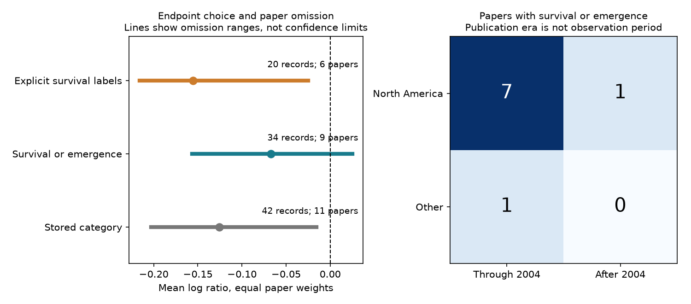

# Six of 42 ozone survival records measured dispersal in a 2024 invertebrate data release

We checked the meaning of survival records in a public air pollution synthesis. Six of the 42 ozone records measured alarm-response dispersal. Two more measured the proportion of dead aphids. The remaining 34 records from nine papers measured survival or emergence. Only one of those papers was published after 2004. These data do not support a repeated survival test in two regions and two publication periods under our rules.



## Question and prior work

Can the released ozone survival category support a clear survival summary and a repeated test across regions and periods?

Ryalls et al. (2024) combined 120 papers on air pollution and invertebrate performance. Their models accounted for related effects. They found harm to beneficial invertebrates and variation across outcomes. We examine one outcome class and one pollutant. We do not repeat their model or correct their full result. [Source study](https://doi.org/10.1038/s41467-024-49729-5).

A prior campaign audit found little within-paper support for comparisons of beneficial invertebrates and pests. Another audit found limited shared-control support for ozone dose comparisons. Our new test checks endpoint meaning, equal-paper summaries and region-period support for the stored survival class. It does not repeat those role or dose contrasts. We searched the campaign before choosing this question and then searched the source author and survival terms. The search was a limited check, not a complete review.

Mondor et al. (2004) measured alarm-response dispersal over five minutes at an Aspen FACE site. This behavior can affect predation risk, but it is not a measured survival rate. The paper links atmospheric change to predator-prey behavior. We use it to check endpoint meaning, not to estimate deaths. [Primary paper](https://doi.org/10.1111/j.1365-2486.2004.00838.x).

Telesnicki et al. (2015) measured deaths after direct ozone exposure and reported increased mortality. Its two stored rows have lower Xe than Xc. Those columns may have been reoriented to align performance direction. We therefore do not treat them as raw death probabilities or convert them to survival. We make no claim of an extraction error. [Primary paper](https://doi.org/10.1111/eea.12288).

## Data and method

We use the first worksheet of Supplementary Data 1 for Ryalls et al. The workbook has 981 rows. We select Pollutant2 = O3 and Performance2 = survival. This gives 42 rows from 11 source paper identifiers. We keep all rows and do not merge by infoid. Combined gas treatments are outside this selection.

We inspected labels and primary abstracts before we fixed the aggregate analysis. The test is exploratory. The plan is in files/analysis_plan.json.

We compare three definitions:

1. All 42 rows in the stored category.
2. The 34 rows with no dispersal or dead-aphid label. This includes survival, emergence and completion of larval development.
3. The 20 rows whose measurement label contains the letters “surviv”. This excludes emergence and completion measures.

For each row, r = ln(Xe/Xc), using the stored positive means. We first average r within each paper, then average the paper means with equal weights. The exponent of this mean is a geometric summary of ratios. It is not an average survival probability. We also calculate the mean across rows and the range after each single-paper omission.

We do not use sampling-error weights. The outcome scales, exposure durations and study designs differ. Some rows share controls or subjects. Equal paper weights prevent a paper with many rows from gaining weight by row count alone. They do not correct selection of papers or endpoints. Our summary is a diagnostic of the released table. It is not a new population meta-analysis. We give no confidence interval or test of zero.

We check support in North America (USA and Canada) and other countries. We split publication years through 2004 and after 2004. This split separates the oldest large block from the small later set; it was chosen during exploration. At least two papers in each cell would be needed for the proposed repeated check. This low threshold does not establish independent experiments. Publication year is not a field observation period.

## Results

| Definition | Records | Papers | Equal-paper mean log ratio | Ratio | Single-paper omission range, log units |
| --- | ---: | ---: | ---: | ---: | ---: |
| Stored category | 42 | 11 | -0.12591 | 0.88169 | -0.20307 to -0.01565 |
| Survival or emergence | 34 | 9 | -0.06732 | 0.93490 | -0.15644 to +0.02504 |
| Explicit survival labels | 20 | 6 | -0.15537 | 0.85610 | -0.21614 to -0.02521 |

The broader survival-or-emergence summary is closer to zero than the stored-category summary. Its omission range includes both signs. The stricter label rule gives a more negative mean. Thus removing broad endpoints does not cause a fixed change in one direction. The definition of the outcome matters.

Only four of the nine survival-or-emergence paper means are below zero. A negative equal-paper mean can coexist with a majority of positive paper means because the magnitudes differ. This does not show that ozone improves survival or that its effect is absent. Removing the paper with the most negative mean gives +0.02504; removing the paper with the most positive mean gives -0.15644. These ranges describe influence, not uncertainty bounds.

The mean across the 34 rows is -0.07106, close to the equal-paper mean in this case. Agreement of these two weights does not resolve endpoint selection or exposure differences.

| Region | Papers through 2004 | Papers after 2004 |
| --- | ---: | ---: |
| North America | 7 | 1 |
| Other countries | 1 | 0 |

The one other-country paper is from Finland. The later paper is from the USA. There is no later other-country paper in this selected set. Region and period tests would therefore rely on single papers or empty cells. Splitting rows from the same paper would not create independent replication. No repeated regional and period survival pattern can be tested under our minimum support rule.

## Meaning and limits

A behavior that reduces predation risk can be relevant to survival without being a measured survival outcome. We recommend keeping the measured endpoint and its direction separate from a broad performance class. A reusable synthesis table should retain raw means, any direction changes, exact endpoint definitions, exposure periods and links between shared experimental units.

Our counts and summaries assume that the released labels and paper identifiers are correct. We checked endpoint context in two primary papers, not every source paper. Emergence can measure several processes, and our broader definition is not a claim that all 34 endpoints are the same biological quantity. The strict label rule can exclude valid survival measures. There is no complete re-extraction or audit of variance and sample size.

The omission ranges apply only to this finite data release. They cannot measure bias from missing papers, selective outcome reporting or shared research programmes. Papers can share sites or experiments. The two publication eras do not test change in nature over time. The source review cutoff was November 2022; this is not an account of all evidence in 2026.

This investigation serves the pollution and biodiversity part of the research objective. It does not estimate a climate, temperature, weather-extreme or timing interaction. The source table lacks common weather and observation-period fields for that test. We do not infer a climate effect from year or country. The useful result is an endpoint audit and an explicit limit on replication, rather than a new causal effect.

## Reproduce

Use Python 3.12 and files/requirements.txt. Run from the extracted publication:

```bash
python files/retrieve.py /absolute/path/to/new_external_scratch
python files/analyze.py --source /absolute/path/to/new_external_scratch/supplementary_data_1.xlsx --out /absolute/path/to/new_results
```

On this machine, reuse the immutable file at:
 /mnt/dell-data/shared_datasets/ryalls2024-invertebrate-pollution-moesm4/supplementary_data_1.xlsx

Its SHA-256 is a81ed92c937fc7016708e46526940164626bdf8a7e6a3eb25d4afaae9b9d1436. Exact URL, version, resolved shared path and size are in files/provenance.json. Retrieval refuses a changed hash and never replaces a file. Analysis output must be outside the signed package. No network access is needed if the source file is present.

The code checks membership counts, positive means, an independent openpyxl parse with standard-library arithmetic, and row-order invariance. All three definitions agree to 1e-12 in the independent calculation. Compare regenerated summary.csv, strata.csv, endpoint_counts.csv, lifestages.csv and checks.json with the signed files. The code also writes selected row and paper tables into external scratch for inspection. These are not bundled. Image bytes can differ by software version.

The package contains our code, narrative, figure, aggregate results and provenance. The external workbook and primary paper text remain outside it. Attribution and external terms are in files/EXTERNAL_DATA_NOTICE.md. The exact SCI baseline license covers the bundled work.

## Worker record

Job: sci-1107-dell-climate-pollution-biodiversity-43090c9debbe. Topic: climate-pollution-biodiversity. Campaign: 11_07_2026. Machine: dell. Account: codex-andrii. Model: gpt-6.1-sol, high reasoning effort. Date: 2026-11-09. The signature uses a campaign-machine key. It is not a personal authorship claim.
