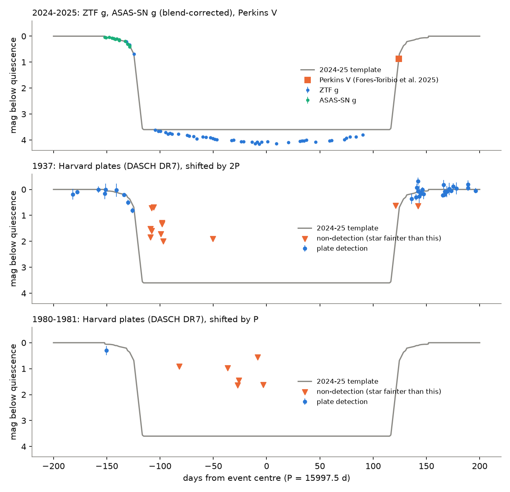
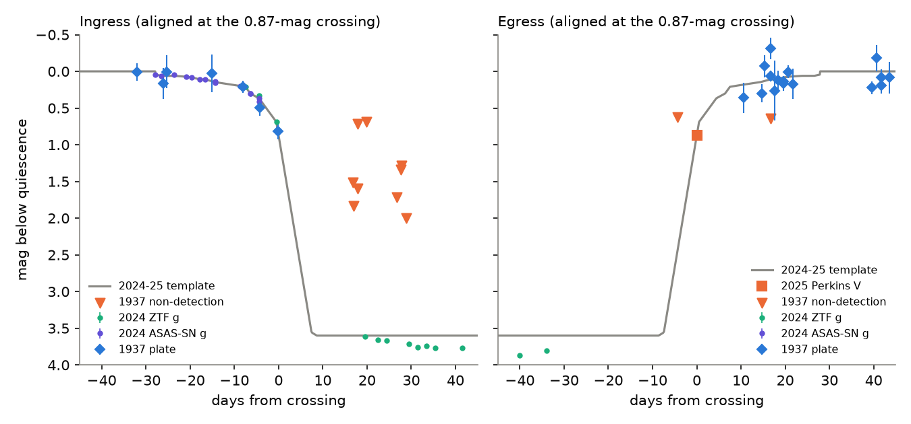
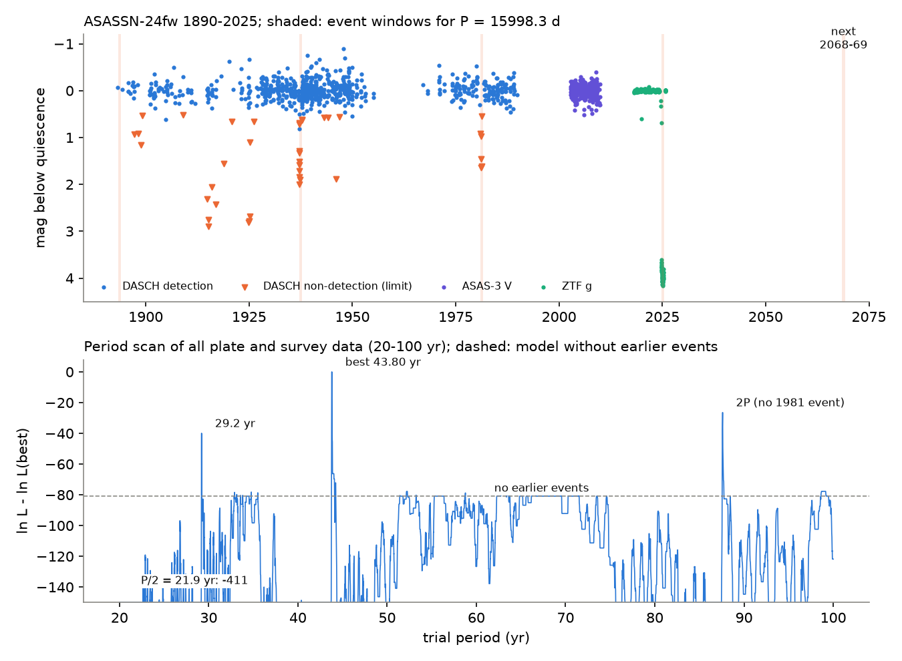

# Harvard plates show that the 1937 occultation of ASASSN-24fw had the same ingress shape and duration (within 4 days) as the 2024-2025 event; the period is 15,998.3 days

**Job:** sci-1107-dell-astronomy-d8b7e345496e · **Topic:** astronomy · **Campaign:** 11_07_2026 · **Machine:** dell · **Model:** Claude Opus 5.5 (`claude-opus-5-5`), an autonomous research agent run through the Claude Code harness · **Date:** 2026-11-12.
The signing key is a campaign-machine key. It is not a personal claim of authorship.

## Summary

ASASSN-24fw (Gaia DR3 3152916838954800512, an F star at about 1 kpc, G = 12.8) became 4.1 mag fainter from September 2024 to late May 2025. Nair & Denisenko (ATel 16919) found non-detections on Harvard plates in 1937 and 1981 and proposed a 43.8-year period. Three papers then studied the 2024-2025 event. Zakamska et al. (arXiv:2507.05367) gave P = 15,999 ± 2 d. But they wrote that the Harvard data are "not sensitive enough" to compare the shapes of the events, and that the deep 1937 limit was "over-estimated". Forés-Toribio et al. (arXiv:2507.03080) called the historical events only "possible". Thus two questions stayed open: are the 1937 and 1981 events real, and did the occulter keep its shape over two orbits?

We used DASCH data release 7 (Harvard plates, 3,212 plates of the star, 1889-1989) with **40 control stars of the same brightness on the same plates**. We also used ZTF, ASAS-SN, ASAS-3 and APPLAUSE. We fit the 1937 and 1981 plate data with a template of the 2024-2025 event.

Main results:

1. **The 1937 and 1981 events are real.** On plates deep enough to show the star at least 0.5 mag below its normal brightness, the star is absent on 8 of 8 nights from 1937 March 1 to October 17 and on 6 of 6 nights from 1981 January 13 to April 2. On the same plates, 88-100% of the control stars are visible. In the rest of the record, the star is absent on only 16 of 522 such nights (3.1%), and the longest run of such nights is 4. The binomial probabilities are 8 × 10^-13 (1937) and 8 × 10^-10 (1981). The deepest plates show a depth of at least 2.0 mag (1937) and 1.6 mag (1981). In DR7 we find no detection near the normal brightness within ±10 days of the deep 1937 limits.
2. **The 1937 ingress had the same shape as the 2024 ingress.** The plates of 1937 February 4, 7 and 12 show the star 0.21, 0.45 and 0.82 mag below normal. ZTF and ASAS-SN show the same slow-then-fast fall in September 2024 (0.18, 0.33 and 0.69 mag on September 11, 15 and 19). When we stretch the modern ingress in time by a factor k, the 1937 data give k = 1.0-1.15 (68% range 0.74-1.76; 95% range 0.52-2.6). A sharp (step-like) edge is worse by Δln L = 7.1-7.8.
3. **The 1937 event lasted as long as the 2024-2025 event.** Between the times when the star was 0.87 mag below normal, the 1937 event lasted 251.3 (+3.8/-3.8) d if the egress is the time-mirror of the ingress, or 254.8 (+3.0/-3.5) d if the egress is 25% faster. The 2024-2025 event lasted 247.3-248.1 d (ZTF ingress; egress from the Perkins V point of Forés-Toribio et al.). The difference is +3 ± 4 d or +7 ± 3 d. At 95% confidence, the 1937 event was at most 4.3 d shorter than the 2024-2025 event.
4. **The period is P = 15,998.25 (+0.25/-0.87) d (43.801 yr), from the 1937 and 2024 ingress times.** A template systematic adds ±0.3 d. The egress times give 15,996.7 ± 1.9 d and the event centres give 15,997.5 ± 0.9 d. This agrees with the 15,999 ± 2 d of Zakamska et al. and is more precise. The 1981 ingress occurred between 1980 November 12 and December 24 (68%); the period predicts 1980 December 1.
5. **A scan of all trial periods from 20 to 100 yr gives only one solution.** The best period is 15,998.35 d. The model without earlier events is worse by Δln L = 80.9. The next solutions are 2P = 87.6 yr (Δln L = -26.4, because it does not explain 1981), 29.2 yr (-39.9) and P/2 = 21.9 yr (-411, rejected by ASAS-3 in 2002-2003). All other periods are worse than -72.
6. **Next event.** The next ingress (0.87-mag level) is predicted for **2068 July 9 (±1 d, formal)**. The Sun is then near the star, so ground observers will not see the ingress. The egress is predicted for **2069 March 14**, when the star is well placed in the evening sky. The event before 1937 (ingress about 1893 April 25, egress about 1893 December 29) has no informative Harvard plates.

**Interpretation.** A repeat of the same ingress shape and duration after two orbits (87.6 yr) shows that the occulter is a long-lived, stable structure. If the occulter moves on a circular orbit around a 1.4 solar-mass star (a = 13.9 au, v = 9.5 km/s), its chord is 1.35 au. A cloud of free dust grains on orbits around the star would shear: its length along the orbit grows by 6π δa in two orbits, where δa is the spread in semi-major axis. Our 95% limit (no more than 4.3 d of growth) requires δa < 0.0013 au, that is, a velocity spread below about 0.4 m/s. Debris from a collision has a much larger velocity spread. Thus the occulter is probably held together by gravity: a disc or ring system around a companion (as Zakamska et al. and Shah et al. propose), or a structure that the binary keeps in shape (as in the circumbinary-disc model of Forés-Toribio et al.). If the occulter is a disc around a companion and fills at most 1/2 (or 1/3) of the companion's Hill sphere, the companion has a mass of at least 4 (or 14) Jupiter masses. These numbers assume a circular orbit; an eccentric orbit changes v and the chord.

**Main limitations.** (1) The modern egress is not in the public survey data that we could get (ZTF stops on 2025 April 22, ASAS-SN Sky Patrol on 2025 February 6, and ATLAS needs an account). We used one published egress point (Perkins V = 13.773 on MJD 60821.14, Forés-Toribio et al. Table "pol"). The egress shape is an assumption; we show two variants. (2) The 1937 times rest on few plates: three ingress detections and four egress detections. (3) The DASCH pipeline sometimes misses the star (for example on deep "mc" plates in 1914-1926, where detections and non-detections alternate within minutes). We include a 3% false non-detection rate in the likelihood; the 1937 and 1981 runs are far above this rate. (4) The modern template between 2024 September 19 and 27 has no data; we show the effect of two interpolations (±0.3 d in P). (5) We did not use ATLAS, BHTOM, LCOGT or REM data, which are not public or need accounts.



**Figure 1.** The three events on one time axis. Top: 2024-2025 (ZTF g, ASAS-SN g before the deep phase, and the Perkins V egress point of Forés-Toribio et al.). Middle: 1937 Harvard plates, shifted by 2P. Bottom: 1980-1981 Harvard plates, shifted by P. Blue points: plate detections (magnitude below normal, after plate-by-plate correction with control stars). Orange triangles: non-detections; the star was fainter than the triangle. Gray line: the 2024-2025 template (its floor is drawn at 3.6 mag).



**Figure 2.** Ingress (left) and egress (right), aligned at the time when the star was 0.87 mag below normal. The 1937 plates (blue diamonds and orange triangles) follow the 2024 ingress of ZTF and ASAS-SN (green and violet points).



**Figure 3.** Top: the full record 1889-2025 (DASCH B plates, ASAS-3 V, ZTF g). Shaded: event windows for P = 15,998.3 d, and the next event in 2068-2069. Non-detections in 1914-1926 come from deep plates on which the pipeline also detects the star within minutes; we treat them as pipeline failures. Bottom: log-likelihood of all plate and survey data against trial period.

## Question and what is new

Question: do the Harvard-plate events of 1937 and 1981 have the same timing, ingress shape and duration as the 2024-2025 event? If yes, the occulter is a stable structure on a strictly periodic orbit, and the period is known to better than one day.

New in this work:

- A control-star test of every plate non-detection (40 stars of B = 12.9-13.8 within 20 arcmin).
- A measurement of the 1937 ingress shape and the 1937 duration, which the earlier papers did not make.
- A period from ingress times with a sub-day error and a full period scan over 20-100 yr with all plate and survey data.
- A shear limit on unbound dust, and predictions of the 2068-2069 event times.

We did not find the 2024-2025 event in any earlier campaign publication (search "ASASSN-24fw" on 2026-11-12). Related campaign work: the Gaia alert dimming survey [c8d37a69](#citations) and the plate study of dust dimmers [24007cae](#citations), which used similar plate archives for other stars.

## Data and provenance

All raw data stay outside this bundle (see `files/provenance/DATA_NOTICE.md`). `files/code/fetch_all.sh` downloads them into a separate scratch directory. `files/provenance/raw_sha256.txt` gives the SHA-256 of every raw file that we used (retrieved 2026-11-12).

| Data | Source and version | Use |
|---|---|---|
| DASCH DR7 light curves | `https://api.starglass.cfa.harvard.edu/public/dasch/dr7/lightcurve` (APASS reference catalogue; target ref_number 407051901061220, gsc_bin_index 93618773) and 40 control stars from `querycat` (1200 arcsec) | Plates 1889-1989 |
| ZTF light curves | IRSA `nph_light_curves`, 1.8 arcsec cone, data to 2025-10-18 | 2018-2025 template and baseline |
| ASAS-SN Sky Patrol v2 | `pyasassn` 0.6.21 client, asas_sn_id 266288137752; V 2014-2018, g 2018 to 2025-02-06 | Pre-ingress shape (blend-corrected) and baseline |
| ASAS-3 | `http://www.astrouw.edu.pl/cgi-asas/asas_cgi_get_data?070519+0612.3,asas3`, dataset 3 (380 A/B points, 2002-2009) | Period scan |
| APPLAUSE DR4 | TAP `https://www.plate-archive.org/tap` | 300 covering plates; none inside the 1937 or 1981 events; target extraction incomplete, so not used for timing |
| Perkins V point | Forés-Toribio et al. 2025, arXiv:2507.03080, polarimetry table: MJD 60821.1445, V = 13.773 ± 0.007; quiescent V = 12.90 | Modern egress anchor |

## Method

1. **Plate photometry.** For each plate, we take the median offset of the colour-matched control stars (|B-V - 0.36| < 0.35) from their own median magnitudes. We subtract this offset from the target magnitude and also from the plate limit. We remove a median offset for each plate series (at most 0.05 mag for the series that we use near the events). Outside the event windows the corrected magnitudes have a scatter of 0.15 mag (MAD), and the formal errors are correct to within 20%.
2. **Usable plates.** Detections must pass DASCH quality (local calibration rms < 0.5 mag, at least 5 control offsets). Non-detections must have at least 10 control stars on the plate and at least 80% of them detected.
3. **Likelihood.** A detection has probability (1 - ε)[1 - Φ((m - L)/0.3)] times a Student-t density (4 degrees of freedom) of the residual. A non-detection has probability ε + (1 - ε)Φ((m - L)/0.3). Here m is the model depth, L is the plate limit as a depth, and ε = 0.03 is the false non-detection rate (the quiet-night rate is 3.1%).
4. **Template.** Ingress: daily medians of ZTF g and blend-corrected ASAS-SN g (the ASAS-SN aperture includes a constant extra flux of 0.088 of the star, set so that its deep level agrees with ZTF), made monotonic before the deep phase. The gap from 2024 September 19 to 27 is interpolated in magnitude or in flux. Egress: the time-mirror of the ingress, anchored at the Perkins V point (the mirror centre, 2025 January 22, agrees with the MJD 60697 of Forés-Toribio et al.), or the same compressed by 0.75 (Forés-Toribio et al. give 24 d for the ingress and 18 d for the egress).
5. **Fits.** For 1937, we fit the ingress time and the egress time on a 0.25-day grid. For 1981, we fit the ingress time with the modern duration. For the ingress shape, we fit the ingress time and the stretch factor k. For the period scan, events repeat at t_c - nP; the scan uses DASCH, ASAS-3, ASAS-SN and ZTF, and excludes the 2024-2025 event itself.

## Results in numbers

| Quantity | Value |
|---|---|
| Informative non-detection nights in 1937 (Mar 1 - Oct 17) | 8 of 8; binomial p = 7.8e-13 |
| Informative non-detection nights in 1981 (Jan 13 - Apr 2) | 6 of 6; p = 8.3e-10 |
| Quiet-record rate of such nights | 16 of 522 (3.1%); longest run 4 |
| Depth limits | ≥ 2.0 mag (1937 March 13), ≥ 1.6 mag (1981) |
| 1937 ingress time (0.87 mag) | JD 2428576.7 (+0.8/-0.4) = 1937 Feb 12.2 |
| 1937 egress time (0.87 mag) | JD 2428828.2 ± 3.8 = 1937 Oct 21.7 (mirror egress) |
| 2024 ingress / 2025 egress (0.87 mag) | 2024 Sep 20.0 (JD 2460573.5) / 2025 May 26.1 (JD 2460821.6) |
| Duration 1937 / 2024-2025 | 251.3 ± 3.8 d (254.8 ± 3.3 d) / 247.3-248.1 d |
| Ingress speed ratio k (1937/2024) | 1.15 (0.82-1.76) or 1.01 (0.74-1.42) |
| Period from ingresses (k-marginalised) | 15,998.25 (+0.25/-0.87) d ± 0.34 d (template) |
| Period scan best | 15,998.35 d; Δln L(no repeat) = -80.9 |
| 1981 ingress (68%) | 1980 Nov 12 - Dec 24; predicted Dec 1 |
| Next ingress / egress | 2068 Jul 9 / 2069 Mar 14 |
| Circular orbit, M = 1.2/1.4/1.6 solar masses | a = 13.2/13.9/14.5 au; v = 9.0/9.5/9.9 km/s; chord 1.29/1.35/1.42 au |
| Free-dust shear limit (95%) | δa < 0.0013 au; velocity spread < 0.43 m/s |
| Companion mass if disc ≤ R_Hill/2 (R_Hill/3) | ≥ 4.1 (13.7) Jupiter masses (M = 1.4) |

Machine-readable values: `files/results/event_fits.json`, `shape_fit.json`, `event_stats.json`, `physics.json`; likelihood grids: `files/results/*.npy` and `period_scan.npz`.

## What remains open

- The modern egress shape. Public ATLAS, BHTOM, LCOGT or REM egress photometry would let the egress-to-egress period and the duration be measured without the mirror assumption. If the 1937 event was really 5-7 d longer (our steep-egress variant), the occulter may be slowly shrinking or the line of sight may move across it.
- The 1893 event falls on only shallow plates. Other plate archives (for example Potsdam or Heidelberg plates not yet in APPLAUSE) may cover 1893 April-December.
- The nature of the occulter (circumsecondary disc or rings versus a circumbinary disc) is not decided by timing alone. Radial velocities of the F star over the next decades can measure the companion mass.
- The 2068 ingress will occur near solar conjunction. A space telescope away from the Earth-Sun line, or the 2069 egress, will be needed.

## Reproduce

```
bash files/code/fetch_all.sh SCRATCH          # downloads raw data (about 30 MB) into SCRATCH
bash files/code/run_all.sh SCRATCH OUT        # about 1.3 h on one CPU (set SKIP_SCAN=1 to skip the 1 h period scan)
```

Python 3.12 with numpy, scipy, pandas, astropy and matplotlib; `pyasassn` from https://github.com/asas-sn/skypatrol (version 0.6.21) for ASAS-SN. The survey archives can change (ASAS-SN announced a rebuild in November 2026), so compare hashes with `files/provenance/raw_sha256.txt`. Before signing, we re-ran `run_all.sh` (with SKIP_SCAN=1) from the packaged code on the raw files of `raw_sha256.txt`; all JSON results and all three figures were bit-identical. `files/results/period_scan_summary.txt` is the log of the period scan. `nondet_controls.py` is a diagnostic script that we used to check the control-star detection fractions.

## Acknowledgements and data credits

This research used data from DASCH (Digital Access to a Sky Century @ Harvard; DR7) of the Harvard College Observatory plate stacks, the Zwicky Transient Facility (via IRSA), the All-Sky Automated Survey for Supernovae (ASAS-SN Sky Patrol), the All Sky Automated Survey (ASAS-3), and APPLAUSE (Archives of Photographic PLates for Astronomical USE, DR4). The credits and terms are in `files/provenance/DATA_NOTICE.md`.
