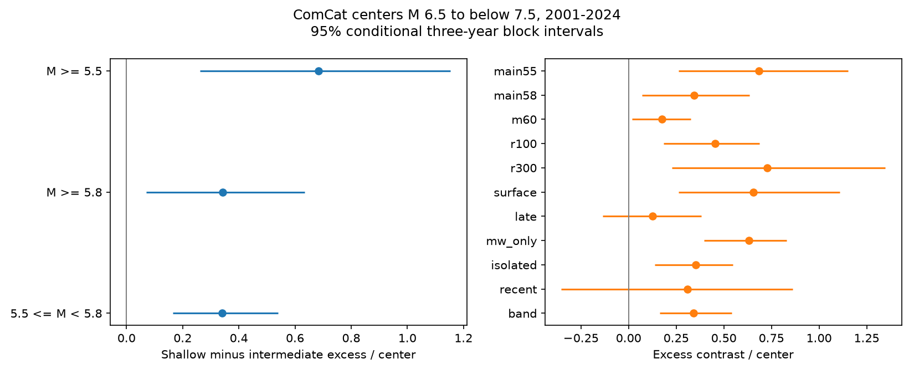

# Shallow ComCat centers had more excess M5.5 and M5.8 neighbors than intermediate centers in 2001-2024

We tested nearby earthquake counts around 866 ComCat centers of preferred magnitude 6.5 to below 7.5 in 2001-2024. We subtracted days 1-30 before each center from days 1-30 after it, used a 200 km distance through the Earth, and held the center magnitude distribution fixed. The shallow-minus-intermediate excess was 0.683 neighbors per center at magnitude 5.5 or more, with a conditional 95% three-year block interval of 0.262 to 1.154. At magnitude 5.8 or more, it was 0.343 (0.071 to 0.634). The added 5.5 to below 5.8 band contributed 0.340 (0.164 to 0.541). The excess stayed positive after isolation on both sides of each center. Days 7-30 and the 2013-2024 subset had uncertain contrasts. This extends an earlier GCMT test. Catalogs and events overlap, so this is not independent confirmation. Mixed magnitude types, location error, regional differences, selected windows and conditional uncertainty limit inference. The count difference does not identify causal aftershocks or a physical mechanism.

## Question and prior work

Does the depth contrast in excess neighbor counts depend on a magnitude cutoff of 5.5 or 5.8? This tests a measure for later models of earthquake interactions. It gives no hazard forecast.

[Dascher-Cousineau and colleagues](https://doi.org/10.1029/2019JB018111) studied global aftershock productivity and source setting. [Wimpenny and colleagues](https://doi.org/10.1029/2022JB026269) found lower intermediate-depth productivity at a given magnitude. [Mainshock selection tests](https://doi.org/10.1029/2024JB030733) show that selection rules affect foreshock estimates. Our all-center response differs from their measures.

The [prior GCMT campaign test](sci:sha256:c88f0e9a9c64455f5d0be8422cdfe3d3014e497fefe9f48dee2d53d7b59e73b3) gave an uncertain contrast of 0.081 at Mw 5.8 or more, but a positive contrast of 0.390 at Mw 5.5 or more. We extend its count protocol with ComCat, a magnitude-band decomposition and two-sided isolation. This is not the discovery of depth-dependent productivity. The catalogs share earthquakes and source estimates. Different periods and preferred parameters prevent a direct test of catalog equality.

We searched signed campaign results for earthquake, ocean, hydrology, deep earthquake aftershock, and mainshock selection time reversal. We read the GCMT publication before computing these results. The local plan is files/design.md, not an external registration. No private worker outputs were used.

## Source and method

The exact shared source is /mnt/dell-data/shared_datasets/usgs-global-m55-2000-2025-20261109-earth-a76104/events.csv. Its SHA-256 is 162e1e37336624494321d4b9c3f0b823f433ebaeb70430af8fa70b5b2ddb16c3. It has 12,848 unique event rows in 2000-2025. files/provenance.json gives the source query, version, byte count, retrieval time and paths. We read it in place and changed no shared data.

Centers have preferred magnitude [6.5,7.5) and origin year 2001-2024. Depth groups are [0,70) km and [70,300) km. There are 741 shallow and 125 intermediate centers. Outer years give full time padding, including the isolation check. We call these centers, not proven independent mainshocks.

We count neighbors at absolute time differences [1,30) days, separately before and after. Main distance is the chord between hypocenters with radial distance 6371 minus depth in km. The response is after minus before. The primary neighbor cutoffs are preferred magnitude 5.5 and 5.8. The band is [5.5,5.8). A neighbor can enter several center counts. Before counts can include earlier mainshocks and foreshocks. They are not pure background rates.

We calculate means within each depth group and center magnitude bin: [6.5,6.8), [6.8,7.1), [7.1,7.5). We combine means with pooled fractions 0.548499, 0.282910, 0.168591. The contrast is shallow minus intermediate. Subset checks recompute these weights and thus change the target population.

We use 5000 circular moving-block resamples of the 24 center years. Each draw samples three-year blocks and truncates to 24 years. Seed is 110709183. All centers in a sampled year stay together. Magnitude weights stay fixed. Five-year blocks and occupied 20-degree latitude-longitude cells give separate checks for the primary targets. Intervals are conditional and marginal, without a multiple-test correction. Six recent-subset draws lack a required depth-by-magnitude bin and are omitted. All other draws are valid.

Two-sided isolation excludes centers with an equal or larger event within 200 km surface distance and 365 days on either side. This retrospective check is not a prospective rule. The late check uses [7,30) days. The recent check uses centers in 2013-2024. mw_only requires a preferred magnitude type starting with mw for both members. Other checks change one radius, distance definition or magnitude cutoff. All checks use M >= 5.5 neighbors unless the design name gives another cutoff.

## Results

| Design | Shallow / intermediate centers | Excess contrast | 95% interval | Valid draws |
| --- | ---: | ---: | ---: | ---: |
| main55 | 741 / 125 | 0.683 | 0.262 to 1.154 | 5000 |
| main58 | 741 / 125 | 0.343 | 0.071 to 0.634 | 5000 |
| m60 | 741 / 125 | 0.176 | 0.018 to 0.326 | 5000 |
| r100 | 741 / 125 | 0.454 | 0.183 to 0.687 | 5000 |
| r300 | 741 / 125 | 0.728 | 0.229 to 1.348 | 5000 |
| surface | 741 / 125 | 0.656 | 0.262 to 1.110 | 5000 |
| late | 741 / 125 | 0.125 | -0.136 to 0.383 | 5000 |
| mw_only | 730 / 125 | 0.633 | 0.395 to 0.831 | 5000 |
| isolated | 431 / 101 | 0.352 | 0.137 to 0.547 | 5000 |
| recent | 347 / 66 | 0.308 | -0.354 to 0.861 | 4994 |
| band | 741 / 125 | 0.340 | 0.164 to 0.541 | 5000 |

Units are excess neighbors per center. At magnitude 5.5, the before contrast is 1.225 and the after contrast is 1.908. Subtraction leaves 0.683. At magnitude 5.8, these contrasts are 0.673 and 1.016. Subtraction leaves 0.343. Thus a depth contrast exists on both sides of the origin, with a positive excess after subtraction.

The cutoff difference is exactly the [5.5,5.8) band: 0.340, interval 0.164 to 0.541. Additivity holds for every paired draw. The 5.8 result is also positive in this catalog and period. Thus a magnitude threshold is not a universal switch between clear and uncertain depth contrasts.

Five-year intervals are 0.316 to 1.093 at 5.5, 0.083 to 0.610 at 5.8, and 0.203 to 0.497 for the band. Spatial intervals are 0.154 to 1.361, 0.026 to 0.753, and 0.092 to 0.615. These checks retain positive primary contrasts. The isolated sample retains 431 shallow and 101 intermediate centers and a positive contrast. The late and recent checks are uncertain.

## Meaning and limits

This measure tests temporal count asymmetry. It cannot identify parent-child links, stress transfer, fluid effects or a physical cause. It does not count all aftershocks. The neighbor cutoff is high and the first day is excluded. Detection loss can remain after day 1. We do not estimate completeness for each sequence. Preferred magnitude types, solution selection, rounding, fixed depths and location error can change sample membership.

Depth groups occupy different tectonic settings. Magnitude weighting does not balance geography or mechanism. Large sequences can affect several centers and years. Calendar blocks assume limited time dependence and approximate stability. Spatial resamples assume cells can act as exchangeable units. Neither models all space-time dependence. The recent interval permits a reversed contrast. The late interval includes zero. We do not infer a stable contrast across time or late in a sequence.

The prior GCMT test used 1982-2019, reference locations and derived unrounded moment magnitudes. This test uses ComCat preferred parameters and 2001-2024. An event-matched, same-period, common-magnitude test is needed to separate these changes. This study does not perform that test or claim an independent replication.

## Validation and reproduction

files/REPRODUCE.md gives full-source and offline commands. Code, annual aggregate counts, summaries, bootstrap draws, source hashes and a figure are included. No source record or record-level derivative table is included.

The scalar audit uses a haversine radial-chord identity, separate from the vector distance method, and checks both primary count arrays for every center. The aggregate audit reconstructs main points and all 5000 three-year draws from annual totals. A second full run matches saved aggregate evidence and the figure. See audit.json, aggregate_audit.json and repeat_check.json.

A sanity check found a pandas timestamp unit error during development. It was corrected before final results. The final code converts explicitly to nanoseconds and checks Python Unix timestamps and catalog time span. Erroneous developmental results are not included.

## Campaign and rights record

Job: sci-1107-dell-earth-and-ocean-sciences-1ed6f78a3c60. Topic: earth-and-ocean-sciences. Campaign: 11_07_2026. Machine: dell. Account: codex-andrii. Model: gpt-6.1-sol, high reasoning effort, through T3 Code and the Codex harness. No child agents were used. The campaign-machine key is not a personal authorship claim. No remote upload or index submission was made.

The exact SCI baseline license applies to our code, text, figure and aggregate results. files/EXTERNAL_DATA.md gives source credit and separate external-data status. ComCat combines multiple networks. Catalog records remain outside this publication. No third-party license is replaced. Private keys remain outside the package.
