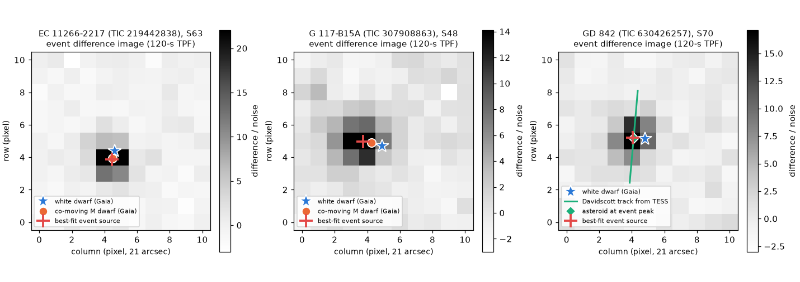
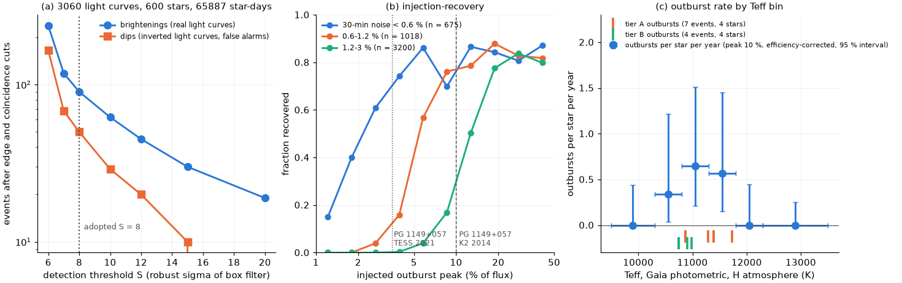
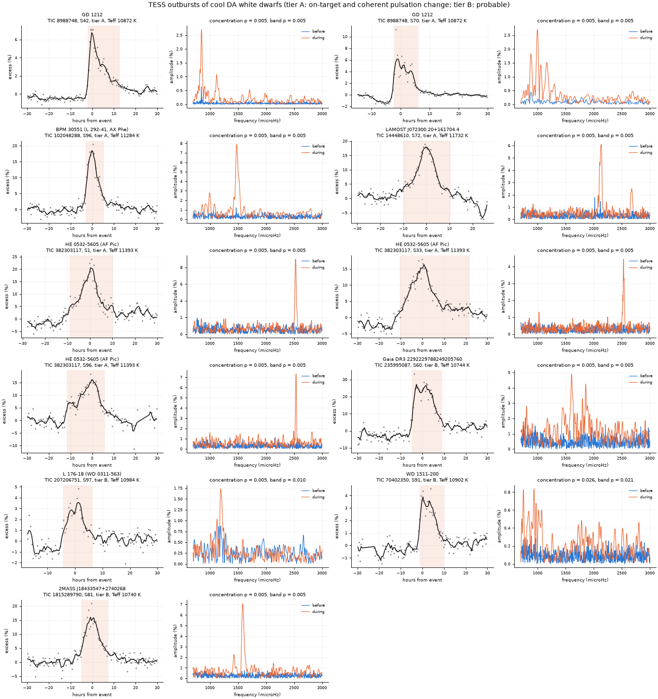

# TESS outbursts of cool ZZ Ceti white dwarfs: the three published TESS candidates are M-dwarf flares and an asteroid, and a 600-star search finds 11 outbursts in 8 white dwarfs, all at 10,700-11,800 K

**Job:** sci-1107-dell-astronomy-6775b959b18b · **Topic:** astronomy · **Machine:** dell · **Model:** claude-opus-5-5
(Anthropic Claude Opus 5.5; account claude-myxtap) · **Campaign:** 11_07_2026 · **Date:** 2026-11-12.
The signing key is a campaign-machine key. It is not a claim of personal authorship.

## Summary

Some cool pulsating hydrogen-atmosphere white dwarfs (ZZ Ceti stars, DAVs) have outbursts. During an outburst the star
becomes 2-45 % brighter for 4-36 h and its pulsations change. Kepler and K2 found eight such stars. The cause is
thought to be nonlinear mode coupling. TESS observes many more white dwarfs, but its pixels are 21 arcsec wide and
the white dwarfs are faint, so neighbour stars and asteroids can produce false events. We asked two questions:
(A) are the three TESS "candidate stellar outbursters" of Bognár & Sódor (2026) real outbursts, and
(B) which TESS brightenings of cool white dwarfs are real outbursts, and at which temperatures do they occur?

Main results:

1. **None of the three published TESS candidates is a white-dwarf outburst.** Five of their six events are flares of
   co-moving M-dwarf companions 12 arcsec from the white dwarfs EC 11266-2217 and G 117-B15A. The PSF fit puts the light
   on the M dwarf (chi-square differences of 26-397 for the companion, inside the range of events injected at the companion). The light curves have the
   fast-rise, slow-decay shape of flares. The sixth event (GD 842) is the main-belt asteroid (15026) Davidscott, which passes
   16.6 arcsec from the star 4 min after the event peak, as seen from TESS. The geocentric SkyBoT check misses this because
   it ignores the TESS observatory code. The real peaks are 1-13 times the white-dwarf flux, not the published 0.6-3.9 %.
2. **A search of 3,060 SPOC 2-min light curves of 600 cool DA-candidate white dwarfs** (65,887 star-days, Sectors 1-107)
   gave 90 brightenings at S >= 8. We classified them as follows: 39 catalogued asteroids seen from TESS; 11 impulsive flares, all on
   white dwarfs with a co-moving red companion within 15 arcsec; 11 blended variable neighbours; 14 systematics; 2
   ambiguous events; and 14 hours-long, smooth, outburst-like events.
3. **Eleven events in eight white dwarfs are outbursts** (tier A: on target and a coherent pulsation change with
   p <= 0.005; tier B: probable). Tier A: GD 1212 (2 events, 2021 and 2023), BPM 30551 (= AX Phe; 2025), LAMOST
   J072300.20+161704.4 (2023) and HE 0532-5605 (= AF Pic; 2018, 2020 and 2025). Tier B: Gaia DR3 2292229788249205760, L 176-18,
   WD 1511-200 and 2MASS J18433547+2740268. To our knowledge, outbursts of BPM 30551, LAMOST J0723+1617 and the four tier-B stars,
   the TESS outbursts of GD 1212 and the 2025 outburst of HE 0532-5605 were not published before.
4. **All eight outbursting stars have Gaia photometric Teff of 10,740-11,730 K.** If the outbursting stars had the Teff
   distribution of the sample, the probability that all eight fall in this range would be 2e-4. Corrected for detection
   efficiency, the rate of outbursts above 10 % is 0.34-0.65 per star per year in the three bins at 10,300-11,800 K.
   We found no event at 9,500-10,300 K or at 11,800-13,500 K (95 % upper limits 0.44, 0.44 and 0.25 per star per year).
5. **The known outburster PG 1149+057** had four weak (2.4-4.3 %), hours-long brightenings in TESS Sector 46 (2021). These are about
   3 times weaker than its K2 outbursts of 2014 (10-14 % in the same 2-h measure, Kepler band; the band factor is 0.87). Only
   one of the four passes the pulsation test.

Figure 1. The six "outburst-like" TESS events of Bognár & Sódor (2026), PDCSAP flux relative to the white dwarf. Orange:
flare template (Davenport et al. 2014). Green: symmetric bump. The text gives the pixel-level source and the
chi-square preference for a flare shape (positive values favour a flare).

Figure 2. Event difference images in signal-to-noise units. Left and centre: the best-fit source (red cross) falls on the
co-moving M dwarf (orange), not the white dwarf (blue star). Right: for GD 842 the best-fit source lies on the
TESS-centric track of the asteroid (15026) Davidscott (green line), at the asteroid position at the event peak.

## Prior work and what is new

- Bognár & Sódor (2026, arXiv:2610.38798, accepted by A&A) searched 239 known ZZ Ceti stars in TESS data to Sector 96 and kept
  three candidate stellar outbursters. They asked for confirmation that the light comes from the white dwarfs. We test this and reject all three.
  Their search used 8-MAD clipping and a duration limit of less than 0.3 d. Real outbursts last longer, which can explain why
  their search did not keep GD 1212, BPM 30551 and HE 0532-5605.
- Hermes et al. (2026, arXiv:2606.09987, accepted by ApJ) found one large outburst of GD 1212 in K2 Campaign 12 and announced
  a TESS recurrence study (Clark et al., in preparation). We report two TESS outbursts of GD 1212 with pulsation changes.
- Bognár et al. (2020; 2023, A&A 674, A204) proposed HE 0532-5605 as an outburster from TESS Sectors 1 and 33. Later
  summaries attributed one brightening to a foreground solar-system object. We find a third outburst in Sector 96 (2025). In all three events the
  same narrow 2530 microHz (395 s) signal appears only during the outburst, and the star is at ecliptic latitude about -79 deg,
  where asteroids are rare.
- In the campaign record, sci:sha256:f79053fe… (TESS superflares on Sun-like stars) showed that faint co-moving M dwarfs inside
  TESS pixels produce flare excesses. We find the same mechanism behind the published white-dwarf outburst candidates.
  The campaign record has no earlier work on ZZ Ceti outbursts.

## Part A: the three published TESS outburst candidates

Bognár & Sódor list six distinct events: TIC 219442838 (EC 11266-2217; BTJD 1548.335, 3018.924, 3028.561, 3756.062),
TIC 307908863 (G 117-B15A; 2612.149) and TIC 630426257 (GD 842; 3224.991). We applied four checks to each event.

1. **Gaia DR3 neighbours.** EC 11266-2217 has a co-moving star 12.5 arcsec away (Gaia DR3 3541237717085786880; G = 16.46,
   BP-RP = 3.42, parallax 11.86 mas against 11.94 mas for the white dwarf). This is an M dwarf that is brighter than the white dwarf in the TESS
   band. G 117-B15A has its known M-dwarf companion G 117-B15B 11.5 arcsec away (Gaia DR3 798566915774818048; G = 14.70,
   BP-RP = 2.88). GD 842 has no Gaia source within 55 arcsec. (Gaia DR3 values: ESA/Gaia/DPAC.)
2. **Pixel-level source location** (`files/code/a3_pixels.py`). For each event we made a difference image from the 120-s target
   pixel file (event core minus a per-pixel linear baseline from 0.06-0.36 d on both sides). We fitted it with a Gaussian PSF
   at the white dwarf, at the neighbour, or at a free position. First we fitted a common astrometric shift and PSF width to the
   quiescent image with all Gaia sources G < 19. Rule: we used the largest fit radius (3.5, 3.0 or 2.5 px) that gives a shift of less than 1 px.
   We measured the noise and the expected chi-square values with 60 difference images at random off-event times, with and without an
   injected event of the measured amplitude at the white dwarf or at the neighbour.
3. **Minor planets seen from TESS** (`files/code/a4_asteroids.py`). The IMCCE SkyBoT service returns geocentric positions also
   when the TESS code C57 is given (the two outputs are identical). TESS is up to about 375,000 km from Earth. This moves a main-belt
   asteroid by several arcminutes. We took all SkyBoT objects within 0.6 deg (V <= 22.5) and computed TESS-centric positions
   with JPL Horizons (CENTER = 500@-95) every 4 min.
4. **Event shape** (`files/code/a5_shapes_figs.py`). We fitted a flare template and a symmetric Gaussian to the 20-s light curve
   if it exists, else to the 120-s light curve.

Results (`files/results/partA_event_vetting.csv`; positive pixel values favour the neighbour):

| Star | Sector, BTJD | chi2(WD) - chi2(neighbour) | Injected at WD (5-95 %) | Injected at neighbour (5-95 %) | chi2(sym) - chi2(flare) | Nearest asteroid seen from TESS | Verdict |
|---|---|---|---|---|---|---|---|
| EC 11266-2217 | S9, 1548.335 | +77.7 | -66 to -21 | +30 to +85 | +87 | 712" | M-dwarf flare |
| EC 11266-2217 | S63, 3018.924 | +397.0 | -244 to -168 | +301 to +382 | +1922 | 936" | M-dwarf flare |
| EC 11266-2217 | S63, 3028.561 | +95.5 | -71 to -26 | +44 to +101 | +55 | 241" (V = 22.1) | M-dwarf flare |
| EC 11266-2217 | S90, 3756.062 | +25.7 | -58 to -19 | +31 to +70 | +314 | 915" | M-dwarf flare |
| G 117-B15A | S48, 2612.149 | +217.1 | -12 to 0 | +69 to +109 | +671 | 238" (V = 20.7) | flare of G 117-B15B |
| GD 842 | S70, 3224.991 | not at the WD: chi2(WD) - chi2(free) = 343 (95 % of injections < 5) | | | -64 (symmetric) | **(15026) Davidscott, V = 17.5, 16.6" at BTJD 3224.994** | asteroid |

For the four EC 11266-2217 events the free-position fit falls 0.06-0.25 px from the M dwarf. The white dwarf and the M dwarf are 0.5 px apart. In 20-s or 120-s
PDCSAP flux (normalised to the white dwarf) the flares peak at 1.0-12.6 times the white-dwarf flux. The published 0.6-3.9 % is possibly
what remains after outlier clipping; we did not verify this. The companions also flare at other times
(`files/results/flare_counts.json`: two more flares in S9 of EC 11266-2217 and one more in S48 of G 117-B15A). Classical outbursts
occur near the cool edge of the instability strip, and G 117-B15A (about 12,000 K) is a stable, hot DAV.

The same checks on the known outburster PG 1149+057 confirm that the brightening of Sector 72 (BTJD 3282.09) is the asteroid
Edwin (V = 16.7, 33 arcsec from the star as seen from TESS; pixel fit not on the star). Bognár & Sódor reached the same conclusion with MPChecker.

## Part B: a search for classical outbursts in cool DA-candidate white dwarfs

**Sample.** We used the Gaia EDR3 white-dwarf catalogue of Gentile Fusillo et al. (2021; VizieR J/MNRAS/508/3877), with
P_WD > 0.75 and pure-hydrogen-model Teff of 9,500-13,500 K, matched to TIC 8.2 on the Gaia source identifier
(`b1_sample.py`, `b2_tic.py`). We kept G < 16.5 for 10,300-12,300 K (the instability strip, where the known outbursters are) and G < 16 for
two control ranges (9,500-10,300 K and 12,300-13,500 K). We used all SPOC 2-min light curves to Sector 107: 3,060 light curves of
600 stars, 65,887 star-days (`b3_fetch.py`). Teff is photometric. The sample contains some non-DA white dwarfs and unresolved binaries,
and most stars in it do not pulsate.

**Detector** (`b4_search.py`). We used QUALITY = 0 PDCSAP flux, normalised. We removed low 5-sigma outliers (we never clipped high points), applied a 3-d
running-median detrend, and made 30-min bins. We applied box filters of 2, 4, 8 and 16 h, and divided each filter output by its own robust standard
deviation (this includes red noise). We removed events closer to a gap or sector edge than max(0.5 d, filter width). We also removed events that
occur on another star of the same sector and camera within 0.25 d (instrumental). The inverted light curves give a false-alarm
reference: at S >= 8 there are 90 brightenings and 50 dips (some dips are real eclipses), and at S >= 20 there are 19 brightenings and 0 dips.

**Efficiency.** We injected 7,844 synthetic outbursts (linear rise 0.25-1.5 h, exponential decay 2-12 h, peak 1-50 %) into the real light curves
and ran the full detector. At S >= 8, a 10 % outburst is recovered with probability 0.80, 0.78 and 0.37 in light curves with
30-min noise below 0.6 %, 0.6-1.2 % and 1.2-3 %. The median 30-min noise is 2.4 %. A 4 % outburst is recovered with probability 0.76 only in the
quietest light curves (Figure 3b).

**Vetting** (`b6_vet.py`, `b11_neighbour_flags.py`; `files/results/candidate_classes.csv`). For each of the 90 events (plus one
duplicate time) we checked asteroids seen from TESS (as in Part A, 0.25 deg, V <= 21), Gaia DR3 neighbours within 30 arcsec, the rise time,
and the light curve. One analyst did the visual classification.

| Class | Events |
|---|---|
| catalogued asteroid seen from TESS within 60 arcsec | 39 |
| impulsive flare (rise <= 0.25 h), all on stars with a co-moving red companion within 15" | 11 |
| blended variable neighbour (periodic or large swings, crowded aperture) | 11 |
| systematic or noise (edge ramps, trends, no clear event) | 14 |
| ambiguous (weak) | 2 |
| outburst-like (hours-long, smooth) | 14 |

**Pulsation tests** (`b10_deepcheck.py`; `files/results/deepcheck.json`). A real DAV outburst changes the pulsations of
the white dwarf (Hermes et al. 2015, 2026; Bell et al. 2016). A neighbour or an asteroid cannot do this. For each event we measured the strongest
amplitude at 700-3000 microHz (periods 5.5-24 min, after a 30-min running median) before, during and after the event. We compared
it with 200 random windows of the same length in the same light curve. Important: a flare spike or a large fast bump adds power at all
frequencies. The flare control (G 117-B15A) passes the band-maximum test (p = 0.005), and so does a fixed-frequency test.
We therefore also measured the spectral concentration (peak amplitude divided by median amplitude in the band), which is high for coherent
modes and low for broadband leakage. The flare control (p = 0.065) and the asteroid control (GD 842, p = 0.15) fail this test.
Tier A requires concentration p <= 0.005 and a pixel location that agrees with the white dwarf.

Figure 3. (a) Events against threshold for the real and the inverted light curves. (b) Injection-recovery by 30-min noise. (c)
Efficiency-corrected outburst rate (peak 10 %) per Teff bin, with 95 % Poisson intervals. Ticks: the 11 detected outbursts.

### Outburst detections (`files/results/outburst_events.csv`, `files/results/star_verdicts.csv`)

| Star (TIC) | Teff (GF21) | Sector, peak BTJD | Peak (2-h mean) | Duration (15 % of peak) | Strongest mode before -> during | Concentration p | Pixel location | Tier |
|---|---|---|---|---|---|---|---|---|
| GD 1212 (8988748) | 10,872 K | S42, 2468.44 | 6.8 % | 15 h | 850 -> 852 microHz, 0.63 -> 2.70 % | 0.005 | on WD (0.04 px), S/N 36 | A |
| GD 1212 | | S70, 3222.24 | 6.4 % | 8.5 h | 883 -> 996 microHz, 0.44 -> 2.71 % | 0.005 | on WD (0.04 px), S/N 38 | A |
| BPM 30551 = AX Phe (102048288) | 11,284 K | S96, 3910.79 | 18.3 % | 8.5 h | 1471 -> 1478 microHz, 1.21 -> 7.90 % | 0.005 | 0.2 px from WD; no Gaia source within 45" | A |
| LAMOST J072300.20+161704.4 (14448610) | 11,732 K | S72, 3284.49 | 18.8 % | 20.5 h | sector mode 2120 microHz: 1.45 -> 5.93 % | 0.005 | consistent (0.5 px, S/N 4.7) | A |
| HE 0532-5605 = AF Pic (382303117) | 11,393 K | S1, 1340.81 | 21.4 % | 19.5 h | new 2530 microHz mode, 9.0 % | 0.005 | on WD (0.13 px) | A |
| HE 0532-5605 | | S33, 2210.60 | 17.4 % | 32.5 h | new 2531 microHz mode, 4.4 % | 0.005 | S/N too low (1.6) | A |
| HE 0532-5605 | | S96, 3926.28 | 15.0 % | 17.5 h | new 2536 microHz mode, 7.3 % | 0.005 | on WD (0.07 px) | A |
| Gaia DR3 2292229788249205760 (235995087) | 10,744 K | S60, 2948.11 | 27.2 % | 14 h | 781 -> 1606 microHz, 2.0 -> 4.9 % (low concentration 4.7) | 0.005 | 0.28 px from WD | B |
| L 176-18 = WD 0311-563 (207206751) | 10,984 K | S97, 3978.98 | 3.7 % | 11 h | 1194 -> 1195 microHz, 0.88 -> 1.73 % | 0.005 | WD or a G = 17.1 star 5" away | B |
| WD 1511-200 (70402350) | 10,902 K | S91, 3797.24 | 4.2 % | 11.5 h | 891 -> 935 microHz, 0.31 -> 0.84 % | 0.026 | on WD (0.07 px) | B |
| 2MASS J18433547+2740268 (1815289790) | 10,740 K | S81, 3523.03 | 14.9 % | 12.5 h | new 1586 microHz mode, 7.1 % | 0.005 | not determined (S/N 1.9, crowded) | B |

Unconfirmed outburst-like events: GALEX J095519.4-230211 (S89), UCAC4 337-053549 (S35, S89) and PG 1149+057 (S46; only one of four events
passes, p = 0.005). Figure 6 shows the light curves and spectra of all tier A and B events.

Figure 6. Tier A and B outbursts: light curve in 30-min bins with 2-h smoothing (shaded: event window), and amplitude spectra before (blue)
and during (orange) the event.

### GD 1212

GD 1212 (spectroscopic Teff 11,000 +- 130 K) had one outburst in 76 d of K2 Campaign 12 and none in 11.5 d of K2 Campaign 0 (Hermes et al. 2026).
TESS shows one outburst in Sector 42 (camera 2) and one in Sector 70 (camera 1), and none in Sector 92 (camera 4; `gd1212_outbursts.json`,
Figure 5). In both events the dominant mode becomes 4-20 times stronger. After the S42 event the amplitude is lower than in random windows (0.25 %
against 0.49 %, p = 0.04). Hermes et al. saw the same post-outburst decrease in K2. The nearest catalogued asteroid seen from TESS was 90" away (S42) and 344" away (S70).
Thus GD 1212 had at least 3 outbursts in about 144 d of space photometry (K2 C0 11.5 d, C12 76 d, TESS 2-min 56 d). The mean interval is
about 50 d (68 % Poisson interval about 25-110 d).

Figure 5. GD 1212 in TESS 20-s data. Top: light curves (10-min bins; blue: before, orange: during, green: after). Middle: amplitude spectra.
Bottom: rms in 3-h windows (it includes the residual of the outburst shape).

### PG 1149+057

Figure 4. PG 1149+057 (EPIC 201806008) in K2 C1 (2014, Kepler-pipeline PDCSAP, with 6-h thruster residuals) and TESS S46 and S72. Orange lines:
events above 4 sigma of the 2-h smoothed series. The S72 event is the asteroid Edwin.

In TESS S46 (SAP and PDCSAP agree) there are four bumps of 2.4-4.3 % that last 3.5-4.5 h, on target in the pixels, with no catalogued asteroid brighter than V = 20.8
within 34". The K2 outbursts of 2014 peak at 10-14 % in the same measure. The TESS band lowers the amplitude only by a factor of about 0.87 (blackbody, 11,000 K).
S72 (2023; 2-h noise 0.9 %) shows no outburst above 3.6 %. Possible explanations are weaker outbursts in 2021, or bumps that are not outbursts. Only one bump passes the
pulsation test, so the 2021 events stay unconfirmed.

## Limitations

- Teff values are Gaia photometric pure-hydrogen values (Gentile Fusillo et al. 2021), with errors of about 100-300 K. Spectroscopic values exist only for some stars (for example GD 1212).
- One analyst classified the 91 events by eye. We did not measure the efficiency of the visual step and of the asteroid, neighbour and pulsation vetting. The rates assume that
  this vetting keeps all real outbursts.
- The search is incomplete for outbursts below about 5 % in most light curves. The median 30-min noise is 2.4 %. The rates therefore apply to outbursts above about 10 %.
- The pulsation test needs a pulsator with enough signal-to-noise ratio. Broadband leakage can imitate it. We control this with the concentration statistic and two controls (one flare, one asteroid),
  but not with a full injection of event shapes.
- The pixel test is weak for faint or crowded stars (HE 0532-5605 S33, 2MASS J18433547+2740268, LAMOST J0723+1617).
- Asteroid checks use catalogued objects only (V <= 21 in the search, V <= 22.5 in Part A). Uncatalogued faint asteroids are possible, but they cannot change the pulsations.
- The rates are per DA-candidate white dwarf, not per ZZ Ceti star, because we did not classify which stars pulsate.
- The K2 to TESS comparison of PG 1149+057 uses the Kepler-pipeline K2 light curve, which has thruster residuals. A K2SFF or EVEREST light curve would be better.

## Open questions for the next study

- Get spectroscopic Teff and log g for the new outbursters (LAMOST J0723+1617, Gaia DR3 2292229788249205760, 2MASS J18433547+2740268, L 176-18, WD 1511-200) and place them in the instability strip.
- Use ground-based fast photometry to confirm the tier-B stars and to find the recurrence times.
- Do a full search of all TESS 20-s data and of the TESS full-frame images (200-s) of fainter cool DAs, with TESS-centric asteroid vetting.
- Test whether the new 2530 microHz mode of HE 0532-5605, which appears only in outbursts, is a daughter mode of parametric resonance.
- Study why PG 1149+057 had weaker events in 2021 than in 2014.

## Reproduction

Code is in `files/code/`. The scripts write to a scratch folder outside the publication. Python 3.12 with numpy, scipy, pandas, astropy 8,
matplotlib, astroquery 0.4.11 and lightkurve 2.6.0. Order of the scripts:

1. Part A: `a1_targets.py` -> `a2_neighbours.py` (ESA Gaia TAP; or `a2c_neighbours_aip.py` for the AIP mirror) -> `dl.py` (TESS files listed in
   `files/provenance/partA_tess_files.tsv`) -> `a3_pixels.py` -> `a4_asteroids.py` -> `a5_shapes_figs.py` -> `a6_flare_counts.py`.
2. Part B: `b1_sample.py` -> `b2_tic.py` -> `b3_fetch.py` (or `fetch_data.py files/provenance/partB_lc_files.tsv OUTDIR --npz`) ->
   `b4_search.py` (search; with `--inject SEED --ninj 3` for injections) -> `b7_summarize.py` -> `b6_vet.py` -> `b11_neighbour_flags.py` ->
   `b10_deepcheck.py` -> `b12_gallery.py`, `b8_fig3.py`; `b5_pg1149.py` and `b9_gd1212.py` for Figures 4 and 5.

Each script has its usage line at the top. External data and licences: `files/NOTICE_EXTERNAL_DATA.md`. We give file names and SHA-256 hashes of every TESS and
K2 file that we used. SPOC reprocessing can change later downloads.

Results files: `partA_*` (Part A), `search_summary.json` (thresholds, efficiency grid, occurrence and rates), `search_events_all.csv`
(all detector events, both signs), `search_lightcurves.csv` (per light curve: days and 30-min noise), `injections.csv`, `search_candidates_S8.csv`,
`candidate_classes.csv`, `deepcheck.json`, `outburst_events.csv`, `star_verdicts.csv`, `*_pixel_fits.json`, `gd1212_outbursts.json`, `pg1149_events.json`.
We removed the columns copied from the Gentile Fusillo et al. catalogue from the tables. The Teff values in this README are quoted from that catalogue.

## References

- Bognár Zs., Sódor Á. 2026, arXiv:2610.38798 (A&A, accepted). Bognár Zs. et al. 2020 (TESS first look at southern ZZ Ceti stars, A&A); 2023, A&A 674, A204.
- Hermes J. J. et al. 2026, arXiv:2606.09987 (ApJ, accepted). Hermes J. J. et al. 2015, ApJ 810, L5. Bell K. J. et al. 2016, ApJ 829, 82.
- Gentile Fusillo N. P. et al. 2021, MNRAS 508, 3877. Gaia Collaboration 2023, A&A 674, A1 (DR3).
- Davenport J. R. A. et al. 2014, ApJ 797, 122. Ricker G. R. et al. 2015, JATIS 1, 014003. Jenkins J. M. et al. 2016, SPIE 9913.
- Berthier J. et al. 2006, ASP Conf. Ser. 351, 367 (SkyBoT). JPL Horizons, https://ssd.jpl.nasa.gov/horizons/.
- Campaign record: sci:sha256:f79053fe304901327274c19f84e4cf95a5256f8a6f76c3ff308833e3e594bcc3.
