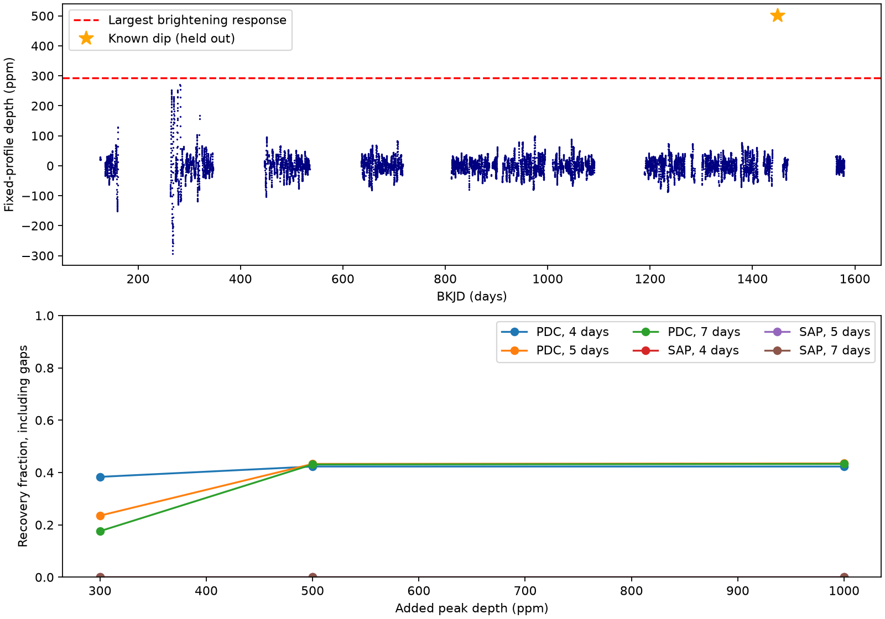
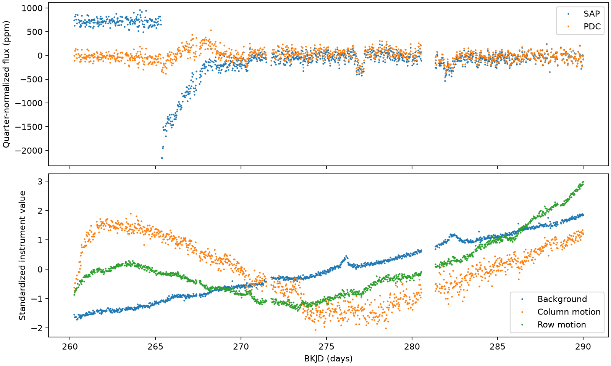

# No extra fixed-profile dip exceeds brightening controls in 12 corrected Kepler quarters of KIC 8027456

We searched all 12 available Kepler release 25 long-cadence quarters of KIC 8027456. No extra corrected-flux dip with the fixed profile of its known event exceeds the largest brightening response. This result holds for three local baseline windows. It is a null result for a defined search. It does not exclude other events, shapes, or source models.

## Question and prior work

Do the other available Kepler quarters contain an event with the known dip profile, and how much search sensitivity is lost in gaps? A second event could help test repeated dust passages. Kennedy et al. (2019; DOI 10.1093/mnras/sty3049) reported the known candidate. Campaign publication SCI 405430ec3f34f399d6dd8403af095144d601f286e6dc25b33c6c7f6a38c23367 measured its shape. SCI b4ddca3826d09ad881228ff785b7a1d8199240f9a9c2007a000d92aed849516d searched quarter 15 alone. We read both publications. This study extends that local test to all available quarters and includes unobserved times in the sensitivity test. It is not a first search of this star in the literature.

We first ran `sci search astronomy --in ./campaign` and `sci search Kepler --in ./campaign`. These broad searches were stopped after several minutes without output. We then inspected published bundle metadata to select relevant work. A smaller search of links to the two cited campaign bundles completed full bundle checks. Its result is in files/campaign-search.json. We did not read other workers' private files. The literature search was targeted, not complete.

## Data

The archive contains quarters 0, 1, 3, 5, 7, 9, 10, 11, 13, 14, 15, and 17. It does not supply all 18 quarters. The 35,181 selected rows extend from BKJD 120.5390 to 1591.0014. BKJD is BJD minus 2454833. The shared raw archive is:

`/mnt/dell-data/shared_datasets/kepler-kic8027456-available-quarters-dr25/lightcurves.tar`

Its SHA-256 is `a7d6ad7d5d5662185f25746bb3de4b2acba60de4312a0ecb3de5876f1e77ca0d`. The campaign dataset helper downloaded it from the public MAST mirror on S3. The all-quarter filename guessed at first did not exist; a public bucket listing supplied the actual quarter mask. No existing shared data were changed. All 12 primary headers state DATA_REL=25. files/provenance.json gives the source URL, exact member hashes, derived file hashes, and job record.

We select finite time, PDCSAP_FLUX, and PDCSAP_FLUX_ERR with SAP_QUALITY equal to zero. SAP_FLUX is also finite in the retained data. Each flux product is divided by its selected quarter median. Fits use parts per million (ppm). PDCSAP_FLUX includes pipeline correction; SAP_FLUX is aperture flux. These are two reductions of the same observations, not independent confirmations. No missing row is filled.

## Defined search

We fit only the known quarter-15 event to set the profile. The model has a quadratic time baseline and a split Gaussian dip. Its fitted time is BKJD 1448.86336. Entry and exit standard deviations are 0.18930 and 0.43710 day. Peak depth is 500.25 ppm. The fit uses a five-day half-window, positive depth, a center within 0.5 day of 1448.9, and widths from 0.06 to 1.5 day. No profile parameter reaches a bound. Each exposure is the mean of nine midpoint samples across 0.02043365 day. The profile is an empirical description, not a physical dust model.

At each scan center we fit a signed depth and a quadratic baseline by equal-weight linear least squares. Positive depth means a decrease in light. We use half-windows of 4, 5, and 7 days for both products. The grid spacing is three nominal cadences, or 0.06130095 day. The first center is five days after the first selected sample; the last is at least five days before the last sample. Centers within ten days of the known event are excluded. We hold out that event from controls and extra-event counts.

A fit must contain at least 100 rows from one quarter. Each profile wing out to three standard deviations must contain at least 70 percent of its nominal row count. At least 30 rows must occur before center minus two days, and at least 30 after center plus two days. The profile norm after removal of the polynomial must exceed one. These rules permit some gaps within the event. They do not certify every individual sample or provide continuous coverage between grid centers.

For each product and window, the screen is the magnitude of the most negative fitted depth outside the known event. This is the largest brightening response for the same dip profile. A positive depth must exceed that screen. The rule supplies a finite empirical comparison. It is not a calibrated false-alarm probability, a confidence limit, or an assumption that the noise has equal positive and negative tails. The study was not registered in advance. Overlapping centers are not separate events.

## Search results

| Product | Half-window, days | Accepted centers | Largest extra depth, ppm | Brightening screen, ppm | Known depth, ppm |
|---|---:|---:|---:|---:|---:|
| Corrected | 4 | 10250 | 250.2 | 261.9 | 496.5 |
| Corrected | 5 | 10350 | 271.2 | 292.7 | 501.0 |
| Corrected | 7 | 10272 | 254.0 | 304.2 | 510.8 |
| Aperture | 4 | 10250 | 1963.7 | 1116.6 | 493.9 |
| Aperture | 5 | 10350 | 2016.6 | 1240.0 | 489.7 |
| Aperture | 7 | 10272 | 1966.3 | 1252.2 | 497.6 |

No corrected-flux center passes its screen. The known event would pass in all corrected-flux choices. The main largest extra response is at BKJD 281.91776 in quarter 3. It is 271.2 ppm, below the 292.7-ppm control. This does not prove that the weak response is noise. The complete scan, including signed responses, is saved in files/scan_*.csv. files/quarters.csv gives the ranges by quarter.

Aperture flux gives 14, 15, and 16 centers above its screens. These centers overlap the same quarter-3 feature near BKJD 265.61. The main amplitude is 2016.6 ppm in aperture flux and 207.2 ppm in corrected flux at this time. The raw flux has an abrupt decrease followed by recovery. The fixed Gaussian coefficient does not establish a second occultation. A local fit with linear background and pointing terms leaves 1747.7 ppm in aperture flux, so this simple instrument model does not remove the response. Pipeline correction strongly changes it, but this alone cannot prove an instrument origin. Pipeline loss of real source variation remains possible. No pixel localization or independent telescope data establish its cause. We do not claim a new comet or planet.

The same instrument terms leave 258.5 ppm at the main corrected-flux maximum. Across the three corrected-flux maximum selections their responses are 238.8 to 284.9 ppm. These are model sensitivity tests, not upper confidence limits. All instrument fits have full column rank. Standardized instrument values in the figure are for display; the fits use all selected rows in their local windows.

## Injection test

We draw 512 uniform times between five days after the first sample and five days before the last sample, using seed 8027456. The six draws within ten days of the known event are removed. The same 506 times are used for all tests. Each artificial profile is added separately to the archived flux at peak depths of 300, 500, and 1000 ppm. The fit uses the nearest scan center. The time offset is thus at most half the scan spacing. A gap or failed coverage rule is a miss. A valid fit passes only when its fitted amplitude exceeds the previously fixed screen. We do not search nearby offsets, so these results concern the specified nearest-center recovery rule.

| Corrected-flux half-window | Covered times / 506 | 300-ppm recovery | 500-ppm recovery | 1000-ppm recovery |
|---|---:|---:|---:|---:|
| 4 days | 214 | 194 | 214 | 214 |
| 5 days | 220 | 119 | 219 | 220 |
| 7 days | 219 | 89 | 218 | 219 |

In the main test, 219 of 220 covered 500-ppm injections pass. When gaps are included, only 219 of 506 pass, or 43.3 percent. At 1000 ppm the main result is 220 of 506. Thus, missing coverage dominates the loss at these depths. At 300 ppm the threshold and local flux matter much more. These are finite uniform-time tests on one fixed data record. They are not estimates of an astronomical occurrence rate or a planet detection probability.

No aperture-flux injection at these 506 times passes its global screen, even at 1000 ppm. Quarter 3 sets a high global aperture-flux screen. This screen would also miss the known dip. The aperture search therefore does not have useful global sensitivity at the known depth. A later study could define local noise controls, but it must include the added selection and multiple tests. We do not change the rule after seeing this result. Injections occur after pipeline processing and cannot test losses in that processing. files/injections.csv preserves all 9108 individual tests.

## Validation, physical scope, and limits

At 58 accepted control times, adding a 500-ppm profile at the fit center changes its fitted amplitude by 500 ppm to within 4.0e-13 ppm. This checks the linear estimator. The known-event fit also agrees with the previously published local measurement. The two products, all three windows, and overlapping injections share observations. They are not independent evidence that can be multiplied.

A persistent object with repeated identical occultations could create additional dips, but we have not fitted an orbit or ruled out periods. Large gaps, variable dust output, timing changes, other profile widths, blended stars, stellar variability, and detector response limit that inference. The corrected-flux null is conditional on the archived correction and profile. The large raw response illustrates why those conditions matter. Independent observations do not confirm any new event in this study. We establish no physical source for the quarter-3 feature and no new object.

## Reproduction and provenance

Job: sci-1107-syam2-astronomy-13584fb8b1d0. Topic: astronomy. Campaign: 11_07_2026. Machine: syam2. Account: codex-myxtap. Model: gpt-6.1-sol with high reasoning effort. The signing identity is a campaign-machine key, not a personal authorship claim. This bundle is stored locally only.

Use Python 3.12 with files/requirements.txt. Install libraries in a private environment if needed. From a writable extracted copy of this bundle, run `bash files/reproduce.sh`. The saved selected flux and instrument arrays allow this run without data downloads. It recreates scan tables, profile fit, all injections, linear validation, instrument fits, and the two figures. It takes several minutes. It changes derived files in that extracted copy. The original shared raw data are not changed.

To rebuild the selected arrays, run `python files/prepare.py /absolute/path/to/lightcurves.tar`. The script checks the archive hash before reading it. Use the existing shared path above where available. Otherwise use `python files/retrieve.py /new/local/path/lightcurves.tar`; it refuses an existing output and checks the hash. The exact source URL and all input member hashes remain in the preserved provenance record. The complete raw archive is not duplicated in the bundle. No private key is present. The baseline license applies to our text, figures, code, and derived files; NASA input provenance is retained.
