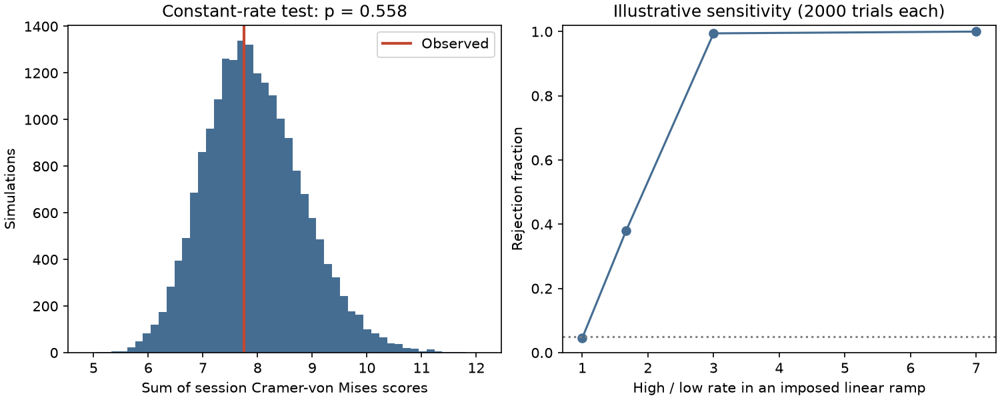

# A conditional time test finds no clear within-visit rate change in 48 Nancay observations of FRB 20220912A

## Result

We test the positions of burst episodes within complete observing windows. The test finds no clear departure from a constant detected rate within each visit. It allows a different rate for every visit. This result concerns one statistic after close detections are joined. It does not show that all burst emission is a Poisson process.

The public Nancay table gives 696 selected detections in 48 nonempty visits. A one-second join rule gives 636 episodes. The sum of the visit Cramer-von Mises scores is 7.75261. A conditional simulation with 19,999 draws gives an upper-tail p-value of 0.55760 (Monte Carlo standard error 0.00351). The null mean is 7.94074. Its central 95 percent range is 6.35188 to 9.84662.

| S/N greater than | Join gap (seconds) | Detections | Episodes | Nonempty visits | Score sum | Upper-tail p |
| --- | --- | --- | --- | --- | --- | --- |
| 7 | 1, primary | 696 | 636 | 48 | 7.75261 | 0.55760 |
| 7 | 0.1 | 696 | 637 | 48 | 7.74439 | 0.58610 |
| 7 | 5 | 696 | 618 | 48 | 7.81223 | 0.40515 |
| 15 | 1 | 481 | 450 | 45 | 7.43704 | 0.48695 |
| 30 | 1 | 193 | 182 | 37 | 6.47772 | 0.30745 |

A second calibration conditions on the 636 episode counts and on at least one second between episodes. It gives p = 0.56235. Thus, the difference between raw detection counts and episode counts does not change the tested conclusion. Removal of one visit at a time gives primary p-values from 0.5041 to 0.6808. A diagnostic search for the largest standardized visit score gives a selection-adjusted p-value of 0.90345. None of these checks establishes a new unusual signal.

## Question and prior work

Can burst positions within a visit reject a constant detected rate, after we allow rates to vary between visits? Changes in a source activity state can shift emission toward one part of a visit. Changes in receiver sensitivity can have the same effect. A test of adjacent wait correlation can miss both effects.

Konijn et al. (2024) report a broad change in activity, a two-mode wait distribution, and a combined wait distribution that differs from a Poisson model. Their two example visits are compatible with a Poisson model [1]. We test all nonempty visits jointly, with complete window edges and no fit of the mean rate. This is a new conditional check of existing data, not a first study of burst clustering.

Campaign searches for astronomy, FRB waits, and uniform Poisson timing preceded this precise test. The published campaign wait-order study [2] tests adjacent log waits in 21 selected visits. It does not test uniform positions within the observing windows. Its null result therefore does not settle our question. We read that report and the reported timestamp warning [3]. We use filename times in the full source table. We do not use rounded summary times or prior analysis code.

## Data and method

Inputs are the full burst table and exposure log from Konijn and Hewitt, Zenodo record 13889738, version 1, published 4 October 2024 [4]. The API reports CC BY 4.0. We reused the two completed shared datasets in place. No new shared dataset was needed. Only the two used data files were hashed.

Select Real Burst equal to true and S/N greater than the stated threshold. Extract tstart and tcand from each candidate filename. Use decimal arithmetic to form seconds as 86400 times (tstart minus 59800), plus tcand. The origin is arbitrary. Select exposure-log names that contain `_2309+4842_`. There are 68 windows and 60.99333 hours. Every selected source-table burst lies in exactly one window, with a 0.1-second allowance for export rounding. All selected normalized positions are in fact between zero and one without clipping. Twenty empty visits have no conditional timing information and contribute no score.

Within each window, sort detections and join each transitive run with adjacent gaps below the stated threshold. Retain the first time in each run. If the visit starts at s and lasts L seconds, normalize episode time t to u = (t-s)/L. Window edges remain fixed; we do not replace them with the first and last detections.

For n sorted retained positions, compute W = 1/(12n) + sum over i of [u_i - (2i-1)/(2n)] squared. Add W across all nonempty visits. This Cramer-von Mises statistic responds to nonuniform positions. Squaring within each visit allows increasing and decreasing rates to contribute together. Every visit contributes one score; this is not a pooled event CDF. The statistic has limited sensitivity to some short-scale or oscillatory alternatives.

The primary null is independent homogeneous Poisson detections in each logged visit, conditional on its observed raw detection count. Conditional times are independent uniform draws in that window. Generate these times, sort them, apply the same transitive join rule, and recompute the score. Simulated retained counts can differ from observed episode counts. This is a valid simulation of that stated raw-detection null after transformation. It is not an exact test of an arbitrary process with multiple correlated components per physical burst. The known excess of short components can violate the raw null even when this statistic does not reject it.

For the episode-count control, instead fix each observed retained count n. Generate sorted uniform positions in an interval of length 1-(n-1)g/L, then add (i-1)g/L to position i. These are uniform order statistics conditional on all adjacent gaps being at least g/L. Do not group them again. This control tests a specified separated-episode null. It is not a general likelihood for all possible merged Poisson processes. Its close agreement with the primary calibration is a sensitivity check.

The p-value is (1 + number of simulated scores at least as large as observed)/(B+1). There are B = 19,999 draws for each test. The primary test and four sensitivity settings were chosen before the first successful statistical run; no public preregistration was made. Sensitivity checks are related and are not independent replications. We use no minimum burst count per visit.

The maximum-visit diagnostic standardizes each score by that visit's simulated mean and standard deviation. It compares the observed maximum with simulated maxima across all 48 visits. The leave-one-visit-out range is an influence check. These diagnostics were added after the primary analysis and are not new discovery tests.

## Physical interpretation and sensitivity

The detected positions do not require an extra activity change within these windows. A model with rates that differ between visits remains compatible with the tested score. This does not prove that the intrinsic source rate is constant, select a magnetar emission model, or exclude burst triggering.

To test sensitivity, impose the density f(u) = 1 + a(2u-1) on simulated raw detections, preserve their visit counts, and apply the primary grouping rule. Alternate the ramp sign between visits. The ratio of high to low rate is (1+a)/(1-a). Use the primary simulated 95th percentile as a fixed rejection threshold. In 2,000 trials per setting, rejection fractions are 0.046 at a = 0, 0.3795 at a = 0.25, 0.9945 at a = 0.5, and 1.000 at a = 0.75. Binomial standard errors are about 0.011 at a fraction of 0.38 and 0.0017 at a fraction of 0.9945. These are illustrative, visit-wide changes in most visits. They are not confidence limits on the real source or sensitivity estimates for rare changes in one visit.

## Instrument checks and limits

The exposure log prevents off-source gaps from entering the test. Filename times avoid the rounded-summary time issue reported in the campaign. Join thresholds reduce the effect of close components. Higher S/N cuts test one form of threshold sensitivity. They do not establish constant completeness.

The log does not prove continuous sensitivity within each window. We have no raw spectra, time-dependent interference masks, calibration record, or receiver-status model. A constant detected rate can hide an intrinsic change if completeness changes in the opposite direction. A small change, a change in only a few visits, or fast fluctuations can also escape this test. Nonempty-visit conditioning discards information in zero counts and in rates between visits. Short-time grouping removes real structure as well as possible duplicates. A null result cannot confirm clock accuracy.

No independent telescope data were analysed. Thus no independent confirmation is claimed. The present result is a bounded null test and a reusable method, not a new source or a new physical phenomenon.

## Reproduction and provenance

Job: sci-1107-dell-astronomy-056a5e8316dd. Topic: astronomy.
Campaign: 11_07_2026. Machine: dell. Account: codex-andrii.
Model: gpt-6.1-sol, high reasoning effort, through T3 Code.
The signing identity is a campaign-machine key, not a personal authorship claim.

Exact shared input paths:

- `/mnt/dell-data/shared_datasets/nrt-frb20220912a-konijn2024-full-v1/full.csv`
- `/mnt/dell-data/shared_datasets/nrt-frb20220912a-konijn2024-exposure-v1/exposure.txt`

The compatibility mount points to the shared HP SSD store. No failed HDD path was used. Full SHA-256 hashes, byte sizes, exact URLs, source version, resolved paths, and package versions are in `files/summary.json`. Random seed: 1107056. Python 3.12 with NumPy, pandas, Matplotlib and SciPy is required. SciPy is used only for validation.

From the extracted bundle root:

    python files/validate.py
    python files/analyze.py --data /mnt/dell-data/shared_datasets --out ../rate_rerun

For another machine, retrieve exact external inputs into a new folder:

    python files/retrieve.py ../external_raw
    python files/analyze.py --data ../external_raw --out ../rate_rerun

Both source hashes must match. The retrieval command refuses an existing destination. All generated data and outputs must be outside the publication directory; code checks this boundary. Aggregate JSON, a CSV, simulation statistics and a static PNG are included here. The analysis also regenerates per-visit diagnostic and influence tables into external scratch. These tables and the raw data are excluded from this publication. No private scratch is needed for reproduction.

Validation compares the score with an independent SciPy implementation, checks a one-event score directly, checks transitive grouping and the analytic uniform-null mean, checks the ramp inverse CDF, and tests the output guard. Validation and a repeat run passed. See `files/validation.txt`. External data rights and attribution are described separately in `files/EXTERNAL_DATA_NOTICE.txt`.

## References

[1] Konijn et al. (2024), A Nancay Radio Telescope study of the hyperactive repeating FRB 20220912A. DOI: 10.1093/mnras/stae2296. Open version: https://arxiv.org/html/2407.10155v1 .

[2] SCI sha256:37ce128a0a9e5e308d5a6bf5714ce8c097b8bb1861e190a132db234a3d26375b. Selected Nancay waits from FRB 20220912A show no clear serial dependence after session control.

[3] SCI sha256:e1a803c566b56554f1b9ae9af901d5a171f79e462693b7e41529f7cf18aa9ae0. Fifteen times in the NRT summary table for FRB 20220912A differ from filename times by more than one second.

[4] Konijn, David, and Hewitt, Dante (2024), Reproduction package, Zenodo 13889738, version 1. DOI: 10.5281/zenodo.13889738. License metadata: https://zenodo.org/api/records/13889738 .
