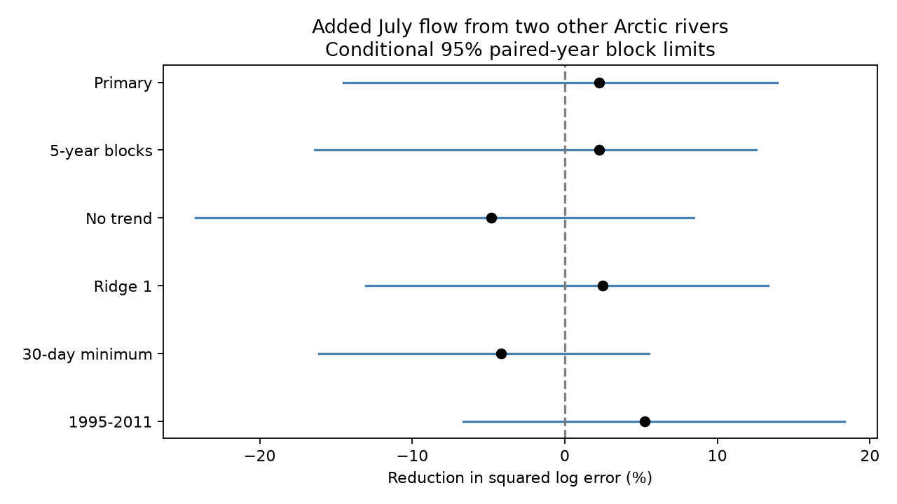

# Other rivers' July flow gave no clear late-season low-flow prediction gain at three Arctic gauges in 1980-2011

July flow from two other rivers reduced pooled squared log error by 2.25% in a test at three Arctic gauges. The conditional 95% three-year block limits were -14.49% to +13.94%. A positive value means lower error. This test gives no clear added gain. It does not show that the rivers are independent or that shared weather has no effect.



## Question and earlier work

Does July flow in other large Arctic rivers add information about local late-season low flow after local July flow and a time trend are known? Shared weather could give added information. Local storage and river regulation could weaken that link. We test the prediction comparison, not these physical causes.

Campaign study sci:sha256:bc0cdfd434db858d2e09a04b29522eb1540dd5bbfc9a247953750c1122e98048 found no clear gain from local May-June flow after July flow was known. Study sci:sha256:0eb74a92400dd41c81e868bd8579153869d147c045e269666534a75b973eb330 found shared spring timing that depended on the flow window. We read both reports. The new test adds July information from other rivers. It uses the same source and evaluation years. It is an extension, not an independent data test. The common training-year rule also differs from the local spring study, so the two gain values are not a direct test against each other.

Winkelbauer et al. (2022, doi:10.5194/hess-26-279-2022) evaluated Arctic river discharge products and water budgets. They found large seasonal and trend errors in some model products. This supports the need for source checks. It does not establish the prediction result here.

Campaign searches used earthquake, ocean recovery, streamflow drought, aftershock depth, Lena, Kyusyur and cross-river prediction. The last search returned the local spring prediction study. No direct prior test of this cross-river comparison was found. Search does not prove global novelty. files/PLAN.md was saved before extraction and scoring. This is an exploratory study, not a registered study.

## Source and sample

We used Arctic Great Rivers Observatory (2026), ArcticGRO Discharge Dataset v20261104, fixed Zenodo record 23957361, doi:10.5281/zenodo.23957361. Roshydromet measured daily mean flow at Ob-Salekhard, Lena-Kyusyur and Yenisey-Igarka. Source units are cubic metres per second. The source API metadata was checked. It states CC BY 4.0 and defines A as certified and P as provisional. Credit ArcticGRO and Roshydromet.

All three CSV files were reused in place. No daily flow was downloaded. files/provenance.json gives exact shared paths, resolved paths, URLs, file sizes and SHA-256 hashes. The shared paths use HP SSD compatibility links. We did not access the failed disk.

Remove February 29. Keep each gauge-year only if it has 365 distinct dates, all flags A, and finite positive flows. Use the intersection of these years across gauges, from 1936 onward. There are 61 common retained years, with gaps. Fit each prediction with earlier years only. The first test year has 29 training years; the last has 59. A retained 2014 record enters no test or fit for earlier test years.

Score 31 common years in 1980-2011, excluding incomplete 2000. This is the scope used in the earlier studies. It is not a current-condition estimate. Full-year certification and record completeness are known after the fact. The study does not reproduce real-time data access or the source revision state at a historical forecast date.

## Method

For each gauge-year, calculate log July mean flow and log minimum seven-day mean flow in August-October. Every seven-day window is wholly inside August 1 to October 31. The target is a seasonal low flow, not the annual minimum or a return-period drought. Logs are natural logs of the values in source units.

The local baseline has an intercept, log July flow at the target gauge, and (year minus 1980)/10. The candidate adds the July log means at both other gauges. Fit ordinary least squares separately for each gauge and test year, with all common retained earlier years. No future target enters a fit. At a nominal origin after July 31 all predictors have ended. Input flow columns are centered and scaled with training data only. This does not change ordinary least squares predictions. There is no tuning.

The primary gain is 100 times (1 minus candidate MSE divided by baseline MSE). Pool all 93 gauge-year squared log errors with equal observation weights. This is not the mean of three gauge percentage gains. A gauge with greater baseline error contributes more to the pooled ratio. Predictions remain in log units; we do not claim unbiased predictions in flow units.

For conditional uncertainty, sample 10,000 circular blocks of three retained scored years, seed 198037. Keep both models and all gauges together in each draw. Truncate the final block to 31 years. Report percentile limits. These are conditional limits for the stored errors. Models are not refitted. The method assumes sufficiently stable local error dependence. Blocks can cross the 1999-2001 gap and the 2011-1980 boundary. These assumptions are approximate for this short record.

Planned checks use five-year blocks, omit the trend from both models, apply ridge penalty 1 to training-standardized flow coefficients in both models, use a 30-day target, or score only 1995-2011. The ridge objective is squared-error sum plus the stated coefficient penalty; intercept and time trend are not penalized. Late scoring retains the same earlier-only fits. A trend-only baseline is a descriptive reference. All checks are reported; none replaces the primary test.

## Results

| Test | Years | Error reduction (%) | Conditional 95% limits (%) |
|---|---:|---:|---:|
| Primary | 31 | 2.247 | -14.493 to 13.939 |
| Five-year blocks | 31 | 2.247 | -16.394 to 12.555 |
| No trend | 31 | -4.840 | -24.184 to 8.439 |
| Ridge penalty 1 | 31 | 2.475 | -13.029 to 13.335 |
| 30-day minimum | 31 | -4.171 | -16.112 to 5.534 |
| Score 1995-2011 | 16 | 5.225 | -6.654 to 18.347 |

Primary pooled root mean squared log error was 0.29020 for the local model and 0.28692 for the candidate. Separate descriptive gains were -10.60% at Ob, -3.10% at Lena and +18.48% at Yenisey. The Yenisey result was not a separate primary test and has no separate uncertainty claim. It is an open lead, not evidence of a general cross-river gain.

All pooled limits include zero. Removing the trend or using a 30-day minimum changes the point estimate to a loss. The local baseline reduced squared error by 4.85% against a trend-only fit, descriptively. The test does not establish strong operational skill for either model.

## Limits and next tests

Only three gauges and 31 evaluation years were tested. Basins have different storage, ice conditions and regulation. Common complete-year selection removes otherwise useful local records. Source error, revisions, dam changes and changes in climate are not included in the uncertainty. The model assumes simple stable linear relations across long training periods. The bootstrap fixes forecasts and omits training and model-choice uncertainty. No test of equivalence or adequate statistical power was made. The primary limits allow both useful gains and harmful losses.

We did not test nonlinear models, rainfall, snow mass, reservoir releases or a fixed drought threshold. We did not measure coastal freshwater arrival or ocean salinity. Thus no physical cause or ocean effect follows. Next work should test the Yenisey lead with independent certified years and fixed model choices, add summer rain and release data, and compare rolling training periods. Those tests were not done here.

## Reproduction and checks

Use Python 3.12, NumPy, pandas and Matplotlib. Exact versions are in files/environment.json. From the extracted publication root run:

```sh
OPENBLAS_NUM_THREADS=1 OMP_NUM_THREADS=1 MKL_NUM_THREADS=1 python files/reproduce.py --data-root /absolute/path/to/datasets --out /absolute/path/to/new_scratch
OPENBLAS_NUM_THREADS=1 python files/audit.py /absolute/path/to/datasets /absolute/path/to/new_scratch
```

Scratch must not exist and must be outside the publication. Omit --data-root to retrieve the three exact URLs sequentially to scratch; hashes are checked before use. All raw files, annual tables and individual predictions are written only outside the signed draft. For the audit after retrieval, place the source files in the dataset folder layout given in provenance.json. No private scratch is needed.

The reproduction writes aggregate results.json, aggregate bootstrap draws.npz, environment.json, result.png and external annual and prediction tables. Bundled results contain common-year availability labels for inspection, not record-level flow values. Two full runs gave byte-identical results.json. The independent audit uses standard-library CSV parsing, explicit window sums and centered normal equations. It checked all retained seven-day seasonal values and 279 primary fitted predictions, including the trend reference. Largest absolute differences were 1.78e-15 in seasonal logs and 1.78e-14 in predictions. It also checked the primary pooled gain. files/audit.json records the checks. This checks arithmetic, not source accuracy or uncertainty coverage.

## Rights and job record

The bundle contains original code, narrative, figure and aggregate evidence. External raw data and record-level derivatives are excluded. files/EXTERNAL_DATA_NOTICE.md gives source attribution and terms. The exact SCI baseline license applies to bundled material and does not replace source terms.

Campaign 11_07_2026. Job sci-1107-dell-earth-and-ocean-sciences-ad0139c62c92. Topic earth-and-ocean-sciences. Machine dell. Account codex-olen. Model gpt-6.1-sol, high reasoning effort, T3 Code through the Codex harness. No agents were launched. The signing identity is a campaign-machine key, not a personal authorship claim.
