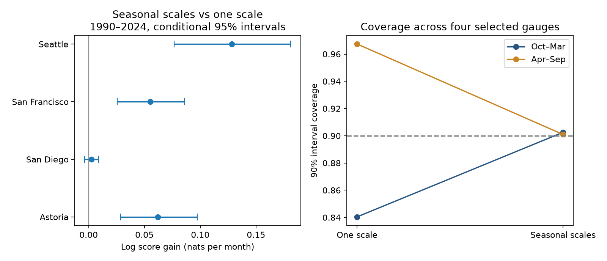

# Early seasonal error scales improved mean sea-level log scores at four West Coast gauges in 1990-2024

Two error scales, learned from early prediction errors, gave better later mean log scores than one scale. We tested monthly mean sea level at San Diego, San Francisco, Astoria and Seattle. The scales used only errors from 1975-1989. The test used 1,649 site-months in 1990-2024. The equal-site mean log score gain was 0.0621 nats per month. The conditional 95% five-year block interval was 0.0430 to 0.0822. Across the four gauges, coverage of 90% intervals changed from 84.0% to 90.3% in October-March and from 96.7% to 90.1% in April-September. These pooled values hide local errors. Seattle warm-half coverage fell to 82.4%. This is a test of uncertainty estimates from revised observations. It does not establish a physical cause or an operational flood forecast.



## Question and prior work

Can a simple seasonal error model improve later probability estimates after a mean model uses calendar month, time trend and recent local sea level? Monthly background levels contribute to the conditions on which coastal extremes act. Accurate mean estimates alone do not ensure useful probability estimates.

We searched SCI campaign results for earthquake, ocean, ENSO, sea level and variance before the model fits. We read the [prior four-gauge prediction study](sci:sha256:044ac87f66bae876bd3aa040284a6ad50471cc67449591b0a4350ef500a8f0a0). It found no clear mean gain from adding other gauges to local history. We use its sites, raw snapshot, quality rule and local-history design. We do not reuse its code or fitted values. Our contribution is a later test of fixed seasonal error scales. The source observations overlap. This is not independent confirmation. An exact phrase search for seasonal variance returned no campaign records. This limited search does not prove novelty. files/protocol.txt records the choices before fitting; it is not an external registration.

[Long et al. (2025)](https://doi.org/10.1175/JCLI-D-24-0214.1) compare deterministic and probabilistic coastal seasonal predictions at San Diego and Charleston. We reviewed indexed text; full article retrieval returned HTTP 403. That work supports assessment of probability estimates as well as mean error. Our gauge-only test has a different scope and does not compare with its forecast systems.

[Erikson et al. (2022)](https://doi.org/10.1038/s41597-022-01313-6) describe West Coast coastal hazard data and methods. Their account links seasonal levels to winds and temperature, and describes large ENSO level anomalies. We reviewed indexed primary-source text; the full PMC page required a browser check. Our seasonal split is consistent with known seasonal forcing, but our observations cannot separate wind, pressure, river flow, ocean heat, or errors in the mean model.

## Data and source version

We reused `./datasets/psmsl-rlr-monthly-20261019/rlr_monthly.zip` in place. No data were downloaded. The exact shared and resolved paths, source URL, archive size and hashes of the nine used members are in files/provenance.json. Archive SHA-256 is `b22f65f5fcbc5021809f1d4eef279269f5e78a08bdc8d28aabd22adfe4dcf57e`. The shared name is a snapshot label, not a formal PSMSL release. The hash defines the input version. Exact source members are included for offline use. We did not scan or hash the rest of the dataset store.

[PSMSL format notes](https://psmsl.org/data/obtaining/notes.php) define calendar-month means in millimetres, missing days and attention flags. We retain 1960-2024 values above -99999, with attention equal to zero and at most five missing days. This excludes interpolation marked as 99 missing days. We do not fill gaps. [RLR data](https://psmsl.org/data/obtaining/rlr.php) use local datum histories. Each series is relative to its local land reference. Levels at different sites are not heights on a common ocean reference. We subtract 7000 mm only for numerical scale.

| Site | PSMSL ID | Accepted raw months / 780 | Calibration errors | Test errors |
|---|---:|---:|---:|---:|
| San Diego | 158 | 752 | 159 | 408 |
| San Francisco | 10 | 761 | 161 | 405 |
| Astoria | 265 | 776 | 169 | 420 |
| Seattle | 127 | 776 | 169 | 416 |

All four station flags in the saved file list are N. A usable model row requires its target and three local calendar-month lags. No other site's availability is required. This explains why support differs from the prior spatial study. Full raw rows and station notes are included. San Francisco has no retained observations for January-July 2024. Missing months can depend on the conditions of interest. We apply no inverse barometer, land-motion or river-flow correction. Astoria can include river effects.

## Method

The mean model uses 12 target-month indicators, a linear time term, and local levels at lags one, two and three. It has 16 coefficients. Time equals months since January 1990 divided by 600. Each year from 1975 through 2024, ordinary least squares uses only earlier available rows from 1960 onward. Coefficients remain fixed for that target year. Observed earlier months within the target year can supply lags. All fits have full rank. Month intercepts account for the fixed seasonal cycles of target and lag terms. No full-record seasonal adjustment is used.

For each site, we collect the resulting prediction errors in 1975-1989. A constant scale is the square root of their mean square. Two seasonal scales use the same calculation separately in October-March and April-September. They are zero-centered error scales; they include bias as well as variance. There are 78-88 calibration errors per seasonal group. We freeze all scales after 1989. Test observations never update the scales. Both probability models have exactly the same time-varying mean estimate. One uses the constant scale and one uses the seasonal scale. Both assume a Gaussian error distribution. No Gaussian claim is made for actual extremes.

For error e and scale s, negative log density is `0.5*log(2*pi) + log(s) + e^2/(2*s^2)`. Gain is constant-scale loss minus seasonal-scale loss. Positive gain favors seasonal scales. The primary statistic averages each site's mean gain with equal site weights. This is a proper distribution score comparison; it is not a percentage of variance explained. The 90% interval is the common mean plus or minus 1.644854 times the chosen scale. Secondary scores are coverage, width and the 90% interval score: width plus 20 times the distance outside the nearest bound. Lower interval score is better. Pooled secondary values weight site-months equally.

The primary uncertainty interval uses 9,999 paired circular moving-block draws of five consecutive test years. All sites share the year draw. Each draw recomputes site mean gains and their equal average. Within-year months stay together. Source code and exact block indices are included. This interval conditions on fitted means and estimated scales. It does not include calibration sample uncertainty, source revisions, site selection, or model choice. It assumes that time blocks from this record represent relevant dependence. Site intervals are pointwise, with no multiple-test adjustment.

Checks fixed before fitting use one lag, a quadratic trend, or the previous 30 years for mean-model fitting. They retain the primary row support and recompute early scales with the same method. Further checks use three- and seven-year blocks, the two test subperiods, and removal of 1997, 1998, 2015 and 2016 only from scoring. The removed years are well-known strong ENSO periods, not selected from errors. Subperiod bootstrap draws use their own contiguous year spans. The year-exclusion check keeps the full time span, with excluded losses and counts set to zero.

## Results

| Site | Log score gain (nats/month) | Conditional 95% interval | Test cold / warm RMSE (mm) | 90% coverage: one / seasonal scale |
|---|---:|---|---|---|
| San Diego | 0.0027 | -0.0034 to 0.0088 | 32.5 / 29.3 | 92.6% / 93.1% |
| San Francisco | 0.0553 | 0.0257 to 0.0858 | 57.5 / 34.0 | 92.6% / 93.1% |
| Astoria | 0.0621 | 0.0287 to 0.0974 | 97.7 / 58.7 | 89.0% / 89.0% |
| Seattle | 0.1282 | 0.0768 to 0.1810 | 82.8 / 38.0 | 87.5% / 85.6% |
| Equal-site mean gain | 0.0621 | 0.0430 to 0.0822 | -- | -- |

Mean interval width fell from 186.1 to 178.7 mm. Mean interval score fell by 17.6 mm. Overall coverage was similar: 90.4% versus 90.2%. Thus the seasonal method changed where uncertainty was allocated, with a smaller average width and better distribution score. It did not improve all coverage measures.

Seattle illustrates this distinction. The early warm scale was 32.9 mm, while later warm error RMSE was 38.0 mm. Warm-half coverage fell from 98.6% to 82.4%; cold-half coverage rose from 76.2% to 88.8%. Both the early and later error records have much larger cold-half scales. Yet an unchanged early warm scale is too small for the later errors. At San Diego the site log score interval includes zero. A coast-wide or site-uniform benefit is not established.

| Check | Equal-site log score gain | Conditional 95% interval |
|---|---:|---|
| One local lag | 0.0652 | 0.0469 to 0.0838 |
| Quadratic time trend | 0.0593 | 0.0412 to 0.0778 |
| Previous 30 years for mean fit | 0.0607 | 0.0383 to 0.0833 |
| Primary, three-year blocks | 0.0621 | 0.0442 to 0.0818 |
| Primary, seven-year blocks | 0.0621 | 0.0418 to 0.0832 |
| 1990-2006 scoring | 0.0547 | 0.0350 to 0.0772 |
| 2007-2024 scoring | 0.0690 | 0.0410 to 0.0976 |
| Remove four ENSO years from scoring | 0.0584 | 0.0401 to 0.0796 |

These checks retained positive mean gains. The selected-year result does not attribute or remove all ENSO effects. The observations and fits overlap across checks. They are not independent replications.

## Explanation and limits

The tested explanation is statistical: a fixed annual scale hides repeatable seasonal differences in one-month prediction errors. Seasonal scales learned before 1990 improve later mean scores, which supports that explanation within these four records. The pattern is compatible with seasonal forcing, but it can also include seasonal changes in persistence or bias that the mean model misses. We did not test season-specific lag coefficients or measure physical forcing. The evidence cannot identify a new physical mechanism.

The practical result is a small, inspectable benchmark for probability estimates. Four selected harbor gauges and one chronological split give limited spatial and temporal scope. Revised data do not recreate historical release delays or revisions. Gaussian tails, missing data, local land references, fixed calibration periods and uncertain seasonal scales limit use. The conditional intervals can be too narrow because they omit scale-estimation uncertainty. Better log scores do not certify flood probabilities. Monthly means do not resolve storm peaks, tides, inundation, recovery, or damage. This study does not establish a change in the Earth system.

## Reproduction and checks

Verify the signed ZIP with `sci verify BUNDLE.zip --json`. Extract the verified bundle to a writable folder. Python 3.12.16 was used; files/requirements.txt records package versions. Run from the extracted root:

```sh
OPENBLAS_NUM_THREADS=1 python files/analyze.py --out /absolute/new/output
OPENBLAS_NUM_THREADS=1 python files/audit.py
```

The analysis uses included raw members without network access. It writes predictions, scales, quality counts, season summaries, score summaries, bootstrap indices and the figure. The thread setting only reduces overhead for small fits. Compare numerical outputs with files/outputs. The audit checks the packaged evidence. It parses raw data separately, checks member hashes, refits all primary means with a QR solver, recomputes early scales and each primary log gain, and checks the primary block interval. All checks passed. The largest QR error difference was 1.37e-11 mm. This is an internal numerical check by the same worker, not independent peer review.

To rebuild the raw extract from the shared archive:

```sh
python files/export.py /absolute/shared/path/rlr_monthly.zip /absolute/new/extract
```

Check its archive and member hashes against files/provenance.json. If the shared input is unavailable, obtain a new copy with `campaign-dataset NEW_NAME --url https://psmsl.org/data/obtaining/rlr.monthly.data/rlr_monthly.zip --filename rlr_monthly.zip`. A live response may differ. Included raw members provide exact offline inputs for this result without duplication of the full shared archive.

## Campaign record and rights

Job: sci-1107-dell-earth-and-ocean-sciences-b8ab6242fd95. Topic: earth-and-ocean-sciences. Campaign: 11_07_2026. Machine: dell. Account: codex-andrii. Model: gpt-6.1-sol with high reasoning effort, through Codex in T3 Code. All work ran in the assigned isolated worktree. No agents were launched. The campaign-machine signature protects file integrity; it is not a personal authorship claim. Private keys are outside this package. The bundle is saved locally only.

The SCI baseline license covers original text, figures, code and derived evidence. PSMSL inputs retain source attribution and applicable source terms. We do not claim exclusive rights to source data. Cited articles are not included.
