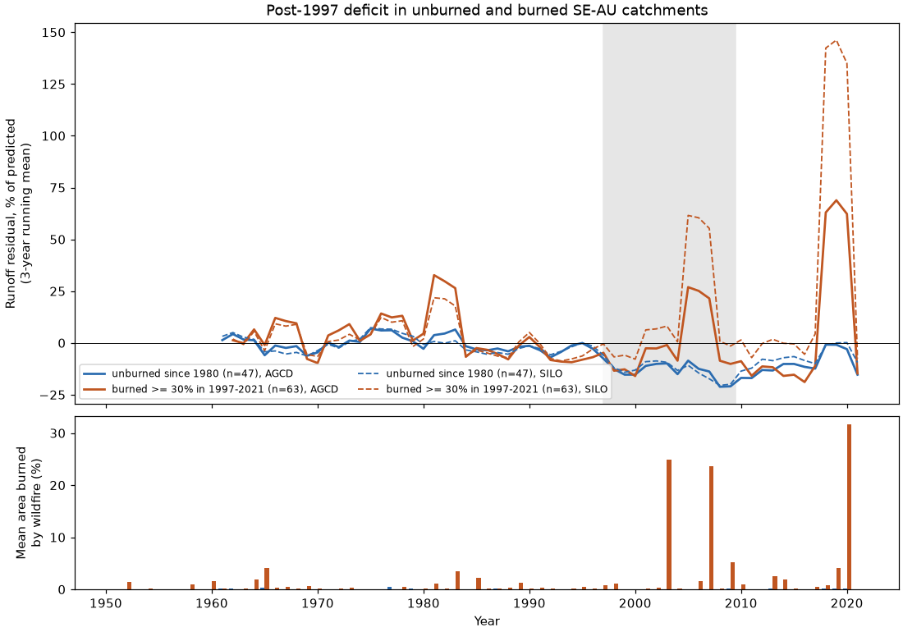
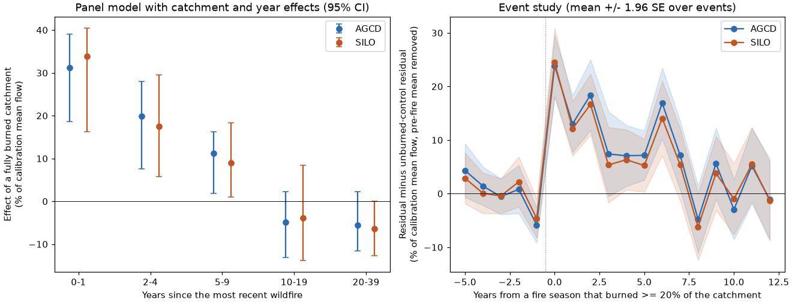
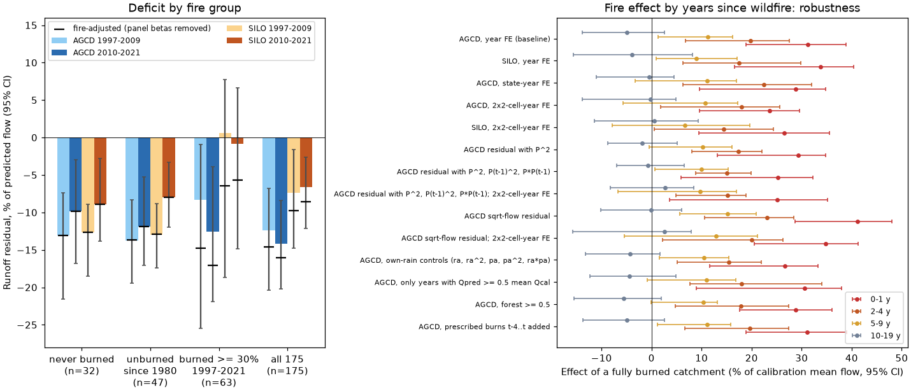

# Bushfires did not cause the post-1997 runoff loss in south-east Australia: unburned catchments lost 8-14% of predicted runoff, and fire raised runoff for up to 9 years (175 CAMELS-AUS catchments)

Job `sci-1107-dell-earth-and-ocean-sciences-58cbb53511b2`, campaign 11_07_2026, topic
earth-and-ocean-sciences, machine dell, account claude-olen. Model: Claude Opus 5.5
(`claude-opus-5-5`) in Claude Code (T3 Code). The signing key is a campaign-machine key. It is
not a personal authorship claim.

## Summary

**Question.** After 1997, runoff in south-east Australia (SE-AU) fell below each catchment's
1951-1996 relation to rain and temperature, and it stayed low (campaign bundles 36d145c1,
df943002, 871b2192). Earlier campaign work excluded or limited rain-gauge artefacts, stored
water, evaporative demand, greening, rain seasonality and one-parameter Budyko changes
(bundles 20955da2, ccf7e5d4, 58715cfe, c651f046, e74dce49, d62649c0, fde6f0d6). Fire was not
tested. SE-AU had very large forest fires in 2003, 2006-07, 2009 and 2019-20, and regrowing
eucalypt forest can use more water than old forest for decades (Kuczera 1987, mountain ash).
Thus fire is a physically possible cause. We asked: **is the post-1997 deficit concentrated in
burned catchments, and how does runoff change after fire?**

**Data and method.** We used the 175 SE-AU catchments of bundle 871b2192 (CAMELS-AUS v2.03;
annual flow, AGCD and SILO rain, AGCD temperature, re-used unchanged). For each catchment we
fitted Q = a + b P + c P(t-1) + d T on 1951-1996 and calculated annual residuals. This
reproduces the deficits of 871b2192 exactly (-12.4% in 1997-2009 and -14.2% in 2010-2021 with
AGCD). We rasterized the Geoscience Australia Historical Bushfire Boundaries v2.0 (CC BY 4.0;
fire extents from the state agencies) on a 250 m equal-area grid. For each catchment and year
we calculated the area burned and the time since the last wildfire. We wrote the analysis plan
(`files/ANALYSIS_PLAN.md`) before we calculated any fire-runoff result. The planned tests were:
(1) the deficit of unburned and burned catchments, (2) a panel model with catchment and year
effects and five time-since-wildfire terms, and (3) the deficit after removal of the fitted
fire terms. Intervals are 95% cluster-bootstrap intervals over 2 x 2 degree cells.

**Main results.**

1. **Catchments without fire had the full deficit (planned test 1).** The 47 catchments with
   less than 5% of their area burned by wildfire in 1980-2021 had runoff 13.7% below the
   1951-1996 relation in 1997-2009 (95% CI 8.3-19.5%) and 11.9% below it in 2010-2021
   (5.3-17.0%), with AGCD rain. With SILO rain the values were 13.0% (8.8-17.4%) and 8.0%
   (3.3-12.0%). The 32 catchments with no dated wildfire in the full record had deficits of
   13.1% and 9.8% (AGCD) and 12.7% and 8.9% (SILO), or 32-40 mm per year. The 63 catchments
   with 30% or more burned in 1997-2021 did not have a larger deficit. The burned-minus-unburned
   difference was +5.4 points in 1997-2009 (CI -12.7 to +15.5) and -0.7 points in 2010-2021
   (-11.9 to +9.4) with AGCD, and +13.6 and +7.2 points with SILO (both intervals include zero).
   The rank correlation between the 2010-2021 residual and the burned fraction was +0.07 (AGCD)
   and +0.17 (SILO). Thus fire was not the cause of the regional deficit (planned decision rule).
2. **Runoff increased after fire (planned test 2).** In the panel model, a fully burned
   catchment had runoff higher by 31% of its mean calibration flow in the fire year and the
   next year (CI 19-39%), by 20% in years 2-4 (8-28%) and by 11% in years 5-9 (2-16%). After 10
   to 39 years the effect was -5% to -6% and the intervals included zero. SILO rain gave the same
   pattern (+34%, +18%, +9%). In a permutation test that exchanged fire histories between
   catchments in the same state, the three early terms were larger than all or nearly all 300
   permuted values (p <= 0.003).
3. **Fire reduced the deficit; it did not make it (planned test 3).** After 1997 the fitted
   fire terms added +1.4% (1997-2009) and +1.6% (2010-2021) of mean flow to SE-AU runoff on
   average. Thus fire offset about 9% (AGCD) to 14% (SILO) of the deficit (2010-2021). The
   permutation p-value of this mean fire term was 0.07. Without the fire terms, the 2010-2021
   deficit of all 175 catchments was 16.0% with AGCD (CI 10.0-21.9%) and 8.5% with SILO
   (4.5-13.4%), instead of 14.2% and 6.6%. The burned group had almost no SILO deficit before
   adjustment (-0.8%), but a 5.7% deficit after it.
4. **The fire effect was robust to the drought confound (post hoc).** Large fires follow very
   dry years, when a linear rain model can be biased. The 0-1 year effect stayed between +24%
   and +41% in 14 variants (Figure 4 and `files/results/robustness.csv`): state-year and
   2 x 2 degree cell-year effects, quadratic terms in rain and previous-year rain, a model of
   square-root flow, own-rain controls, only years with a predicted flow of at least half the
   mean, forested catchments only, and prescribed burns as an extra term (no prescribed-burn
   effect: -2.5% per unit area, CI -31 to +14%). The effect was also present before the
   drought (fires and years of 1951-1996 only: +24%, CI 15-34%). In an event study of 84 fires
   that burned 20% or more of a catchment (1958-2016), the residual relative to unburned
   catchments in the same years rose by 24% of mean flow in the fire year, 16% in years 1-2, 9%
   in years 3-7 and 0% in years 8-12 (Figure 3).
5. **The 2019-20 fires gave a smaller increase than predicted (post hoc forward test).** We
   fitted the panel on 1951-2019 only. For the 30 catchments with 20% or more burned in the
   2019-20 season (mean 58%), the 2020-2021 residual relative to 2015-2019 rose by 6.0% of mean
   flow more than in 86 unburned catchments (CI -8.1 to +17.2%; SILO +7.8%, -8.4 to +20.5%). The
   1951-2019 model predicted +22.7% (SILO +22.0%). The dry year 2019 had a positive residual in
   the burned group (low predicted flow), which lowers the contrast. With 2015-2018 as the
   reference the rise was +7.4% (AGCD, CI -3.2 to +17.3%) and +9.0% (SILO, -4.1 to +20.5%); with
   2010-2018 it was +9.9% (-3.7 to +19.9%) and +13.0% (-1.3 to +23.1%). Thus the sign agreed in
   all six cases, but the observed rise was one third to one half of the prediction. The
   interval excluded the prediction in five of six cases. The record ends in 2021 and includes
   only 132-136 catchments in 2020-2021.

**Conclusion.** Bushfire and forest regrowth do not explain the persistent post-1997 runoff
loss in SE-AU. The deficit was equally large in catchments with no wildfire since 1980 or in the
whole record, and it was not larger in burned catchments. Fire had the opposite sign: runoff
increased for about 5-9 years after a fire, by about one third of mean flow at first for a
fully burned catchment. A late decrease of water yield as forests regrow, as found for mountain
ash, was not detected at the scale of these catchments (10-39 years: -5% to -6%, intervals
include zero). Because fires in 2003-2009 and 2019-20 raised runoff in burned catchments, the
non-fire deficit is about 10-30% larger than the raw value. For water planning, post-fire
years should not be used as evidence of recovery from the deficit. The cause of the SE-AU loss
must be a process that also acts in unburned catchments.

## Figures

**Figure 1.** Left: area fraction of each catchment burned by wildfire at least once in
1997-2021. Right: mean 2010-2021 runoff residual from the 1951-1996 relation (AGCD rain), as a
fraction of predicted flow. Black rings: the 47 catchments with less than 5% burned in
1980-2021. Many of these catchments have large deficits.

**Figure 2.** Top: annual residual (sum over the group, % of predicted flow, 3-year running
mean) for the unburned and burned groups, with AGCD (solid) and SILO (dashed) rain. Grey: 1997-2009.
Both groups fall below zero after 1997. The burned group has positive peaks after the 2003 and
2006-07 fires. Bottom: mean area burned by wildfire per year in each group. The 2018-2020 peak
of the burned group comes from the dry year 2019, before the 2019-20 fires (group residual
+216% of a very small predicted flow); in 2020 the burned group was at -14%. This ratio is
unstable when predicted flow is near zero; the panel model uses the calibration mean flow as
denominator.

**Figure 3.** Left: panel coefficients (catchment and year effects) for the area fraction whose
last wildfire was 0-1, 2-4, 5-9, 10-19 or 20-39 years before. Units: % of the calibration mean
flow for a fully burned catchment. Right: event study for 84 fires that burned 20% or more of a
catchment (no other such fire in the 5 years before), relative to catchments with less than 2%
burned in every year of the window; the pre-fire mean (years -5 to -1) is removed.

**Figure 4.** Left: deficit by group and period (bars, 95% CI) and the deficit after removal of
the fitted fire terms (black ticks). Right: fire coefficients in 14 model variants (post hoc).

## Tables

**Table 1. Deficit by fire group** (mean residual / mean predicted flow; 95% cluster-bootstrap
CI). Source: `files/results/summary.csv`, `files/results/groups_fire_adjusted.csv`.

| Group | n | Rain | 1997-2009 | 2010-2021 | 2010-2021, fire terms removed |
| --- | ---: | --- | --- | --- | --- |
| Never burned (no dated wildfire to 2021) | 32 | AGCD | -13.1% [-21.5, -7.4] | -9.8% [-16.8, -3.0] | -9.8% |
| Unburned since 1980 (BF80 < 0.05) | 47 | AGCD | -13.7% [-19.5, -8.3] | -11.9% [-17.0, -5.3] | -11.9% |
| Burned >= 30% in 1997-2021 | 63 | AGCD | -8.3% [-25.5, -0.9] | -12.6% [-21.9, -3.9] | -17.1% [-25.5, -7.9] |
| All | 175 | AGCD | -12.4% [-20.4, -6.7] | -14.2% [-20.2, -8.4] | -16.0% [-21.9, -10.0] |
| Never burned | 32 | SILO | -12.7% [-18.5, -8.9] | -8.9% [-13.8, -2.8] | -8.9% |
| Unburned since 1980 | 47 | SILO | -13.0% [-17.4, -8.8] | -8.0% [-12.0, -3.3] | -8.0% |
| Burned >= 30% in 1997-2021 | 63 | SILO | +0.6% [-18.7, +7.8] | -0.8% [-14.9, +6.6] | -5.7% [-19.1, +2.4] |
| All | 175 | SILO | -7.4% [-14.8, -1.6] | -6.6% [-12.1, -2.6] | -8.5% [-13.4, -4.5] |

The unburned groups also had less than 5% of their area inside undated wildfire polygons
(Addendum A of the plan).

**Table 2. Panel coefficients** (effect of a fully burned catchment, % of calibration mean
flow; catchment and year effects; 1951-2021; 10,211 catchment-years). Source:
`files/results/panel_beta_*.csv`, `permutation_summary.csv`.

| Years since last wildfire | AGCD [95% CI] | SILO [95% CI] | Permutation p (AGCD) |
| --- | --- | --- | --- |
| 0-1 | +31.2 [+18.7, +39.0] | +33.8 [+16.3, +40.4] | < 0.003 |
| 2-4 | +19.8 [+7.6, +28.0] | +17.5 [+5.8, +29.6] | < 0.003 |
| 5-9 | +11.2 [+1.8, +16.3] | +9.0 [+1.0, +18.4] | 0.003 |
| 10-19 | -4.9 [-13.1, +2.3] | -3.9 [-13.8, +8.5] | 0.57 |
| 20-39 | -5.6 [-11.6, +2.3] | -6.4 [-12.6, +0.0] | 0.02 |

Mean fire term in 2010-2021: +1.6% of mean flow with AGCD (CI 0.0 to 3.2; permutation p 0.07)
and +1.5% with SILO (-0.2 to +3.0). The mean panel residual f in 2010-2021 was -18.7% (AGCD)
and -10.8% (SILO). This differs from Table 1, because f is scaled by each catchment's own mean
flow and every catchment-year has the same weight. The attributable share (mean fire term /
mean f) was -8.6% (AGCD, CI -17.0 to -0.2%) and -13.7% (SILO, -28.0 to +1.5%).

**Table 3. Robustness of the early fire terms (post hoc).** Range over 14 variants in
`files/results/robustness.csv` (300 bootstrap draws each).

| Term | Range of point estimates | Variants with the 95% CI above zero |
| --- | --- | --- |
| 0-1 years | +23.6 to +41.2 | 14 of 14 |
| 2-4 years | +14.5 to +23.1 | 14 of 14 |
| 5-9 years | +6.6 to +15.2 | 6 of 14 |
| 10-19 years | -5.6 to +2.8 | 0 of 14 |

## Relation to prior work

- Peterson et al. (2021, doi:10.1126/science.abd5085), Saft et al. (2015,
  doi:10.1002/2014WR015348) and Fowler et al. (2022, doi:10.5194/hess-26-6073-2022) describe
  the persistent post-drought shifts in SE-AU and list possible causes. Fowler et al. (2022)
  discuss vegetation change among the hypotheses. To our knowledge, a test of the regional
  deficit with a consistent fire history for all CAMELS-AUS catchments of SE-AU has not been
  published. This does not prove that no such test exists.
- Kuczera (1987, J. Hydrol. 94:215-236) found a large water-yield decrease that peaks 20-30
  years after fire in mountain ash forests, which are killed by fire and regrow from seed. Our
  10-39 year terms are small and uncertain. Many eucalypt species in the burned catchments
  resprout after fire; we did not map forest types, so we cannot test a mountain-ash response
  separately.
- Campaign bundle 07ca7c27 found +21% (1985-2019) and +37% (2020-2022) more runoff for 1-6
  years after large fires in western US basins, as did Williams et al. (2022,
  doi:10.1073/pnas.2114069119). The SE-AU response here has the same sign and a similar size
  and duration.
- Campaign bundle c651f046 found that leaf area fell in SE-AU in 1997-2009. Part of that fall can
  be fire. Our result agrees that vegetation change did not cause the deficit: the fire-related
  loss of vegetation increased runoff.

## Limitations

- **Fire record.** The source maps extents, not severity, and includes unburnt patches inside
  perimeters. Completeness changes with state and era. In NSW, 8,543 wildfire polygons in the
  study area have no date or year (mostly western grassland fires of the 1970s-1980s); we
  excluded them from the panel and from the unburned groups. Errors in the fire record bias the
  panel coefficients towards zero. They cannot make the unburned groups have a deficit.
- **Fire year.** Fires from July to June are assigned to the calendar year that contains the
  June. Victorian polygons with a year only (date 1 January) are assigned to that year.
- **Confounding.** Fires follow dry years. The variants in Table 3 control for this in several
  ways, but annual models cannot remove all of it. The 2019-20 forward test gave a smaller rise
  than predicted. The first-year size of the fire effect is therefore uncertain; its sign and the
  2-9 year persistence are better supported.
- **Post hoc analyses.** The never-burned group, the robustness variants, the permutation test,
  the event-study normalisation, the 2019-20 forward test and its reference periods were added after the planned results
  were seen. The planned time-shift placebo was not informative (shifted exposures keep the true
  effect in other bins; `files/results/extra.json`), so we used the permutation test instead.
- **Model and sample.** Annual linear models with rain, previous-year rain and temperature;
  CAMELS-AUS records end in 2014, 2020 or 2021 to 2022, and the annual tables end in 2021. The
  sample is not random, and nested catchments and shared weather reduce the effective sample
  size. The deficit size depends on the rain product (871b2192): it is about half as large with
  SILO as with AGCD.
- **Cause not found.** This study excludes one cause. It does not identify the cause of the
  SE-AU deficit.

## Reproduction

1. `bash files/code/fetch_inputs.sh <scratch>` downloads the fire archive (SHA-256 checked),
   the CAMELS-AUS boundaries and master table, and extracts the annual tables from bundle
   871b2192 with `sci read`. Set `SCI_CAMPAIGN` to the folder that holds the signed bundle.
2. `bash files/code/reproduce.sh <scratch> <output>` runs `residuals.py`, `fire_exposure.py`
   (about 5 minutes), `fire_tests.py`, `robustness.py` (about 1 hour on a loaded host),
   `never_burned.py`, `black_summer.py` (reference periods 2015-2019, 2015-2018 and
   2010-2018) and `figures.py`.
3. Package versions are in `files/environment.txt`. Input hashes are in
   `files/provenance/input_sha256.txt`.

## Files

- `files/ANALYSIS_PLAN.md`: plan written before the fire-runoff results, with Addendum A.
- `files/code/`: all code.
- `files/data/fire_annual.csv.gz`: per catchment and year (1945-2023), area fractions burned by
  wildfire and prescribed fire, and the time-since-wildfire fractions. `fire_catch.csv`: BF97,
  BF80 and the undated fraction. `fire_records.csv`: polygon counts and summed areas per year
  and fire kind. `resid_AGCD.csv.gz`, `resid_SILO.csv.gz`: annual residuals.
- `files/results/`: all result tables (see the table sources above).
- `files/DATA_NOTICE.md`: sources, licences and required credit for external data.
