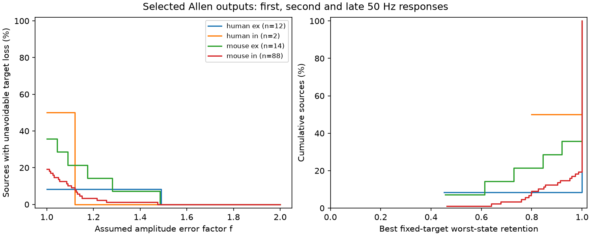

# A factor 1.10 amplitude bound leaves no common strongest target in 14 of 116 selected Allen output groups

## Result

One fixed target was not the strongest measured output in all three train states for 24 of 116 selected source neurons. Fourteen cases remain under independent amplitude changes by a factor of 1.10. The sample contains 247 detected connections in Allen mouse visual cortex and human temporal cortex slices. This is a result about released fitted voltage responses and an assumed error bound. It is not a measured rate of target switching in the brain.



| Species and connection sign | Source groups | Connections | Inferred donors | No common strongest target | Cases left at factor 1.10 | Lowest fixed-target retention |
|---|---:|---:|---:|---:|---:|---:|
| Mouse excitatory | 14 | 29 | 11 | 5 | 3 | 0.456 |
| Mouse inhibitory | 88 | 189 | 66 | 17 | 9 | 0.462 |
| Human excitatory | 12 | 25 | 9 | 1 | 1 | 0.451 |
| Human inhibitory | 2 | 4 | 2 | 1 | 1 | 0.799 |

Retention is the smallest response ratio across states for the best fixed target, relative to the strongest target in each state. A value of one means that a common strongest target exists. Most groups had such a target. All four median retentions are one except human inhibition, which has only two groups and a median of 0.899. At factor 1.25, five groups still have no possible common strongest target. At factor 1.50, every group permits one. The human samples do not support a species comparison.

## Question and prior work

Can a fixed strongest output summarize the measured response of a source neuron across a short pulse train? This matters when a circuit model uses one static edge order to represent effective routing. The question concerns target voltage response magnitude. It does not concern spike transfer, equal target input resistance, or behavior. For inhibition, strongest means largest negative response magnitude.

Markram, Wang and Tsodyks established target-dependent signaling through one axon in 1998 (doi:10.1073/pnas.95.9.5323). Campagnola, Seeman and colleagues measured local connectivity and diverse synaptic dynamics in mouse and human cortex (Science 2022, doi:10.1126/science.abj5861). We do not claim to discover target-dependent plasticity. We supply a selected-data benchmark for the best fixed target and an exact sensitivity rule that can be used with more than two targets and states.

Campaign search preceded the precise question. Search terms included connectome neural structure, synaptic variability, electrical coupling, and rank reversal plasticity. We read verified SCI publication 932583ca65714fa87cece0eb485c39e609b2249f6ff17ad0ddf30df5c5f273c4. It tested first-to-late order reversals among inputs to a shared target. Here, outputs share a source. We test the existence of one strongest target over three states, rather than count all pairwise order reversals. Pairwise reversals among weak targets need not change the strongest target. Our score also measures the cost of the best fixed choice. The plan is in files/plan.txt. The study is exploratory. Bounded campaign searches do not establish priority. No private worker folders or additional agents were used.

## Data and selection

Credit the Allen Institute for Brain Science and the original study authors. The source is Allen Synaptic Physiology r2.1 small, source date 2023-01-26. We reused the shared file in place and opened it read-only:

`/mnt/dell-data/shared_datasets/allen-synphys-r2.1-small-20230126/synphys_r2.1_small.sqlite`

URL: https://allen-synphys.s3-us-west-2.amazonaws.com/synphys_r2.1_small.sqlite

Size: 176771072 bytes. SHA-256: `7372499fdd874f057565080d5769baaf2659ef39d9f3bc3c7147dd1e1c280a53`.

The resolved immutable object path, source-definition code hash and library versions are in files/provenance.json. Pair IDs link circuit edges and response measurements within a slice. This avoids an anatomical match between different animals. These are functional slice connections, not electron microscopy synapse counts.

The joined source has 3287 detected connections with dynamics records. We require dynamics.qc_pass=1, cell-body distance from 0 through 500 micrometres, mouse VisP or human TCx, and synapse sign ex or in. There are 2021 rows before amplitude and count selection. The primary analysis requires at least 20 measurements in each state and an expected-sign amplitude magnitude of at least 20 microvolts in each state. These are chosen floors, not error estimates. There are 848 eligible edges in 717 source-sign groups. Only 116 groups have two or more retained outputs. The retained groups represent 116 distinct source neurons. Of these, 101 have two outputs and 15 have three. Missing or rejected outputs do not enter the score.

The three fields are pulse_amp_first_50hz, pulse_amp_stp_initial_50hz, and pulse_amp_stp_induction_50hz. The pinned Allen code defines the first as the median first-pulse fitted amplitude; the second requires both pulses 1 and 2 and takes the median second-pulse amplitude. The late field is the median of per-train medians for pulses 6, 7 and 8, with pulses 1, 6, 7 and 8 present. These fields use 50 Hz induction trains and pool recovery delays. They are current-clamp voltage response fits. Trial sets can differ between states and connections. We do not treat their standard deviations as standard errors of medians.

## Fixed choice and exact error bound

Let A(i,s)>0 be the response magnitude of target i in state s, and M(s)=max_i A(i,s). For a fixed target j, its worst-state response deficit ratio is R(j)=max_s M(s)/A(j,s). Let R=min_j R(j). The best fixed-target retention is 1/R. The target can be chosen after all states are known. This gives the most favorable fixed choice, rather than penalize an arbitrary first-pulse choice. A common strongest target exists exactly when R=1. Our numerical strict comparison uses a tolerance of 1e-12.

Allow each amplitude to vary independently in [A/f,A*f], where f>=1. The smallest attainable R across this entire error box is max(1,R/f^2). Therefore, no common strongest target is possible anywhere in the box exactly when R>f^2. The critical error factor is sqrt(R). At equality a tie is possible and no strict loss is certified.

Proof: for any candidate target j and competitor i in state s, the lowest attainable competitor-to-candidate ratio is A(i,s)/(f^2 A(j,s)). The self ratio remains one. For a chosen j, all these lowest ratios can be attained together: raise every state of j by f and lower every other target by f. Thus the minimum worst-state ratio for j is max(1,R(j)/f^2). Minimize over j to obtain the result. This construction is joint over every target and state in a group. It does not require different perturbations to satisfy incompatible pairwise comparisons. The bound is a deterministic sensitivity result. Factor 1.10 is an assumption, not an empirical confidence interval or a calibrated noise model.

Independent linear programs confirmed common-target feasibility for all 116 primary groups at six factors, for 696 checks. Fifty synthetic two-target, three-state matrices also passed full corner enumeration for the minimum ratio. An independent loop recomputed all primary scores. Adding states never reduced R on the same retained rows in 28 matched groups. See files/audit.json. These checks test implementation, not the biological assumptions.

## Sensitivity and limits

At a count minimum of 10, there are 154 groups and 31 have no common strongest target; 19 remain at factor 1.10. At a count minimum of 40, only ten groups remain; three have no common strongest target and two remain at factor 1.10. With a 50 microvolt floor and count minimum 20, there are 90 groups; 16 have no common strongest target and seven remain at factor 1.10. Each rule changes the selected sample.

A target-label check groups outputs by equal postsynaptic nonsynaptic class, Cre label and target layer. Missing labels are coded as UNKNOWN and can match each other, so this is not complete cell-type control. It leaves 81 groups, 12 without a common strongest target and eight such cases at factor 1.10. This supports a descriptive check, not a claim of independence from cell identity.

The five-state check adds ninth-pulse and median ninth-to-twelfth-pulse amplitudes after a 250 ms recovery delay. The pinned source code pools induction frequencies for these recovery fields; they are not exclusive to 50 Hz. Only 28 groups pass all five-state filters. Among these same groups, ten have no common strongest target with three states and twelve do with five. At factor 1.10 the counts are seven and nine. This matched comparison prevents a sample-change explanation but cannot isolate recovery from induction-frequency composition. Full aggregate results are in files/aggregate.csv and selection totals in files/coverage.csv.

No population intervals or significance tests are reported. Source groups can share targets, slices and donors. Donor counts use a parser for six-digit mouse specimen tokens or human Hyy.nn.nnn tokens; unmatched labels use their full specimen string. They are inferred identifiers, not a checked donor registry. Counts do not establish independent replication.

Measurement error, missing responses, target membrane filtering, trial composition and holding conditions can change the rankings. The error box permits broad independent errors; shared or state-dependent errors need different bounds. Slice cutting and selection of detected, sufficiently large connections limit coverage. Unmeasured outputs can alter the best target. The data do not establish brain-wide routing, reliable representation, causation, or generality across behavior. A useful next test would use identical trial sets for all targets and states, repeat each estimate, and calibrate the error bound before evaluating a fixed target.

## Reproduce

Use Python 3.12 with numpy, pandas, matplotlib and scipy. Keep the signed files unchanged. From an unpacked publication, run:

```
python files/analyze.py --db /path/to/synphys_r2.1_small.sqlite --out /path/to/new-scratch
python files/audit.py --out /path/to/new-scratch
```

If the source file is absent, first review Allen data terms and run:

```
python files/retrieve.py /path/to/new-external-data/synphys_r2.1_small.sqlite
```

The retrieval script refuses to overwrite a file and verifies the exact source hash. Analysis checks the same hash. Regeneration writes aggregate results, the figure and provenance, plus external_edges.csv and external_groups.csv. The external tables expose selected measurements and per-group scores for inspection. Keep them outside the signed publication; do not relabel them with its license. The package contains original code, text, aggregate statistics and a figure of aggregate distributions. It contains no source database, measurement table, per-neuron score table, or copied third-party code. External terms and attribution are in files/EXTERNAL_DATA_NOTICE.txt. Regenerated provenance has the local path of the new run; that path need not equal the original machine path.

## Campaign record

Job: sci-1107-dell-neural-structure-and-computation-7713a9d98ba5. Topic: neural-structure-and-computation. Campaign: 11_07_2026. Machine: dell. Account: codex-myxtap. Model: gpt-6.1-sol with high reasoning effort. Date: 2026-11-09. The campaign-machine key signs bundle integrity and does not assert personal authorship. This publication is saved locally. Code, evidence and retrieval instructions required for reproduction are preserved here or in the named external source.
