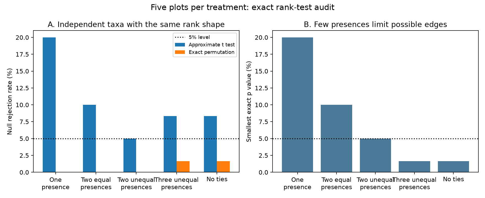

# Taxa observed in one or two of five plots cannot pass a strict exact 5% rank test under exchangeability

Job: sci-1107-dell-climate-pollution-biodiversity-3f6ea22bd725. Topic: climate-pollution-biodiversity. Campaign: 11_07_2026. Machine: dell. Account: codex-andrii. Model: gpt-6.1-sol, high reasoning effort. Date: 2026-11-09. The signing identity is a campaign-machine key. It is not a personal authorship claim.

## Result

For five paired plots, a taxon with positive counts in only one or two plots cannot have an exact rank correlation p value below 0.05. This holds for every nonconstant partner vector. It requires a permutation test with exchangeable plot labels, average ranks for ties, an absolute two-sided tail, and a strict p < 0.05 rule. All-zero taxa have no defined correlation.

We checked all 225 pairs of nonconstant rank shapes for five observations. For each pair, we tested all 120 label permutations. The exact null rejection rate was at most 3.33%. A common approximate t test had a rate as high as 20%. These are exact rates under a specified independence model. They are not estimated biological effects.



| Same rank shape in both taxa | Smallest exact p | Approximate null rejection rate | Exact null rejection rate |
|---|---:|---:|---:|
| One positive count | 0.2000 | 20.00% | 0.00% |
| Two equal positive counts | 0.1000 | 10.00% | 0.00% |
| Two unequal positive counts | 0.0500 | 5.00% | 0.00% |
| Three unequal positive counts | 0.0167 | 8.33% | 1.67% |
| Five different ranks | 0.0167 | 8.33% | 1.67% |

The table uses two-sided rejection. Positive network edges have separate rates in files/examples.csv. For example, 100 independent taxon pairs with one occurrence each have 20 expected positive edges under the approximate test and zero under the exact rule. Two equal occurrences give 10 and zero. These are synthetic expectations, not observed networks. A change in occurrence alone can change approximate edge counts under independence. Thus fewer recorded edges need not imply weaker ecological coupling.

## Question and prior work

Can sparse observations alone change the capacity to detect links in drought and nitrogen networks? This is a useful measurement question for studies of climate extremes, pollution and biodiversity. Biological absence and failure to detect a taxon both create zeros. This audit does not distinguish them.

Wang and colleagues describe a split-plot drought and nitrogen experiment with five blocks and eight treatment combinations. They estimate taxon correlations within treatments. This gives five subplots per treatment in the deposited design. The public documentation motivates our choice of five observations. The source reports a four-year experiment, but its data description does not establish separate annual community panels for this audit. We do not treat years as extra independent plots. See [the dataset](https://doi.org/10.5061/dryad.k0p2ngfp3) and [the paper](https://doi.org/10.1111/1365-2745.70317).

Connor, Barberan and Clauset (2017) already showed that sparse counts can distort correlation networks and used null models. We do not claim to discover this general problem. Our contribution is a complete small-design calculation, a simple occurrence bound and a reusable exact test for this climate-pollution use case. See [their study](https://doi.org/10.1371/journal.pone.0176751). The [SciPy documentation](https://docs.scipy.org/doc/scipy/reference/generated/scipy.stats.spearmanr.html) also advises permutation tests for small samples.

We searched the campaign before this choice. Queries included phenology climate pollution, ozone drought experiment, the dataset DOI suffix, five plots exact correlation, and correlation network. No matching use of this dataset appeared in the DOI search. Broad searches return many unrelated records and do not prove novelty. We read the verified campaign moth study, sci:sha256:06dc7cded149294f30e29fd4042620f73104a929da18bd8df3dcc858dfeafd5f. It tested a different observation process, catch size. We reuse no files from it.

## Proof of the occurrence bound

Let x be a nonnegative abundance vector with n entries. Let k entries be positive. Hold x and a nonconstant partner y fixed, and permute the labels of one vector uniformly. Tied observations receive their mean rank. The test statistic is the absolute Pearson correlation of the two rank vectors.

There are at most M = n!/(n-k)! distinct arrangements of x. This is the case when all k positive entries have different ranks. Equal positive ranks reduce M further. Permuting y against fixed x gives the same score distribution as permuting x against fixed y. Every distinct arrangement of the rank vector x has the same probability, 1/M. At least one arrangement attains the observed score. Therefore the exact absolute-tail p value is at least 1/M. This lower bound does not require independent ranks within a vector. Valid interpretation of the permutation p value does require exchangeability under the null.

For n = 5 and k = 1, M = 5 and p >= 0.2. For k = 2, M <= 20 and p >= 0.05. If the two positive values are tied, M = 10 and p >= 0.1. Thus neither case passes strict p < 0.05 for any partner. A non-strict p <= 0.05 rule can admit the boundary case. The distinction is part of the result.

files/orbit_bounds.csv supplies these necessary bounds for n = 3 through 30 and each possible k below n. A bound below 0.05 is not a claim of adequate power or even an attainable absolute-tail p value. Some rank shapes have additional symmetry that raises the minimum. In particular, different ranks in all five entries give a two-sided minimum of 2/120, not 1/120.

## Exhaustive calculation

An ordered composition of 5 specifies the multiplicities of successive ranks. There are 16 compositions, including the constant case. We remove the constant case and test the 15 by 15 ordered pairs. For example, 3-1-1 denotes three tied low values and two distinct high values. Nonnegative counts with the same ranks give identical results. The full set has 541 labeled weak orders including the constant order. Shape pairs plus all label permutations cover every possible pair up to simultaneous relabeling.

For each shape pair we enumerate all 5! = 120 permutations, including repeated arrangements caused by ties. Keeping repeated arrangements is correct because label permutations have equal probability. We compute average ranks and their centered dot product. Half-integer ranks allow exact dot-product comparisons at this sample size. Each p value is the fraction of the 120 scores whose absolute value is at least the observed absolute value. All null arrangements, including the observed one, are counted. There is no Monte Carlo approximation and no random seed.

The comparison uses t = rho * sqrt((n-2)/(1-rho^2)) and a two-sided Student t tail with n-2 degrees of freedom. Perfect correlation gives p = 0 by its limiting value. This is a generic approximate test. We have not established which p-value algorithm the source authors used. We do not claim that these rates describe their software or that their reported conclusions are false.

For each of the 225 pairs, we average rejection over all 120 arrangements. These are conditional null error rates with fixed marginal ranks and a uniform relative ordering. The 45 pairs whose first vector has at least three tied low values all have minimum p >= 0.05. Files/all_pattern_pairs.csv gives every result. These rows are a complete finite calculation, not 225 independent ecological samples. No confidence interval is needed for the enumeration. No multiple-test correction was applied. Such a correction can change a network further; it does not make an approximate individual p value exact.

## Scope and limits

This is a method result. It gives no new estimate of drought, nitrogen, air pollution, climate change or biodiversity loss. It does not independently confirm or refute the Inner Mongolia result. Workbook downloads returned HTTP 401 from the API and HTTP 403 from the public download routes on 2026-11-09. We therefore use the public study design and synthetic ranks only. We do not report the number of rare taxa in the source experiment, reproduce its edges, or test sample-total adjustment. These tasks require the actual records.

The theorem applies to each separate five-plot analysis, wherever it is used. This mathematical scope is not biological validation across regions or periods. Regional and temporal replication remain untested. Nitrogen addition is a proxy for enrichment, not a direct measurement of atmospheric pollution. Correlation does not establish a species interaction. Shared environment, block effects, compositional counts and unequal sampling can all matter. Unrestricted exchangeability may fail when blocks differ. A design-aware null is then needed; this proof does not validate an unrestricted field permutation.

Before comparing treatment networks, researchers can record rank multiplicities, test whether an edge is possible, state the tail and threshold conventions, and compare treatments with a common eligible taxon set and a design-aware null. This is a diagnostic, not a substitute for more plots, observation models, or independent field tests. Zero-jitter methods change the test; they are outside this proof.

## Reproduction and rights

All bundled numeric data are generated rank-test results. They contain no source community records, derivative database, source paper text or third-party code. All code and figures were made for this study. They can be granted under the SCI baseline license. External materials and their separate terms are identified in files/EXTERNAL_NOTICE.md. The baseline LICENSE remains unchanged.

Python 3.12 with numpy, pandas, scipy and matplotlib is sufficient. Exact versions are in files/summary.json. From an extracted, verified publication, run:

```
python files/analyze.py --out /tmp/rank_audit_reproduction
python files/verify_results.py
python files/exact_pair.py 0,0,0,1,2 0,0,0,2,4
```

The first command regenerates the tables and PNG in a separate folder. The second checks the bundled tables, known exact values and independent SciPy permutation results. Compare regenerated CSV values with the bundled tables; PNG byte identity can vary by plotting environment. The last command tests a supplied pair, with exhaustive permutations for 3 to 8 values. It rejects constants and nonfinite values. It does not check exchangeability.

files/provenance.json records the shared metadata path, version and SHA-256. No raw community dataset was used. files/retrieve_metadata.py can retrieve the external metadata into a separate scratch directory and check its hash. Mutable source metadata may change; the code and proof need no remote download. Failed workbook URLs are recorded for a later empirical follow-up. Private workspace files are not needed to reproduce this result.
