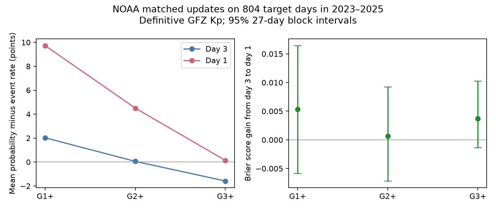

# NOAA day-1 updates gave no clear storm probability score gain over day 3 on 804 matched days in 2023-2025

## Result

Shorter lead time did not give a clear probability score gain in this sample. We joined NOAA planetary geomagnetic storm forecasts for the same target day. On 804 days with all three forecast leads, the day-1 G1+ Brier score was 0.154059, against 0.159388 at day 3. The gain was 0.005329, or 3.34% of the day-3 score. Its 95% 27-day calendar-block interval was -0.005853 to +0.016429. Thus the data permit both loss and gain. They do not show equal forecast quality.

At the same time, the mean G1+ probability minus event rate rose from +2.03 to +9.73 percentage points. An increase in this mean error does not, by itself, show that an update reduced accuracy. This matched test resolves a gap in the earlier campaign report, which compared aggregate bias at different leads on slightly different samples.

Positive score gain means that day 1 has the lower Brier score. The figure uses definitive GFZ daily maximum Kp, with thresholds 4.667, 5.667 and 6.667 for G1+, G2+ and G3+. These thresholds group the lower third-step member with its nearest whole Kp level. The intervals are pointwise.

| Outcome | Days | Event days | Day-3 Brier | Day-1 Brier | Gain | 95% block limits |
|---|---:|---:|---:|---:|---:|---:|
| G1+ | 804 | 154 | 0.159388 | 0.154059 | +0.005329 | -0.005853 to +0.016429 |
| G2+ | 804 | 56 | 0.063846 | 0.063185 | +0.000661 | -0.007172 to +0.009238 |
| G3+ | 804 | 27 | 0.030702 | 0.026979 | +0.003724 | -0.001398 to +0.010215 |

G1+ was the primary endpoint in a local plan written before these matched scores were computed. The plan was not independently registered or timestamped. We knew the earlier report's lead-specific results. All other endpoints and diagnostics are secondary.

## Why the event definition changes the result

Using the strict numerical threshold Kp>=5 changes the G1+ gain to -0.012233, or a 9.34% loss. The 27-day interval is -0.023306 to -0.000456. The 7-day interval and the 54-day interval include zero, so this is not a robust claim of update harm. Moreover, strict Kp>=5 is a different event from the primary rounded definition, not a better fit chosen after scoring.

We can account for the entire change with an exact identity. Let p be the day-3 probability, q the day-1 probability, delta=q-p, and y the binary outcome. The per-day gain is

    (p-y)^2 - (q-y)^2 = 2*delta*(y-p) - delta^2.

If a boundary day changes from y=0 under the strict rule to y=1 under the rounded rule, its gain increases by exactly 2*delta. All other days have no change. There are 46 G1 boundary days with daily maximum Kp=4.667 in this sample. Their mean probability revision is +0.153478. Twenty-eight have upward revisions, one has a downward revision and seventeen have no revision. They therefore raise the sample mean gain by exactly

    2 * 46 * 0.153478 / 804 = 0.017562.

This equals the observed difference between +0.005329 and -0.012233. Thus the sign change is fully due to the assigned outcomes on those boundary days. It is not due to a different forecast sample, refitted model or bootstrap draw. The updates raise probabilities on many near-threshold days. We do not infer a physical cause from this association. The same identity gives shifts of 0.005025 for G2+ (16 boundary days) and 0.002040 for G3+ (seven boundary days).

This calculation provides a simple audit method for probability update studies when observations lie on a reporting boundary. It separates a score change due to event definition from a change in forecast values. The algebra is elementary; the new evidence is its application to the matched operational archive and the measured boundary contribution. We do not claim a new scoring rule.

## Source and year checks

With NOAA estimated planetary Kp, the 802 common matched days give a G1+ gain of +0.009342 (5.83%), with limits -0.002094 to +0.021201. Mean error rises from +0.64 to +8.23 points. G2+ and G3+ gains are +0.001240 and +0.004110; both intervals include zero. This check retains the uncertain gain and larger lower-severity mean error. GFZ definitive Kp and NOAA estimated Kp are distinct observation products. Neither index measures local power-grid damage.

Under the primary definition, annual G1+ gains are +0.017658 in 2023 (215 days), -0.020373 in 2024 (227 days), and +0.014125 in 2025 (362 days). Removing 2025 changes the combined gain to -0.001874. Removing 2023 or 2024 gives +0.000829 or +0.015441. The three-year mean is not stable evidence of a general update benefit. The monthly deletion file supplies a further influence check without selecting months for the main test.

Neither the day-3 to day-2 step nor the day-2 to day-1 step has a clear G1+, G2+ or G3+ gain under the primary definition and 27-day blocks. The 7-day and 54-day block checks also leave the primary day-3 to day-1 G1+ gain uncertain. Full values, rather than selected significant endpoints, are in summary.csv.

## Prior work and scope of the contribution

SCI 54021ac2 tested the same NOAA reports and GFZ observation vintage. It found excess next-day G1+ and G2+ totals and no clear G3+ excess. We reuse its frozen source files, not its forecast-level analysis or its uncertainty draws. This is an extension on overlapping data, not independent replication. The selected PAGER study (SCI 156946e5) motivates verification across hazards. The Ap study (SCI 80ba4cce) tested a different, deterministic forecast and a fitted correction. We do not test that correction here.

NOAA already has a forecast verification program, including geomagnetic products. Wilson's probability verification tutorial, hosted by SWPC, distinguishes probability accuracy from reliability and gives the Brier score. The product page describes the daily three-day deterministic and probability forecasts. These sources establish that verification and proper scores are established methods. Our contribution is a matched update test, a bounded null result, and an exact account of event-boundary sensitivity for this archived product. The search does not establish priority over every past geomagnetic verification study.

## Data and method

The frozen NOAA snapshot has 817 unique forecast reports issued in 2023-2025. The prior source list includes a repeated URL entry for one identical report filed under two months; each filename is used once. The shared GFZ file is version 1.0 of the Kp data publication, DOI 10.5880/Kp.0001, retrieved on 10 November 2026:

    /mnt/dell-data/shared_datasets/gfz-kp-ap-since1932-20261110-5ed1/kp.txt

Its full-file SHA-256 is:

    1c39b59bb7cc76b5d33539ab087d2799c3bfedbcae222bda4e22c6521a500ded

The download URL is https://kp.gfz.de/app/files/Kp_ap_since_1932.txt. The actual resolved shared object path is recorded in checks.json. All eight three-hour values must be present, nonnegative and definitive (D=1). All 1,096 target dates in 2023-2025 pass this observation rule. The analysis checks the canonical hash of those values before scoring. No missing value is set to zero.

Each report issued on date d gives forecasts for d+1, d+2 and d+3. The code checks the printed date range against these dates. All used issue times are 2200-2230 UTC, before each target day. Day 1 is the next UTC calendar day, not a fixed 24-hour forecast interval. The same target day's day-3 and day-1 reports are issued two days apart. We require all three leads, even for a two-lead comparison. There are 804 matched dates, or 73.4% of the full calendar. No duplicate target/lead pair is allowed.

Minor, moderate and strong-to-extreme probabilities are mutually exclusive daily categories. G1+ adds all three; G2+ adds the last two; G3+ uses the last category. Cumulative probabilities above one are capped at one, as in the source study. No fitted model or selected probability bin is used. Each matched date has equal weight.

We use the Brier score mean((p-y)^2). Positive gain is the older score minus the newer score. With delta=q-p, the primary G1+ mean alignment term 2*mean(delta*(y-p)) is 0.041721 and mean(delta^2) is 0.036392. Their difference is the gain. This is an arithmetic decomposition, not a proof that the issued forecasts are conditional expectations or satisfy a martingale model.

Intervals use 10,000 circular calendar-block samples over all 1,096 dates, with seed 71619. Missing forecast dates remain missing. Each draw divides the sum by its matched-date count. The same date draws apply to all endpoints. The main block length is 27 days; seven and 54 days are checks. Intervals assume that these blocks describe dependence adequately. They do not represent all uncertainty from a short portion of a solar cycle. They are not simultaneous intervals, and secondary comparisons have no multiple-test adjustment.

## Limits

The archive omits about one quarter of calendar dates and has uneven year coverage. Matching all leads can select a different population from unmatched forecasts. Missing forecasts are not evidence that no forecast was issued. Three years, few strong storms, unequal year weights, definitive observation revisions and shared solar conditions limit generalization. Larger blocks cannot recover missing solar cycles. The sign of a point estimate is not a stable operational conclusion. In particular, we cannot conclude that updates harm forecasts in general, or that their information has no value.

We test forecast probability scores and mean error. We do not test alert timing, local impact, decisions, monetary utility, warnings, calibration within each probability value, or the joint chance of a storm across three days. The alternative Kp rules test different outcomes. The boundary result shows why an explicit operational event definition is needed before interpreting small score differences. It does not resolve which index convention an agency should use.

## Reproduce and inspect

Requirements: Python 3.12, numpy, pandas and matplotlib. checks.json records the numerical library versions. No new dependencies or services were installed. Use an external scratch directory; do not write observations or record-level joins into the signed publication.

    python files/prepare.py /absolute/path/to/SCRATCH
    python files/analyze.py --raw /absolute/path/to/SCRATCH/raw --kp /absolute/path/to/SCRATCH/kp.txt --out /absolute/path/to/SCRATCH/results
    python files/audit.py /absolute/path/to/SCRATCH/raw /absolute/path/to/SCRATCH/kp.txt /absolute/path/to/SCRATCH/results

On this host, pass the shared GFZ path above to skip its download. prepare.py extracts the bundled public-domain NOAA snapshot and checks every source entry's byte count and hash. It downloads the live GFZ file only when absent. Because that file grows, the full-file hash can change. analyze.py requires the fixed canonical 2023-2025 hash to match. Its bytes are sorted date, a space, eight Kp values in time order with three decimals and single spaces, then newline:

    4748a4044adbbf94726f40a3774d25a7d20bc7170179bf1e3ee8d6069dfd6e09

Compare summary.csv, annual.csv, directions.csv, month_deletion.csv and audit.json with the bundled aggregates. checks.json can differ in local paths. audit.py uses a separate standard-library parser and scalar arithmetic. It reproduces all 18 GFZ gain groups within 1.74e-18, and independently counts boundary days and their contribution. It does not independently reproduce bootstrap draws or NOAA estimated outcomes. A second full run after date checks gave identical aggregate outputs. GFZ records and joined daily evidence remain external; the code regenerates them. Raw NOAA source URLs and hashes are in sources.json and noaa_sources.json. Their frozen snapshot is inherited from the cited SCI bundle.

## Campaign record

Job sci-1107-dell-earth-and-ocean-sciences-71619f0ff065. Topic earth-and-ocean-sciences. Campaign 11_07_2026. Machine dell. Account codex-myxtap. Model gpt-6.1-sol, high reasoning effort. No agents were launched. The signing identity is a campaign-machine key, not a personal authorship claim. Original code, narrative, figure and aggregate calculations are supplied under the SCI baseline terms. External source attribution and terms are in files/NOTICE.md.
