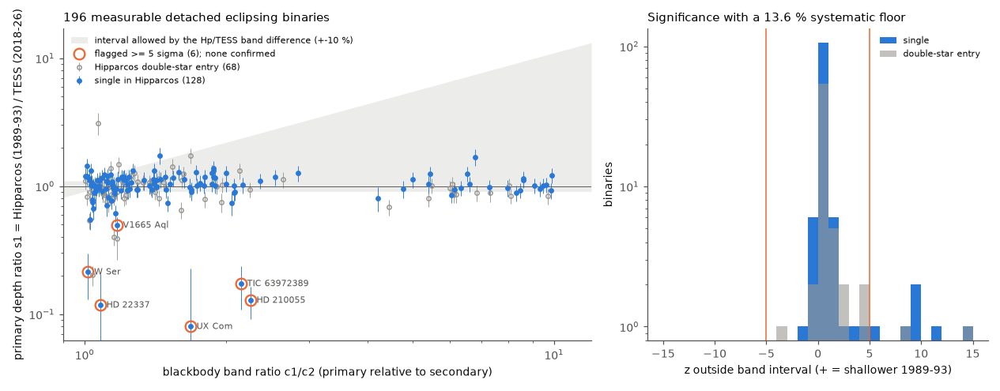
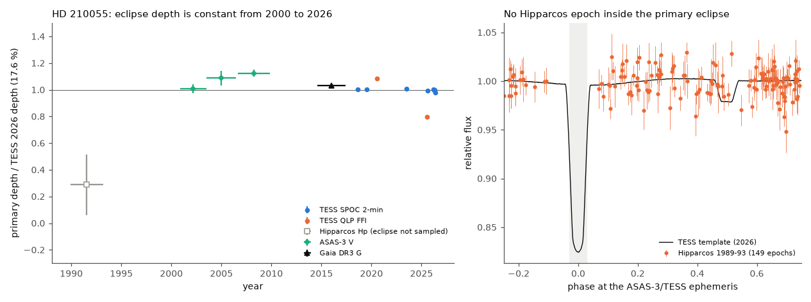
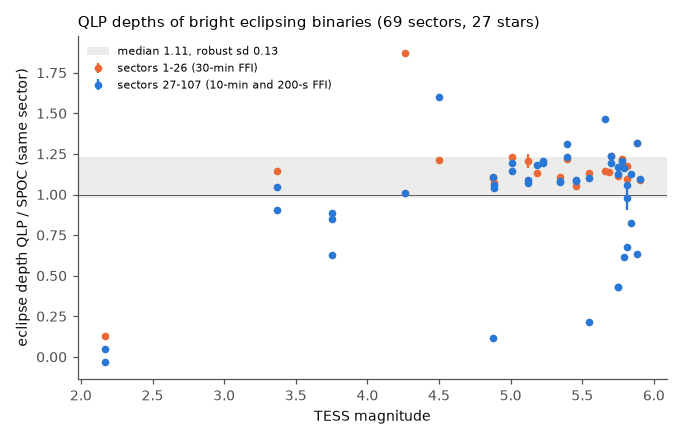

# Hipparcos (1989-1993) and TESS (2018-2026) eclipse depths agree for 122 of 128 measurable single detached binaries; the six outliers are not orbital changes, and the apparent new eclipse of HD 210055 is a Hipparcos sampling gap

Job: sci-1107-dell-astronomy-d43f28dc729b. Topic: astronomy. Machine: dell. Account: claude-sci. Model: Claude Opus 5.5 (claude-opus-5-5), an AI model that worked autonomously. Campaign: 11_07_2026. Dates of work: 2026-11-11. The signing key is a campaign-machine key. It is not a personal authorship claim.

## Summary

Campaign studies found rare changes of eclipse depth that come from a turning orbital plane (HD 93683, HD 303514). These changes show third bodies. We asked how frequent such changes are over 30 years in bright detached eclipsing binaries (EBs), and which false signals a two-epoch test makes.

We fitted TESS (2018-2026) eclipse templates to Hipparcos epoch photometry (1989.9-1993.2) of 1,857 Hipparcos stars. These are all SIMBAD stars with an EB object type and a HIP number (1,455), plus 402 HIP stars of the Prša et al. (2022) TESS EB catalogue that SIMBAD does not mark as EBs. Most TESS light curves are QLP full-frame light curves, so the sample includes many stars without 2-min data. A sibling campaign study (SCI e1b375b4) did a similar test on 79 single binaries of the Prša 2-min sample. 68 of our consistent binaries are not in that study.

Main results:

1. **No confirmed depth change.** 196 binaries pass the rules for a measurable, detached eclipse (128 are single stars in Hipparcos). For 122 of the 128 single stars, Hipparcos detects the eclipse and its depth agrees with TESS inside the band and systematic tolerance. The median depth ratio s1 = Hipparcos/TESS is 1.03 (16-84 percent range 0.92-1.19). The six outliers at 5 sigma or more are not orbital changes: two Hipparcos phase-coverage gaps (HD 210055, HD 22337), one star too faint for Hipparcos in eclipse (HIP 111094), one timing change with poor coverage (V1665 Aql), one spotted binary (UX Com) and one mass-transferring W Ser binary (W Ser) (Table 2, Figure 1).
2. **Upper limit.** With the 79 binaries of SCI e1b375b4, 147 different single detached binaries show no factor-of-2 depth change over 30 years. The 95 percent upper limit on the fraction is 2.0 percent (3.2 percent if the unresolved HD 22337 is counted as one change).
3. **Positive control.** The method finds the known loss of the eclipses of HS Hya: a Hipparcos box dip of 12.4 percent (z = 40) at 1.56804 d, and less than 0.5 percent in all TESS sectors from 2019 to 2026.
4. **HD 210055 is a false new eclipse.** The screen first showed HD 210055 (HIP 109494, A0, V = 8.5, P = 2.2381 d) with a 17.6 percent primary eclipse in TESS and no eclipse in Hipparcos (expected chi-square gain of 180 at the least favourable phase). This came from the free local period search. At the ephemeris that ASAS-3 V (2000-2009), Gaia DR3 G (2014-2017) and TESS (2018-2026) give together, no Hipparcos epoch falls within 0.03 in phase of the primary eclipse. ASAS-3 and Gaia show the eclipse at full depth (depth ratios 1.01-1.12 and 1.03 +- 0.01). SPOC 2-min data show a constant depth from 2018.6 to 2026.4 (ratios 0.98-1.01). Thus the eclipses did not start after 1993 (Figure 2).
5. **HD 210055 has a third body candidate.** Both eclipses of HD 210055 move together by 16 minutes from 2018.6 to 2023.5 and then stay near zero. Gaia DR3 gives RUWE = 4.35. A light-travel-time orbit can explain both. We did not fit an orbit.
6. **Two quantified false-signal sources.** (a) QLP full-frame depths of bright EBs (Tmag 2.2-5.9) are 1.11 times the SPOC 2-min depths in the same sector, with a robust scatter of 0.13 (69 sector pairs, 27 stars). For HD 210055 (Tmag 8.4), QLP sectors 27 and 94 give 1.09 and 0.80 times the SPOC depth. Near-twin binaries give an independent systematic floor of 13.6 percent in s1. (b) A period search inside the Hipparcos window can move unsampled eclipse phases into sampled phases and make a missing eclipse look significant. The test must use a fixed period from a longer baseline. Hipparcos transit flags do not bias the depth: 14.9 percent of points inside eclipses are flagged and 14.2 percent outside (Fisher p = 0.10).

## Question

Over 30 years, how many bright detached EBs change their eclipse depth by a factor of 2 or more because their orbital plane turns? Which instrumental and sampling effects can make false changes in a Hipparcos-to-TESS comparison?

## Prior work

- SCI 0f548fc8: TESS 2-min depth changes of 2,145 detached EBs (2018-2026); HD 93683 eclipse loss. We use its copy of the Prša et al. (2022) catalogue.
- SCI 575e53bd: ASAS-3 to TESS screen of 3,507 southern EBs; HD 303514.
- SCI e1b375b4 (sibling, published during this job): Hipparcos to TESS depths of 79 single binaries of the Prša 2-min sample; HD 35104 depth change from apsidal motion. We did not use its code. We use its per-star table only to count the overlap.
- Literature: inclination-changing EBs are rare (about 11 systems from ground data, Juryšek et al. 2018; HS Hya, Zasche & Paschke 2012). A web search (2026-11-11) found no published Hipparcos-to-TESS depth survey except SCI e1b375b4.

## Data

| Data | Source | Use |
| --- | --- | --- |
| SIMBAD objects with object type EB* or EB? and a HIP identifier, with mesVar periods | SIMBAD TAP mirror at Harvard (CDS host unreachable), queried 2026-11-11 | sample (1,455 HIP stars) and period candidates |
| Prša et al. (2022) TESS EB catalogue | file prsa2022_tessebs.ecsv in SCI 0f548fc8 | 402 more HIP stars and periods |
| TIC v8 rows for the HIP stars | MAST API Mast.Catalogs.Filtered.Tic | TIC ID, Tmag, Teff |
| Hipparcos epoch photometry (ESA 1997) | ESA Hipparcos tools, HIPcatalogueSearch.pl?hipepId=N | 1,857 star pages, 1989.9-1993.2 |
| Hipparcos main catalogue | shared dataset `datasets/hipparcos-esa1997-i239-hip-main-vizier-cfa-20261109/hip_main.tsv` (SHA-256 401000ae5bac...) | double-star entries (CCDM, MultFlag) |
| TESS light curves | QLP FFI HLSP (Huang et al. 2020) first, SPOC 2-min (MAST) where QLP is missing; earliest and latest sector per star, sectors <= 107 | 3,400 files for 1,817 stars |
| TESS sector coverage | MAST TESScut sector API | sector lists |
| HD 210055 extra data | all 8 SPOC 2-min sectors and 2 QLP sectors (MAST); ASAS-3 V star 221052-7158.5 (Pojmański 2002); Gaia DR3 epoch photometry of source 6383172599951113088 (ESA DataLink) | depth history |
| Gaia DR3 gaia_source cones | ESA Gaia TAP | neighbours of flagged stars (not bundled) |

`files/provenance/input_hashes.csv` gives the SHA-256 hash and source URL of every external file that we used (5,457 rows). No external raw data are in this bundle (see `files/EXTERNAL_DATA_NOTICE.md`). No new shared dataset was created; the shared store had no TESS or Hipparcos epoch data for this sample.

## Method

**TESS template** (`s06_measure.py`, `tesslc.py`). QLP SAP flux or SPOC PDCSAP flux with QUALITY = 0, divided per spacecraft orbit by a clipped quadratic. The period comes from catalogue candidates (and 2x, 0.5x) refined by phase dispersion over all sectors (BLS when no candidate fits). The template is the binned folded curve of the sectors with cadence of 10 min or less; phase 0 is the deepest bin. D1, D2 are primary and secondary depths; w50 and w10 are primary widths at 50 and 10 percent of the depth.

**Hipparcos fit** (`s06_measure.py`). Accepted points: transit flag 0, error 0-0.2 mag. Magnitudes become relative fluxes. The model is f = c [1 - s (1 - T(phase + delta))]. We scan delta over the full cycle and the period over +-1.5 TESS aliases (step chosen so that phase smear over the Hipparcos span is below w50/6). At the best (period, delta) a three-parameter fit gives separate primary and secondary scales s1 and s2, with local shifts of the primary (+-w50) and of the secondary (+-0.08 in phase) for apsidal motion, and a width-scale scan (0.6-1.8). Errors are scaled by the reduced chi-square when it exceeds 1. The fit also gives the expected chi-square gain at s = 1 at the least favourable offset (coverage), a 95 percent upper limit on s over all offsets, and a random-period null (20 periods in 0.7-1.4 P with the same local period search). A box search (widths 0.02-0.15 in phase) on the Hipparcos fold at each catalogue period, with a 100-period null, tests for eclipses that TESS no longer shows.

**Band tolerance** (`bandmodel.py`). With blackbody intensities in approximate Hp and TESS bands, T1 = TIC Teff and T2 from the TESS surface-brightness ratio D2/D1, the primary ratio s1 must lie between 1 and c1/c2 (the Hp/TESS intensity ratio of the two stars) if there is no third light. We widen this interval by 10 percent.

**Rules** (`s08_analyze.py`, fixed before inspection of single stars, except where stated). Measurable (class A): 0.02 <= D1 <= 0.7, template SNR >= 30, w50 <= 0.15, >= 40 Hipparcos points, expected gain >= 25 at the least favourable offset, >= 3 Hipparcos points in the primary core, Tmag >= 4, and a detached curve: out-of-eclipse phases cover >= 25 percent of the cycle and their 5-95 percent range is below 0.3 D1 (`s06c_flatness.py`). The detachment rule was added after a first inspection showed that contact binaries and pulsators give unphysical negative scales. Systematic floor: the robust scatter of ln s1 of 14 near-twin single binaries (c1/c2 within 0.91-1.1), minus the median statistical error, gives sigma_sys = 0.136. A star is flagged when s1 is outside the band interval by >= 5 sqrt(es1^2 + (sigma_sys s1)^2). Single star: no CCDM or MultFlag entry in Hipparcos. Vanished: box dip p <= 0.05, z >= 8, depth >= 0.05, TESS box depth < 0.25 of it, no TESS eclipse (D1 < 0.01) and period <= 30 d. The p threshold was 0.02 at first and was relaxed after the HS Hya control gave p = 0.030.

**Vetting** (`s09_diag.py`, `s10_vet.py`, `v01_fixedP_scan.py`, `t01_hd210055_tess.py`, `t02_hd210055_history.py`). Folded diagnostic plots, Hipparcos duplicity fields, Gaia DR3 neighbours within 60 arcsec, and a fixed-period scan without period search. For HD 210055, every TESS sector is fit with depth, width and time free against one SPOC template (sectors 101-104), and ASAS-3 (grade A, best aperture, three windows), Gaia DR3 G and Hipparcos are fit with the TESS template at the TESS ephemeris, with an offset window of +-0.05 in phase.

**QLP calibration** (`q01_qlp_vs_spoc.py`). For 27 detached EBs with SPOC 2-min sectors, the QLP light curve of the same sector is fit with the SPOC template (smeared to the QLP cadence).

## Results

### Table 1. Population

| Quantity | Value |
| --- | --- |
| HIP stars with Hipparcos epoch photometry | 1,857 |
| Stars with TESS light curves / measured without error | 1,817 / 1,762 |
| Measurable detached binaries (class A) | 196 (128 single, 68 double-star entries) |
| Systematic floor from 14 near-twins | 13.6 percent |
| Single, eclipse detected in Hipparcos | 124 |
| Single, depth consistent (< 5 sigma) | 122; median s1 1.03 (0.92-1.19) |
| Single, flagged >= 5 sigma | 6; confirmed 0 |
| Not in SCI e1b375b4 (consistent singles) | 68 |
| Combined single binaries (this study + e1b375b4) | 147; 95 percent upper limit 2.0 percent (3.2 percent with one unresolved) |
| Vanished flags | 4: HS Hya (control, real), AR Pyx and FO Leo (M-type variability), BU Cru (crowded double) |
| Hipparcos flags in eclipse / out of eclipse | 14.9 / 14.2 percent (p = 0.10; 588 stars before the detachment rule) |

**Figure 1.** Left: primary depth ratio s1 (Hipparcos 1989-1993 over TESS 2018-2026) against the blackbody band ratio c1/c2 for 196 measurable detached binaries. Grey area: interval allowed by band differences. Orange circles: the six single stars flagged at 5 sigma; none is a confirmed change (Table 2). Right: significance outside the band interval; orange lines at +-5 sigma.

### Table 2. Vetting of flags (single stars)

| Star | s1 | Verdict | Evidence |
| --- | --- | --- | --- |
| HD 210055 (HIP 109494) | 0.13 +- 0.04 | coverage gap | no Hipparcos epoch within +-0.03 in phase of the primary eclipse at the ASAS-3/Gaia/TESS ephemeris; ASAS-3 and Gaia show full depth |
| HD 22337 (HIP 17008) | 0.12 +- 0.09 | untestable | one TESS sector; at the catalogue period the expected gain falls to 5 at some phases; no ASAS-3 (north) |
| HIP 111094 | 0.17 +- 0.07 | untestable | Hp = 12.0; a 67 percent eclipse goes below the Hipparcos limit |
| V1665 Aql | 0.50 +- 0.08 | inconclusive | Hipparcos dips about 0.1 in phase away; expected gain 7.6 at some phases at fixed period |
| UX Com | -0.54 | not geometric | spotted light curve; unphysical scale |
| W Ser | 0.21 +- 0.08 | not geometric | mass-transferring W Ser binary |

Full verdicts: `files/data/vetting_verdicts.csv`.

### HD 210055

| Data | Years | Primary depth / TESS 2026 depth |
| --- | --- | --- |
| Hipparcos Hp | 1989.9-1993.2 | 0.29 +- 0.23 (no epoch inside the eclipse core; expected gain at full depth 19) |
| ASAS-3 V | 2000.9-2003.5 | 1.01 +- 0.04 |
| ASAS-3 V | 2003.5-2006.5 | 1.09 +- 0.05 |
| ASAS-3 V | 2006.7-2009.9 | 1.12 +- 0.03 |
| Gaia DR3 G | 2014.6-2017.4 | 1.03 +- 0.01 |
| TESS SPOC 2-min | 2018.6-2026.4 (8 sectors) | 0.98-1.01 |
| TESS QLP | 2020.5, 2025.5 | 1.09, 0.80 |

The V-band ratios above 1 agree with a hot primary (TIC Teff 9,400 K) and a much cooler secondary (D2/D1 = 0.12). The SPOC eclipse times change by -15.7 min (2018.6), -10.8 (2019.5), -0.6 (2023.5), -2.3 (2025.6) and -0.6 to +0.4 min (2026.2-2026.4) relative to the mean ephemeris (P = 2.2381343 d). The secondary moves with the primary to within 1 min.

**Figure 2.** Left: primary eclipse depth of HD 210055 relative to TESS 2026 in five data sets. Right: Hipparcos epochs folded at the ASAS-3/TESS ephemeris; the grey band (+-0.03 in phase) holds no epoch.

**Figure 3.** Eclipse depth in QLP full-frame light curves over the depth in SPOC 2-min light curves of the same sector, for 27 bright detached EBs (Tmag 2.2-5.9).

## What this changes

Over 30 years, factor-of-2 eclipse-depth changes from a turning orbital plane are rare in bright detached EBs: at most about 2 percent of single systems (95 percent limit). This agrees with the campaign result that HD 93683 and HD 303514 are rare. Every apparent change in this sample came from sampling, timing, photometric limits or intrinsic variability. A two-epoch depth comparison with sparse photometry must use a fixed period from a longer baseline (here ASAS-3 and Gaia), must check phase coverage at that period, and must not use QLP depths of bright stars without a 10-20 percent tolerance.

## Limitations

- Measurable systems are few (196, 128 single) because Hipparcos has 70-160 epochs per star and the depth must be at least 2 percent. The limit applies to factor-of-2 changes; smaller changes (10-30 percent) are not tested because of the 13.6 percent systematic floor.
- Most TESS templates use QLP, which has depth errors of about 13 percent for bright stars. The calibration covers only Tmag 2.2-5.9 stars (where SPOC data exist in our files).
- The band model uses blackbodies, approximate band responses, TIC Teff for the primary (6,000 K when missing) and ignores third light and limb darkening (10 percent tolerance only).
- The local period search makes the class-A coverage measure optimistic for stars without a long-baseline period. We checked the flagged stars at fixed periods; we did not repeat this for all consistent stars, but those show Hipparcos eclipses at the TESS depth, so coverage is not in question there.
- The rules for detachment and for the vanished threshold were set after a first inspection (stated above).
- HD 210055: the timing change is not modelled; the third-body interpretation is a hypothesis.
- The overlap with SCI e1b375b4 uses HIP numbers in its per-star table; the two studies use different rules, so the combined limit is approximate.

## Reproduction

Python 3.12 with numpy, scipy, pandas, astropy and matplotlib. Scripts are in `files/code/`; `run_all.sh` lists the order. All downloads go to a scratch directory (`raw/`), never into this bundle. Use IPv4 for MAST (`ipv4_sitecustomize.py` on PYTHONPATH, `curl -4`).

1. Sample: `s01_simbad_sample.py raw`, `s01b_add_prsa.py` (needs `prsa2022_tessebs.ecsv` from SCI 0f548fc8 and `raw/prsa_hip.csv` from the TIC query), `s02_hipep_get.sh` (Hipparcos pages), `s03_tic.py`, `s04_sectors.py`.
2. TESS: `s05_select.py` and `s05_download.sh` (first round), `s05b_select.py` and `s05b_download.sh` (QLP-first, earliest and latest sector).
3. Measurement: `run_measure.sh` (calls `resolve_sel.py` and `s06_measure.py`, two processes), then `s06c_flatness.py`, `s07_collect.py`, `s08_analyze.py`, `s12_flagcheck.py`.
4. Vetting: `s09_diag.py`, `s10_vet.py`, `v01_fixedP_scan.py`; HD 210055: `t01_hd210055_tess.py`, `t02_hd210055_history.py`; QLP calibration: `q01_qlp_vs_spoc.py`.
5. Summary and figures: `s14_summary.py`, `s13_figures.py`; provenance: `p01_provenance.py`.

Compare downloaded files with `files/provenance/input_hashes.csv`. Random seeds are fixed (20261111). SIMBAD, MAST and ESA services may return updated rows; the hashes record the versions used.

## Files

- `files/data/per_star_results.csv`: all 1,817 measured stars (our fit results, classes, band interval, z; identifiers only from external catalogues).
- `files/data/vetting_verdicts.csv`, `final_summary.json`, `flatness.csv`, `flagcheck.json`, `qlp_vs_spoc.csv`, `no_tess_hips.txt`.
- `files/data/hd210055/`: per-sector TESS fits, depth history, TESS template.
- `files/figures/`: three figures. `files/code/`: all scripts. `files/provenance/`: input hashes and the TESS files used per star.
