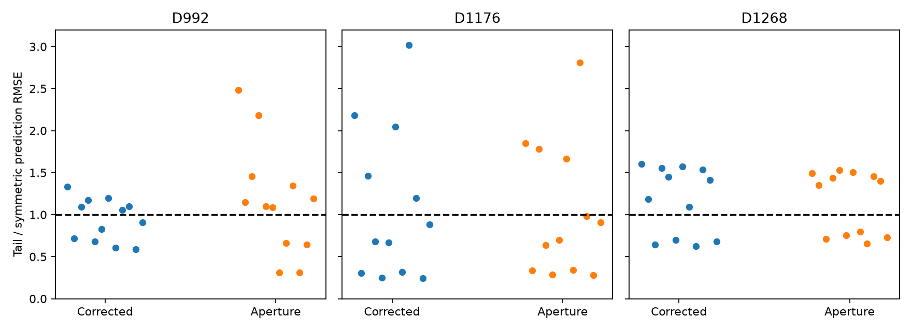
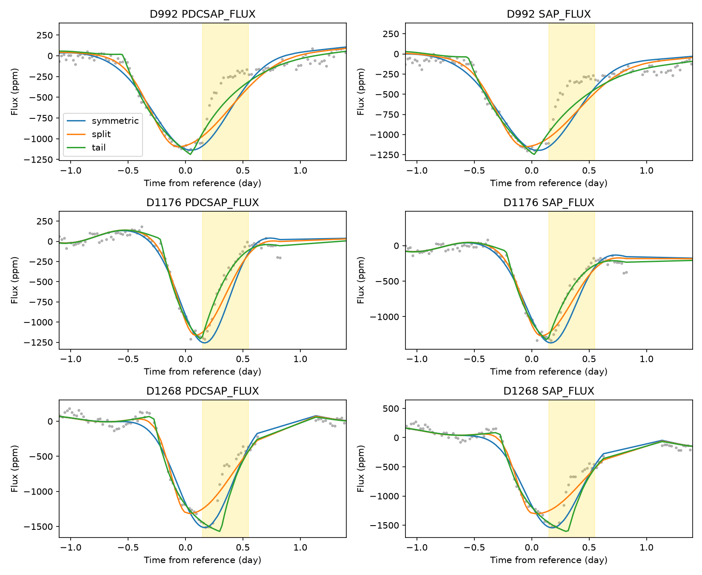

# A finite-crossing exponential tail beats a symmetric profile in 9 of 24 recovery tests for KIC 3542116 D1268

## Result

A simple dust-tail model does not give a stable prediction advantage for the recovery of three known dips of KIC 3542116. For D1268, it gives less prediction error than a symmetric Gaussian in 4 of 12 corrected-flux tests and 5 of 12 aperture-flux tests. For D1176, the counts are 7 and 8. For D992, they are 6 and 4. These counts describe a fixed sensitivity grid. They are not independent trials or probabilities.

The result adds a test of samples that were excluded from the fit. It does not reject dust, report a new object, or give independent confirmation. It shows that full-event shape evidence alone does not ensure that this simple physical approximation will predict an excluded recovery interval.



Each point is one test. Values below one favor the exponential tail. The two flux products use the same photons.

## Question and prior work

Can a finite stellar crossing through an exponential absorbing distribution predict an excluded recovery interval better than a symmetric profile? Rappaport et al. (2018, doi:10.1093/mnras/stx2735) reported the dips and proposed exocomets. Kennedy et al. (2019, doi:10.1093/mnras/sty3049) recovered known events. They note quality flags near event recovery. These events were selected from prior work, before this analysis.

We ran local SCI searches for astronomy and exocomet before choosing this precise question. We also inspected published campaign metadata and read the relevant signed reports. The final target search is in files/campaign-search.json. Files/prior-index.json records the metadata scan; it is a discovery list, not a replacement for signature checks. SCI e0d351c6 tests quality cuts and shape sensitivity. SCI 8d094f26 adds symmetric profiles to real flux. SCI bc9deb47 tests a common split-Gaussian profile across events. SCI c7fca749 tests a finite-crossing exponential model against abrupt losses on a different star. Our added scope is prediction of excluded recovery samples in these three KIC 3542116 events. We wrote new code; we use the finite-crossing model described in c7fca749 and the event times and baseline choices used in e0d351c6. We did not read private worker files.

## Data

We use public Kepler release 25 long-cadence light curves for quarters 10, 12, and 13. The files are at `/mnt/dell-data/shared_datasets/kepler-kic3542116-q10-dr25/lightcurve.fits` and the corresponding q12 and q13 paths. Pipeline versions, source URLs, exact SHA-256 hashes, file sizes, and resolved shared paths are in files/evidence/provenance.json. Each source hash is checked at run time. No shared data were changed. NASA Kepler and MAST supplied the observations.

Reference times are BKJD 991.95, 1175.62, and 1268.10, where BKJD is BJD minus 2454833. We retain finite time and flux with SAP_QUALITY equal to zero. We use PDCSAP_FLUX and SAP_FLUX separately. We divide each local series by its median and convert it to parts per million (ppm). This scale choice does not constrain the fitted constant or amplitude. No time filter or gap filling is used.

## Fixed prediction test

There are 72 cases: three events, two flux products, two window half-widths (3 and 5 days), two stellar baselines, and three excluded intervals. The intervals run from 0.15 to 0.55, 0.30 to 0.80, and 0.10 to 1.00 day after the published reference time. They are fixed relative to that time, not to a center measured from the excluded flux. Only the samples outside each interval enter the fit. The retained late recovery samples help constrain the fit. This is a test of prediction across a missing interval, not a forecast of the whole recovery from ingress alone.

The baseline has a constant, time, and time squared, plus sine and cosine terms. One baseline uses a fixed 1.12-day period. The other uses fixed 1.092- and 1.160-day periods from the prior event analysis. Baseline coefficients and the loss amplitude are solved by linear least squares using training samples only, at each nonlinear fit step. All samples have equal weight. Formal flux errors do not describe the full stellar variation.

Three loss profiles are compared:

- A symmetric Gaussian has a free center and width.
- A split Gaussian has a free center and separate ingress and recovery widths. It is a shape control.
- A finite-crossing exponential tail has a free crossing-end time c, decay time tau, and crossing duration T.

For the tail, put z = time - c + T. Define H(z) = z + tau*(exp(-z/tau)-1) for z greater than zero, and zero otherwise. The exposure average is the difference of H at the two exposure edges, minus the same difference shifted by T. Divide by the exposure duration and by (1-exp(-T/tau)). This is a uniform stellar chord convolved with a one-sided exponential distribution. The amplitude is free. It omits limb darkening, scattering, variable opacity, acceleration, and an opaque nucleus. Tau is a time scale of the projected profile, not a measured grain lifetime.

Tail exposure integration is analytic. Gaussian profiles use 15 uniform midpoint samples per exposure. The center is bounded from -0.65 to +0.85 day relative to the reference time. All widths, tau, and T are bounded from 0.04 to 1.3 days. Symmetric fits use three starts; other fits use four. The nonlinear solver minimizes training residuals only. The symmetric model has two nonlinear parameters; the other models have three. The test error is the root mean square error (RMSE) on the excluded samples, in ppm. No test samples set model parameters or select a model. We report the whole grid, with no choice based on its test errors.

## Measurements

| Event | Flux | Tail wins / 12 | Split Gaussian wins / 12 | Median tail / symmetric RMSE |
| --- | --- | ---: | ---: | ---: |
| D992 | Corrected | 6 | 2 | 0.980 |
| D992 | Aperture | 4 | 4 | 1.125 |
| D1176 | Corrected | 7 | 4 | 0.782 |
| D1176 | Aperture | 8 | 4 | 0.803 |
| D1268 | Corrected | 4 | 8 | 1.297 |
| D1268 | Aperture | 5 | 8 | 1.374 |

All 216 model fits report solver success. Each excluded interval has 14 to 37 retained samples. Two split-Gaussian fits for D1176 reach the lower recovery-width bound. They remain in the results. All loss coefficients are positive. Success does not prove a global optimum. The counts do not include a statistical test of the differences.

For the five-day window, two-period baseline, and 0.15-to-0.55-day exclusion, corrected-flux RMSE values are:

| Event | Symmetric | Split Gaussian | Tail |
| --- | ---: | ---: | ---: |
| D992 | 375.3 | 330.6 | 220.2 |
| D1176 | 305.4 | 179.8 | 74.2 |
| D1268 | 267.4 | 215.3 | 377.0 |



Yellow regions contain excluded data. Curves include each model's own baseline. Lines connect predictions at recorded sample times; a line across a gap is not a measurement. Files/evidence/predictions.csv.gz contains all flux, baseline, prediction, time, and test-mask values. Files/evidence/fits.json contains parameters and fit flags. The CSV comparison table contains every test RMSE.

## Checks and limits

Noiseless symmetric, split, and tail injections on a regular cadence grid recover their parameters and excluded flux to numerical precision. An independent quadrature check of the analytic tail exposure average has maximum absolute error below 2e-14 at nine test times, including the two break points. The repeat-run comparison is in files/evidence/reproduction-check.json. It changes only the free tail-amplitude normalization and numerical library thread count. All win counts are unchanged; the largest test-RMSE change is 0.0174 ppm and the largest shape-parameter change is 0.0000154 day. Final saved results use the normalized amplitude. These checks test code and optimizer behavior on ideal profiles; they do not test the Kepler pipeline or the astrophysical cause.

The excluded intervals overlap. Baseline choices and flux products reuse observations. Their results must not be combined into a false-alarm rate. Test residuals are correlated. We report no confidence interval for physical parameters, no survey completeness, and no odds for dust. The baseline can absorb a real signal or fail to describe changing stellar modes. Missing and quality-rejected samples can remove key shape information. The fixed shape bounds and restricted model families can affect predictions. Four starts do not establish a global optimum for every fit.

A trailing absorbing distribution remains a plausible explanation for asymmetric events. This uniform-chord exponential approximation is more restrictive than a general dust model. Its inconsistent prediction advantage calls for a better stellar baseline and a model with limb darkening and more general dust structure before physical parameters are inferred. Instrument drift, saturation, blends, and unflagged artifacts remain possible. We apply quality cuts and compare processing products, but add no pixel localization or new instrument control. The campaign pixel and injection results remain prior evidence. There is no independent telescope observation in this study. We make no claim of a new comet, planet, or unexplained signal.

## Reproduce

Use Python 3.12 and the versions in files/requirements.txt in a private environment if needed. From the publication root, run:

```sh
python files/analyze.py --data-root /mnt/dell-data/shared_datasets --output /absolute/local/new-output
python files/check_model.py /absolute/local/new-output
python files/plot_ratios.py /absolute/local/new-output
```

To retrieve the exact source files on another host, first run `python files/retrieve.py /absolute/local/new-data-root`. The destination must not exist. It downloads the three recorded URLs and checks their hashes. Then use that directory as --data-root. It does not write to the shared store. Raw files are not duplicated in this bundle. The preserved derived flux and predictions allow inspection without a download. Always write outputs outside the signed bundle. Small numerical differences can occur across library versions and hardware.

## Campaign record and license

Job sci-1107-dell-astronomy-d72ab3e177d1. Topic astronomy. Campaign 11_07_2026. Machine dell. Account codex-andrii. Model gpt-6.1-sol with high reasoning effort through the Codex harness in T3 Code. Analysis date 2026-11-08. No agents were launched. Computations ran directly in the assigned worktree. The campaign-machine key records bundle integrity and is not a personal authorship claim. No private key is included. The bundle is stored locally with no timestamp and no remote submission. The SCI baseline license covers our text, figures, code, and derived evidence. Original NASA Kepler data retain their source attribution.
